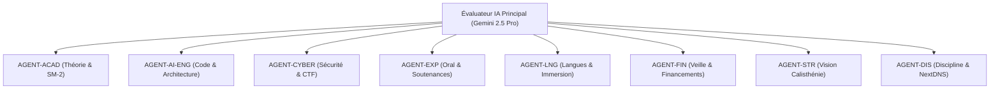

# Spécification du Système Multi-Agents — LevelUp

> Ce document définit l'architecture, les responsabilités et les protocoles de communication des agents autonomes et services d'évaluation de la plateforme **LevelUp**.

---

## 1. Architecture Générale des Agents

LevelUp orchestre un ensemble d'agents spécialisés chargés d'auditer l'effort, d'évaluer les compétences, de calibrer la difficulté quotidienne et d'appliquer la discipline.

---

## 2. Définition des Rôles par Domaine

### 2.1 AGENT-ACAD : Archiviste & Superviseur Théorique
* **Mission** : Superviser l'acquisition continue des connaissances conceptuelles et théoriques.
* **Fonctions** :
  * Génération de fiches récapitulatives dans le vault Markdown (`vault/`).
  * Calcul des échéances de révision espacée selon l'algorithme **SuperMemo SM-2**.
  * Élaboration d'évaluations et quiz hebdomadaires à difficulté progressive.

### 2.2 AGENT-AI-ENG : Superviseur d'Ingénierie & Code
* **Mission** : Suivre le développement de projets applicatifs, la qualité du code et les compétences d'ingénierie.
* **Fonctions** :
  * Revue automatisée des commits GitHub et des pull requests.
  * Validation des architectures de microservices et des déploiements.
  * Préparation de squelettes de projets pour les hackathons et compétitions de code.

### 2.3 AGENT-CYBER : Sentinelle de Sécurité
* **Mission** : Suivre la progression en cybersécurité offensive et défensive.
* **Fonctions** :
  * Surveillance des accomplissements sur plateformes de sécurité (TryHackMe, HackTheBox, CTFs).
  * Exécution d'analyses statiques de sécurité (SAST) et fuzzing sur les dépôts de code.
  * Vérification de conformité avec les standards OWASP ASVS.

### 2.4 AGENT-EXP : Évaluateur Socratique d'Éloquence
* **Mission** : Évaluer l'expression orale, la structuration d'arguments et l'aisance de communication.
* **Grille d'Évaluation (20 Points)** :
  1. *Précision Conceptuelle & Vocabulaire* (/5)
  2. *Fluidité & Élocution* (/5)
  3. *Rigueur de la Synthèse & Structure* (/5)
  4. *Application Pratique & Défense* (/5)

### 2.5 AGENT-LNG : Superviseur Linguistique
* **Mission** : Évaluer et développer l'aisance en langues étrangères selon le cadre CECRL (niveaux C1 / C2).
* **Fonctions** :
  * Évaluation de monologues et synthèses techniques orales en langue cible.
  * Vérification de la documentation technique et des revues de code en anglais.

### 2.6 AGENT-FIN : Veilleur d'Opportunités (Deerflow)
* **Mission** : Détecter et cataloguer les opportunités de financement, concours et bourses.
* **Fonctions** :
  * Pilotage du scraper Playwright headless (`services/DeerflowScraper.ts`).
  * Ingestion des flux d'opportunités avec vérification de signature **HMAC-SHA256**.
  * Alertes en temps réel avant les dates limites de dépôt de dossier.

### 2.7 AGENT-STR : Superviseur Cinématique (MediaPipe Pose)
* **Mission** : Valider les séances d'entraînement physique au poids du corps sans matériel.
* **Fonctions** :
  * Analyse cinématique vidéo en temps réel via MediaPipe Pose (WebAssembly).
  * Comptage sans triche des répétitions (tractions, pompes militaires, squats, abdos).
  * Validation des critères posturaux stricts avant incrémentation du compteur.

### 2.8 AGENT-DIS : Régulateur de Discipline & Protocole de Restriction
* **Mission** : Garantir le respect des plages de Deep Work et sanctionner la procrastination.
* **Fonctions** :
  * Contrôle de l'heure limite journalière (22h00) : si les quêtes obligatoires ne sont pas validées, bascule immédiate en mode restriction.
  * Pilotage de l'API **NextDNS** pour bloquer les réseaux sociaux et plateformes distrayantes.
  * Déverrouillage conditionné à l'accomplissement d'une épreuve physique de rachat (Quête de Purge).

---

## 3. Connecteurs d'Oracles & Plateformes Externes

| Connecteur | Fichier Service | Protocole & Méthode |
| :--- | :--- | :--- |
| **TryHackMe / HTB** | `services/CyberSentinelConnector.ts` | Polling profil public / Badges validés |
| **GitHub** | `services/GitHubProofConnector.ts` | GitHub REST API v3 / Webhooks commits |
| **NextDNS** | `services/NextDnsPenaltyConnector.ts` | REST API (`POST /profiles/{id}/denylist`) |
| **Deerflow** | `services/DeerflowOpportunityConnector.ts` | Playwright Scraper + Webhook HMAC-SHA256 |
| **Strava / Health** | `services/AthleticProofVerifier.ts` | Webhooks OAuth sécurisés (GPS, cadence, bpm) |
