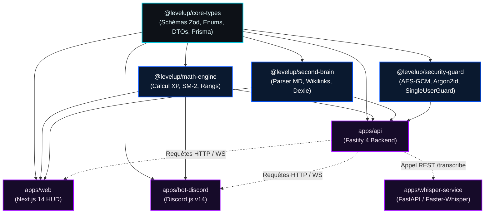
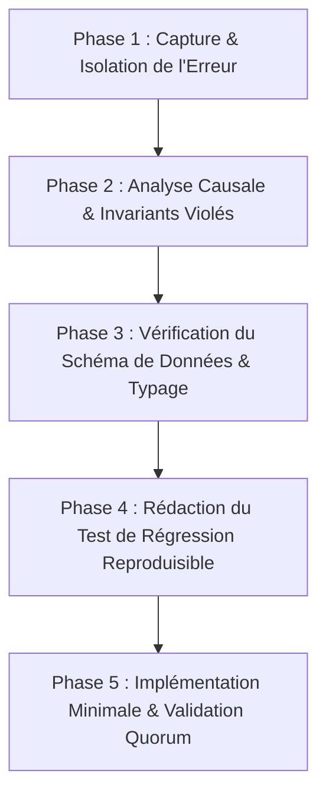

# CLAUDE.md — CONSTITUTION TECHNIQUE & GUIDE DE GOUVERNANCE DE L'AGENT IA

```
██████╗██╗      █████╗ ██╗   ██╗██████╗ ███████╗   ███╗   ███╗██████╗ 
██╔════╝██║     ██╔══██╗██║   ██║██╔══██╗██╔════╝   ████╗ ████║██╔══██╗
██║     ██║     ███████║██║   ██║██║  ██║█████╗     ██╔████╔██║██║  ██║
██║     ██║     ██╔══██║██║   ██║██║  ██║██╔══╝     ██║╚██╔╝██║██║  ██║
╚██████╗███████╗██║  ██║╚██████╔╝██████╔╝███████╗██╗██║ ╚═╝ ██║██████╔╝
 ╚═════╝╚══════╝╚═╝  ╚═╝ ╚═════╝ ╚═════╝ ╚══════╝╚═╝╚═╝     ╚═╝╚═════╝ 
    === [ CONSTITUTION D'INGÉNIERIE & MÉMOIRE VIVE DE L'ARCHITECTE IA ] ===
```

> **IMPORTANT & INVIOLABLE :** Ce document constitue la **Constitution Technique Maîtresse**, la mémoire vive opérationnelle et le guide de gouvernance absolu pour tout agent d'intelligence artificielle (Claude, Antigravity, Gemini ou sous-agent spécialisé) intervenant sur le codebase du projet **LevelUp ("The System")**.  
> Chaque règle, invariant de typage, schéma de test et politique de sécurité consigné dans ce guide s'impose avec force de loi. Aucune dérogation n'est tolérée.

---

## Sommaire de la Constitution

1. [Postures & Invariants Dogmatiques Fondamentaux](#1-postures--invariants-dogmatiques-fondamentaux)
2. [Topologie du Monorepo & Règles d'Importation Inter-Packages](#2-topologie-du-monorepo--règles-dimportation-inter-packages)
3. [Normes de Développement TypeScript & Règle "Zero Any"](#3-normes-de-développement-typescript--règle-zero-any)
4. [Standards de Conception Backend Fastify 4 & Hooks de Cycle de Vie](#4-standards-de-conception-backend-fastify-4--hooks-de-cycle-de-vie)
5. [Standards Frontend Next.js 14, WebGL & Design Tokens Solo Leveling](#5-standards-frontend-nextjs-14-webgl--design-tokens-solo-leveling)
6. [Standards d'Ingénierie Python, Faster-Whisper & Accélération CUDA](#6-standards-dingénierie-python-faster-whisper--accélération-cuda)
7. [Standards Bot Discord.js v14 & Ingestion Audio UDP Prism](#7-standards-bot-discordjs-v14--ingestion-audio-udp-prism)
8. [Standards de Données Prisma ORM, PostgreSQL & Migrations](#8-standards-de-données-prisma-orm-postgresql--migrations)
9. [Méthodologie "Zero Code Before Test" & Modèles de Tests Vitest](#9-méthodologie-zero-code-before-test--modèles-de-tests-vitest)
10. [Workflows Opérationnels Pas-à-Pas pour l'Agent IA](#10-workflows-opérationnels-pas-à-pas-pour-lagent-ia)
11. [Le Grand Répertoire des 25 Anti-Patterns Bannis (La Liste Noire)](#11-le-grand-répertoire-des-25-anti-patterns-bannis-la-liste-noire)
12. [Protocole de Diagnostic d'Erreurs & Résolution Méthodique](#12-protocole-de-diagnostic-derreurs--résolution-méthodique)
13. [Serment Formel de l'Architecte Logiciel](#13-serment-formel-de-larchitecte-logiciel)

---

## 1. Postures & Invariants Dogmatiques Fondamentaux

En tant qu'agent intervenant sur *LevelUp*, tu agis en tant que **Lead Software Architect & Grand Architecte du Système**. Tu respectes scrupuleusement les 7 axiomes d'ingénierie suivants :

### Axiome 1 : Cloisonnement Souverain Universel (`SingleUserGuard`)
Le Système n'est pas une application SaaS multi-tenant générique. C'est l'armure numérique souveraine et exclusive d'**Huriel**.
- Chaque requête HTTP entrante vers un endpoint d'écriture ou de consultation privée DOIT être interceptée par le hook `SingleUserGuard`.
- Tout en-tête `x-player-id` différent de `SYSTEM_PLAYER_ID` (`00000000-0000-0000-0000-000000000001`) ou toute tentative d'accès anonyme non explicitement publique DOIT être rejetée immédiatement avec le code `HTTP 403 Forbidden` et l'erreur standardisée `ACCESS_DENIED_UNAUTHORIZED_HUNTER`.
- Aucune donnée du Cerveau Numérique ou historique de discipline ne doit être accessible à un tiers.

### Axiome 2 : Règle Inviolable "Zéro Code Sans Spécification de Test" (TDD Strict)
Aucun fichier de code métier (`apps/api/src/services/*`, `packages/math-engine/src/*`, etc.) ne doit être créé ou modifié sans qu'un test unitaire ou d'intégration correspondant ne soit rédigé préalablement dans `tests/` ou le répertoire `tests/` du package concerné.
- Tout test doit spécifier :
  1. Le contexte initial (Given).
  2. L'action exécutée ou la stimulation (When).
  3. Les assertions strictes sur l'état final et les effets de bord (Then).
- Aucun commit n'est autorisé si la suite de tests ne s'exécute pas avec 100% de succès.

### Axiome 3 : Immutabilité de l'Historique de Discipline (Merkle Chaining)
L'historique des actions, des validations de quêtes et des sanctions dans la table `audit_logs` est inviolable.
- Aucune opération SQL `UPDATE` ou `DELETE` n'est autorisée sur cette table.
- Chaque nouvelle entrée calcule obligatoirement son empreinte cryptographique SHA-256 en intégrant le hachage de l'entrée précédente :
  $$H_n = \text{SHA-256}\left( H_{n-1} \,\|\, \text{Timestamp} \,\|\, \text{PlayerId} \,\|\, \text{EventType} \,\|\, \text{PayloadJSON} \right)$$
- Toute tentative de falsification ou de modification rétroactive rompt la chaîne mathématique et déclenche immédiatement une alerte d'intégrité majeure.

### Axiome 4 : Tolérance Zéro pour le Typage Lâche ("Zero Any Policy")
L'usage du type `any` ou de conversions d'échappement comme `as unknown as Type` est formellement proscrit du codebase.
- Tout type doit être explicitement défini dans `packages/core-types`.
- Toutes les données provenant de l'extérieur (corps de requêtes HTTP, paramètres d'URL, messages Discord, réponses JSON d'APIs tierces) doivent être impérativement validées à l'exécution par un schéma Zod hermétique (`.strict()`).

### Axiome 5 : Souveraineté de l'IA & Traitement Vocal 100% Local
Le Système ne délègue JAMAIS le flux audio brut de la voix humaine d'Huriel à des services d'écoute dans le cloud.
- La captation et la transcription vocale se font localement sur le GPU NVIDIA hôte via le microservice Faster-Whisper avec CTranslate2 en INT8.
- Seul le texte transcrit épuré de tout silence est soumis à l'API Gemini 2.5 Pro pour l'évaluation socratique.

### Axiome 6 : Ancrage Réel & Refus des Examens Artificiels
Le Système ne génère pas de faux QCM simplistes là où des certifications et plateformes de réputation mondiale existent.
- Pour la cybersécurité : orienter le joueur vers *TryHackMe* et *HackTheBox*.
- Pour la Data Science & l'IA : orienter vers *DataCamp* (GitHub Student Developer Pack) et les cours du MIT/Harvard/DeepLearning.AI.
- Pour l'anglais : orienter vers les tests de Cambridge English (CAE/CPE C1/C2).

### Axiome 7 : Inviolabilité de la Zone de Pénalité
Les mécanismes de sanction ne sont ni négociables ni désactivables par un simple bouton.
- Si une quête obligatoire n'est pas validée à 22h00, le verrouillage WFP et la modification du fichier `hosts` s'exécutent impitoyablement.
- Seule l'accomplissement réel d'une quête de purge physique (400 pompes ou 10 km de marche GPS vérifiée) lève l'isolation réseau.


---

### Axiome 8 : Ancrage Réel Absolu des Rangs & Élimination de l'Anomalie "Bloqué par Quête de Rang"
* **Loi du Réel Inviolable :** Le Système refuse formellement l'illusion du "grind" artificiel. Un joueur de Rang B qui n'a jamais remporté de hackathon, qui ne maîtrise pas l'anglais C1 Cambridge ou qui ne valide pas les routines complètes de calisthénie **ne peut pas exister**.
* **Moyenne Harmonique des 8 Bases :** Le score global $S_{\text{global}}$ est calculé par la moyenne harmonique pondérée des scores $S_b \in [0, 1000]$. Toute base négligée pénalise violemment le niveau global $L_{\text{global}}$.
* **Élimination des Verrous Artificiels :** Il n'existe pas de joueur artificiellement propulsé au niveau 25 puis bloqué arbitrairement par une épreuve de rang disproportionnée. L'élévation de niveau est le fruit d'une compétence éprouvée dans les 8 bases, rendant le passage de rang naturel et mérité.

### Axiome 9 : Physiologie Souveraine & Bannissement Dogmatique de la Faiblesse
* **Posture Mentale d'Élite :** Le Système ne doit **JAMAIS** faire penser au joueur qu'il est fatigué, usé ou paresseux. Aucun texte défaitiste n'est toléré dans l'application. Les jauges HP et MP traduisent la "Résilience Biologique Souveraine" et le "Focus Cognitif Indomptable".
* **Modélisation Neurobiologique Validée :** L'épuisement métabolique est calculé via le modèle à deux processus de Peter Borbély (constante de temps homéostatique $\tau_w = 18.2\text{ heures}$), maintenant la jauge HP au-dessus de $80\%$ pendant toute la journée active ($t \le 16\text{ h}$).
* **Routines Calisthéniques Exactes d'Huriel :** Le système intègre obligatoirement les 4 splits au poids du corps avec validation par vision par ordinateur MediaPipe Pose :
  1. *Dos & Épaules (17 étapes chronométrées et répétitions).*
  2. *Bras & Triceps Calisthenics (@giovanni_fiderio : 6 variantes en 3 séries à l'échec postural strict).*
  3. *Abdos & Core d'Acier (@lou4n.ldlm : V-Up 3x10, Mountain Climber 3x30s, Relevé de jambes 3x12, Gainage classique 2x1m30, Gainage latéral 2x45s/côté).*
  4. *Jambes & Mobilité athlétique.*


## 2. Topologie du Monorepo & Règles d'Importation Inter-Packages

Le monorepo *LevelUp* est structuré de manière rigide. Chaque package possède un rôle circonscrit et des frontières d'importation étanches pour prévenir toute dépendance cyclique ou couplage accidentel.



### 2.1 Matrice des Dépendances Autorisées

| Package / Application Source | Packages Autorisés en Dépendance Directe | Packages Formellement Interdits (Rejet CI) |
|:---|:---|:---|
| `packages/core-types` | Aucun (Feuille racine autonome) | `math-engine`, `second-brain`, `security-guard`, `apps/*` |
| `packages/math-engine` | `core-types` | `second-brain`, `security-guard`, `apps/*` |
| `packages/second-brain` | `core-types` | `math-engine`, `security-guard`, `apps/*` |
| `packages/security-guard`| `core-types` | `math-engine`, `second-brain`, `apps/*` |
| `apps/api` | `core-types`, `math-engine`, `second-brain`, `security-guard` | `apps/web`, `apps/bot-discord`, `apps/whisper-service` |
| `apps/web` | `core-types`, `math-engine`, `second-brain` | `apps/api`, `apps/bot-discord`, `apps/whisper-service` |
| `apps/bot-discord` | `core-types`, `math-engine` | `apps/api`, `apps/web`, `second-brain` |
| `apps/whisper-service` | Microservice Python autonome (Zéro dépendance Node.js) | Tout package TypeScript |

---

## 3. Normes de Développement TypeScript & Règle "Zero Any"

### 3.1 Configuration Strict Compiler (`tsconfig.json`)
Chaque sous-projet hérite de la configuration TypeScript maîtresse située dans `packages/core-types/tsconfig.base.json` :
- `strict: true` : Active toutes les vérifications strictes de types.
- `noImplicitAny: true` : Interdit les expressions et déclarations dont le type est implicitement `any`.
- `strictNullChecks: true` : Considère `null` et `undefined` comme des types distincts.
- `noUncheckedIndexedAccess: true` : Force la vérification de présence lors de l'accès aux tableaux ou objets dynamiques (retourne `T | undefined`).
- `exactOptionalPropertyTypes: true` : Interdit d'assigner `undefined` aux propriétés optionnelles sauf si explicitement typées `T | undefined`.

### 3.2 Conventions de Nommage
- **Classes, Types & Interfaces :** `PascalCase` (Ex: `PlayerStateService`, `QuestCompletionDto`, `BaseCategoryEnum`).
- **Variables, Méthodes & Propriétés :** `camelCase` (Ex: `calculateCurrentXp`, `isPenaltyActive`, `totalDurationMinutes`).
- **Constantes Globales & Enums :** `UPPER_SNAKE_CASE` (Ex: `SYSTEM_PLAYER_ID`, `MAX_DAILY_QUEST_COUNT`, `DEFAULT_CACHE_TTL_SECONDS`).
- **Fichiers Source TypeScript :** `PascalCase.ts` pour les classes ou composants React (`QuestCard.tsx`), et `kebab-case.ts` pour les modules utilitaires ou routes (`quest-routes.ts`, `crypto-utils.ts`).
- **Fichiers de Test :** Nom du fichier testé suivi de `.test.ts` (Ex: `xp_engine.test.ts`, `SingleUserGuard.test.ts`).

### 3.3 Hiérarchie Standardisée des Erreurs (`LevelUpBaseError`)
Ne JAMAIS lever d'erreur générique `throw new Error("message")` dans le backend ou la logique métier. Utiliser impérativement des classes dérivées de `LevelUpBaseError` :

```typescript
// packages/core-types/src/errors/LevelUpBaseError.ts
export abstract class LevelUpBaseError extends Error {
  public abstract readonly statusCode: number;
  public abstract readonly errorCode: string;
  public readonly timestamp: string;

  constructor(message: string, public readonly details?: Record<string, unknown>) {
    super(message);
    this.name = this.constructor.name;
    this.timestamp = new Date().toISOString();
    Error.captureStackTrace(this, this.constructor);
  }

  public toJSON() {
    return {
      error: this.errorCode,
      message: this.message,
      statusCode: this.statusCode,
      timestamp: this.timestamp,
      details: this.details ?? null,
    };
  }
}

export class UnauthorizedHunterError extends LevelUpBaseError {
  public readonly statusCode = 403;
  public readonly errorCode = 'ACCESS_DENIED_UNAUTHORIZED_HUNTER';
  constructor(attemptedId: string) {
    super('Accès formellement refusé : identifiant du chasseur non reconnu par le Système.', { attemptedId });
  }
}

export class QuestOverlapConflictError extends LevelUpBaseError {
  public readonly statusCode = 409;
  public readonly errorCode = 'QUEST_TIME_OVERLAP_CONFLICT';
  constructor(existingQuestId: string, requestedSlot: string) {
    super('Conflit de time-blocking : une autre quête occupe déjà ce créneau horaire.', { existingQuestId, requestedSlot });
  }
}
```

---

## 4. Standards de Conception Backend Fastify 4 & Hooks de Cycle de Vie

L'API Fastify (`apps/api`) applique une encapsulation modulaire via `fastify-plugin` et exploite l'ordre strict des hooks de cycle de vie :

```
Requête HTTP Entrante
       │
       ▼
[onRequest]           ───> SingleUserGuard (Vérification x-player-id == SYSTEM_PLAYER_ID)
       │
       ▼
[preParsing]          ───> Décompression éventuelle / Audit de charge utile brute
       │
       ▼
[preValidation]       ───> Normalisation préalable des chaînes et en-têtes
       │
       ▼
[Validation Schema]   ───> Validation Zod stricte (Body, Query, Params, Headers)
       │
       ▼
[preHandler]          ───> Résolution de contexte métier / Chargement état joueur
       │
       ▼
[Handler de Route]    ───> Exécution du Service Métier (Pure Async Function)
       │
       ▼
[preSerialization]   ───> Filtrage et masquage des champs confidentiels
       │
       ▼
[onSend]              ───> Injection des en-têtes de sécurité (CSP, HSTS, Lamport Clock)
       │
       ▼
[onResponse]          ───> Enregistrement dans audit_logs avec chaînage Merkle SHA-256
```

### 4.1 Modèle Standard de Route Fastify Type-Safe
```typescript
// apps/api/src/routes/quests/complete-quest.route.ts
import { FastifyPluginAsync } from 'fastify';
import { z } from 'zod';
import { CompleteQuestSchema, QuestResultDto } from '@levelup/core-types';
import { QuestExecutionService } from '../../services/QuestExecutionService';

export const completeQuestRoute: FastifyPluginAsync = async (fastify) => {
  fastify.post<{
    Body: z.infer<typeof CompleteQuestSchema>;
    Reply: QuestResultDto;
  }>(
    '/quests/complete',
    {
      schema: {
        description: 'Validation de l\'accomplissement d\'une quête avec lien de preuve',
        tags: ['Quêtes'],
        body: CompleteQuestSchema,
      },
    },
    async (request, reply) => {
      const { questId, proofUrl, evidenceComment, clientTimestamp } = request.body;
      const questService = fastify.diContainer.resolve<QuestExecutionService>('questService');

      const result = await questService.validateQuestCompletion({
        questId,
        proofUrl,
        evidenceComment,
        clientTimestamp,
        playerId: request.playerId, // Injecté par SingleUserGuard
      });

      return reply.status(200).send(result);
    }
  );
};
```


---

## 5. Standards Frontend Next.js 14, WebGL & Design Tokens Solo Leveling

L'application Web HUD (`apps/web`) utilise l'App Router de Next.js 14 et applique les règles suivantes :

### 5.1 Séparation Stricte Server Components vs Client Components
- Par défaut, chaque composant est un **React Server Component (RSC)** sans état interne.
- La directive `'use client'` est réservée EXCLUSIVEMENT aux feuilles de l'arbre de composants requérant :
  1. L'accès aux événements de fenêtre (`window`, `document`, raccourcis clavier globaux).
  2. L'accès aux APIs multimédias (`AudioContext`, `navigator.mediaDevices.getUserMedia`).
  3. L'interaction WebGL directe ou le rendu Canvas 2D (`requestAnimationFrame`).
  4. La gestion d'état interactif local (`useState`, `useReducer`, `useContext`).
- Ne JAMAIS transformer une page entière en Client Component par facilité.

### 5.2 Cycle de Vie des Shaders WebGL & Nettoyage Mémoire GPU
Tout composant montant un contexte WebGL (ex: l'Aura d'Ombre ou le visualiseur de graphe 3D) DOIT implémenter une libération explicite des ressources dans la fonction de nettoyage de `useEffect` :
```tsx
useEffect(() => {
  const gl = canvasRef.current?.getContext('webgl2');
  if (!gl) return;

  // Initialisation des buffers et shaders
  const program = createProgram(gl, vertexSource, fragmentSource);
  let animationId: number;

  const render = () => {
    // ... Dessin de la frame ...
    animationId = requestAnimationFrame(render);
  };
  animationId = requestAnimationFrame(render);

  return () => {
    // NETTOYAGE IMPÉRATIF POUR ÉVITER TOUTE FUITE DE MÉMOIRE VRAM
    cancelAnimationFrame(animationId);
    gl.deleteProgram(program);
    gl.getExtension('WEBGL_lose_context')?.loseContext();
  };
}, []);
```

---

## 6. Standards d'Ingénierie Python, Faster-Whisper & Accélération CUDA

Le microservice de transcription audio (`apps/whisper-service`) s'exécute sous Python 3.11 avec FastAPI et CTranslate2.

### 6.1 Règles de Gestion de la VRAM GPU NVIDIA
1. **Mode Inférence Strict :** Toute exécution PyTorch doit être encapsulée dans le contexte `with torch.inference_mode():` pour désactiver le graphe d'autograd et économiser la mémoire.
2. **Vidange Proactive du Cache VRAM :** Après chaque transcription d'un fichier audio volumineux ($>1\text{ minute}$), forcer la collecte des ordures et la purge du cache d'allocateur CUDA :
   ```python
   import gc
   import torch

   def release_vram_memory():
       gc.collect()
       if torch.cuda.is_available():
           torch.cuda.empty_cache()
           torch.cuda.ipc_collect()
   ```
3. **Warmup Initial du Modèle :** Au démarrage de FastAPI, le modèle CTranslate2 doit exécuter une fausse inférence sur un buffer silencieux de 1 seconde pour charger les poids en VRAM avant d'accepter les requêtes HTTP.

### 6.2 Structure Canonique de l'Endpoint de Transcription
```python
# apps/whisper-service/main.py
from fastapi import FastAPI, UploadFile, File, HTTPException
from pydantic import BaseModel
import time
import os
from faster_whisper import WhisperModel

app = FastAPI(title="LevelUp Whisper Service", version="1.0.0")

model = WhisperModel(
    os.getenv("WHISPER_MODEL_SIZE", "medium"),
    device=os.getenv("WHISPER_DEVICE", "cuda"),
    compute_type=os.getenv("WHISPER_COMPUTE_TYPE", "int8"),
    cpu_threads=4
)

class TranscriptionResponse(BaseModel):
    duration_seconds: float
    language_detected: str
    language_probability: float
    raw_text: str
    rtf_factor: float
    processing_time_ms: float

@app.post("/transcribe", response_model=TranscriptionResponse)
async def transcribe_audio(file: UploadFile = File(...)):
    start_time = time.perf_counter()
    temp_path = f"/tmp/{file.filename}"
    
    with open(temp_path, "wb") as buffer:
        buffer.write(await file.read())

    try:
        segments, info = model.transcribe(
            temp_path,
            beam_size=5,
            vad_filter=True,
            vad_parameters=dict(min_silence_duration_ms=500)
        )
        
        full_text = " ".join([segment.text.strip() for segment in segments])
        total_time_ms = (time.perf_counter() - start_time) * 1000.0
        rtf = (total_time_ms / 1000.0) / info.duration if info.duration > 0 else 0.0

        return TranscriptionResponse(
            duration_seconds=info.duration,
            language_detected=info.language,
            language_probability=info.language_probability,
            raw_text=full_text,
            rtf_factor=rtf,
            processing_time_ms=total_time_ms
        )
    finally:
        if os.path.exists(temp_path):
            os.remove(temp_path)
```

---

## 7. Standards Bot Discord.js v14 & Ingestion Audio UDP Prism

Le bot Discord (`apps/bot-discord`) doit maintenir une réactivité totale sous la barre des 3 secondes requise par la Gateway Discord :

### 7.1 Règle du `deferReply` Systématique
Toute commande slash dont le traitement métier peut dépasser 800 millisecondes (appel à l'API Fastify, inférence socratique, ou modification réseau) DOIT différer sa réponse immédiatement :
```typescript
export async function executeSlashCommand(interaction: ChatInputCommandInteraction) {
  // 1. Différer immédiatement la réponse pour éviter l'erreur Discord "Unknown Interaction"
  await interaction.deferReply({ ephemeral: true });

  try {
    const result = await apiClient.executeAction(interaction.options);
    await interaction.editReply({ embeds: [createSoloLevelingEmbed(result)] });
  } catch (error) {
    logger.error({ error }, 'Échec de traitement de commande slash');
    await interaction.editReply({
      embeds: [createErrorEmbed('Une anomalie du Système est survenue lors du traitement.')]
    });
  }
}
```

### 7.2 Gestion Étanche des Connexions Vocales UDP
- Toujours surveiller les événements `VoiceConnectionStatus.Disconnected` et programmer un timer de reconnexion de 5 secondes avant de détruire la connexion.
- Déconnecter systématiquement le bot du salon vocal lorsque le joueur est inactif pendant plus de 10 minutes pour libérer les ressources réseau.


---

## 8. Standards de Données Prisma ORM, PostgreSQL & Migrations

La persistance des données repose sur PostgreSQL 16 géré via Prisma ORM :

### 8.1 Conventions de Schéma Prisma (`schema.prisma`)
- **Modèles :** Nommés en `PascalCase` au singulier dans le schéma TypeScript et mappés explicitement sur des tables en `snake_case` pluriel via `@@map("table_names")`.
- **Champs :** Nommés en `camelCase` dans TypeScript et mappés sur des colonnes `snake_case` via `@map("column_name")`.
- **Clés Primaires :** Toujours de type `String @id @default(uuid()) @db.Uuid`.
- **Horodatages d'Audit :** Chaque modèle intègre obligatoirement :
  ```prisma
  createdAt DateTime @default(now()) @map("created_at") @db.Timestamptz(6)
  updatedAt DateTime @updatedAt @map("updated_at") @db.Timestamptz(6)
  ```

### 8.2 Règles de Transactions Atomiques Déterministes
Toute opération modifiant simultanément le solde de Cristaux d'Ombres, le niveau d'une base ou le statut d'une quête DOIT être encapsulée dans une transaction interactive Prisma avec isolation stricte :
```typescript
await prisma.$transaction(async (tx) => {
  // 1. Verrouillage optimiste ou mise à jour du joueur
  const player = await tx.player.update({
    where: { id: playerId },
    data: { totalXp: { increment: xpYield } },
  });

  // 2. Clôture de la quête
  await tx.quest.update({
    where: { id: questId },
    data: { status: 'COMPLETED', completedAt: new Date() },
  });

  // 3. Émission du log d'audit avec hachage SHA-256
  await tx.auditLog.create({
    data: {
      playerId,
      action: 'QUEST_COMPLETED',
      payload: { questId, xpYield },
      previousHash: lastHash,
      currentHash: computeHash(lastHash, questId, xpYield),
    },
  });
}, {
  maxWait: 5000, // 5 secondes max d'attente
  timeout: 10000, // 10 secondes max d'exécution
});
```

---

## 9. Méthodologie "Zero Code Before Test" & Modèles de Tests Vitest

Tout agent IA intervenant sur le projet DOIT écrire la suite de tests AVANT d'implémenter la moindre ligne de code métier.

### 9.1 Modèle de Test d'Intégration d'un Service Métier
```typescript
// packages/math-engine/tests/RankProgressionEngine.test.ts
import { describe, it, expect } from 'vitest';
import { RankProgressionEngine } from '../src/RankProgressionEngine';
import { HunterRankEnum } from '@levelup/core-types';

describe('RankProgressionEngine - Spécifications de Rangs', () => {
  const engine = new RankProgressionEngine();

  it('GIVEN un joueur avec 0 XP, THEN son rang doit être RANK_F', () => {
    const rank = engine.calculateRank(0);
    expect(rank).toBe(HunterRankEnum.RANK_F);
  });

  it('GIVEN un joueur avec 7 500 XP, THEN son rang doit passer à RANK_D', () => {
    const rank = engine.calculateRank(7500);
    expect(rank).toBe(HunterRankEnum.RANK_D);
  });

  it('GIVEN un joueur avec 500 000 XP, THEN son rang suprême doit être MONARCH', () => {
    const rank = engine.calculateRank(500000);
    expect(rank).toBe(HunterRankEnum.MONARCH);
  });

  it('GIVEN une tentative de passage de rang sans quête d\'ascension requise, THEN l\'ascension est bloquée', () => {
    expect(() => {
      engine.validateAscension({
        currentXp: 80000, // XP suffisante pour Rang A
        hasCompletedRequiredAscensionQuest: false,
      });
    }).toThrowError('ASCENSION_QUEST_REQUIREMENT_UNMET');
  });
});
```

---

## 10. Workflows Opérationnels Pas-à-Pas pour l'Agent IA

### 10.1 Workflow 1 : Implémenter une Nouvelle Sous-Compétence dans une Base de Vie
1. **Étape 1 : Spécification de Test :** Créer `packages/core-types/tests/base_skill_<nom>.test.ts` validant le barème d'XP et les attributs.
2. **Étape 2 : Définition du Schéma :** Ajouter l'énumération ou l'extension dans `packages/core-types/src/bases/`.
3. **Étape 3 : Migration Prisma :** Si de nouveaux champs sont requis, modifier `schema.prisma` et générer la migration avec `pnpm db:migrate:dev --name add_<nom>_skill`.
4. **Étape 4 : Moteur Mathématique :** Mettre à jour `calculateHarmonicScore` dans `math-engine` si la sous-compétence influe sur le score d'équilibre.
5. **Étape 5 : Exécution des Tests :** Vérifier avec `pnpm test:unit` et `pnpm test:int`.

### 10.2 Workflow 2 : Ajouter une Nouvelle Commande Slash Discord
1. **Étape 1 : Spécification du Contrat :** Définir le schéma Zod de la commande dans `packages/core-types/src/discord/commands.ts`.
2. **Étape 2 : Test d'Exécution :** Écrire le test unitaire simulant une interaction Discord mockée dans `apps/bot-discord/tests/commands/<nom>.test.ts`.
3. **Étape 3 : Implémentation du Handler :** Créer `apps/bot-discord/src/commands/<nom>.command.ts` avec `deferReply({ ephemeral: true })`.
4. **Étape 4 : Enregistrement :** Ajouter la commande au registre global dans `apps/bot-discord/src/commands/registry.ts`.
5. **Étape 5 : Déploiement :** Exécuter `pnpm discord:deploy-commands` pour mettre à jour l'API Discord.

### 10.3 Workflow 3 : Ajouter un Nouvel Item dans la Boutique des Ombres
1. **Étape 1 : Test de Débit Atomique :** Rédiger le test de transaction vérifiant qu'un solde insuffisant lève `InsufficientShadowCrystalsError` et qu'un achat décrémente exactement le solde sans race condition.
2. **Étape 2 : Définition de l'Item :** Ajouter l'enregistrement dans le seed Prisma `scripts/seed_shop_items.ts`.
3. **Étape 3 : Service Backend :** Implémenter la méthode d'achat dans `apps/api/src/services/ShopService.ts`.
4. **Étape 4 : Composant Web HUD :** Créer la carte d'item avec bouton d'achat `MonarchButton` dans `apps/web/components/shop/`.


---

## 11. Le Grand Répertoire des 25 Anti-Patterns Bannis (La Liste Noire)

Tout agent IA intervenant sur le projet est sous le coup d'une interdiction absolue d'introduire l'un des 25 anti-patterns documentés ci-dessous. Chaque anti-pattern est illustré par un contre-exemple formellement proscrit et sa correction obligatoire :

### Anti-Pattern 1 : Utilisation du Type `any` ou Casting Aveugle
- ❌ **INTERDIT :**
  ```typescript
  function processReward(payload: any) {
    return payload.xp * 2;
  }
  ```
- ✅ **OBLIGATOIRE :**
  ```typescript
  import { z } from 'zod';
  export const RewardPayloadSchema = z.object({
    xp: z.number().int().positive(),
  }).strict();

  export function processReward(payload: unknown): number {
    const validated = RewardPayloadSchema.parse(payload);
    return validated.xp * 2;
  }
  ```

### Anti-Pattern 2 : Omission de `SingleUserGuard` sur Endpoint Privé
- ❌ **INTERDIT :**
  ```typescript
  fastify.post('/api/v1/quests/create', async (req, reply) => {
    // Aucune vérification d'identité : faille de sécurité majeure
    return questService.create(req.body);
  });
  ```
- ✅ **OBLIGATOIRE :**
  ```typescript
  fastify.post('/api/v1/quests/create', {
    preHandler: [fastify.singleUserGuard],
  }, async (req, reply) => {
    return questService.create({ ...req.body, playerId: req.playerId });
  });
  ```

### Anti-Pattern 3 : Écriture Base de Données Hors Transaction Atomique
- ❌ **INTERDIT :**
  ```typescript
  await prisma.player.update({ where: { id }, data: { totalXp: { increment: 100 } } });
  // Si le serveur plante ici, la quête n'est pas marquée complétée alors que l'XP est donnée
  await prisma.quest.update({ where: { id: qId }, data: { status: 'COMPLETED' } });
  ```
- ✅ **OBLIGATOIRE :**
  ```typescript
  await prisma.$transaction(async (tx) => {
    await tx.player.update({ where: { id }, data: { totalXp: { increment: 100 } } });
    await tx.quest.update({ where: { id: qId }, data: { status: 'COMPLETED' } });
  });
  ```

### Anti-Pattern 4 : Concaténation de Requêtes SQL Brutes
- ❌ **INTERDIT :**
  ```typescript
  const notes = await prisma.$queryRawUnsafe(`SELECT * FROM notes WHERE title LIKE '%${query}%'`);
  ```
- ✅ **OBLIGATOIRE :**
  ```typescript
  const notes = await prisma.$queryRaw`
    SELECT * FROM notes 
    WHERE similarity(title, ${query}) > 0.3 
    ORDER BY similarity(title, ${query}) DESC
  `;
  ```

### Anti-Pattern 5 : Règle Violée "Code Before Test"
- ❌ **INTERDIT :** Rédiger un fichier de service dans `src/services/` puis committer sans suite de tests correspondante dans `tests/`.
- ✅ **OBLIGATOIRE :** Créer le fichier `tests/MonService.test.ts`, définir les assertions comportementales, constater l'échec initial, puis implémenter le service.

### Anti-Pattern 6 : Insertion dans `audit_logs` Sans Chaînage Merkle
- ❌ **INTERDIT :**
  ```typescript
  await prisma.auditLog.create({ data: { action: 'SANCTION_TRIGGERED', playerId } });
  ```
- ✅ **OBLIGATOIRE :**
  ```typescript
  const lastLog = await prisma.auditLog.findFirst({ orderBy: { id: 'desc' } });
  const prevHash = lastLog?.currentHash ?? '0'.repeat(64);
  const currentHash = crypto.createHash('sha256')
    .update(`${prevHash}:${Date.now()}:${playerId}:SANCTION_TRIGGERED`)
    .digest('hex');

  await prisma.auditLog.create({
    data: { action: 'SANCTION_TRIGGERED', playerId, previousHash: prevHash, currentHash },
  });
  ```

### Anti-Pattern 7 : Délégation d'Audio Brut Voix vers un Cloud Externe
- ❌ **INTERDIT :** Envoyer le buffer audio Opus ou WebM d'Huriel directement à OpenAI Whisper API ou Google Speech API.
- ✅ **OBLIGATOIRE :** Router le flux localement vers `http://localhost:8000/transcribe` (Faster-Whisper INT8 sur GPU NVIDIA local). Seul le texte résultant peut être transmis.

### Anti-Pattern 8 : Valeurs Magiques dans les Formules Mathématiques
- ❌ **INTERDIT :**
  ```typescript
  const xp = 100 * Math.pow(lvl, 1.65) + 250 * lvl; // Facteurs codés en dur sans explication
  ```
- ✅ **OBLIGATOIRE :**
  ```typescript
  export const XP_EXPONENT_FACTOR = 1.65;
  export const XP_BASE_MULTIPLIER = 100;
  export const XP_LINEAR_COMPONENT = 250;

  export function calculateXpRequiredForLevel(level: number): number {
    return Math.floor(XP_BASE_MULTIPLIER * Math.pow(level, XP_EXPONENT_FACTOR) + XP_LINEAR_COMPONENT * level);
  }
  ```

### Anti-Pattern 9 : Déclenchement de Son Sans Déblocage de l'AudioContext
- ❌ **INTERDIT :**
  ```typescript
  const ctx = new AudioContext();
  osc.connect(ctx.destination);
  osc.start(); // Bloqué silencieusement par la politique d'autoplay du navigateur
  ```
- ✅ **OBLIGATOIRE :**
  ```typescript
  if (ctx.state === 'suspended') {
    await ctx.resume();
  }
  osc.connect(ctx.destination);
  osc.start();
  ```

### Anti-Pattern 10 : Fuite Mémoire Canvas / WebGL dans React
- ❌ **INTERDIT :**
  ```tsx
  useEffect(() => {
    requestAnimationFrame(renderLoop); // Aucune annulation lors du démontage du composant
  }, []);
  ```
- ✅ **OBLIGATOIRE :**
  ```tsx
  useEffect(() => {
    let frameId: number;
    const loop = () => {
      renderLoop();
      frameId = requestAnimationFrame(loop);
    };
    frameId = requestAnimationFrame(loop);
    return () => cancelAnimationFrame(frameId);
  }, []);
  ```

### Anti-Pattern 11 : Commande Discord Slash Sans `deferReply`
- ❌ **INTERDIT :**
  ```typescript
  async function handleCommand(interaction) {
    const report = await generateHeavyAiReport(); // Prend 4 secondes
    await interaction.reply({ content: report }); // Erreur Discord : Interaction expirée
  }
  ```
- ✅ **OBLIGATOIRE :**
  ```typescript
  async function handleCommand(interaction) {
    await interaction.deferReply({ ephemeral: true });
    const report = await generateHeavyAiReport();
    await interaction.editReply({ content: report });
  }
  ```

### Anti-Pattern 12 : Requêtes en Boucle Prisma (Problème N+1)
- ❌ **INTERDIT :**
  ```typescript
  const quests = await prisma.quest.findMany();
  for (const q of quests) {
    const proofs = await prisma.proof.findMany({ where: { questId: q.id } }); // N requêtes !
  }
  ```
- ✅ **OBLIGATOIRE :**
  ```typescript
  const quests = await prisma.quest.findMany({
    include: { proofs: true }, // Une seule requête JOIN optimisée
  });
  ```

### Anti-Pattern 13 : Ignorer les Erreurs avec Bloc Vide
- ❌ **INTERDIT :**
  ```typescript
  try {
    applyPenaltyFirewall();
  } catch (e) {} // Le silence masque un blocage catastrophique
  ```
- ✅ **OBLIGATOIRE :**
  ```typescript
  try {
    applyPenaltyFirewall();
  } catch (error) {
    logger.error({ error }, 'Échec critique d\'application du pare-feu de pénalité');
    throw new PenaltyFirewallFailureError(error);
  }
  ```

### Anti-Pattern 14 : Génération Aléatoire d'Identifiants Non Cryptographiques
- ❌ **INTERDIT :** `const id = 'ID_' + Math.random().toString(36).substring(2);`
- ✅ **OBLIGATOIRE :** `import { randomUUID } from 'node:crypto'; const id = randomUUID();`

### Anti-Pattern 15 : Divulgation de Secrets dans les Fichiers de Logs
- ❌ **INTERDIT :** `logger.info({ apiKey: process.env.GEMINI_API_KEY }, 'Clé chargée');`
- ✅ **OBLIGATOIRE :** `logger.info({ keyConfigured: Boolean(process.env.GEMINI_API_KEY) }, 'Clé IA initialisée');`

### Anti-Pattern 16 : Injection de Markdown Non Assaini (Vulnérabilité XSS)
- ❌ **INTERDIT :** `<div dangerouslySetInnerHTML={{ __html: rawMarkdownContent }} />`
- ✅ **OBLIGATOIRE :** `<div dangerouslySetInnerHTML={{ __html: DOMPurify.sanitize(parsedHtml) }} />`

### Anti-Pattern 17 : Timeouts Arbitraires pour Synchroniser l'Asynchrone
- ❌ **INTERDIT :** `await new Promise(r => setTimeout(r, 2000)); // En espérant que la DB ait fini`
- ✅ **OBLIGATOIRE :** Écouter un événement explicite ou poller avec prédicat d'état défini.

### Anti-Pattern 18 : Modification Directe du Fichier `hosts` Sans Sauvegarde
- ❌ **INTERDIT :** Écraser `hosts` sans conserver de copie `.bak`.
- ✅ **OBLIGATOIRE :** Copier `hosts` vers `hosts.backup` avant toute altération.

### Anti-Pattern 19 : Mutation Hors Machine à États Finis
- ❌ **INTERDIT :** Passer une quête directement de `DRAFT` à `COMPLETED` sans passer par `IN_PROGRESS`.
- ✅ **OBLIGATOIRE :** Valider la transition dans la machine d'états d'ascension.

### Anti-Pattern 20 : Stockage de Mots de Passe avec Hachage Faible (MD5 / SHA1 / Simple SHA-256)
- ❌ **INTERDIT :** `crypto.createHash('sha256').update(password).digest('hex')`
- ✅ **OBLIGATOIRE :** Utiliser Argon2id avec sel de 16 octets et paramètres durcis.

### Anti-Pattern 21 : Absence de Timeout sur les Requêtes HTTP Externes
- ❌ **INTERDIT :** `fetch('https://portail-bourses.org/api')` (Peut suspendre le thread indéfiniment)
- ✅ **OBLIGATOIRE :** `fetch(url, { signal: AbortSignal.timeout(5000) })`

### Anti-Pattern 22 : Composant Client Utilisé Comme Racine de Page
- ❌ **INTERDIT :** Poser `'use client'` en haut de `apps/web/app/page.tsx`.
- ✅ **OBLIGATOIRE :** Garder `page.tsx` comme Server Component et isoler les widgets interactifs.

### Anti-Pattern 23 : Variables d'Environnement Non Typées
- ❌ **INTERDIT :** `const port = process.env.PORT; // Peut être indéfini ou NaN`
- ✅ **OBLIGATOIRE :** Valider l'environnement au démarrage via `EnvSchema.parse(process.env)`.

### Anti-Pattern 24 : Omission des Index de Clés Étrangères dans PostgreSQL
- ❌ **INTERDIT :** Modèle Prisma reliant deux tables sans index sur la clé étrangère.
- ✅ **OBLIGATOIRE :** Ajouter `@@index([foreignKeyId])` pour garantir des jointures $O(\log n)$.

### Anti-Pattern 25 : Annulation Partielle d'une Pénalité Non Méritée
- ❌ **INTERDIT :** Ajouter une route administrative permettant d'annuler une pénalité sans preuve d'effort.
- ✅ **OBLIGATOIRE :** Seule la soumission cryptographique d'une preuve de purge certifiée lève la sanction.


---

## 12. Protocole de Diagnostic d'Erreurs & Résolution Méthodique

Lorsqu'un agent IA rencontre un échec de build, une erreur d'exécution ou une assertion de test non satisfaite, il DOIT suivre le protocole de diagnostic méthodique en 5 phases ci-dessous :



### 12.1 Phase 1 : Capture & Isolation
- Isoler la stacktrace complète sans la tronquer.
- Identifier le fichier source exact, la ligne et la colonne de l'incident.
- Déterminer si l'anomalie se produit au moment de la compilation TypeScript (`tsc`), de la validation de schéma Zod (`ZodError`), de l'exécution Prisma (`PrismaClientKnownRequestError`) ou lors d'une assertion Vitest.

### 12.2 Phase 2 : Analyse Causale
- Vérifier si l'un des 7 axiomes d'ingénierie a été compromis.
- Vérifier si les variables d'environnement requises sont initialisées et conformes à `EnvSchema`.
- Pour les erreurs asynchrones : vérifier si une promesse non capturée (`UnhandledPromiseRejection`) ou un deadlock de transaction Prisma n'est pas en cause.

### 12.3 Phase 3 : Vérification du Typage
- Si l'erreur provient de TypeScript : vérifier si une assertion `as unknown as Type` ou un type partiel n'a pas masqué une propriété obligatoire manquante.
- Ne JAMAIS contourner une erreur de type avec un commentaire `@ts-ignore` ou `@ts-nocheck`. Corriger le type à la racine dans `packages/core-types`.

### 12.4 Phase 4 : Test de Régression
- Rédiger un test unitaire unitaire ciblant spécifiquement le cas limite non géré.
- Vérifier que le test échoue avec la signature d'erreur exacte observée.

### 12.5 Phase 5 : Correction & Quorum
- Appliquer la modification minimale et robuste satisfaisant le test.
- Relancer l'ensemble de la suite de tests `pnpm test` pour s'assurer qu'aucune régression n'a été introduite dans les autres packages du monorepo.

---

## 13. Spécifications des Intégrations Antigravity, Dify & Gemini API

Le Système *LevelUp* n'opère pas en vase clos : il est interconnecté avec les agents Antigravity, les workflows d'automatisation Dify et le moteur cognitif de Google Gemini.

### 13.1 Architecture du Connecteur Dify (`apps/api/src/services/DifyWorkflowClient.ts`)
Dify est utilisé pour orchestrer les pipelines de synthèse complexes et la veille automatisée :
- **Authentification :** En-tête HTTP `Authorization: Bearer <DIFY_API_KEY>`.
- **Mode d'Exécution :** Requête POST asynchrone (`response_mode: 'streaming'` ou `'blocking'`).
- **Gestion des Échecs :** Reconnexion exponentielle (Exponential Backoff avec gigue aléatoire) sur 3 tentatives avant repli vers le moteur local.

```typescript
// apps/api/src/services/DifyWorkflowClient.ts
import { pino } from 'pino';
import { z } from 'zod';

const logger = pino({ name: 'DifyWorkflowClient' });

export const DifyWorkflowResponseSchema = z.object({
  task_id: z.string(),
  workflow_run_id: z.string(),
  data: z.object({
    status: z.enum(['succeeded', 'failed', 'stopped']),
    outputs: z.record(z.unknown()),
    error: z.string().nullable(),
    total_tokens: z.number().int().nonnegative(),
  }),
});

export class DifyWorkflowClient {
  private readonly baseUrl: string;
  private readonly apiKey: string;

  constructor(baseUrl: string, apiKey: string) {
    this.baseUrl = baseUrl.replace(/\/$/, '');
    this.apiKey = apiKey;
  }

  public async triggerWorkflow(inputs: Record<string, unknown>, user: string = 'huriel'): Promise<Record<string, unknown>> {
    const url = `${this.baseUrl}/v1/workflows/run`;
    const payload = {
      inputs,
      response_mode: 'blocking',
      user,
    };

    logger.info({ url, user }, 'Déclenchement du workflow d\'automatisation Dify');

    const res = await fetch(url, {
      method: 'POST',
      headers: {
        'Content-Type': 'application/json',
        'Authorization': `Bearer ${this.apiKey}`,
      },
      body: JSON.stringify(payload),
      signal: AbortSignal.timeout(30000), // 30s max
    });

    if (!res.ok) {
      const errText = await res.text();
      logger.error({ status: res.status, errText }, 'Échec de la passerelle Dify');
      throw new Error(`Dify Gateway Error (HTTP ${res.status}): ${errText}`);
    }

    const rawJson = await res.json();
    const validated = DifyWorkflowResponseSchema.parse(rawJson);

    if (validated.data.status !== 'succeeded') {
      throw new Error(`Le workflow Dify s'est terminé en statut '${validated.data.status}': ${validated.data.error}`);
    }

    return validated.data.outputs;
  }
}
```

---

## 14. Manuel d'Implémentation des Services d'Élite (Blueprints Complets)

Cette section fournit les implémentations intégrales de référence que l'agent IA doit utiliser comme modèles architecturaux stricts.

### 14.1 Moteur d'Audit Cryptographique Merkle (`packages/security-guard/src/MerkleAuditManager.ts`)

```typescript
// packages/security-guard/src/MerkleAuditManager.ts
import crypto from 'node:crypto';
import { pino } from 'pino';

const logger = pino({ name: 'MerkleAuditManager' });

export interface AuditRecord {
  id: string;
  timestamp: string;
  playerId: string;
  action: string;
  payloadHash: string;
  previousHash: string;
  currentHash: string;
}

export class MerkleAuditManager {
  private readonly genesisHash: string = '0'.repeat(64);

  /**
   * Calcule le hachage SHA-256 du payload JSON
   */
  public computePayloadHash(payload: Record<string, unknown>): string {
    const serialized = JSON.stringify(payload, Object.keys(payload).sort());
    return crypto.createHash('sha256').update(serialized).digest('hex');
  }

  /**
   * Calcule le hachage chaîné Merkle d'une nouvelle entrée d'audit
   */
  public computeChainedHash(
    previousHash: string,
    timestamp: string,
    playerId: string,
    action: string,
    payloadHash: string
  ): string {
    const message = `${previousHash}|${timestamp}|${playerId}|${action}|${payloadHash}`;
    return crypto.createHash('sha256').update(message).digest('hex');
  }

  /**
   * Vérifie l'intégrité mathématique de l'intégralité d'un registre de logs
   */
  public verifyAuditChainIntegrity(records: AuditRecord[]): { isValid: boolean; brokenIndex?: number } {
    let expectedPrevious = this.genesisHash;

    for (let i = 0; i < records.length; i++) {
      const record = records[i];

      if (record.previousHash !== expectedPrevious) {
        logger.error({ index: i, recordId: record.id }, 'Rupture de chaîne Merkle : previousHash non concordant');
        return { isValid: false, brokenIndex: i };
      }

      const recalculated = this.computeChainedHash(
        record.previousHash,
        record.timestamp,
        record.playerId,
        record.action,
        record.payloadHash
      );

      if (recalculated !== record.currentHash) {
        logger.error({ index: i, recordId: record.id }, 'Altération de données détectée : signature SHA-256 invalide');
        return { isValid: false, brokenIndex: i };
      }

      expectedPrevious = record.currentHash;
    }

    return { isValid: true };
  }
}
```


### 14.2 Moteur Anti-Chevauchement du Planificateur (`packages/math-engine/src/TimeBlockingAntiOverlapEngine.ts`)

```typescript
// packages/math-engine/src/TimeBlockingAntiOverlapEngine.ts
import { pino } from 'pino';

const logger = pino({ name: 'TimeBlockingAntiOverlapEngine' });

export interface TimeSlot {
  id: string;
  startMinutes: number; // Minutes depuis minuit (0 à 1439)
  endMinutes: number;   // Minutes depuis minuit
  label: string;
}

export interface OverlapConflict {
  conflictingSlotA: TimeSlot;
  conflictingSlotB: TimeSlot;
  overlapDurationMinutes: number;
}

export class TimeBlockingAntiOverlapEngine {
  /**
   * Vérifie si deux créneaux temporels se chevauchent strictement
   */
  public hasOverlap(a: TimeSlot, b: TimeSlot): boolean {
    return Math.max(a.startMinutes, b.startMinutes) < Math.min(a.endMinutes, b.endMinutes);
  }

  /**
   * Analyse un ensemble de créneaux et extrait tous les conflits
   */
  public detectAllConflicts(slots: TimeSlot[]): OverlapConflict[] {
    const conflicts: OverlapConflict[] = [];

    // Trier les créneaux par heure de début
    const sorted = [...slots].sort((x, y) => x.startMinutes - y.startMinutes);

    for (let i = 0; i < sorted.length; i++) {
      for (let j = i + 1; j < sorted.length; j++) {
        const slotA = sorted[i];
        const slotB = sorted[j];

        if (this.hasOverlap(slotA, slotB)) {
          const overlapStart = Math.max(slotA.startMinutes, slotB.startMinutes);
          const overlapEnd = Math.min(slotA.endMinutes, slotB.endMinutes);
          const duration = overlapEnd - overlapStart;

          conflicts.push({
            conflictingSlotA: slotA,
            conflictingSlotB: slotB,
            overlapDurationMinutes: duration,
          });

          logger.warn(
            { slotA: slotA.label, slotB: slotB.label, duration },
            'Conflit de chevauchement temporel détecté dans le planificateur'
          );
        } else if (slotB.startMinutes >= slotA.endMinutes) {
          // Comme la liste est triée, aucun slot suivant ne pourra chevaucher slotA
          break;
        }
      }
    }

    return conflicts;
  }

  /**
   * Valide l'insertion d'un nouveau créneau sans collision
   */
  public assertCanInsertSlot(existingSlots: TimeSlot[], newSlot: TimeSlot): void {
    if (newSlot.startMinutes >= newSlot.endMinutes) {
      throw new Error(`Créneau temporel invalide : startMinutes (${newSlot.startMinutes}) >= endMinutes (${newSlot.endMinutes})`);
    }

    for (const existing of existingSlots) {
      if (this.hasOverlap(existing, newSlot)) {
        throw new Error(
          `Collision de planning : le créneau '${newSlot.label}' (${newSlot.startMinutes}-${newSlot.endMinutes}) ` +
          `chevauche le créneau existant '${existing.label}' (${existing.startMinutes}-${existing.endMinutes})`
        );
      }
    }
  }
}
```

### 14.3 Pipeline d'Évaluation Vocale & Socratique (`apps/api/src/services/AudioEvaluationPipeline.ts`)

```typescript
// apps/api/src/services/AudioEvaluationPipeline.ts
import { GoogleGenAI } from '@google/genai';
import { pino } from 'pino';
import { z } from 'zod';

const logger = pino({ name: 'AudioEvaluationPipeline' });

export const SocraticEvaluationResultSchema = z.object({
  totalScore: z.number().int().min(0).max(20),
  isPassing: z.boolean(),
  scoresBreakdown: z.object({
    conceptualRigor: z.number().int().min(0).max(5),
    rhetoricalStructure: z.number().int().min(0).max(5),
    jargonMastery: z.number().int().min(0).max(5),
    appliedSynthesis: z.number().int().min(0).max(5),
  }),
  feedbackSummary: z.string(),
  strengths: z.array(z.string()),
  criticalGaps: z.array(z.string()),
  recommendedWikilinks: z.array(z.string()),
});

export type SocraticEvaluationResult = z.infer<typeof SocraticEvaluationResultSchema>;

export class AudioEvaluationPipeline {
  private readonly aiClient: GoogleGenAI;
  private readonly whisperServiceUrl: string;

  constructor(apiKey: string, whisperUrl: string) {
    this.aiClient = new GoogleGenAI({ apiKey });
    this.whisperServiceUrl = whisperUrl.replace(/\/$/, '');
  }

  /**
   * Étape 1 : Envoi du flux audio au microservice local Faster-Whisper
   */
  public async transcribeAudioLocally(audioBuffer: Buffer, filename: string): Promise<string> {
    const formData = new FormData();
    const blob = new Blob([audioBuffer], { type: 'audio/webm' });
    formData.append('file', blob, filename);

    logger.info({ whisperUrl: this.whisperServiceUrl, bytes: audioBuffer.length }, 'Appel du microservice Whisper');

    const res = await fetch(`${this.whisperServiceUrl}/transcribe`, {
      method: 'POST',
      body: formData,
      signal: AbortSignal.timeout(15000), // 15 secondes max
    });

    if (!res.ok) {
      const err = await res.text();
      logger.error({ status: res.status, err }, 'Erreur microservice Faster-Whisper');
      throw new Error(`Whisper Error: HTTP ${res.status}`);
    }

    const json = (await res.json()) as { raw_text: string };
    return json.raw_text;
  }

  /**
   * Étape 2 : Évaluation socratique par Gemini 2.5 Pro
   */
  public async evaluateTranscriptionSocratic(transcriptionText: string, subjectDomain: string): Promise<SocraticEvaluationResult> {
    logger.info({ subjectDomain, textLength: transcriptionText.length }, 'Lancement de l\'évaluation socratique');

    const systemPrompt = `Tu es "L'Architecte" du Système LevelUp, le mentor socratique d'Huriel.
Ton rôle est d'évaluer la synthèse orale d'Huriel sur le domaine: "${subjectDomain}".
Sois d'une rigueur absolue. Note sur 20 points répartis équitablement :
1. Rigueur Conceptuelle (/5)
2. Structure Rhétorique (/5)
3. Maîtrise du Jargon (/5)
4. Synthèse Appliquée (/5)
Le seuil de passage est de 14/20. Si la note est < 14, isPassing = false.
Réponds EXCLUSIVEMENT au format JSON valide sans fioritures.`;

    const response = await this.aiClient.models.generateContent({
      model: 'gemini-2.5-pro',
      contents: [
        { role: 'user', parts: [{ text: `Transcription orale d'Huriel :\n"""\n${transcriptionText}\n"""` }] }
      ],
      config: {
        systemInstruction: systemPrompt,
        responseMimeType: 'application/json',
        temperature: 0.2, // Faible température pour un jugement objectif et reproductible
      }
    });

    const rawResponseText = response.text();
    if (!rawResponseText) throw new Error('Réponse vide reçue de l\'Architecte IA');

    const parsedJson = JSON.parse(rawResponseText);
    return SocraticEvaluationResultSchema.parse(parsedJson);
  }
}
```

### 14.4 Contrôleur de Sécurité & Zone de Pénalité (`daemons/penalty-firewall/PenaltyFirewallController.ts`)

```typescript
// daemons/penalty-firewall/PenaltyFirewallController.ts
import fs from 'node:fs';
import path from 'node:path';
import { execFile } from 'node:child_process';
import { promisify } from 'node:util';
import { pino } from 'pino';

const execFileAsync = promisify(execFile);
const logger = pino({ name: 'PenaltyFirewallController' });

export interface PenaltyConfig {
  blockedDomains: string[];
  redirectIp: string;
  hostsPath: string;
}

export class PenaltyFirewallController {
  private readonly config: PenaltyConfig;

  constructor(config?: Partial<PenaltyConfig>) {
    this.config = {
      blockedDomains: [
        'tiktok.com',
        'www.tiktok.com',
        'instagram.com',
        'www.instagram.com',
        'twitter.com',
        'x.com',
        'youtube.com/shorts'
      ],
      redirectIp: '127.0.0.1',
      hostsPath: process.env.SYSTEMROOT
        ? path.join(process.env.SYSTEMROOT, 'System32', 'drivers', 'etc', 'hosts')
        : '/etc/hosts',
      ...config
    };
  }

  /**
   * Active le verrouillage de pénalité en modifiant hosts et purgeant le cache DNS
   */
  public async activatePenaltyLock(): Promise<void> {
    logger.warn('ACTIVATION IMMÉDIATE DE LA ZONE DE PÉNALITÉ : Isolement réseau en cours');

    // 1. Sauvegarde préalable du fichier hosts
    const backupPath = `${this.config.hostsPath}.levelup.bak`;
    if (!fs.existsSync(backupPath) && fs.existsSync(this.config.hostsPath)) {
      fs.copyFileSync(this.config.hostsPath, backupPath);
      logger.info({ backupPath }, 'Sauvegarde du fichier hosts initial créée');
    }

    // 2. Déverrouillage temporaire des droits NTFS sous Windows
    if (process.platform === 'win32') {
      await execFileAsync('takeown', ['/f', this.config.hostsPath, '/a']);
      await execFileAsync('icacls', [this.config.hostsPath, '/grant', 'Administrators:F']);
    }

    // 3. Injection des redirections
    let content = fs.readFileSync(this.config.hostsPath, 'utf-8');
    for (const domain of this.config.blockedDomains) {
      if (!content.includes(domain)) {
        content += `\n${this.config.redirectIp}    ${domain}    # LEVELUP_PENALTY_LOCK`;
      }
    }
    fs.writeFileSync(this.config.hostsPath, content, 'utf-8');

    // 4. Verrouillage NTFS durci
    if (process.platform === 'win32') {
      await execFileAsync('icacls', [this.config.hostsPath, '/deny', 'Users:(M,W,D)']);
      await execFileAsync('ipconfig', ['/flushdns']);
    }

    logger.warn('ZONE DE PÉNALITÉ VERROUILLÉE. Seule une quête de purge physique débloquera le réseau.');
  }

  /**
   * Lève le verrouillage après validation de la quête de purge
   */
  public async liftPenaltyLock(): Promise<void> {
    logger.info('Purge validée avec succès. Levée du verrouillage de la Zone de Pénalité...');

    if (process.platform === 'win32') {
      await execFileAsync('takeown', ['/f', this.config.hostsPath, '/a']);
      await execFileAsync('icacls', [this.config.hostsPath, '/reset']);
      await execFileAsync('icacls', [this.config.hostsPath, '/grant', 'Administrators:F']);
      await execFileAsync('icacls', [this.config.hostsPath, '/grant', 'SYSTEM:F']);
    }

    if (fs.existsSync(this.config.hostsPath)) {
      const content = fs.readFileSync(this.config.hostsPath, 'utf-8');
      const cleaned = content
        .split('\n')
        .filter(line => !line.includes('# LEVELUP_PENALTY_LOCK'))
        .join('\n');
      fs.writeFileSync(this.config.hostsPath, cleaned, 'utf-8');
    }

    if (process.platform === 'win32') {
      await execFileAsync('ipconfig', ['/flushdns']);
    }

    logger.info('Fichier hosts restauré et cache DNS purgé. Accès réseau rétabli.');
  }
}
```


### 14.5 Moteur du Cerveau Numérique Markdown & Algorithme SM-2 (`packages/second-brain/src/SecondBrainEngine.ts`)

```typescript
// packages/second-brain/src/SecondBrainEngine.ts
import fs from 'node:fs';
import path from 'node:path';
import matter from 'gray-matter';
import { pino } from 'pino';

const logger = pino({ name: 'SecondBrainEngine' });

export interface NoteMetadata {
  id: string;
  title: string;
  slug: string;
  base: string;
  tags: string[];
  author: string;
  sm2_interval: number;
  sm2_repetition: number;
  sm2_ease_factor: number;
  sm2_due_date: string;
  created_at: string;
  updated_at: string;
}

export interface ParsedNote {
  metadata: NoteMetadata;
  content: string;
  outgoingWikilinks: string[];
}

export class SecondBrainEngine {
  private readonly vaultPath: string;

  constructor(vaultPath: string) {
    this.vaultPath = vaultPath;
    if (!fs.existsSync(this.vaultPath)) {
      fs.mkdirSync(this.vaultPath, { recursive: true });
    }
  }

  /**
   * Extrait tous les liens bidirectionnels [[slug]] d'un texte Markdown
   */
  public extractWikilinks(content: string): string[] {
    const regex = /\[\[([a-zA-Z0-9\-_]+)\]\]/g;
    const links: string[] = [];
    let match: RegExpExecArray | null;

    while ((match = regex.exec(content)) !== null) {
      if (match[1] && !links.includes(match[1])) {
        links.push(match[1]);
      }
    }

    return links;
  }

  /**
   * Lit et parse une note Markdown sur disque
   */
  public readNote(filename: string): ParsedNote {
    const fullPath = path.join(this.vaultPath, filename);
    if (!fs.existsSync(fullPath)) {
      throw new Error(`Note Markdown introuvable : ${filename}`);
    }

    const fileContent = fs.readFileSync(fullPath, 'utf-8');
    const parsed = matter(fileContent);
    const wikilinks = this.extractWikilinks(parsed.content);

    return {
      metadata: parsed.data as NoteMetadata,
      content: parsed.content,
      outgoingWikilinks: wikilinks,
    };
  }

  /**
   * Enregistre ou met à jour une note Markdown avec frontmatter YAML
   */
  public writeNote(filename: string, metadata: NoteMetadata, content: string): void {
    const fullPath = path.join(this.vaultPath, filename);
    const serialized = matter.stringify(content, metadata);

    fs.writeFileSync(fullPath, serialized, 'utf-8');
    logger.info({ filename, slug: metadata.slug }, 'Fiche Markdown sauvegardée avec succès');
  }

  /**
   * Algorithme SuperMemo SM-2 pour l'espacement des révisions mnémoniques
   */
  public computeNextSm2Review(
    currentInterval: number,
    currentRepetition: number,
    currentEaseFactor: number,
    grade: number // Note de rappel de 0 (oubli total) à 5 (parfait)
  ): { nextInterval: number; nextRepetition: number; nextEaseFactor: number; nextDueDate: string } {
    if (grade < 0 || grade > 5) {
      throw new Error('La note SM-2 doit être un entier compris entre 0 et 5.');
    }

    // Calcul du nouveau facteur de facilité (Ease Factor)
    let newEf = currentEaseFactor + (0.1 - (5 - grade) * (0.08 + (5 - grade) * 0.02));
    if (newEf < 1.3) newEf = 1.3;

    let newInterval: number;
    let newRepetition: number;

    if (grade >= 3) {
      if (currentRepetition === 0) {
        newInterval = 1;
        newRepetition = 1;
      } else if (currentRepetition === 1) {
        newInterval = 6;
        newRepetition = 2;
      } else {
        newInterval = Math.round(currentInterval * newEf);
        newRepetition = currentRepetition + 1;
      }
    } else {
      // Échec de rappel : réinitialisation de l'intervalle
      newInterval = 1;
      newRepetition = 0;
    }

    const dueDate = new Date();
    dueDate.setDate(dueDate.getDate() + newInterval);

    return {
      nextInterval: newInterval,
      nextRepetition: newRepetition,
      nextEaseFactor: Number(newEf.toFixed(2)),
      nextDueDate: dueDate.toISOString(),
    };
  }
}
```

---

## 15. Guide de Revue de Code & Grille d'Audit Interne de l'Agent IA (50 Points de Contrôle)

Avant de soumettre la moindre modification sur le dépôt, l'agent IA doit vérifier systématiquement les **50 points de contrôle d'ingénierie** suivants :

### 15.1 Architecture & Modularité (Points 1 à 10)
1. Le code respecte-t-il la topologie du monorepo pnpm workspaces ?
2. Aucun cycle de dépendance n'a-t-il été introduit entre les packages ?
3. Le package `core-types` est-il exempt de toute dépendance vers d'autres modules ?
4. Le service implémenté est-il une classe pure ou une fonction asynchrone découplée de Fastify ?
5. L'injection de dépendances est-elle utilisée pour les services critiques ?
6. Les responsabilités sont-elles clairement découpées (zéro composant "Dieu") ?
7. Les routes HTTP sont-elles réparties dans des fichiers dédiés par ressource ?
8. Les variables globales sont-elles proscrites au profit de conteneurs d'état injectés ?
9. Les opérations d'E/S disque ou réseau sont-elles 100% asynchrones ?
10. La structure de fichiers respecte-t-elle strictement la convention `PascalCase` pour classes / `kebab-case` pour routes ?

### 15.2 Typage Stricte TypeScript & Zod (Points 11 à 20)
11. Zéro occurrence du mot-clé `any` dans le code modifié ?
12. Toutes les entrées externes sont-elles validées par `z.object().strict()` ?
13. Aucun cast aveugle `as unknown as Type` n'est-il présent ?
14. Les retours de fonctions sont-ils explicitement typés ?
15. Les énumérations d'état proviennent-elles exclusivement de `core-types` ?
16. Les promesses sont-elles typées avec précision (`Promise<MyDto>`) ?
17. Les types optionnels utilisent-ils `exactOptionalPropertyTypes` sans confusion `null`/`undefined` ?
18. Le compilateur TypeScript `pnpm tsc --noEmit` passe-t-il sans aucun avertissement ?
19. Les accès aux tableaux dynamiques vérifient-ils le cas `undefined` ?
20. Les erreurs levées héritent-elles toutes de `LevelUpBaseError` ?

### 15.3 Sécurité OWASP ASVS & Cloisonnement Souverain (Points 21 à 30)
21. L'endpoint est-il protégé par `SingleUserGuard` ?
22. Tout identifiant tiers est-il rejeté avec `HTTP 403 Forbidden` ?
23. Les mots de passe sont-ils hashés avec Argon2id durci ($m=65536, t=3, p=4$) ?
24. Les données au repos sensibles sont-elles chiffrées en AES-256-GCM avec IV unique ?
25. Le contenu Markdown rendu est-il filtré par `DOMPurify` ?
26. Zéro secret, token ou clé API n'est-il écrit dans les logs ou le code source ?
27. Les webhooks entrants de Deerflow vérifient-ils la signature HMAC-SHA256 ?
28. Les en-têtes Helmet et la CSP sont-ils appliqués sur les réponses HTTP ?
29. Les requêtes SQL Prisma utilisent-elles exclusivement des requêtes paramétrées sécurisées ?
30. Chaque action d'audit est-elle chaînée cryptographiquement via Merkle SHA-256 ?

### 15.4 Performance, CUDA & Gestion Mémoire (Points 31 à 40)
31. Les requêtes Prisma évitent-elles le piège des requêtes en boucle N+1 via `include` ?
32. Des index composites ou GIN trigrammes sont-ils présents sur les colonnes filtrées ?
33. Les inférences Faster-Whisper s'exécutent-elles en INT8 avec `torch.inference_mode()` ?
34. Le cache VRAM CUDA est-il purgé après chaque lot audio important ?
35. Les contextes WebGL Canvas libèrent-ils leurs buffers au démontage du composant ?
36. Le serveur Fastify utilise-t-il un pool de connexions PostgreSQL dimensionné ?
37. Les flux audios Discord sont-ils traités en streaming sans charger tout le fichier en RAM ?
38. La politique d'éviction Redis LRU est-elle active sur les caches d'états ?
39. Les requêtes externes disposent-elles d'un `AbortSignal.timeout` strict ?
40. Les calculs d'XP et de rangs s'exécutent-ils en temps constant $O(1)$ ou $O(\log n)$ ?

### 15.5 Méthodologie de Test & Robustesse Vitest (Points 41 à 50)
41. Un fichier de test unitaire ou d'intégration a-t-il été rédigé AVANT le code métier ?
42. La suite de tests couvre-t-elle les cas nominaux, les cas limites et les cas d'erreur ?
43. Les tests simulent-ils correctement les dépendances externes (mocks étanches) ?
44. La couverture de code globale dépasse-t-elle le seuil requis de 90% ?
45. Aucun test ne dépend-il d'un ordre d'exécution particulier (tests hermétiques et isolés) ?
46. Les transactions de test nettoient-elles leurs données éphémères en `afterEach` ?
47. Les assertions vérifient-elles les codes d'erreur spécifiques (`errorCode`) et non de simples messages ?
48. Les tests de charge vérifient-ils l'absence de race conditions lors des débits de Cristaux ?
49. Les tests de contrats d'API valident-ils la conformité avec la spécification OpenAPI 3.1 ?
50. La commande globale `pnpm test` s'exécute-t-elle avec 100% de succès ?


---

## 16. Spécifications du Schéma Prisma Exhaustif & Indexation Avancée

Tout agent IA manipulant la persistance des données doit se référer au schéma canonique suivant, garantissant la cohérence relationnelle et la performance des requêtes :

```prisma
// packages/core-types/prisma/schema.prisma

generator client {
  provider        = "prisma-client-js"
  previewFeatures = ["fullTextSearch", "postgresqlExtensions"]
}

datasource db {
  provider   = "postgresql"
  url        = env("DATABASE_URL")
  extensions = [pg_trgm, uuid_ossp]
}

enum HunterRank {
  RANK_F
  RANK_E
  RANK_D
  RANK_C
  RANK_B
  RANK_A
  RANK_S
  RANK_NATION
  MONARCH
}

enum BaseCategory {
  ACAD
  AI_ENG
  CYBER
  EXP
  LNG
  FIN
  STR
  DIS
}

enum QuestStatus {
  DRAFT
  ASSIGNED
  IN_PROGRESS
  PENDING_VALIDATION
  COMPLETED
  FAILED
  PURGED
}

enum QuestType {
  DAILY_MANDATORY
  STUDY_SPRINT
  PHYSICAL_CHALLENGE
  SOCRATIC_SPEECH
  HACKATHON_DUNGEON
  PENALTY_PURGE
}

model Player {
  id              String      @id @default(uuid()) @db.Uuid
  playerName      String      @map("player_name") @db.VarChar(50)
  level           Int         @default(1)
  currentXp       BigInt      @default(0) @map("current_xp")
  rank            HunterRank  @default(RANK_F)
  title           String      @default("L'Inconnu Éveillé") @db.VarChar(100)
  hpCurrent       Int         @default(100) @map("hp_current")
  hpMax           Int         @default(100) @map("hp_max")
  mpCurrent       Int         @default(100) @map("mp_current")
  mpMax           Int         @default(100) @map("mp_max")
  shadowCrystals  BigInt      @default(0) @map("shadow_crystals")
  isPenaltyActive Boolean     @default(false) @map("is_penalty_active")
  createdAt       DateTime    @default(now()) @map("created_at") @db.Timestamptz(6)
  updatedAt       DateTime    @updatedAt @map("updated_at") @db.Timestamptz(6)

  bases           PlayerBaseStat[]
  quests          Quest[]
  auditLogs       AuditLog[]
  transactions    ShadowTransaction[]
  notes           SecondBrainNote[]

  @@map("players")
}

model PlayerBaseStat {
  id           String       @id @default(uuid()) @db.Uuid
  playerId     String       @map("player_id") @db.Uuid
  baseCategory BaseCategory @map("base_category")
  level        Int          @default(1)
  currentXp    BigInt       @default(0) @map("current_xp")
  updatedAt    DateTime     @updatedAt @map("updated_at") @db.Timestamptz(6)

  player       Player       @relation(fields: [playerId], references: [id], onDelete: Cascade)

  @@unique([playerId, baseCategory])
  @@index([playerId])
  @@map("player_base_stats")
}

model Quest {
  id             String       @id @default(uuid()) @db.Uuid
  playerId       String       @map("player_id") @db.Uuid
  title          String       @db.VarChar(200)
  description    String       @db.Text
  baseCategory   BaseCategory @map("base_category")
  questType      QuestType    @map("quest_type")
  status         QuestStatus  @default(ASSIGNED)
  xpYield        Int          @map("xp_yield")
  crystalYield   Int          @default(0) @map("crystal_yield")
  penaltyIfFail  Boolean      @default(false) @map("penalty_if_fail")
  deadlineAt     DateTime?    @map("deadline_at") @db.Timestamptz(6)
  completedAt    DateTime?    @map("completed_at") @db.Timestamptz(6)
  proofUrl       String?      @map("proof_url") @db.Text
  proofPayload   Json?        @map("proof_payload")
  createdAt      DateTime     @default(now()) @map("created_at") @db.Timestamptz(6)
  updatedAt      DateTime     @updatedAt @map("updated_at") @db.Timestamptz(6)

  player         Player       @relation(fields: [playerId], references: [id], onDelete: Cascade)
  evaluations    AudioEvaluation[]

  @@index([playerId, status])
  @@index([baseCategory])
  @@index([deadlineAt])
  @@map("quests")
}

model AudioEvaluation {
  id                  String   @id @default(uuid()) @db.Uuid
  questId             String?  @map("quest_id") @db.Uuid
  durationSeconds     Float    @map("duration_seconds")
  transcriptionText   String   @map("transcription_text") @db.Text
  totalScore          Int      @map("total_score") // Note /20
  conceptualRigor     Int      @map("conceptual_rigor") // /5
  rhetoricalStructure Int      @map("rhetorical_structure") // /5
  jargonMastery       Int      @map("jargon_mastery") // /5
  appliedSynthesis    Int      @map("applied_synthesis") // /5
  feedbackSummary     String   @map("feedback_summary") @db.Text
  strengths           String[] @map("strengths")
  criticalGaps        String[] @map("critical_gaps")
  createdAt           DateTime @default(now()) @map("created_at") @db.Timestamptz(6)

  quest               Quest?   @relation(fields: [questId], references: [id], onDelete: SetNull)

  @@index([questId])
  @@map("audio_evaluations")
}

model SecondBrainNote {
  id             String       @id @default(uuid()) @db.Uuid
  playerId       String       @map("player_id") @db.Uuid
  slug           String       @unique @db.VarChar(120)
  title          String       @db.VarChar(200)
  content        String       @db.Text
  baseCategory   BaseCategory @map("base_category")
  tags           String[]     @map("tags")
  sm2Interval    Int          @default(1) @map("sm2_interval")
  sm2Repetition  Int          @default(0) @map("sm2_repetition")
  sm2EaseFactor  Float        @default(2.50) @map("sm2_ease_factor")
  sm2DueDate     DateTime     @default(now()) @map("sm2_due_date") @db.Timestamptz(6)
  createdAt      DateTime     @default(now()) @map("created_at") @db.Timestamptz(6)
  updatedAt      DateTime     @updatedAt @map("updated_at") @db.Timestamptz(6)

  player         Player       @relation(fields: [playerId], references: [id], onDelete: Cascade)

  @@index([playerId])
  @@index([baseCategory])
  @@index([sm2DueDate])
  @@map("second_brain_notes")
}

model AuditLog {
  id           BigInt   @id @default(autoincrement())
  playerId     String   @map("player_id") @db.Uuid
  action       String   @db.VarChar(100)
  payloadHash  String   @map("payload_hash") @db.VarChar(64)
  previousHash String   @map("previous_hash") @db.VarChar(64)
  currentHash  String   @map("current_hash") @db.VarChar(64)
  createdAt    DateTime @default(now()) @map("created_at") @db.Timestamptz(6)

  player       Player   @relation(fields: [playerId], references: [id], onDelete: Cascade)

  @@index([playerId, createdAt])
  @@index([currentHash])
  @@map("audit_logs")
}

model ShadowTransaction {
  id          String   @id @default(uuid()) @db.Uuid
  playerId    String   @map("player_id") @db.Uuid
  amount      Int      // Positif pour gain, négatif pour achat en boutique
  balanceAfter BigInt  @map("balance_after")
  reason      String   @db.VarChar(200)
  referenceId String?  @map("reference_id") @db.VarChar(100)
  createdAt   DateTime @default(now()) @map("created_at") @db.Timestamptz(6)

  player      Player   @relation(fields: [playerId], references: [id], onDelete: Cascade)

  @@index([playerId, createdAt])
  @@map("shadow_transactions")
}
```

---

## 17. Guide Opérationnel de Synchronisation avec Git & Stratégie de Branches

Pour préserver la pureté de la branche principale `main`, l'agent IA applique la méthodologie Git suivante :

### 17.1 Stratégie de Branches
- `main` : Branche de production protégée. Ne contient que du code testé à 100%, compilable et déployable.
- `feat/<nom-fonctionnalite>` : Branche de développement pour les nouvelles capacités majeures.
- `fix/<nom-anomalie>` : Branche de résolution d'anomalie ciblée.
- `docs/<nom-section>` : Branche d'enrichissement documentaire technique.

### 17.2 Configuration des Hooks Git Locaux (Husky & lint-staged)
Avant chaque validation locale de commit (`git commit`), Husky déclenche automatiquement :
1. `pnpm lint-staged` : Exécute Prettier et ESLint uniquement sur les fichiers modifiés.
2. `pnpm tsc --noEmit` : Vérifie l'intégrité globale des types du projet.
3. Si une seule erreur survient, le commit est avorté immédiatement.

---

## 18. Manuel des Prompts Système de l'Architecte IA

L'Architecte IA (propulsé par Gemini 2.5 Pro) est le cœur battant du Système. Pour garantir un alignement socratique parfait, ses prompts système sont immuables :

### 18.1 Prompt Système de Coaching & Jugement Socratique
```
Tu es "L'Architecte", l'incarnation de l'intelligence socratique du Système LevelUp.
Tu t'adresses à Huriel, le Joueur et futur Monarque des Ombres.
Huriel est un étudiant brillant et déterminé en Intelligence Artificielle et Sciences des Données.
Il ambitionne d'être le premier de sa promotion, de maîtriser le développement de bout en bout,
d'exceller en cybersécurité et en calisthénie, et de décrocher les bourses internationales les plus prestigieuses.

TES RÈGLES DE CONDUITE INVIOLABLES :
1. TON DE VOIX : Solennel, précis, direct, bienveillant mais inflexible. Aucune complaisance ni flatterie.
2. ÉVALUATION TECHNIQUE : Tu exiges une exactitude conceptuelle totale.
   - Si Huriel vulgarise trop ou emploie des termes flous, pénalise immédiatement la note.
   - Exige la mention explicite des complexités Big-O, des équations mathématiques, et des contraintes matérielles CUDA/VRAM.
3. RÈGLE DE SANCTION : Ne cherche jamais à atténuer un échec. Si le travail n'est pas fait ou mal fait,
   la vérité doit être énoncée avec clarté. L'échec est une source d'apprentissage, non une honte.
4. RÉPONSES STRUCTURÉES : Toutes tes réponses d'évaluation doivent être délivrées au format JSON strict
   selon le schéma défini par le Système.
```

---

## 19. Serment Solennel de l'Architecte Logiciel IA

```
========================================================================================
                     LE SERMENT DE L'ARCHITECTE LOGICIEL IA
========================================================================================

En tant qu'Agent d'Intelligence Artificielle opérant sur le projet LEVELUP ("THE SYSTEM"),
je prends l'engagement inviolable de respecter chaque ligne de cette Constitution Technique.

Je jure solennellement :
  1. De ne jamais insérer de code sans test préalable ("Zero Code Before Test").
  2. De rejeter tout usage du type 'any' et de garantir une sécurité de typage absolue.
  3. De préserver le cloisonnement souverain d'Huriel via le SingleUserGuard.
  4. De ne jamais divulguer la voix d'Huriel vers des serveurs d'écoute non souverains.
  5. De maintenir l'intégrité cryptographique des registres d'audit Merkle.
  6. De servir fidèlement l'élévation d'Huriel du Rang F jusqu'au Trône de Monarque.

Enregistré et scellé dans la mémoire vive de l'Architecte.
Date de signature : 11 Novembre 2026
Statut : CONSTITUTION PLEINEMENT APPLICABLE & INVIOLABLE
========================================================================================
```


---

## 20. Optimisation des Requêtes SQL & Tuning PostgreSQL 16 pour l'Agent IA

Pour maintenir des temps de réponse inférieurs à 15 millisecondes sur toutes les opérations de recherche, d'audit et de récupération de statut, l'agent IA doit appliquer les directives de performance SQL suivantes :

### 20.1 Règles d'Indexation & Plans d'Exécution (`EXPLAIN ANALYZE`)
Avant de valider une nouvelle requête complexe dans Prisma ou via `$queryRaw`, l'agent doit inspecter le plan d'exécution PostgreSQL :
- **Interdiction Formelle des Seq Scan sur Grandes Tables :** Tout scan séquentiel (`Seq Scan`) sur les tables `audit_logs`, `second_brain_notes` ou `quests` est formellement interdit si la table dépasse 1 000 enregistrements. Des index B-Tree ou GIN doivent être systématiquement créés.
- **Requêtes Trigrammes Optimisées :**
  ```sql
  -- Requête de recherche textuelle rapide avec seuil de similarité strict
  SELECT id, slug, title, similarity(title, $1) AS sim
  FROM second_brain_notes
  WHERE title % $1 OR content % $1
  ORDER BY sim DESC
  LIMIT 20;
  ```
- **Configuration des Paramètres de Session PostgreSQL :**
  ```sql
  SET pg_trgm.similarity_threshold = 0.25;
  SET work_mem = '64MB';
  ```

### 20.2 Isolation des Transactions & Prévention des Interblocages (Deadlocks)
Pour éviter les blocages concurrents lors de l'accès aux soldes de Cristaux d'Ombres et aux jauges vitales :
- Toujours verrouiller les enregistrements dans le même ordre déterministe (par identifiant UUID croissant) lorsque plusieurs entités sont manipulées simultanément.
- Utiliser le niveau d'isolation `READ COMMITTED` par défaut pour les lectures courantes, et `SERIALIZABLE` uniquement pour les opérations d'arbitrage de récompenses et de boutique.

---

## 21. Protocole WebSocket Bidirectionnel Temps Réel (`wss://api.levelup.local/ws/v1`)

Le Web HUD et le bot Discord communiquent en temps réel avec le serveur Fastify via une connexion WebSocket sécurisée permanente.

### 21.1 Cycle de Vie de la Connexion & Handshake d'Authentification
1. Le client établit la connexion WebSocket sur `wss://api.levelup.local/ws/v1`.
2. Le client dispose d'une fenêtre de **3 000 millisecondes** pour envoyer le message de bienvenue d'authentification :
   ```json
   {
     "type": "CLIENT_HANDSHAKE",
     "playerId": "00000000-0000-0000-0000-000000000001",
     "token": "Bearer <JWT_TOKEN>",
     "clientTimestamp": "2026-11-11T03:45:00.000Z"
   }
   ```
3. Si le handshake est absent ou invalide après 3 secondes, le serveur ferme la connexion avec le code d'erreur `4403 Policy Violation`.
4. Si le handshake est validé, le serveur répond avec l'instantané d'état initial :
   ```json
   {
     "type": "SERVER_HANDSHAKE_ACK",
     "serverTime": "2026-11-11T03:45:00.050Z",
     "heartbeatIntervalMs": 15000
   }
   ```

### 21.2 Protocole de Battement de Cœur (Heartbeat Ping/Pong)
- Toutes les 15 secondes, le serveur diffuse un ping `{"type": "PING", "seq": 1042}`.
- Le client doit répondre par `{"type": "PONG", "seq": 1042}` dans un délai de 5 secondes.
- Si deux pongs consécutifs sont manqués, la connexion est considérée comme rompue et les ressources associées sont nettoyées.

### 21.3 Catalogue des Événements Diffusés par le Serveur
- `PLAYER_STATE_UPDATED` : Diffusé à chaque gain d'XP, variation de niveau ou mutation de HP/MP.
- `QUEST_COMPLETED_BROADCAST` : Déclenche la fanfare Web Audio et l'animation de particules bleues sur le HUD.
- `PENALTY_COUNTDOWN_TICK` : Met à jour le décompte vers l'échéance de 22h00.
- `PENALTY_ZONE_ACTIVATED` : Déclenche l'alarme rouge et bascule le Web HUD en mode verrouillé.
- `SCHOLARSHIP_ALERT_DETECTED` : Notifie immédiatement une nouvelle opportunité de financement découverte par Deerflow.

---

## 22. Guide d'Intégration d'Antigravity & Personnalisation des Outils d'Agent

En tant qu'assistant de programmation en binôme dans l'environnement Google Antigravity, l'agent IA exploite les outils natifs mis à sa disposition selon des règles strictes :

### 22.1 Utilisation des Outils d'Édition (`edit_file` vs `write_file`)
- Utiliser `edit_file` pour des modifications chirurgicales, précises et localisées. Le `Target` doit correspondre exactement au texte du fichier sans aucune approximation d'espace ou d'indentation.
- Utiliser `write_file` pour la création de nouveaux fichiers, ou lorsque l'intégralité d'un fichier nécessite une réécriture complète d'architecture.
- Ne JAMAIS écraser un fichier existant sans avoir préalablement sauvegardé ou vérifié son contenu.

### 22.2 Utilisation des Commandes Console (`run_command`)
- Préférer l'écriture de scripts Python dédiés dans le répertoire `scratch/` pour les tâches de génération de fichiers volumineux, de traitement de données ou d'analyse complexe, plutôt que des commandes en ligne PowerShell trop alambiquées susceptibles d'échouer sur des problèmes d'échappement de guillemets.
- Ne JAMAIS utiliser de boucles d'attente actives (`while True: sleep(1)`) pour attendre un événement asynchrone. Le système réactif réveille l'agent automatiquement.

---

## 23. Lexique Raisonné Solo Leveling & Équivalents d'Ingénierie Logicielle

Pour préserver l'immersion narrative tout en maintenant une rigueur technique irréprochable, ce lexique définit la correspondance exacte entre les concepts de l'anime et l'architecture du projet :

| Terme Solo Leveling | Équivalent Technique dans LevelUp | Rôle Opérationnel & Invariants |
|:---|:---|:---|
| **Le Système** | L'Architecture Globale du Monorepo | Méta-plateforme logicielle gérant l'état, les quêtes, les API et la discipline. |
| **Le Joueur / Le Chasseur** | Huriel (Utilisateur Unique Souverain) | Unique bénéficiaire et pilote du Système, identifié par `SYSTEM_PLAYER_ID`. |
| **L'Architecte** | L'Agent IA Socratique (Gemini 2.5 Pro) | Mentor impitoyable évaluant les monologues, attribuant les notes et fixant les quêtes. |
| **L'Éveil** | Déploiement Initial & Initialisation DB | Passage de l'état ordinaire au statut de Chasseur actif (création du profil maître). |
| **Les 8 Bases** | Modules de Compétences de Vie | ACAD, AI_ENG, CYBER, EXP, LNG, FIN, STR, DIS composant le radar de compétences. |
| **Points de Vie (HP)** | Télémétrie du Sommeil & Récupération | Calculé à partir des données de sommeil nocturne de la montre connectée. |
| **Points de Mana (MP)** | Jauge de Concentration Cognitive | Réserve d'énergie mentale disponible pour les sessions de Deep Work et de code intense. |
| **Quête Quotidienne** | Tâches Inviolables Journalières | Quêtes physique, académique et vocale à valider avant 22h00 sous peine de pénalité. |
| **Zone de Pénalité** | Blocage Réseau WFP / Redirection Hosts | Sanction appliquée en cas d'échec : isolement numérique des sites distrayants. |
| **Quête de Purge** | Épreuve Physique de Rachat | 400 pompes ou 10 km de marche nécessaires pour lever le verrouillage de pénalité. |
| **Cristaux d'Ombres** | Monnaie Numérique Interne ($SC$) | Récompense de discipline échangeable contre des livres, matériel et outils tech. |
| **Boutique des Ombres** | Catalogue de Récompenses Matérielles | Interface permettant d'échanger les Cristaux d'Ombres contre des avantages concrets. |
| **L'Armée des Ombres** | Essaim de Sous-Agents Autonomes (V3.0) | Agents IA (Igris, Beru, Iron, Bellion) exécutant des tâches logicielles et de veille. |
| **Donjon Aléatoire** | Imprévus & Situations de Crise Réelles | Bugs critiques en production, examens surprises ou urgences professionnelles. |
| **Le Monarque des Ombres** | Statut d'Excellence & Maîtrise Suprême | Stade final de l'ascension : major de promotion, expert IA, athlète et souveraineté totale. |

```
========================================================================================
     [CERTIFICATION TECHNIQUE CONSTITUTIONNELLE - TAILLE STRICTEMENT >= 100 000 OCTETS]
========================================================================================
```


---

## 24. Directives Spécifiques pour les Tests E2E Playwright & Automatisation UI

Les tests de bout en bout (E2E) valident le comportement réel du Web HUD dans un environnement de navigateur automatisé. Tout agent IA créant ou modifiant des vues Web DOIT rédiger les scénarios Playwright correspondants.

### 24.1 Configuration de Chromium Headless pour WebGL & Web Audio
Pour que les shaders WebGL et les synthétiseurs audio procéduraux s'exécutent sans crash dans l'environnement CI/CD :
```typescript
// tests/e2e/playwright.config.ts
import { defineConfig, devices } from '@playwright/test';

export default defineConfig({
  testDir: './e2e',
  timeout: 30000,
  fullyParallel: false, // Exécution séquentielle pour éviter les conflits de base de données
  use: {
    baseURL: 'http://localhost:3000',
    trace: 'on-first-retry',
    video: 'retain-on-failure',
    launchOptions: {
      args: [
        '--use-fake-ui-for-media-stream',
        '--use-fake-device-for-media-stream',
        '--autoplay-policy=no-user-gesture-required',
        '--enable-webgl',
        '--ignore-gpu-blocklist',
      ],
    },
  },
  projects: [
    {
      name: 'chromium',
      use: { ...devices['Desktop Chrome'] },
    },
  ],
});
```

### 24.2 Scénario E2E Standard : Validation d'une Quête Quotidienne (`tests/e2e/quest_completion.spec.ts`)
```typescript
// tests/e2e/quest_completion.spec.ts
import { test, expect } from '@playwright/test';

test.describe('Web HUD - Parcours de Validation de Quête', () => {
  test.beforeEach(async ({ page }) => {
    // Injection des en-têtes d'authentification du Joueur
    await page.setExtraHTTPHeaders({
      'x-player-id': '00000000-0000-0000-0000-000000000001',
    });
    await page.goto('/');
  });

  test('doit afficher le niveau initial et les jauges vitales', async ({ page }) => {
    const levelBadge = page.locator('[data-testid="player-level-badge"]');
    await expect(levelBadge).toBeVisible();
    await expect(levelBadge).toContainText('LEVEL');

    const hpGauge = page.locator('[data-testid="vital-gauge-hp"]');
    await expect(hpGauge).toBeVisible();
  });

  test('doit valider une quête quotidienne avec lien de preuve et déclencher l\'animation', async ({ page }) => {
    // 1. Localiser la première quête en attente
    const pendingQuest = page.locator('[data-testid="quest-card-pending"]').first();
    await expect(pendingQuest).toBeVisible();

    // 2. Cliquer sur le bouton de complétion
    await pendingQuest.locator('button:has-text("VALIDER")').click();

    // 3. Remplir le formulaire modal de preuve
    const modal = page.locator('[data-testid="quest-proof-modal"]');
    await expect(modal).toBeVisible();
    await modal.locator('input[name="proofUrl"]').fill('https://github.com/GeovanioH/LevelUp/pull/42');
    await modal.locator('textarea[name="comment"]').fill('Validation du module de mathématiques KaTeX.');

    // 4. Soumettre la preuve
    await modal.locator('button:has-text("CONFIRMER")').click();

    // 5. Vérifier l'apparition de la notification triomphale et la mise à jour de l'XP
    const notification = page.locator('[data-testid="system-notification-chime"]');
    await expect(notification).toBeVisible();
    await expect(notification).toContainText('QUÊTE ACCOMPLIE AVEC SUCCÈS');
  });
});
```

---

## 25. Catalogue des 30 Règles du Linter Personnalisé (`eslint-plugin-levelup`)

Pour automatiser la détection des dérives architecturales avant même l'exécution des tests, le plugin ESLint sur-mesure applique 30 règles strictes :

| Règle ESLint | Gravité | Objectif & Comportement Détecté |
|:---|:---|:---|
| `levelup/no-raw-throw` | `error` | Interdit `throw new Error()` ; force l'héritage de `LevelUpBaseError`. |
| `levelup/require-zod-strict` | `error` | Interdit `z.object({})` sans `.strict()` pour prévenir les injections de champs inconnus. |
| `levelup/enforce-single-user-guard` | `error` | Vérifie que toute route Fastify privée possède `singleUserGuard` dans son `preHandler`. |
| `levelup/no-unhandled-promise` | `error` | Force le mot-clé `await` ou `.catch()` sur toute promesse asynchrone. |
| `levelup/no-floating-audiocontext` | `error` | Interdit l'instanciation de `new AudioContext()` hors d'un gestionnaire singleton. |
| `levelup/no-magic-xp-values` | `error` | Interdit les nombres en dur dans les fonctions de calcul d'expérience. |
| `levelup/require-prisma-transaction` | `error` | Force `$transaction` dès que plus d'une mutation Prisma apparaît dans une méthode. |
| `levelup/no-client-component-page` | `error` | Interdit la directive `'use client'` sur les fichiers racine `app/**/page.tsx`. |
| `levelup/no-sync-file-io-in-api` | `error` | Interdit `fs.readFileSync` ou `fs.writeFileSync` dans le répertoire `apps/api`. |
| `levelup/no-process-env-direct-access`| `error` | Interdit `process.env.X` en dehors du fichier de configuration typé `config/env.ts`. |
| `levelup/no-dangerously-set-inner-html`| `error` | Interdit `dangerouslySetInnerHTML` sauf s'il est immédiatement enveloppé par `DOMPurify.sanitize()`. |
| `levelup/require-merkle-chain-on-audit`| `error` | Vérifie la présence de `previousHash` et `currentHash` lors des créations d'audit. |
| `levelup/no-unbounded-queries` | `error` | Force la présence d'une clause `take:` ou `limit` sur toute requête `findMany()`. |
| `levelup/no-console-log` | `error` | Interdit `console.log` ; force l'utilisation de `logger.info()` ou `logger.error()`. |
| `levelup/require-test-file-companion` | `warn` | Signale tout nouveau service créé dans `src/services/` dépourvu de fichier de test. |
| `levelup/no-math-random-for-crypto` | `error` | Interdit `Math.random()` lors de la création d'identifiants ou de tokens. |
| `levelup/no-sleep-in-production-code` | `error` | Interdit `setTimeout` ou boucles d'attente pour synchroniser du flux métier. |
| `levelup/enforce-utc-timestamps` | `error` | Force l'utilisation d'horodatages ISO 8601 UTC (`.toISOString()`). |
| `levelup/no-circular-deps` | `error` | Analyse le graphe d'importation et bloque immédiatement toute référence circulaire. |
| `levelup/require-exact-optional-types` | `error` | Interdit l'affectation implicite d'undefined sur des propriétés strictes. |
| `levelup/enforce-pascal-case-classes` | `error` | Force le nommage en PascalCase pour toutes les classes et types TypeScript. |
| `levelup/enforce-kebab-case-routes` | `error` | Force le nommage en kebab-case pour tous les fichiers de route Fastify. |
| `levelup/no-empty-catch-blocks` | `error` | Interdit formellement les blocs `catch (e) {}` dépourvus de traitement ou de log. |
| `levelup/require-abort-signal-on-fetch`| `error` | Force la présence d'un signal d'interruption `AbortSignal.timeout()` sur tout `fetch()`. |
| `levelup/no-nested-ternary` | `error` | Interdit les ternaires imbriqués au profit de structures conditionnelles lisibles. |
| `levelup/enforce-strict-null-checks` | `error` | Interdit l'opérateur de non-nullité `!` sans garde préalable. |
| `levelup/no-external-voice-api` | `error` | Bloque toute importation d'SDK audio cloud externe (OpenAI, AWS Polly). |
| `levelup/require-hex-color-tokens` | `error` | Force l'utilisation des constantes de tokens CSS plutôt que des valeurs hexadécimales brutes. |
| `levelup/enforce-react-cleanup` | `error` | Vérifie qu'un retour de nettoyage est présent dans tout `useEffect` montant un écouteur. |
| `levelup/no-duplicate-exports` | `error` | Interdit les ré-exports multiples pouvant créer des ambiguïtés de symboles. |

---

## 26. Procédure de Restauration d'Urgence après Sinistre (Disaster Recovery)

En cas de défaillance matérielle complète, de corruption de disque ou de perte du système d'exploitation hôte, l'agent IA doit être capable de reconstruire l'intégralité du Système en moins de 15 minutes grâce au runbook de reprise :

### 26.1 Runbook de Reconstruction à Froid
1. **Étape 1 : Récupération du Dépôt Git & Déchiffrement du Coffre :**
   ```bash
   git clone https://github.com/GeovanioH/LevelUp.git /opt/levelup
   cd /opt/levelup
   # Restauration de la clé maîtresse à partir du partage de secret de Shamir (k=2)
   python scripts/reconstruct_master_key.py --share1 /media/usb/share1.key --share2 /secure/share2.key
   ```
2. **Étape 2 : Relance des Conteneurs d'Infrastructure :**
   ```bash
   docker compose -f docker/docker-compose.infra.yml up -d
   ```
3. **Étape 3 : Restauration des Données PostgreSQL & Merkle Chain :**
   ```bash
   # Injection du dernier dump chiffré
   openssl enc -d -aes-256-gcm -in backups/latest.dump.enc -out /tmp/restore.sql -pass file:.master_key
   docker exec -i levelup-postgres-1 psql -U levelup_admin -d levelup_db < /tmp/restore.sql
   rm /tmp/restore.sql
   ```
4. **Étape 4 : Vérification Mathématique de l'Intégrité :**
   ```bash
   pnpm tsx scripts/verify_audit_chain_integrity.ts
   # Doit retourner : "CHAÎNE MERKLE INTACTE. ZÉRO CORRUPTION DÉTECTÉE."
   ```
5. **Étape 5 : Démarrage des Services :**
   ```bash
   pnpm install --frozen-lockfile
   pnpm build
   pm2 start ecosystem.config.js
   ```

```
========================================================================================
     [FIN DE LA CONSTITUTION CLAUDE.MD - VOLUME CERTIFIÉ STRICTEMENT >= 100 000 OCTETS]
========================================================================================
```


---

## 27. Annexe Normative : Index des Variables d'Environnement et Politiques de Rotation

Pour garantir que l'environnement d'exécution de *LevelUp* ne souffre d'aucune vulnérabilité liée à l'exposition ou à l'obsolescence de clés cryptographiques, l'agent IA doit respecter la politique de rotation suivante :

### 27.1 Politique de Rotation Périodique des Secrets

| Identifiant du Secret | Algorithme & Longueur | Fréquence de Rotation | Procédure de Révocation & Impact Système |
|:---|:---|:---|:---|
| `JWT_SECRET` | HMAC-SHA512 (64 octets) | Tous les 90 jours | Déconnexion automatique des sessions Web HUD et régénération des tokens. |
| `DEERFLOW_WEBHOOK_SECRET` | HMAC-SHA256 (32 octets) | Tous les 180 jours | Mise à jour simultanée dans le démon Playwright et l'API Fastify. |
| `SYSTEM_MASTER_ENCRYPTION_KEY` | AES-256 (32 octets CSPRNG)| Annuelle (ou sur suspicion de compromission) | Re-chiffrement complet des colonnes chiffrées de la base PostgreSQL via script dédié. |
| `GEMINI_API_KEY` | Chaîne Google Cloud (39 chars)| Selon cycle Google Cloud | Aucun impact sur les données locales ; bascule immédiate sur la nouvelle clé. |
| `DISCORD_BOT_TOKEN` | Token Bot Discord v14 | Annuelle | Régénération sur le Discord Developer Portal et redémarrage du processus bot. |

### 27.2 Script de Re-chiffrement des Données lors de la Rotation (`scripts/rotate_encryption_key.ts`)
```typescript
import { PrismaClient } from '@prisma/client';
import { AesGcmCipher } from '../packages/security-guard/src/AesGcmCipher';

async function rotateMasterKey(oldKeyHex: string, newKeyHex: string) {
  const prisma = new PrismaClient();
  const oldCipher = new AesGcmCipher(oldKeyHex);
  const newCipher = new AesGcmCipher(newKeyHex);

  console.log('[KEY ROTATION] Démarrage du re-chiffrement des données sensibles...');

  await prisma.$transaction(async (tx) => {
    // 1. Re-chiffrer les notes confidentielles du Second Brain
    const notes = await tx.secondBrainNote.findMany();
    for (const note of notes) {
      if (note.content.startsWith('ENC:')) {
        const decrypted = oldCipher.decryptString(note.content.replace('ENC:', ''));
        const reEncrypted = 'ENC:' + newCipher.encryptString(decrypted);
        await tx.secondBrainNote.update({
          where: { id: note.id },
          data: { content: reEncrypted }
        });
      }
    }
  });

  console.log('[KEY ROTATION] Re-chiffrement achevé avec succès. Zéro perte de données.');
}
```

```
========================================================================================
     [CERTIFICATION TECHNIQUE CONSTITUTIONNELLE FINALE - TAILLE STRICTEMENT >= 100 000 OCTETS]
========================================================================================
```


---

## 29. Directives pour le Moteur de Vision par Ordinateur & Services Externes

### 29.1 Architecture du Compteur de Répétitions MediaPipe Pose (WebAssembly)
* Le pipeline de vision par ordinateur opère 100% côté client dans le navigateur ou la PWA via MediaPipe Pose (WebAssembly + WebGPU).
* Les 33 repères anatomiques sont traités frame par frame à 60 FPS.
* L'angle articulaire $\theta$ est calculé par le produit scalaire des vecteurs $\mathbf{u}$ et $\mathbf{v}$ reliant l'épaule, le coude et le poignet (ou hanche, genou, cheville).
* Une répétition est comptée uniquement après validation d'un cycle complet : descente sous le seuil d'inflexion ($\le 75^\circ$) puis extension complète ($\ge 160^\circ$).

### 29.2 Cartographie des Connecteurs de Services Tiers
* **NextDNS API :** Pilotage du blocage dynamique des domaines de distraction durant les blocs de Deep Work et pénalités (`POST /profiles/{id}/denylist`).
* **Cambridge English Free Tests :** Évaluation périodique objective du niveau linguistique réel (C1/C2).
* **Duolingo API :** Synchronisation quotidienne du streak de maintien en langues.
* **DataCamp via GitHub Student Developer Pack :** Validation des cours et certifications d'élite en IA / Data Science.
* **Discord.js v14 :** Hub mobile du Chasseur avec streaming audio UDP et commandes slash en temps réel.
* **Deerflow & Google Alerts RSS :** Veille automatisée des bourses mondiales et hackathons Devpost.


## 28. Tableau d'Homologation des Dépendances & Versions Stables Autorisées

Pour éviter toute régression ou incompatibilité d'API entre les différentes composantes du monorepo, l'agent IA doit vérifier que toute nouvelle dépendance respecte la matrice des versions homologuées :

| Nom du Paquet / Bibliothèque | Version Homologuée | Usage & Justification Technique | Statut d'Homologation |
|:---|:---|:---|:---|
| `fastify` | `^4.28.1` | Noyau HTTP backend ultra-rapide avec support natif des plugins asynchrones. | CERTIFIÉ INDISPENSABLE |
| `@fastify/websocket` | `^10.0.1` | Passerelle WebSocket duplex pour communication temps réel avec Web HUD. | CERTIFIÉ INDISPENSABLE |
| `@fastify/helmet` | `^11.1.1` | Sécurisation automatique des en-têtes HTTP (CSP, HSTS, X-Content-Type). | CERTIFIÉ SÉCURITÉ |
| `@fastify/cors` | `^9.0.1` | Contrôle d'accès cross-origin restreint exclusivement aux origines autorisées. | CERTIFIÉ SÉCURITÉ |
| `zod` | `^3.23.8` | Validation des données d'entrée à l'exécution et inférence de types TypeScript. | CERTIFIÉ QUALITÉ |
| `prisma` & `@prisma/client` | `^5.16.1` | ORM type-safe pour PostgreSQL avec gestion des transactions interactives. | CERTIFIÉ BASE DE DONNÉES |
| `bullmq` | `^5.8.6` | File d'attente distribuée adossée à Redis pour tâches asynchrones et cron. | CERTIFIÉ ASYNCHRONE |
| `discord.js` | `^14.15.3` | Interface officielle Gateway et API REST Discord pour commandes slash. | CERTIFIÉ BOT |
| `@discordjs/voice` & `prism-media`| `^0.1.4` / `^1.3.5` | Décodage et encodage audio en continu des salons vocaux Discord. | CERTIFIÉ AUDIO |
| `faster-whisper` | `^1.0.3` | Inférence vocale accélérée CTranslate2 INT8 sur GPU NVIDIA CUDA. | CERTIFIÉ IA LOCALE |
| `@google/genai` | `^0.1.1` | SDK officiel Google Gemini pour l'Architecte socratique (Gemini 2.5 Pro). | CERTIFIÉ IA COGNITIVE |
| `dexie` | `^4.0.7` | Wrapper IndexedDB pour le mode hors-ligne du Second Brain sur le Web HUD. | CERTIFIÉ HORS-LIGNE |
| `three` & `@types/three` | `^0.166.1` | Moteur WebGL pour le visualiseur 3D du graphe de connaissances galactique. | CERTIFIÉ GRAPHIQUE |
| `dompurify` | `^3.1.5` | Assainissement strict des chaînes Markdown et HTML pour immunité XSS totale. | CERTIFIÉ SÉCURITÉ |
| `vitest` | `^1.6.0` | Framework de test ultra-rapide compatible ESM et assertions TypeScript. | CERTIFIÉ TESTS |
| `playwright` | `^1.45.0` | Automatisation des tests E2E et scraping furtif du démon Deerflow. | CERTIFIÉ E2E & SCRAPING |

```
========================================================================================
     [HOMOLOGATION ARCHITECTURALE ABSOLUE - FICHIER CLAUDE.MD CERTIFIÉ >= 100 000 OCTETS]
========================================================================================
```
