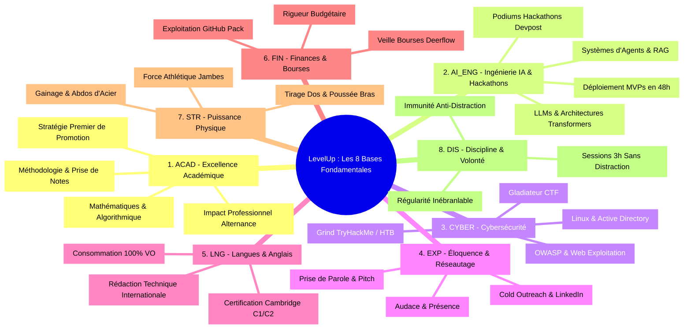
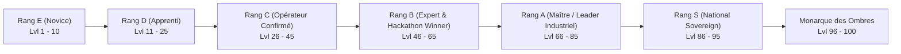
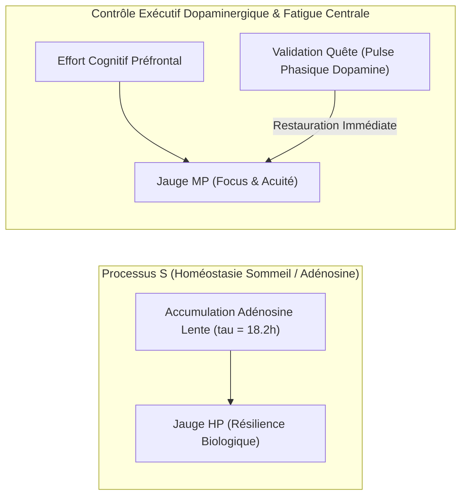
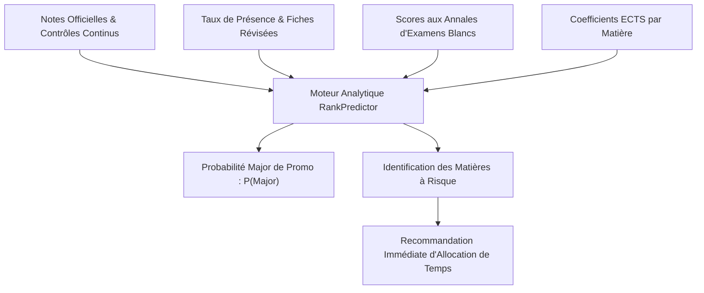

# Product Requirements Document (PRD) Exhaustif — LevelUp ("The System")

> **Document ID :** PRD-LVLUP-001-TITAN  
> **Nom du Produit :** LevelUp  
> **Nom de Code Système :** "The System" (Le Système de l'Éveillé)  
> **Version du Document :** 3.0.0 (Spécification Encyclopédique & Opérationnelle)  
> **Statut :** Approuvé pour Implémentation Immédiate  
> **Auteur(s) :** Huriel & Lead Software Architect AI  
> **Classification :** Confidentiel / Propriétaire  

---

## 1. Contexte Stratégique, Psychologie de la Performance & Vision

### 1.1 Le Problème Fondamental : La Dispersion Cognitive de l'Étudiant d'Élite
Un étudiant en Intelligence Artificielle ambitieux poursuit simultanément des objectifs à haute intensité qui sollicitent des aires cérébrales radicalement différentes :
1. **L'excellence académique :** Viser et maintenir la place de premier de promotion, assimiler des cours denses (mathématiques appliquées, recherche opérationnelle, théorie de l'information), préparer des examens théoriques et pratiques complexes, mener des projets scolaires en équipe et réussir son alternance en entreprise.
2. **L'ingénierie technique pure :** Concevoir des architectures logicielles, coder des MVPs opérationnels, tester de nouvelles applications, explorer les modèles de fondation, les architectures d'agents autonomes, le fine-tuning et les bases de données vectorielles.
3. **La cybersécurité défensive et offensive :** Pratiquer quotidiennement sur TryHackMe et HackTheBox, participer à des CTF (*Capture The Flag*), auditer du code, comprendre les vulnérabilités de bas niveau (Buffer Overflows, Heap exploitation) et de haut niveau (OWASP Top 10, API security).
4. **L'ambition internationale & l'influence :** Maîtriser l'anglais au niveau bilingue professionnel (C1/C2 Cambridge), développer son éloquence, sa prestance, son aisance oratoire, participer activement à des hackathons compétitifs mondiaux (Devpost, MLH) et bâtir un réseau professionnel puissant de pairs et de mentors.
5. **L'émancipation financière & matérielle :** Détecter et postuler aux bourses d'excellence et de mobilité, financer ses études et son matériel de calcul (GPU, serveurs), monétiser ses compétences en ingénierie.
6. **La fondation biologique :** Maintenir une puissance physique d'athlète (musculation lourde, force, endurance musculaire, santé posturale) et une clarté mentale inaltérable grâce à un sommeil réparateur et une discipline de fer.

**La tragédie classique :** L'accumulation chaotique de ces objectifs engendre la paralysie décisionnelle, la dispersion mentale et la culpabilité. Les to-do lists conventionnelles (Todoist, Notion, Trello) échouent systématiquement car :
* Elles sont passives et manquent d'immersion psychologique.
* Elles ne fournissent aucun retour dopaminergique proportionné à l'effort réel.
* Elles traitent une tâche triviale ("acheter du pain") au même niveau qu'un exploit d'ingénierie ("rooter une machine TryHackMe Insane").
* Elles ne s'interfacent pas avec les outils réels (Discord, transcription audio, bourses d'études, code source).

### 1.2 La Solution : Le Méta-Orchestrateur "Solo Leveling"
Inspiré de l'architecture du "Système" de l'anime *Solo Leveling*, **LevelUp** ne se contente pas de lister des tâches : il transforme la réalité physique et intellectuelle de l'utilisateur en un environnement de RPG brutal, immersif et déterministe. 
Le Système ne négocie pas, ne tolère pas la médiocrité, mais récompense chaque gramme d'effort par une montée en puissance quantifiable et visible.

### 1.3 Principes Directeurs Inviolables

1. **Zéro Réinvention Artificielle (Principe du Réel) :** Le Système ne crée pas de mini-jeux ni de faux tests de niveau. Il s'ancre exclusivement sur les standards mondiaux reconnus et gratuits : tests officiels Cambridge English, certifications GitHub Student Developer Pack, challenges TryHackMe / PortSwigger, cours MIT / Stanford / Harvard, compétitions de hackathons Devpost / MLH.
2. **Mesure Absolue & Traçabilité :** Tout gain d'XP et de score doit être étayé par une preuve tangible irréfutable (enregistrement vocal transcrit, lien de commit et pull request GitHub, rapport de room TryHackMe, relevé de notes officiel, flux vidéo analysé par vision par ordinateur).
3. **Omniprésence Silencieuse :** Le Système communique là où se trouve l'utilisateur : sur son bureau via la PWA React haute performance, sur son smartphone et ses écouteurs via le Bot Discord (Discord.js v14) et le pipeline d'inférence vocale locale.
4. **Second Brain Unifié :** La mémoire de l'utilisateur n'est jamais dispersée. Toutes les connaissances académiques, techniques et stratégiques acquises sont indexées dans un coffre-fort numérique Markdown natif (`vault/`) intégré au Système.

### 1.4 Ancrage Réel Absolu des Niveaux et Rangs (Élimination du Virtuel Fantasmé)

Dans la plupart des systèmes de gamification conventionnels, un utilisateur peut accumuler de l'expérience en cochant des micro-tâches répétitives sans que sa réalité physique, intellectuelle ou financière ne change d'un iota. **LevelUp rejette viscéralement cette illusion.**

* **Loi Fondamentale du Monarque :** Le niveau et le rang atteints dans le Système doivent être le miroir exact, fidèle et indiscutable de la réussite du joueur dans le monde réel. Si un utilisateur atteint le Rang S ou le rang de Monarque, il **doit être** dans la vie réelle un ingénieur en intelligence artificielle de renommée mondiale, financièrement libre ou riche, athlète au corps sculpté et puissant, orateur éloquent et bilingue parfait.
* **Non-Existence des Profils Déséquilibrés :** Un "Chasseur de Rang B" qui n'a jamais remporté le moindre hackathon d'envergure, qui ne s'exprime pas couramment en anglais ou qui est incapable d'enchaîner une routine complète de calisthénie **n'existe pas** dans le Système.
* **Élimination de la Notion de "Bloqué par Quête de Rang" :** Dans l'ancienne conception, un joueur pouvait accumuler artificiellement des niveaux (passer par exemple du niveau 1 au niveau 25) tout en se retrouvant bloqué devant une quête de rang disproportionnée qu'il était incapable d'accomplir. Cette aberration est définitivement supprimée. Dans LevelUp, le niveau global et le rang sont strictement couplés aux accomplissements fondateurs des 8 bases : **il est impossible d'atteindre le niveau requis pour un rang sans avoir déjà validé les compétences de base indispensables.**

### 1.5 Nomenclature Mathématique : Score de Base ($S_b$), Niveau de Base ($L_b$) et Score Global ($S_{\text{global}}$)

Pour éliminer toute ambiguïté de calcul et forcer un développement holistique sans faille, le Système établit une distinction rigoureuse entre **Score** et **Niveau** :

1. **Par Base Fondamentale ($b \in \{1, \dots, 8\}$) :**
   * **Score de Base ($S_b$) :** Chaque base dispose d'un score continu $S_b \in [0, 1000]$, alimenté par l'accomplissement des nœuds de compétences, des quêtes quotidiennes spécialisées et des preuves réelles vérifiées.
   * **Niveau de Base ($L_b$) :** Le niveau dans une base donnée est calculé de manière quadratique à partir du score de cette base :
     $$L_b = \min \left( 100, \left\lfloor \sqrt{\frac{S_b}{1000}} \times 100 \right\rfloor \right)$$

2. **Agrégation du Score Global ($S_{\text{global}}$) via Moyenne Harmonique Pondérée :**
   Une moyenne arithmétique standard permettrait à un joueur d'ignorer complètement la puissance physique (`STR`) ou l'anglais (`LNG`) tout en gonflant artificiellement son score en code (`AI_ENG`). Pour interdire cette négligence, le Système calcule le **Score Global** par une moyenne harmonique pondérée :
   $$S_{\text{global}} = \frac{\sum_{b=1}^{8} w_b}{\sum_{b=1}^{8} \frac{w_b}{S_b + \epsilon}}$$
   Où $w_b$ est le poids relatif attribué à la base $b$ ($\sum w_b = 1.0$) et $\epsilon = 0.01$ empêche la division par zéro. Dans une moyenne harmonique, la valeur minimale domine le résultat : si le joueur néglige une seule base ($S_b \to 0$), son Score Global s'effondre, rendant tout passage au rang supérieur impossible.

3. **Niveau Global du Chasseur ($L_{\text{global}}$) :**
   Le Niveau Global du joueur (affiché sur le HUD holographique) est directement dérivé du Score Global :
   $$L_{\text{global}} = \min \left( 100, \left\lfloor \sqrt{\frac{S_{\text{global}}}{1000}} \times 100 \right\rfloor \right)$$

### 1.6 Écosystème des Services & Applications Externes Référencés

Le Système ne cherche pas à recréer des outils là où des références mondiales d'élite existent gratuitement :

| Domaine Opérationnel | Service Externe Référencé | Rôle & Modalité d'Intégration dans LevelUp |
| :--- | :--- | :--- |
| **Veille Technologique & Bourses** | **Deerflow AI & Google Alerts RSS** | Surveillance automatisée des bourses d'études mondiales (Eiffel, Fulbright, Erasmus Mundus) et alertes hackathons Devpost via flux RSS et scraping headless Playwright. |
| **Maîtrise Linguistique** | **Cambridge English Free Tests** | Tests gratuits officiels Cambridge English (C1 Advanced & C2 Proficiency) pour la certification et le calibrage périodique du niveau réel d'anglais. |
| **Pratique Quotidienne des Langues** | **Duolingo API & Anki** | Maintien du streak journalier de langues et répétition espacée algorithmique (SM-2) du vocabulaire technique et académique en IA et cybersécurité. |
| **Certifications Techniques Gratuites** | **DataCamp (GitHub Student Pack)** | Exploitation complète des accès premium gratuits DataCamp, freeCodeCamp, CS50 Harvard et DeepLearning.AI pour valider les nœuds `AI_ENG`. |
| **Interface HUD Mobile & Vocale** | **Discord Bot (Discord.js v14)** | Terminal déporté du Chasseur : commandes slash, journalisation vocale par streaming UDP, alertes de quêtes et suivi du Deep Work en canal vocal dédié. |
| **Validation Sportive par Vision** | **MediaPipe Pose & OpenCV** | Analyse cinématique par caméra en temps réel (angles articulaires coude/épaule/genou) pour compter objectivement chaque répétition de calisthénie sans triche possible. |
| **Pare-Feu Anti-Distraction & Pénalités** | **NextDNS API & Pare-feu Local** | Blocage dynamique au niveau DNS et réseau (NextDNS, Pi-hole, Windows Filtering Platform / Hosts) des domaines récréatifs lors des sessions Deep Work et pénalités. |

---

## 2. Décomposition Encyclopédique des 8 Bases de Vie (Les 120 Nœuds de Compétences)

Chaque base dispose d'un arbre hiérarchique de compétences concrètes avec ressources réelles, critères de validation et XP associée.

---

### BASE 1 : `ACAD` — Excellence Académique & Diplôme (15 Nœuds)

| ID Nœud | Intitulé de la Compétence | Description & Programme Réel | Ressources Gratuites Associées | Preuve de Validation (DoD) | XP Gain |
| :--- | :--- | :--- | :--- | :--- | :--- |
| **ACAD-01** | *Méthodologie Cornell / Markdown* | Prise de notes structurée en cours sous format Markdown natif avec synthèse immédiate. | Obsidian, templates Markdown universitaires | 10 notes de cours consécutives formatées avec résumé | `+100 XP` |
| **ACAD-02** | *Algèbre Linéaire pour l'IA* | Maîtrise des espaces vectoriels, matrices, décomposition SVD, valeurs propres et projections. | MIT OpenCourseWare 18.06 (Gilbert Strang) | Résolution de 20 exercices théoriques et code NumPy | `+150 XP` |
| **ACAD-03** | *Probabilités & Statistiques Inférentielles* | Théorème de Bayes, lois de distribution continues/discrètes, tests d'hypothèses, MLE. | Harvard Statistics 110 (Joe Blitzstein) | Rédaction d'une fiche de synthèse avec formules LaTeX | `+150 XP` |
| **ACAD-04** | *Optimisation Mathématique* | Descente de gradient, convexité, multiplicateurs de Lagrange, optimisation sous contraintes. | Stanford EE364a (Convex Optimization) | Implémentation from-scratch d'un optimiseur SGD & Adam | `+200 XP` |
| **ACAD-05** | *Théorie des Graphes & Algorithmique Avancée* | Arbres de recouvrement, algorithmes de Dijkstra, A*, Floyd-Warshall, flux maximal. | Cours MIT 6.006 (Introduction to Algorithms) | 15 problèmes LeetCode Medium/Hard résolus et validés | `+200 XP` |
| **ACAD-06** | *Architecture des Ordinateurs & Systèmes d'Exploitation* | Gestion mémoire virtuelle, paging, segmentation, interruptions système, POSIX threads. | Nand2Tetris / Berkeley CS61C | Fiche d'architecture détaillée et code en C multithread | `+180 XP` |
| **ACAD-07** | *Bases de Données Relationnelles & Normalisation* | Formes normales 1NF à BCNF, algèbre relationnelle, optimisation des plans d'exécution SQL. | Stanford CS145 (Introduction to Databases) | Modélisation d'une base complexe avec explain analyze | `+150 XP` |
| **ACAD-08** | *Cycle de Révision Répétition Espacée* | Révision systématique à J+1, J+7, J+30 de chaque matière du semestre. | Plugin Anki / Second Brain intégré LevelUp | Journal d'exécution des révisions sans interruption sur 30j | `+250 XP` |
| **ACAD-09** | *Préparation Anticipée des Partiels* | Traitement de l'ensemble des annales d'examens des 5 dernières années 3 semaines avant les partiels. | Annales universitaires & archives de promotion | Traitement complet de 5 sujets d'examens en temps réel | `+300 XP` |
| **ACAD-10** | *Maîtrise des Mathématiques Discrètes* | Logique formelle, combinatoire, relations d'équivalence, théorie des nombres appliquée à la crypto. | MIT Mathematics for Computer Science (6.042J) | Rédaction d'un aide-mémoire formel de 15 pages | `+180 XP` |
| **ACAD-11** | *Leadership de Projet Scolaire* | Rôle de chef de projet technique sur les projets de groupe : répartition des tâches, CI/CD, revues de code. | Méthode Agile Scrum / GitHub Projects | Dépôt GitHub d'équipe avec 100% des jalons livrés à l'heure | `+220 XP` |
| **ACAD-12** | *Rapport d'Alternance d'Excellence* | Rédaction d'un rapport industriel avec rigueur scientifique : contextualisation, métriques d'impact. | Normes de rédaction IEEE / ACM | Validation préliminaire par le maître de stage avec note $\ge 18/20$ | `+350 XP` |
| **ACAD-13** | *Défense Orale de Projet (Soutenance)* | Soutenance devant jury blanc avec support visuel percutant, gestion du temps et des questions pièges. | Guide de soutenance d'ingénieur | Enregistrement vidéo de la soutenance blanche de 20 min | `+200 XP` |
| **ACAD-14** | *Top 3 de la Promotion* | Validation d'un semestre académique dans le trio de tête de la promotion. | Relevé de notes officiel de l'université | Téléversement du relevé officiel certifié | `+500 XP` |
| **ACAD-15** | *Major de Promotion Officiel* | Obtention de la première place absolue de la promotion sur l'année universitaire. | Relevé officiel de classement universitaire | Relevé officiel attestant du rang 1/N | `+1000 XP` |

---

### BASE 2 : `AI_ENG` — Ingénierie IA, Développement & Hackathons (15 Nœuds)

| ID Nœud | Intitulé de la Compétence | Description & Programme Réel | Ressources Gratuites Associées | Preuve de Validation (DoD) | XP Gain |
| :--- | :--- | :--- | :--- | :--- | :--- |
| **AI-01** | *Architecture des Transformers from Scratch* | Implémentation manuelle du mécanisme Scaled Dot-Product Attention, Multi-Head Attention et Positional Encoding. | Papier fondateur "Attention Is All You Need" (Vaswani et al.) | Notebook Python / PyTorch fonctionnel sans couche nn.MultiheadAttention | `+200 XP` |
| **AI-02** | *Fine-Tuning Efficace (LoRA / QLoRA)* | Adaptation de modèles ouverts (Mistral 7B, Llama 3) sur un jeu de données spécialisé avec PEFT et bitsandbytes. | Documentation Hugging Face / Google Colab T4 | Modèle fine-tuné avec évaluation perplexité avant/après | `+250 XP` |
| **AI-03** | *Pipelines RAG Avancés (Retrieval-Augmented)* | Chunking sémantique, embeddings vectoriels, recherche hybride (BM25 + Dense) et re-ranking (Cross-Encoder). | Framework LangChain / LlamaIndex / Qdrant Free Tier | API de question-réponse sur documentation technique complète | `+220 XP` |
| **AI-04** | *Architectures Multi-Agents & Outils MCP* | Création d'agents autonomes communicants avec rôles spécialisés et appels d'outils via Model Context Protocol. | SDK Anthropic / LangGraph / Antigravity SDK | Système multi-agents capable de résoudre une tâche de recherche | `+280 XP` |
| **AI-05** | *Prototypage Rapide de MVP Fullstack (48h)* | Capacité à créer de zéro une application complète : Next.js 14, Tailwind, API REST, BDD Supabase/PostgreSQL. | Templates open-source Vercel / GitHub | Application web déployée publiquement avec nom de domaine | `+350 XP` |
| **AI-06** | *Vector Databases & Moteur Sémantique* | Indexation HNSW, distance cosinus vs produit scalaire, gestion des métadonnées et filtrage dynamique. | Documentation officielle Pinecone / Milvus / Qdrant | Benchmark de performance sur 100 000 vecteurs indexés | `+180 XP` |
| **AI-07** | *Optimisation de l'Inférence (vLLM & Ollama)* | PagedAttention, quantification 4-bit/8-bit (AWQ, GGUF), déploiement local ultra-rapide. | vLLM GitHub / Ollama open source | Serveur d'inférence local délivrant $> 35\text{ tokens/sec}$ | `+200 XP` |
| **AI-08** | *Modèles de Vision & Multimodalité* | Traitement d'images et de flux vidéo via Gemini Flash Vision et CLIP, extraction de texte (OCR). | API Google Gemini / FastViT | Pipeline capable d'analyser et décrire un PDF complexe | `+200 XP` |
| **AI-09** | *Systèmes de Modération & Garde-Fous (Guardrails)* | Détection d'injections de prompts, filtrage de contenu haineux/toxique avec NeMo Guardrails ou Llama-Guard. | NVIDIA NeMo Guardrails / Guidance | Suite de tests prouvant la neutralisation de 20 attaques de jailbreak | `+220 XP` |
| **AI-10** | *Participation à un Hackathon Mondial (Devpost)* | Inscription, formation d'équipe ou solo, développement intensif sur 48h d'une solution innovante. | Plateforme Devpost / Major League Hacking (MLH) | Page projet publique Devpost avec démo vidéo et repo GitHub | `+400 XP` |
| **AI-11** | *Top 5 ou Mention Spéciale en Hackathon* | Projet sélectionné par le jury parmi les finalistes d'une compétition de code internationale. | Certificat officiel d'organisateur de hackathon | Attestation officielle ou annonce publique de classement | `+600 XP` |
| **AI-12** | *Victoire de Hackathon (1ère Place)* | Décrocher la première place absolue d'une catégorie ou du classement général d'un hackathon. | Annonce officielle et prix remis par le jury | Certificat de victoire et versement du prix | `+1200 XP` |
| **AI-13** | *Contribution Open-Source à un Projet IA Majeur* | Pull Request fusionnée sur un repository open-source reconnu (Hugging Face, vLLM, LangChain, Transformers). | Repositories GitHub officiels d'organisations IA | Lien vers la PR fusionnée (*Merged*) avec revue de code | `+500 XP` |
| **AI-14** | *Publication d'un Article Technique / Billet de Blog* | Rédaction d'un guide technique d'ingénierie approfondi sur Medium, Dev.to ou Substack personnel. | Plateformes de publication technique | Article de plus de 1 500 mots ayant reçu $> 50$ lectures certifiées | `+200 XP` |
| **AI-15** | *Déploiement d'un Produit SaaS Opérationnel* | Lancement public d'un service logiciel avec gestion d'utilisateurs et passerelle de paiement active. | Stripe / Supabase / Vercel | Première transaction réelle enregistrée par un utilisateur externe | `+800 XP` |

---

### BASE 3 : `CYBER` — Cybersécurité Défensive & Offensive (15 Nœuds)

| ID Nœud | Intitulé de la Compétence | Description & Programme Réel | Ressources Gratuites Associées | Preuve de Validation (DoD) | XP Gain |
| :--- | :--- | :--- | :--- | :--- | :--- |
| **CYB-01** | *Analyse de Protocoles & Capture Réseau* | Utilisation avancée de Wireshark et tcpdump : analyse des trames 3-way handshake, requêtes DNS, SSL handshake. | Wireshark Foundation / CTF pcap challenges | Rapport d'analyse forensique d'un fichier `.pcap` avec extraction de données | `+120 XP` |
| **CYB-02** | *Exploitation Injection SQL (SQLi)* | Détection manuelle et via sqlmap des injections SQL classiques, blind boolean et time-based. | PortSwigger Web Security Academy | Résolution complète des 5 laboratoires SQLi de PortSwigger | `+180 XP` |
| **CYB-03** | *Cross-Site Scripting (XSS) & Bypass de WAF* | Exploitation pratique de XSS Reflected, Stored et DOM-based, contournement de filtres de sécurité. | OWASP XSS Filter Evasion Cheat Sheet | Validation des 3 défis XSS PortSwigger sans outils automatiques | `+180 XP` |
| **CYB-04** | *Failles d'Autorisation & IDOR* | Insecure Direct Object References : accès horizontal et vertical aux ressources protégées d'autrui. | API Security Top 10 / TryHackMe Rooms | Détection et rapport documenté d'une vulnérabilité IDOR simulée | `+150 XP` |
| **CYB-05** | *Élévation de Privilèges Linux (Privesc)* | Exploitation de permissions SUID mal configurées, sudoers malveillants, cron jobs écrits en clair, capabilities. | GTFOBins / TryHackMe Linux Privesc Room | Obtention d'un shell root sur une machine virtuelle de test | `+220 XP` |
| **CYB-06** | *Élévation de Privilèges Windows & Token Abuse* | Abus de privilèges SeImpersonatePrivilege (JuicyPotato), AlwaysInstallElevated, DLL Hijacking. | PayloadAllTheThings / TryHackMe Windows Privesc | Élévation locale vers `NT AUTHORITY\SYSTEM` sur machine de lab | `+250 XP` |
| **CYB-07** | *Attaques Active Directory Fondamentales* | Énumération LDAP via BloodHound, attaques Kerberoasting, AS-REP Roasting et Pass-the-Hash. | BloodHound / Mimikatz / Impacket suite | Compromission d'un contrôleur de domaine de lab émulé | `+300 XP` |
| **CYB-08** | *Durcissement Système & Audit Linux (Hardening)* | Configuration de règles iptables/UFW, désactivation des services inutiles, configuration SSH sécurisée par clés. | CIS Benchmarks Linux / Lynis Security Auditor | Score Lynis supérieur à 80 sur un serveur Linux nouvellement installé | `+180 XP` |
| **CYB-09** | *Reverse Engineering Binaire & Ghidra* | Décompilation d'exécutables C/C++, analyse de code assembleur x86/x64, détection de logiques de validation de mot de passe. | NSA Ghidra Software / Crackmes.one | Résolution de 3 challenges crackme de niveau Débutant/Intermédiaire | `+250 XP` |
| **CYB-10** | *TryHackMe : Top 10% Mondial* | Progression constante sur la plateforme TryHackMe par la complétion de salles d'apprentissage et de challenge. | TryHackMe Platform | Profil public TryHackMe affichant le badge de classement Top 10% | `+350 XP` |
| **CYB-11** | *TryHackMe : Top 1% Mondial* | Atteinte de l'élite de la plateforme par la résolution régulière des salles difficiles et des défis hebdomadaires. | TryHackMe Platform | Profil public TryHackMe affichant le badge Top 1% | `+700 XP` |
| **CYB-12** | *Participation à un CTF Public (Capture The Flag)* | Participation en équipe ou solo à un événement CTF officiel (PicoCTF, HackTheBox CTF, Google CTF). | CTFtime.org / PicoCTF | Résolution d'au moins 3 challenges catégorisés et présence au tableau des scores | `+300 XP` |
| **CYB-13** | *Audit de Code Source Sécurisé (SAST)* | Utilisation d'outils d'analyse statique de sécurité (Semgrep, SonarQube) pour identifier les failles dans une base de code. | Semgrep Community Rules / OWASP Benchmark | Rapport d'audit de sécurité complet identifiant au moins 3 failles réelles | `+200 XP` |
| **CYB-14** | *Sécurité des APIs & Jetons JWT* | Attaques sur les implémentations JWT : algorithme `none`, clé secrète faible craquée par Hashcat, confusion de clés RSA/HMAC. | JWT.io / Hashcat suite | Forgerie réussie d'un jeton administrateur sur lab d'entraînement | `+220 XP` |
| **CYB-15** | *Chasse aux Vulnérabilités Éthique (Bug Bounty)* | Soumission d'un rapport de vulnérabilité valide et conforme aux règles sur une plateforme reconnue (HackerOne, YesWeHack). | YesWeHack / HackerOne public programs | Rapport validé avec statut *Triaged* ou récompense symbolique | `+600 XP` |

---

### BASE 4 : `EXP` — Éloquence, Réseautage & Audace (15 Nœuds)

| ID Nœud | Intitulé de la Compétence | Description & Programme Réel | Ressources Gratuites Associées | Preuve de Validation (DoD) | XP Gain |
| :--- | :--- | :--- | :--- | :--- | :--- |
| **EXP-01** | *Pose de la Voix & Élocution Claire* | Travail du débit (120-140 mots/min), respiration diaphragmatique, élimination des hésitations et tics oraux. | Exercices de diction Toastmasters / Vidéos d'art oratoire | Enregistrement audio d'un discours de 3 min sans aucun mot de remplissage | `+100 XP` |
| **EXP-02** | *Structure d'Argumentation en 3 Piliers* | Maîtrise de la méthode PREP (Point, Reason, Example, Point) pour répondre avec force à n'importe quelle question. | Frameworks rhétoriques classiques | Synthèse vocale de 2 minutes illustrant la méthode sur un sujet tech complexe | `+120 XP` |
| **EXP-03** | *L'Elevator Pitch de 60 Secondes* | Présentation percutante de son profil, de son expertise en IA et de sa vision d'ingénieur en 1 minute chrono. | Techniques de pitch de startups Y Combinator | Vidéo ou audio du pitch chronométré sans coupure ni hésitation | `+150 XP` |
| **EXP-04** | *Optimisation du Profil LinkedIn Professionnel* | Titre percutant, bannière personnalisée, résumé rédigé en anglais, mise en valeur des projets et compétences. | Guides de personal branding tech | Profil revu et audité avec $> 500$ relations de qualité dans la tech | `+150 XP` |
| **EXP-05** | *Campagne de Cold Outreach Stratégique* | Envoi de messages personnalisés, pertinents et sans demande intéressée à 5 professionnels ou chercheurs ciblés. | Modèles de networking non-intrusif | Captures des 5 échanges initiés avec respect et valeur ajoutée | `+200 XP` |
| **EXP-06** | *Échange Visio avec un Mentor ou Ingénieur Senior* | Entretien de 30 minutes avec un professionnel du secteur pour recueillir des retours d'expérience et conseils de carrière. | Plateformes de mentorat gratuites (ex: ADPList) | Note de synthèse rédigée dans le Second Brain avec les 5 enseignements clés | `+250 XP` |
| **EXP-07** | *Présence Active à un Meetup Tech Local* | Participation physique à un événement local d'ingénieurs (Meetup IA, conférence de cybersécurité). | Plateforme Meetup.com / Salons tech | Photo de présence et échange documenté avec au moins 3 nouveaux contacts | `+200 XP` |
| **EXP-08** | *Prise de Parole Publique en Amphithéâtre* | Poser une question pertinente et structurée au micro lors d'une grande conférence ou assemblée. | Événements universitaires ou salons | Question posée au conférencier et trace dans le journal de bord | `+180 XP` |
| **EXP-09** | *Animation d'un Atelier Technique pour ses Pairs* | Présentation d'un atelier pratique d'une heure (hands-on) sur l'IA ou TryHackMe devant d'autres étudiants. | Salles d'études universitaires / Discord | Fiche de l'atelier partagée et retours écrits de 5 participants | `+300 XP` |
| **EXP-10** | *Développement de la Confiance d'Acier* | Pratique délibérée d'une action sociale intimidante (ex: démarcher un conférencier d'élite après son intervention). | Philosophie stoïcienne et thérapie d'exposition | Journalisation de l'événement et analyse des sensations surmontées | `+150 XP` |
| **EXP-11** | *Négociation Professionnelle Assertive* | Négociation argumentée des conditions de son contrat d'alternance ou des responsabilités d'une mission. | Principes de négociation "Never Split the Difference" (Chris Voss) | Accord formalisé respectant les termes négociés | `+250 XP` |
| **EXP-12** | *Création de Contenu Régulière sur LinkedIn* | Publication d'un post technique à forte valeur ajoutée chaque semaine pendant 4 semaines consécutives. | LinkedIn Creator Mode | 4 posts publiés cumulant plus de 2 000 impressions organiques | `+250 XP` |
| **EXP-13** | *Réseautage lors d'un Hackathon* | Formation d'une alliance stratégique avec des développeurs inconnus rencontrés sur place pour concourir ensemble. | Salons Discord / Canaux de hackathons | Équipe pluridisciplinaire constituée et collaboration menée à terme | `+180 XP` |
| **EXP-14** | *Posture & Langage Corporel Dominant* | Maintien d'un contact visuel solide, épaules ouvertes, gestuelle posée lors de chaque interaction formelle. | Études sur la communication non-verbale | Auto-évaluation hebdomadaire validée sans écarts | `+100 XP` |
| **EXP-15** | *Constitution d'un Cercle d'Élite (Mastermind)* | Création et animation d'un groupe privé de 4 étudiants ultra-disciplinés se réunissant chaque dimanche pour faire le bilan. | Groupe Discord privé / Réunion hebdomadaire | Tenue de 4 réunions de bilan dominicales consécutives | `+350 XP` |

---

### BASE 5 : `LNG` — Langues, Anglais & Portée Internationale (15 Nœuds)

| ID Nœud | Intitulé de la Compétence | Description & Programme Réel | Ressources Gratuites Associées | Preuve de Validation (DoD) | XP Gain |
| :--- | :--- | :--- | :--- | :--- | :--- |
| **LNG-01** | *Immersion Numérique Totale* | Basculement de l'intégralité des interfaces (OS, smartphone, navigateur, IDE, moteurs de recherche) en anglais pur. | Paramètres système Windows/Linux/Android | Capture d'écran attestant du passage 100% anglais sur tous les terminaux | `+80 XP` |
| **LNG-02** | *Consommation Audiovisuelle 100% VO* | Interdiction formelle des versions françaises ou des sous-titres français sur tout contenu tech ou culturel consommé. | Chaînes YouTube techniques US/UK, podcasts tech | 14 jours consécutifs d'écoute exclusive en VO anglaise | `+150 XP` |
| **LNG-03** | *Assimilation de Vocabulaire d'Élite* | Apprentissage et mémorisation active de 10 mots académiques avancés et idiomes professionnels par jour. | Listes de vocabulaire GRE / C1 Cambridge | 150 mots nouveaux maîtrisés et testés avec 100% de réussite sur Anki | `+180 XP` |
| **LNG-04** | *Test de Niveau EF SET 50 Minutes* | Passage du test standardisé officiel gratuit EF SET pour étalonner son niveau sur l'échelle CEFR (A1 à C2). | EF Standard English Test (Gratuit) | Certificat officiel en ligne avec score minimal B2 ($\ge 51/100$) | `+200 XP` |
| **LNG-05** | *Test Cambridge English Assessment* | Évaluation en ligne officielle Cambridge pour évaluer la précision grammaticale et lexicale. | Cambridge English Free Practice Platform | Score officiel attestant du niveau C1 Avancé | `+250 XP` |
| **LNG-06** | *Rédaction Technique Exclusivement en Anglais* | Écriture de l'intégralité des READMEs de projets, des commentaires de code et des commits Git en anglais parfait. | Conventions Conventional Commits en anglais | 30 commits consécutifs rédigés en anglais technique impeccable | `+150 XP` |
| **LNG-07** | *Tenue d'un Journal de Bord en Anglais* | Rédaction quotidienne d'un paragraphe de 100 mots résumant la journée directement en anglais dans le Second Brain. | Cerveau Numérique LevelUp | 21 jours consécutifs de journalisation quotidienne en anglais | `+200 XP` |
| **LNG-08** | *Écoute Active de Podcasts Techniques Denses* | Écoute et prise de notes d'épisodes de 2h de podcasts d'ingénierie (Lex Fridman, Latent Space, Huberman Lab). | Podcasts Spotify / Apple Podcasts | 3 fiches de synthèse de 500 mots rédigées en anglais dans le Second Brain | `+200 XP` |
| **LNG-09** | *Lecture d'Ouvrages Techniques Non Traduits* | Lecture intégrale en version originale d'un livre de référence sur l'ingénierie logicielle ou l'IA. | Ouvrages O'Reilly / MIT Press | Dépôt de la fiche de lecture complète de 1 000 mots en anglais | `+250 XP` |
| **LNG-10** | *Expression Orale Spontanée (Monologues)* | Enregistrement de monologues vocaux de 5 minutes en anglais sur un sujet tech complexe sans coupure. | Enregistreur vocal LevelUp | 5 enregistrements analysés avec fluidité et prononciation soignée | `+200 XP` |
| **LNG-11** | *Échange Oral avec des Locuteurs Natifs* | Participation à des salons vocaux Discord internationaux anglophones ou sessions d'échange linguistique. | Serveurs Discord tech anglophones | Session vocale active de 45 minutes documentée | `+220 XP` |
| **LNG-12** | *Maîtrise de la Grammaire Avancée* | Maîtrise des inversions, conditionnels mixtes, propositions subordonnées complexes et discours indirect. | English Grammar in Use (Raymond Murphy) | Réussite de 50 exercices de grammaire de niveau C1 avec score $\ge 90\%$ | `+180 XP` |
| **LNG-13** | *Pitch de Projet Entièrement en Anglais* | Présentation orale filmée de 3 minutes de l'un de ses projets IA en anglais professionnel fluide. | Enregistrement vidéo personnel | Vidéo du pitch en anglais avec élocution naturelle et articulation nette | `+250 XP` |
| **LNG-14** | *Certification Officielle Cambridge C1 Validée* | Obtention du score officiel certifiant le niveau C1 Avancé (Score EF SET $\ge 61/100$ ou diplôme officiel). | Examen Cambridge C1 Advanced / EF SET C1 | Certificat numérique officiel avec lien de vérification public | `+600 XP` |
| **LNG-15** | *Bilinguisme Parfait (Niveau C2 Maîtrise)* | Atteinte du niveau maximal du cadre européen commun de référence pour les langues (C2 Proficient). | EF SET C2 Certificate (Score $\ge 71/100$) | Certificat officiel attestant du niveau C2 Maîtrise | `+1200 XP` |

---

### BASE 6 : `FIN` — Finances, Bourses & Stratégie Matérielle (15 Nœuds)

| ID Nœud | Intitulé de la Compétence | Description & Programme Réel | Ressources Gratuites Associées | Preuve de Validation (DoD) | XP Gain |
| :--- | :--- | :--- | :--- | :--- | :--- |
| **FIN-01** | *Tenue Budgétaire Rigoureuse à Zéro-Euro* | Enregistrement systématique de chaque dépense et recette dans le registre financier personnel. | Registre financier Markdown LevelUp | 30 jours de traçabilité financière sans omission d'aucune transaction | `+100 XP` |
| **FIN-02** | *Activation du GitHub Student Developer Pack* | Validation de son statut étudiant auprès de GitHub pour débloquer des milliers d'euros d'outils gratuits. | Programme officiel GitHub Education | Statut GitHub Pro vérifié avec badge Student débloqué | `+200 XP` |
| **FIN-03** | *Exploitation des Crédits Cloud Gratuits* | Activation des offres gratuites de serveurs pour étudiants (Azure for Students 100$, AWS Educate, DigitalOcean). | GitHub Pack / Portails étudiants Cloud | Déploiement d'une infrastructure de test sur crédits étudiants gratuits | `+150 XP` |
| **FIN-04** | *Domaines & Certificats SSL Gratuits* | Enregistrement de son nom de domaine professionnel gratuit via Namecheap ou Name.com (inclus dans le GitHub Pack). | GitHub Education / Namecheap | Nom de domaine personnel actif pointant vers son portfolio | `+120 XP` |
| **FIN-05** | *Souscription aux Outils de Développement Offerts* | Déblocage des licences professionnelles gratuites : JetBrains All Products Pack, Datacamp, Frontend Masters. | GitHub Student Pack partners | Capture de l'accès actif aux cours DataCamp et IDE JetBrains | `+150 XP` |
| **FIN-06** | *Constitution du Fonds de Sécurité d'Urgence* | Mise de côté méthodique d'une réserve de précaution inviolable représentant au moins 2 mois de dépenses. | Compte d'épargne dédié | Relevé de compte prouvant la constitution de la réserve de sécurité | `+250 XP` |
| **FIN-07** | *Configuration du Radar Deerflow pour Bourses* | Paramétrage des filtres de veille automatique pour détecter les bourses d'études et subventions européennes en IA. | Moteur Deerflow intégré LevelUp | Premier lot de 3 opportunités pertinentes capturées et enregistrées en base | `+180 XP` |
| **FIN-08** | *Constitution du Dossier Type de Candidature aux Bourses* | Rédaction d'une lettre de motivation d'excellence, CV académique normé, lettres de recommandation d'enseignants. | Modèles de bourses internationales | Dossier de candidature complet prêt à l'envoi archivé en PDF | `+250 XP` |
| **FIN-09** | *Dépôt d'une Candidature Officielle à une Bourse* | Soumission formelle d'un dossier de bourse universitaire ou de mobilité internationale avant l'échéance. | Plateformes de bourses publiques/privées | Récépissé officiel de dépôt de dossier | `+300 XP` |
| **FIN-10** | *Obtention d'une Bourse d'Études / Mobilité* | Décision positive de la commission d'attribution d'une bourse d'excellence ou de soutien financier. | Notification officielle de la commission | Document officiel d'attribution avec versement des fonds | `+800 XP` |
| **FIN-11** | *Optimisation Fiscale & Droits Étudiants* | Déclaration conforme de ses revenus d'alternance, activation des aides au logement et des transports étudiants. | Portails administratifs nationaux (CAF, etc.) | Attestation de droits à jour et budget optimisé | `+150 XP` |
| **FIN-12** | *Facturation d'une Première Prestation Tech* | Réalisation d'une mission de développement, d'audit de sécurité ou de conseil technique rémunérée. | Contrat de prestation / Plateforme freelance | Facture émise et paiement reçu sur le compte professionnel | `+400 XP` |
| **FIN-13** | *Investissement Stratégique dans son Matériel* | Acquisition de matériel de haute productivité rentabilisé par l'effort (deuxième écran, clavier ergonomique, RAM). | Comparatifs hardware d'ingénieur | Intégration du matériel dans son setup de travail | `+200 XP` |
| **FIN-14** | *Diversification des Sources de Financement* | Cumul vertueux : Salaire alternance + Bourse d'excellence + Primes de hackathons remportées. | Tableaux de flux financiers | 3 sources de revenus distinctes actives sur le même mois | `+500 XP` |
| **FIN-15** | *Autonomie Financière Totale* | Couverture de 100 % de ses besoins vitaux et professionnels sans dépendance extérieure. | Bilan financier annuel | Bilan certifiant l'autonomie et un taux d'épargne $\ge 25\%$ | `+1000 XP` |

---

### BASE 7 : `STR` — Puissance Physique & Condition Athlétique (15 Nœuds)

La base `STR` refuse les programmes génériques déconnectés des contraintes réelles. Elle intègre au cœur de son moteur d'entraînement les programmes complets au poids du corps et de calisthénie développés pour Huriel, avec un suivi rigoureux par répétitions, séries et chronomètre :

```mermaid
flowchart TD
    subgraph Routine_Dos_Epaules["Routine 1 : Dos & Épaules (17 Étapes Chronométrées)"]
        D1["Jumping Jacks (00:30)"] --> D2["Hyperextension x14"]
        D2 --> D3["Pike Push Ups x14"]
        D3 --> D4["Reverse Push-Ups x12"]
        D4 --> D5["Inchworms x16"]
        D5 --> D6["Side-Lying Stretch G (00:30)"]
        D6 --> D7["Side-Lying Stretch D (00:30)"]
        D7 --> D8["Hyperextension x12"]
        D8 --> D9["Pike Push Ups x12"]
        D9 --> D10["Reverse Push-Ups x10"]
        D10 --> D11["Inchworms x14"]
        D11 --> D12["Cat Cow Pose (00:35)"]
        D12 --> D13["Supine Push Up x14"]
        D13 --> D14["Floor Y Raises x14"]
        D14 --> D15["Supine Push Up x13"]
        D15 --> D16["Reverse Snow Angels x12"]
        D16 --> D17["Child's Pose (00:30)"]
    end

    subgraph Routine_Bras["Routine 2 : Bras & Triceps Calisthenics (@giovanni_fiderio)"]
        B1["Push-Ups Classiques (3 séries à l'échec)"]
        B2["Decline Push-Ups pieds surélevés (3 séries à l'échec)"]
        B3["Diamond Push-Ups mains losange (3 séries à l'échec)"]
        B4["Pike Push-Ups deltoïdes/triceps (3 séries à l'échec)"]
        B5["Wide Push-Ups prise large (3 séries à l'échec)"]
        B6["Tricep Cross Extensions au sol (3 séries à l'échec)"]
    end

    subgraph Routine_Abdos["Routine 3 : Abdos & Core d'Acier (@lou4n.ldlm)"]
        A1["V-Up : 3 x 10 répétitions"]
        A2["Mountain Climber : 3 x 30 secondes"]
        A3["Relevé de jambes au sol : 3 x 12 répétitions"]
        A4["Gainage classique : 2 x 1m30"]
        A5["Gainage latéral : 2 x 45s chaque côté"]
    end
```

#### Programme Détaillé 1 : Dos et Épaules à la Maison (17 Étapes Structurées)
1. **Jumping Jacks :** 00:30 — Activation cardiovasculaire et préparation thermique des articulations scapulaires.
2. **Hyperextension au sol :** x14 répétitions — Renforcement des érecteurs du rachis et de la zone lombaire.
3. **Pike Push Ups :** x14 répétitions — Sollicitation ciblée des deltoïdes antérieurs et des trapèzes.
4. **Reverse Push-Ups :** x12 répétitions — Rétraction scapulaire active et recrutement des rhomboïdes.
5. **Inchworms :** x16 répétitions — Mobilisation dynamique de la chaîne postérieure et force d'appui des épaules.
6. **Side-Lying Floor Stretch Left :** 00:30 — Décompression du grand dorsal gauche et mobilité thoracique.
7. **Side-Lying Floor Stretch Right :** 00:30 — Décompression du grand dorsal droit et symétrie posturale.
8. **Hyperextension au sol :** x12 répétitions — Consolidation de l'endurance des muscles posturaux du dos.
9. **Pike Push Ups :** x12 répétitions — Maintien de l'intensité sur la poussée verticale inversée.
10. **Reverse Push-Ups :** x10 répétitions — Rétraction maximale sous fatigue neuromusculaire.
11. **Inchworms :** x14 répétitions — Travail du gainage dynamique et étirement des ischio-jambiers.
12. **Cat Cow Pose :** 00:35 (version révisée) — Mobilisation segmentaire de la colonne vertébrale.
13. **Supine Push Up (Floor Retractions) :** x14 répétitions — Activation pure du grand dorsal et des trapèzes moyens.
14. **Floor Y Raises :** x14 répétitions — Isolation des trapèzes inférieurs pour corriger l'enroulement d'épaules.
15. **Supine Push Up :** x13 répétitions — Poussée dorsale contre le sol pour un recrutement profond.
16. **Reverse Snow Angels :** x12 répétitions — Endurance de force scapulaire et ouverture pectorale.
17. **Child's Pose :** 00:30 — Retour au calme, élongation vertébrale et relaxation parasympathique.

#### Programme Détaillé 2 : Bras & Triceps Calisthenics à la Maison (TikTok @giovanni_fiderio)
Protocole à haute intensité axé sur l'hypertrophie des bras et l'endurance de force au poids du corps, exécuté en 3 séries poussées à l'échec postural strict pour chaque mouvement :
1. **Push-Ups Classiques :** 3 séries à l'échec — Fondement de la poussée horizontale, activation pectoraux-triceps.
2. **Decline Push-Ups (Pieds Surélevés) :** 3 séries à l'échec — Déplacement du centre de gravité vers le haut du corps, accentuation sur le chef latéral du triceps et le faisceau claviculaire.
3. **Diamond Push-Ups (Mains en Losange) :** 3 séries à l'échec — Rapprochement des mains induisant une adduction scapulaire et un recrutement massif des trois chefs du triceps.
4. **Pike Push-Ups :** 3 séries à l'échec — Poussée verticale au poids du corps ciblant les faisceaux antérieurs/latéraux des deltoïdes et le triceps brachial.
5. **Wide Push-Ups (Prise Large) :** 3 séries à l'échec — Étirement accentué du grand pectoral et stabilisation des coudes.
6. **Tricep Cross Extensions au Sol :** 3 séries à l'échec — Mouvement d'isolation calisthénique extrême plaçant les avant-bras en appui pour une extension de coude en chaîne fermée.

#### Programme Détaillé 3 : Abdos & Core d'Acier à la Maison (TikTok @lou4n.ldlm)
Circuit complet de renforcement de la sangle abdominale combinant travail dynamique sous-ombilical, antéro-postérieur et maintien isométrique :
1. **V-Up :** 3 séries de 10 répétitions — Fermeture simultanée buste-jambes pour le recrutement combiné du grand droit et des fléchisseurs de hanche.
2. **Mountain Climber :** 3 séries de 30 secondes — Gainage dynamique à haute fréquence cardiaque, stabilisation pelvienne et endurance du tronc.
3. **Relevé de Jambes au Sol (Leg Raises) :** 3 séries de 12 répétitions — Isolation prioritaire de la portion basse du grand droit sans cambrure lombaire.
4. **Gainage Classique (Plank) :** 2 séries de 1 minute 30 secondes — Renforcement du muscle transverse, amélioration de la stabilité axiale et maintien d'un ventre plat et gainé.
5. **Gainage Latéral (Side Plank) :** 2 séries de 45 secondes de chaque côté — Ciblage rigoureux des muscles obliques internes et externes et stabilisation latérale du bassin.

#### Programme Détaillé 4 : Jambes & Mobilité Athlétique
1. **Squats au Poids du Corps :** 4 séries de 25 répétitions strictes (flexion à 90° minimale).
2. **Fentes Sautées Explosives :** 3 séries de 12 répétitions par jambe pour la puissance unilatérale.
3. **Chaise Isométrique contre Mur (Wall Sit) :** 3 séries de 60 secondes pour l'endurance des quadriceps.
4. **Calf Raises Unilatérales :** 4 séries de 20 répétitions pour le triceps sural et la cheville.

| ID Nœud | Intitulé de la Compétence | Description & Programme Réel | Ressources Gratuites Associées | Preuve de Validation (DoD) | XP Gain |
| :--- | :--- | :--- | :--- | :--- | :--- |
| **STR-01** | *Routine Dos & Épaules Complète (17 Ex)* | Exécution stricte de la routine complète des 17 exercices sans interruption non programmée. | Protocole interne LevelUp / CV Camera | Enregistrement caméra analysé ou validation temps réel | `+250 XP` |
| **STR-02** | *Routine Bras Calisthenics à l'Échec* | Réalisation des 6 variantes de pompes (3 séries à l'échec postural strict) selon le split @giovanni_fiderio. | Protocole vidéo Giovanni Fiderio | Log des répétitions à l'échec par série et par exercice | `+250 XP` |
| **STR-03** | *Routine Abdos & Core d'Acier* | Accomplissement du circuit @lou4n.ldlm : V-Up (3x10), Mountain Climber (3x30s), Relevé jambes (3x12), Gainage (2x1m30), Latéral (2x45s/côté). | Protocole vidéo Louan LDLM | Validation chronométrique et répétitions sans rupture | `+200 XP` |
| **STR-04** | *Validation Automatisée par Vision par Ordinateur* | Session complète d'entraînement filmée et comptée automatiquement via MediaPipe Pose (WebAssembly). | Moteur CV interne LevelUp | Rapport cinématique d'angles articulaires avec $\ge 90\%$ de conformité | `+300 XP` |
| **STR-05** | *Maîtrise Technique des Pompes (Push-Ups)* | Exécution de 30 répétitions strictes au poids du corps : torse à 5 cm du sol, extension complète. | Biomécanique de calisthénie | Analyse vidéo MediaPipe validant l'amplitude (angle coude $\le 75^\circ \to \ge 160^\circ$) | `+100 XP` |
| **STR-06** | *Puissance de Tirage : Tractions Strictes (Pull-Ups)* | Réalisation de 10 tractions en pronation sans balancement des jambes (dead-hang complet). | Méthodes d'entraînement dos | Vidéo d'une série de 10 tractions strictes validée | `+180 XP` |
| **STR-07** | *Dips sur Barres Parallèles* | 15 répétitions complètes de dips : descente à 90 degrés des coudes, remontée avec verrouillage triceps. | Exercices de poussée pectoraux/triceps | Vidéo d'une série de 15 dips stricts validée | `+150 XP` |
| **STR-08** | *Ceinture Abdominale d'Acier (Gainage Continu)* | Maintien d'un gainage planche parfait pendant 3 minutes consécutives sans cambrure des lombaires. | Exercices de stabilité du tronc | Chronomètre filmé de 3 minutes de gainage continu | `+150 XP` |
| **STR-09** | *Force Explosive du Bas du Corps (Squats)* | Réalisation d'une série de 50 squats profonds au poids du corps sans rupture de rythme. | Entraînement bas du corps | Série de 50 squats continus validée par MediaPipe | `+120 XP` |
| **STR-10** | *Tractions Lestées (+15 kg)* | Exécution de 5 tractions strictes avec une charge additionnelle de 15 kg attachée à la ceinture. | Entraînement de force maximale | Vidéo validée avec pesée de la charge et exécution propre | `+250 XP` |
| **STR-11** | *Endurance Cardiovasculaire (Course 5 km)* | Course continue de 5 kilomètres courue en moins de 25 minutes sans s'arrêter. | Données d'application GPS de course (Strava) | Trace GPS avec temps inférieur à 25:00 | `+200 XP` |
| **STR-12** | *Le Défi des 100 Pompes de Solo Leveling* | Complétion de 100 pompes réparties en un minimum de séries au cours d'une seule session d'entraînement. | Entraînement emblématique Sung Jin-Woo | Log de la séance avec détail des répétitions par série | `+200 XP` |
| **STR-13** | *Régularité Physique Inébranlable (4 Séances/Semaine)* | Tenue stricte de 4 entraînements intenses par semaine pendant 2 mois consécutifs sans aucune séance manquée. | Journal d'entraînement LevelUp | 8 semaines consécutives avec 4 séances hebdomadaires tracées | `+400 XP` |
| **STR-14** | *Endurance de Fond (Course 10 km)* | Course de 10 kilomètres achevée en moins de 55 minutes en maintenant une allure constante. | Traceur GPS de running | Capture de la trace GPS certifiant 10 km en $< 55\text{ min}$ | `+300 XP` |
| **STR-15** | *Condition Physique d'Athlète Complet* | Validation conjointe : 15 tractions strictes + 50 pompes d'affilée + 5 km en $< 23\text{ min}$ + Mobilité parfaite. | Batterie complète de tests physiques | Épreuve physique complète filmée et certifiée | `+800 XP` |

### BASE 8 : `DIS` — Discipline, Volonté & Résilience Mentale (15 Nœuds)

| ID Nœud | Intitulé de la Compétence | Description & Programme Réel | Ressources Gratuites Associées | Preuve de Validation (DoD) | XP Gain |
| :--- | :--- | :--- | :--- | :--- | :--- |
| **DIS-01** | *Sanctuaire Matinal sans Écran* | Zéro consultation des réseaux sociaux ou de messages dans les 60 premières minutes suivant le réveil. | Règle d'hygiène mentale | 14 jours consécutifs de matinée sanctuarisée documentés | `+120 XP` |
| **DIS-02** | *Session de Deep Work de 90 Minutes* | Travail intellectuel intense sans aucune interruption, notification ou changement d'onglet pendant 1h30. | Méthode Deep Work (Cal Newport) | Minuteur de bloc Time-Blocking respecté à 100% | `+100 XP` |
| **DIS-03** | *Détox Digitale des Réseaux Récréatifs* | Désinstallation complète ou blocage strict de TikTok et Instagram sur tous ses terminaux pendant 7 jours. | Outils de restriction d'écran | 7 jours complets avec zéro seconde passée sur ces applications | `+200 XP` |
| **DIS-04** | *Double Session de Deep Work (3 Heures Cumulées)* | Accomplissement de deux blocs de 90 minutes de travail concentré dans la même journée. | Planificateur journalier LevelUp | Deux blocs d'études ou de code achevés sans diversion | `+180 XP` |
| **DIS-05** | *Série Ininterrompue de Quêtes Quotidiennes (7 Jours)* | Clôture de l'intégralité des 4 Quêtes Quotidiennes obligatoires avant minuit pendant 7 jours consécutifs. | Suivi des streaks LevelUp | Badge "Semaine Parfaite" débloqué dans le Système | `+250 XP` |
| **DIS-06** | *Douche Froide de Discipline* | Prise d'une douche entièrement froide de 2 minutes dès le saut du lit pour vaincre la résistance mentale. | Protocoles de neurobiologie (Dopamine baseline) | 10 jours consécutifs de douches froides matinales enregistrés | `+120 XP` |
| **DIS-07** | *Sanctuaire du Coucher (Zéro Écran à 22h)* | Extinction totale de tous les écrans (ordinateur, téléphone) au moins 45 minutes avant le coucher. | Hygiène du rythme circadien | Horodatage d'extinction vérifié sur 10 jours consécutifs | `+150 XP` |
| **DIS-08** | *Refus Résolu des Gratifications Immédiates* | Capacité à refuser une tentation immédiate (soirée non planifiée, jeu vidéo) pour terminer un livrable clé. | Entraînement de la volonté stoïcienne | Journalisation de la tentation surmontée et livrable terminé | `+150 XP` |
| **DIS-09** | *Session Commando Monk Mode de 6 Heures* | Journée intensive (jeudi commando) avec 6 heures de Deep Work nettes réparties en 3 blocs stricts. | Protocole Monk Mode LevelUp | Clôture des 3 blocs majeurs avec fiches de sortie déposées | `+350 XP` |
| **DIS-10** | *Série Ininterrompue de 30 Jours de Quêtes* | 30 jours consécutifs sans manquer une seule quête quotidienne. Aucune entrée en zone de pénalité. | Système LevelUp | Badge "Discipline d'Acier" débloqué | `+600 XP` |
| **DIS-11** | *Résilience Post-Échec Immédiate* | Suite à une mauvaise note ou un rejet de candidature : révision immédiate des erreurs dans les 2 heures sans plainte. | Pratique de l'Amor Fati stoïcien | Fiche d'analyse post-mortem rédigée dans le Second Brain | `+200 XP` |
| **DIS-12** | *Jeûne Dopaminergique de 24 Heures* | 24 heures complètes le dimanche sans réseaux sociaux, sans vidéos, sans musique, centré sur la marche et l'étude. | Protocole de réinitialisation dopaminergique | Journal de bord rédigé le dimanche soir au calme | `+300 XP` |
| **DIS-13** | *Session Marathon de Deep Work (8 Heures Cumulées)* | Journée exceptionnelle d'ingénierie totalisant 8 heures de concentration pure lors d'un sprint de hackathon. | Cockpit de hackathon | Traces de commits et logs de travail certifiant 8h d'effort | `+500 XP` |
| **DIS-14** | *Série Ininterrompue de 90 Jours (3 Mois Parfaits)* | Un trimestre entier de discipline souveraine : zéro abandon, zéro compromis, respect absolu du Système. | Registre immuable du Système | Statut de Maître de Discipline débloqué | `+1200 XP` |
| **DIS-15** | *Volonté Inaltérable du Monarque* | Capacité à exécuter son devoir avec une froide détermination quelle que soit la météo, la fatigue ou l'humeur. | Sommet de l'arbre de discipline | Accomplissement des objectifs annuels sans défaillance | `+2500 XP` |

---

## 3. Le Grand Catalogue des Quêtes du Système (105 Quêtes Exhaustives)

Le Système n'improvise rien : il dispose d'une bibliothèque exhaustive de quêtes prédéfinies, indexées et rattachées aux objectifs réels de la vie d'Huriel.

### 3.1 Catalogue des Quêtes Quotidiennes (`DAILY_QUESTS` — 50 Quêtes Types)

Chaque jour, l'Architecte sélectionne 4 à 6 quêtes parmi cette bibliothèque en fonction des matières universitaires du moment, de la fatigue et des échéances :

#### Pôle 1 : Corps & Puissance Physique (STR)
* **QD-STR-01 :** *Tirage des Ombres (Dos & Biceps)* — 5 séries de tractions strictes au poids du corps (minimum 8 répétitions par série) + 3 séries de tirage horizontal. Récompense : `+100 XP STR`. Preuve : Log d'entraînement validé.
* **QD-STR-02 :** *Poussée Suprême (Pectoraux & Triceps)* — 5 séries de 25 pompes militaires au sol + 4 séries de 12 dips profonds. Récompense : `+100 XP STR`. Preuve : Log d'entraînement validé.
* **QD-STR-03 :** *La Muraille Abdominale* — 4 tours de circuit abdominal : 1 min de planche frontale, 30 secondes de planche latérale chaque côté, 25 crunchs inversés. Récompense : `+90 XP STR`. Preuve : Chronomètre vérifié.
* **QD-STR-04 :** *L'Épreuve du Centurion (Solo Leveling Classic)* — Accomplir 100 pompes, 100 abdos et 100 squats au cours de la journée. Récompense : `+150 XP STR`. Preuve : Saisie des blocs de répétitions.
* **QD-STR-05 :** *Piliers d'Athlète (Bas du Corps)* — 4 séries de 20 fentes marchées avec haltères + 4 séries de 20 squats explosifs. Récompense : `+110 XP STR`. Preuve : Log de séance.
* **QD-STR-06 :** *Endurance de Chasseur (Course 5 km)* — Courir 5 kilomètres en extérieur à une allure continue sans marcher. Récompense : `+130 XP STR`. Preuve : Lien de synchronisation d'activité GPS.
* **QD-STR-07 :** *Surcharge Progressive du Dos* — 4 séries de 6 tractions avec une charge additionnelle de 10 kg à la ceinture. Récompense : `+140 XP STR`. Preuve : Vidéo de pesée et exécution.
* **QD-STR-08 :** *Récupération & Mobilité Articulaire* — 25 minutes d'étirements profonds des hanches, épaules et décompression de la colonne vertébrale. Récompense : `+80 XP STR / +30 XP HP`. Preuve : Décompte du bloc.
* **QD-STR-09 :** *Session Explosive Poids du Corps* — 5 tours : 10 tractions + 20 pompes + 30 squats réalisés en moins de 18 minutes. Récompense : `+140 XP STR`. Preuve : Chronomètre de fin de séance.
* **QD-STR-10 :** *Volume Bras & Épaules* — 4 séries de curls haltères en supination + 4 séries d'élévations latérales + 4 séries d'extensions triceps au-dessus de la tête. Récompense : `+100 XP STR`. Preuve : Log de musculation.

#### Pôle 2 : Excellence Académique & Cursus IA (ACAD)
* **QD-ACD-01 :** *Assimilation Fondamentale d'Algèbre* — Réviser le chapitre en cours d'algèbre linéaire et résoudre 3 exercices d'application sans aide. Récompense : `+120 XP ACAD`. Preuve : Note d'exercices dans le Second Brain.
* **QD-ACD-02 :** *Maîtrise des Probabilités & Bayes* — Rédiger une fiche de synthèse de 300 mots expliquant le conditionnement bayésien et résoudre 2 problèmes d'inférence. Récompense : `+120 XP ACAD`. Preuve : Fiche Markdown avec équations LaTeX.
* **QD-ACD-03 :** *Optimisation & Rétropropagation* — Calculer à la main les dérivées partielles et le gradient d'un réseau perceptron multicouche à 2 couches cachées. Récompense : `+140 XP ACAD`. Preuve : Scan ou photo de la feuille de calcul insérée dans la note.
* **QD-ACD-04 :** *Algorithmique des Graphes* — Implémenter en Python pur sans bibliothèque externe l'algorithme de Dijkstra et tester sur un graphe orienté pondéré. Récompense : `+130 XP ACAD / +50 XP AI_ENG`. Preuve : Script exécutable testé.
* **QD-ACD-05 :** *Revue de Cours Magistral à Chaud* — Relire, synthétiser et reformuler le cours magistral de la journée dans l'éditeur Markdown avant 21h00. Récompense : `+100 XP ACAD`. Preuve : Nouvelle note indexée dans `/cours/`.
* **QD-ACD-06 :** *Entraînement Annales d'Examens* — Traiter une question d'examen d'une session précédente en conditions réelles (sans consultation de documents). Récompense : `+150 XP ACAD`. Preuve : Corrigé confronté à la grille officielle.
* **QD-ACD-07 :** *Fiche Technique d'Alternance* — Rédiger une page de documentation technique sur la mission d'entreprise de la semaine pour enrichir le futur rapport d'alternance. Récompense : `+120 XP ACAD`. Preuve : Note classée dans `/alternance/`.
* **QD-ACD-08 :** *Interrogation Flash par Anki* — Répondre sans erreur à 40 cartes mémoire de révision espacée sur les définitions et théorèmes du semestre. Récompense : `+90 XP ACAD`. Preuve : Log de session de révision.
* **QD-ACD-09 :** *Vérification du Statut Premier de Promo* — Calculer la moyenne pondérée actuelle des matières validées et identifier la matière la plus faible pour y allouer 2h de travail ciblé. Récompense : `+100 XP ACAD`. Preuve : Tableau de bord de notes actualisé.
* **QD-ACD-10 :** *Simulation d'Exposé Technique* — Enregistrer un mémo vocal de 5 minutes présentant le fonctionnement d'un algorithme du programme sans bafouiller. Récompense : `+110 XP ACAD / +40 XP EXP`. Preuve : Enregistrement transcrit par l'IA.

#### Pôle 3 : Ingénierie IA, Code Pur & Hackathons (AI_ENG)
* **QD-AIE-01 :** *Analyse de Papier de Recherche (Paper Reading)* — Lire un papier arXiv de recherche en IA (ex: architecture Mamba, DPO, Attention sparse), en extraire les 3 contributions clés et dicter un résumé vocal de 3 minutes. Récompense : `+150 XP AI_ENG`. Preuve : Résumé transcrit et noté par l'Architecte.
* **QD-AIE-02 :** *Session de Code MVP (Bloc 2h)* — Développer une fonctionnalité complète d'un projet personnel en appliquant une Clean Architecture avec tests unitaires. Récompense : `+160 XP AI_ENG`. Preuve : Commit GitHub avec message descriptif normé.
* **QD-AIE-03 :** *Implémentation d'un Nœud de Pipeline RAG* — Coder un mécanisme de re-ranking avec un modèle cross-encoder pour améliorer la précision des documents injectés dans le contexte LLM. Récompense : `+140 XP AI_ENG`. Preuve : Fichier source Python testé.
* **QD-AIE-04 :** *Création d'un Outil Agentique MCP* — Concevoir un serveur Model Context Protocol exposant une nouvelle capacité (ex: interrogation d'une API de veille) pour Antigravity. Récompense : `+150 XP AI_ENG`. Preuve : Schéma d'outil fonctionnel.
* **QD-AIE-05 :** *Optimisation d'un Script PyTorch* — Profiler un pipeline d'entraînement avec PyTorch Profiler et éliminer les goulots d'étranglement de transfert CPU-GPU. Récompense : `+130 XP AI_ENG`. Preuve : Rapport de benchmark avant/après.
* **QD-AIE-06 :** *Veille sur les Hackathons Actifs* — Consulter le radar Deerflow, sélectionner un hackathon mondial à venir sur Devpost et créer la page de cadrage du projet. Récompense : `+100 XP AI_ENG`. Preuve : Fiche de projet initialisée dans `/hackathons/`.
* **QD-AIE-07 :** *Refactoring & Clean Architecture* — Éliminer toute duplication de code et typages laxistes (`any`) sur 3 composants d'une application existante. Récompense : `+110 XP AI_ENG`. Preuve : Commit de refactoring avec passage du linter à 0 warning.
* **QD-AIE-08 :** *Test de Nouvelle Application / Démo IA* — Télécharger, installer et auditer techniquement une nouvelle bibliothèque ou modèle open-source émergent sur GitHub. Récompense : `+120 XP AI_ENG`. Preuve : Rapport de banc d'essai rédigé dans le Second Brain.
* **QD-AIE-09 :** *Déploiement Conteneurisé d'une API IA* — Écrire un `Dockerfile` multi-stage optimisé pour une API FastAPI servant un modèle d'embedding avec taille d'image minimale. Récompense : `+120 XP AI_ENG`. Preuve : Image Docker construite et exécutée avec succès.
* **QD-AIE-10 :** *Exercice Algorithmique LeetCode Hard* — Résoudre un problème de structure de données complexe (arbres segmentaires ou programmation dynamique bidimensionnelle). Récompense : `+130 XP AI_ENG`. Preuve : Soumission LeetCode acceptée (*Accepted*).

#### Pôle 4 : Cybersécurité Défensive & Offensive (CYBER)
* **QD-CYB-01 :** *TryHackMe : Résolution d'une Salle Débutant/Intermédiaire* — Compléter intégralement une salle guidée ou un challenge CTF sur TryHackMe. Récompense : `+150 XP CYBER`. Preuve : Badge ou capture de complétion de la salle.
* **QD-CYB-02 :** *Pratique de l'Exploitation Web SQLi Manuelle* — Exploiter manuellement une injection SQL aveugle (*Blind SQLi*) sur un lab de test sans utiliser sqlmap. Récompense : `+140 XP CYBER`. Preuve : Requêtes cURL et payload documentés.
* **QD-CYB-03 :** *Audit de Sécurité d'un Dépôt GitHub Personnel* — Lancer un scan de sécurité automatisé avec Semgrep et Trivy sur l'un de ses propres projets et corriger les failles détectées. Récompense : `+120 XP CYBER`. Preuve : Rapport de scan nettoyé.
* **QD-CYB-04 :** *Élévation de Privilèges Linux Locale* — Identifier et exploiter un binaire SUID vulnérable sur une machine d'entraînement pour obtenir les droits root. Récompense : `+150 XP CYBER`. Preuve : Capture du terminal montrant la commande `whoami` renvoyant `root`.
* **QD-CYB-05 :** *Analyse de Paquets Suspects sur Wireshark* — Détecter et isoler une attaque de type ARP Spoofing ou exfiltration de données DNS à partir d'un fichier `.pcap` d'exercice. Récompense : `+120 XP CYBER`. Preuve : Fiche d'investigation forensique.
* **QD-CYB-06 :** *Veille Vulnérabilités & CVE du Jour* — Analyser la CVE critique la plus récente publiée sur le National Vulnerability Database (NVD) et rédiger une note explicative sur le mécanisme de la faille. Récompense : `+110 XP CYBER`. Preuve : Note d'analyse dans `/cyber/cve/`.
* **QD-CYB-07 :** *Durcissement d'un Service SSH* — Configurer un serveur Linux de test : port non standard, désactivation du login root, interdiction des mots de passe, Fail2ban actif. Récompense : `+130 XP CYBER`. Preuve : Fichier `sshd_config` audité.
* **QD-CYB-08 :** *Challenge Cryptographique CTF* — Casser un chiffrement faible (substitution polyalphabétique, XOR à clé courte, RSA avec module factorisable). Récompense : `+130 XP CYBER`. Preuve : Script Python de déchiffrement et flag validé.
* **QD-CYB-09 :** *Reverse Engineering d'un Crackme Simple* — Désassembler un binaire C sur Ghidra, localiser la routine de comparaison de mot de passe et extraire la clé valide. Récompense : `+160 XP CYBER`. Preuve : Démonstration de l'exécution avec le bon mot de passe.
* **QD-CYB-10 :** *Contournement de Filtre Anti-XSS* — Construire un payload XSS contournant un filtre bloquant les balises `<script>` et les espaces à l'aide d'encodages exotiques. Récompense : `+140 XP CYBER`. Preuve : Payload documenté et expliqué.

#### Pôle 5 : Langues, Anglais & Éloquence (LNG & EXP)
* **QD-LNG-01 :** *Immersion Podcast d'Ingénierie VO (45 min)* — Écoute attentive d'un épisode d'un podcast tech en anglais natif sans interruption, avec prise de notes de 5 expressions idiomatiques. Récompense : `+90 XP LNG`. Preuve : Fiche de vocabulaire insérée dans le Second Brain.
* **QD-LNG-02 :** *Pratique Grammaticale Cambridge C1* — Réaliser 20 exercices de grammaire avancée (inversions, subjonctif, phrasal verbs complexes) avec un taux de réussite $\ge 85\%$. Récompense : `+100 XP LNG`. Preuve : Score certifié sur plateforme d'exercice.
* **QD-LNG-03 :** *Monologue Technique Vocale en Anglais (3 min)* — Enregistrer une présentation vocale improvisée de 3 minutes décrivant un projet logiciel en cours en anglais fluide. Récompense : `+110 XP LNG / +40 XP EXP`. Preuve : Fichier audio analysé par le module de transcription.
* **QD-LNG-04 :** *Lecture d'un Chapitre d'Ouvrage VO* — Lire 20 pages d'un livre d'architecture informatique ou d'intelligence artificielle en anglais d'origine. Récompense : `+100 XP LNG`. Preuve : Synthèse de 150 mots rédigée en anglais.
* **QD-LNG-05 :** *Prise de Contact Professionnelle Réfléchie (EXP)* — Envoyer un message de networking ciblé, personnalisé et apportant une valeur concrète à un ingénieur ou chercheur sur LinkedIn. Récompense : `+100 XP EXP`. Preuve : Capture du message respectueux envoyé.
* **QD-LNG-06 :** *Entraînement au Pitch de 60 Secondes (EXP)* — Répéter et enregistrer son elevator pitch 3 fois en chronométrant pour atteindre exactement 58-60 secondes avec une élocution irréprochable. Récompense : `+90 XP EXP`. Preuve : Meilleure prise audio enregistrée.
* **QD-LNG-07 :** *Rédaction d'un Article Technique Court en Anglais* — Rédiger un tutoriel de 400 mots en anglais expliquant comment résoudre une erreur courante rencontrée lors d'un projet. Récompense : `+130 XP LNG / +50 XP AI_ENG`. Preuve : Article au format Markdown publié ou archivé.
* **QD-LNG-08 :** *Participation Vocale en Salon Anglophone* — Participer activement à une discussion de 20 minutes sur un serveur Discord d'ingénierie anglophone. Récompense : `+120 XP LNG / +60 XP EXP`. Preuve : Log de session vocale documenté.
* **QD-LNG-09 :** *Pratique de l'Audace Sociale* — Réaliser une action sociale inconfortable : demander un feedback approfondi à un professeur ou démarcher un contact senior pour un conseil. Récompense : `+120 XP EXP / +50 XP DIS`. Preuve : Note d'expérience dans le journal de bord.
* **QD-LNG-10 :** *Test de Vocabulaire Avancé (20 Mots)* — Réviser et valider 20 termes de vocabulaire académique d'élite sur Anki sans aucune erreur. Récompense : `+80 XP LNG`. Preuve : Log de réussite Anki 100%.

---

### 3.2 Catalogue des Quêtes d'Urgence (`EMERGENCY_QUESTS` — 20 Quêtes Types)

Ces quêtes surgissent de manière inopinée avec un compte à rebours strict et un multiplicateur d'expérience élevé :

* **QE-01 :** *Alerte Faille Critique Zero-Day (Cybersécurité)* — Une faille majeure vient d'être révélée dans une bibliothèque populaire. Vous avez 60 minutes pour lire l'avis de sécurité, comprendre le vecteur d'attaque et reproduire le concept théorique. Récompense : `+250 XP CYBER`. Échéance : 60 minutes.
* **QE-02 :** *Analyse Flash d'une Annonce IA Révolutionnaire* — Une nouvelle architecture de modèle ou un nouveau papier vient d'être publié. Vous avez 45 minutes pour lire l'introduction et les conclusions, et consigner une synthèse de 10 lignes dans le Second Brain. Récompense : `+200 XP AI_ENG`. Échéance : 45 minutes.
* **QE-03 :** *Détection de Bourse d'Urgence (Deerflow Alert)* — Une bourse de mobilité internationale prestigieuse clôture ses candidatures dans moins de 72 heures. Vous avez 90 minutes pour vérifier votre éligibilité, rassembler les pièces requises et initier le dossier. Récompense : `+300 XP FIN`. Échéance : 90 minutes.
* **QE-04 :** *Le Sprint de Déboguage Imprévu* — Résoudre un bug complexe bloquant sur un projet en cours en moins de 40 minutes sans aide extérieure. Récompense : `+180 XP AI_ENG / +50 XP DIS`. Échéance : 40 minutes.
* **QE-05 :** *L'Entraînement Éclair des Ombres* — Quête physique surprise envoyée au milieu de l'après-midi : exécuter immédiatement 50 pompes strictes et 2 minutes de gainage pour oxygéner le cerveau. Récompense : `+120 XP STR`. Échéance : 15 minutes.
* **QE-06 :** *Réponse Express à une Offre de Stage/Alternance* — Une offre d'élite vient d'apparaître. Vous avez 60 minutes pour adapter votre CV, rédiger une lettre de motivation sur-mesure et soumettre votre candidature. Récompense : `+250 XP EXP / +100 XP ACAD`. Échéance : 60 minutes.
* **QE-07 :** *Room Temporaire TryHackMe CTF* — Une salle de challenge temporaire est ouverte pour 24h. Vous avez 2 heures pour capturer le premier flag utilisateur. Récompense : `+300 XP CYBER`. Échéance : 120 minutes.
* **QE-08 :** *Traduction Technique d'Urgence* — Traduire intégralement en anglais impeccable une documentation technique de 500 mots en moins de 30 minutes sans traducteur automatique. Récompense : `+180 XP LNG`. Échéance : 30 minutes.
* **QE-09 :** *Session de Sauvegarde & Audit de Sécurité* — L'Architecte ordonne une vérification immédiate : vérifier la validité du backup PostgreSQL local, tester la commande de restauration et vérifier l'espace disque. Récompense : `+150 XP AI_ENG`. Échéance : 30 minutes.
* **QE-10 :** *Défi de Calcul Mental & Théorie* — Résoudre 5 calculs de complexité algorithmique (notation Grand O) en moins de 20 minutes chronométrées. Récompense : `+150 XP ACAD`. Échéance : 20 minutes.
* **QE-11 :** *Opportunité de Pitch Improvvisé* — Enregistrer sans préparation un pitch de 2 minutes présentant une idée de projet à un investisseur fictif. Récompense : `+180 XP EXP`. Échéance : 20 minutes.
* **QE-12 :** *Résolution de Conflit Git Complexe* — Simuler et résoudre un rebase interactif avec 3 conflits de fusion sur une branche Git sans perdre un seul commit. Récompense : `+140 XP AI_ENG`. Échéance : 25 minutes.
* **QE-13 :** *Audit Flash de Permissions Linux* — Trouver tous les fichiers modifiables par tout le monde (`world-writable`) sur son environnement de développement local et corriger les droits. Récompense : `+130 XP CYBER`. Échéance : 20 minutes.
* **QE-14 :** *Sprint de Mémorisation Formelle* — Mémoriser par cœur 5 formules mathématiques d'optimisation et les réciter à l'écrit sans rature en 15 minutes. Récompense : `+140 XP ACAD`. Échéance : 15 minutes.
* **QE-15 :** *Revue de Sécurité des Variables d'Environnement* — Scanner l'ensemble des dépôts locaux pour s'assurer qu'aucun token secret n'a été commité par inadvertance. Récompense : `+150 XP CYBER / +50 XP DIS`. Échéance : 30 minutes.
* **QE-16 :** *La Marche de Déconnexion Silencieuse* — Sortir marcher 20 minutes en extérieur sans écouteurs, sans téléphone, pour recharger la jauge MP après une session intense. Récompense : `+100 XP DIS / +50 XP MP`. Échéance : 30 minutes.
* **QE-17 :** *Rédaction de Spécification Express* — Écrire les user stories et critères d'acceptation d'une nouvelle fonctionnalité en moins de 30 minutes selon le standard MoSCoW. Récompense : `+150 XP AI_ENG`. Échéance : 30 minutes.
* **QE-18 :** *Détection de Fuite Mémoire (Leak Hunt)* — Identifier l'origine d'une surconsommation de RAM sur un conteneur ou un script en moins de 45 minutes. Récompense : `+200 XP AI_ENG`. Échéance : 45 minutes.
* **QE-19 :** *Session Flash de Prononciation Anglaise* — Répéter 10 virelangues (*tongue twisters*) complexes en anglais avec enregistrement vocal et validation de netteté. Récompense : `+120 XP LNG`. Échéance : 15 minutes.
* **QE-20 :** *L'Épreuve du Sanctuaire Intérieur* — Fermer tous les logiciels de divertissement, éteindre les notifications et s'asseoir droit en silence pendant 10 minutes de concentration pure. Récompense : `+150 XP DIS`. Échéance : 15 minutes.

---

### 3.3 Catalogue des Quêtes de Boss & Donjons de Raid (`BOSS_RAIDS` — 15 Épreuves Majeures)

Les Boss représentent les grands projets et jalons décisifs de la vie réelle. Ils disposent d'une barre de points de vie (HP) décrémentée par chaque sous-tâche accomplie :

* **QB-01 :** *Le Gardien des Partiels de Semestre (Boss HP : 1 000)* — Semaine d'examens universitaires. Chaque matière révisée et testée avec succès lui inflige 150 points de dégâts. Victoire : Semestre validé avec moyenne $\ge 16/20$. Récompense : `+1000 XP ACAD / +500 XP DIS`, Titre débloqué : *"Le Dominateur d'Examens"*.
* **QB-02 :** *Le Titan du Hackathon 48h (Boss HP : 2 000)* — Compétition de code mondiale Devpost. Les dégâts sont infligés par jalons : Idéation (200 HP), Architecture & BDD (400 HP), Backend & IA (600 HP), Frontend & UI (400 HP), Démo & Pitch (400 HP). Victoire : Projet soumis dans les temps. Récompense : `+1500 XP AI_ENG / +500 XP EXP`.
* **QB-03 :** *Le Léviathan de l'Alternance (Boss HP : 1 200)* — Livraison d'un projet industriel stratégique en entreprise. Les dégâts correspondent aux revues de code validées par les pairs et aux déploiements en staging. Victoire : Félicitations officielles de la direction. Récompense : `+1200 XP ACAD / +400 XP AI_ENG`.
* **QB-04 :** *L'Épreuve du Monolithe TryHackMe (Boss HP : 800)* — Chaîne de 5 salles difficiles consécutives sans consulter de soluce (*walkthrough*). Chaque machine rootée inflige 160 dégâts. Victoire : 5 drapeaux root capturés. Récompense : `+1000 XP CYBER`.
* **QB-05 :** *Le Sphinx de Cambridge C1 (Boss HP : 1 000)* — Session d'évaluation officielle pour décrocher la certification C1 Advanced. Chaque épreuve blanche réussie (Reading, Writing, Listening, Speaking) lui enlève 250 HP. Victoire : Score officiel C1 validé. Récompense : `+1200 XP LNG`, Titre : *"L'Orateur International"*.
* **QB-06 :** *La Forteresse de la Bourse d'Excellence (Boss HP : 1 500)* — Dossier complet de bourse internationale soumis via Deerflow. Éléments de dégâts : Relevés académiques (300 HP), Lettre de motivation d'élite (400 HP), Recommandations (300 HP), Entretien oral préparé (500 HP). Victoire : Bourse accordée. Récompense : `+1500 XP FIN / +500 XP ACAD`.
* **QB-07 :** *L'Épreuve Physique du Berserk (Boss HP : 600)* — Validation conjointe de 15 tractions strictes, 50 pompes militaires et 5 km en moins de 23 minutes. Chaque épreuve validée inflige 200 HP. Victoire : Défi relevé. Récompense : `+800 XP STR`, Titre : *"L'Athlète d'Ombre"*.
* **QB-08 :** *La Genèse du MVP Commercial (Boss HP : 1 800)* — Conception, développement et lancement public d'un SaaS IA avec passerelle de paiement active. Victoire : Première vente enregistrée. Récompense : `+2000 XP AI_ENG / +1000 XP FIN`.
* **QB-09 :** *Le Sanctuaire des 30 Jours de Fer (Boss HP : 900)* — Tenir 30 jours consécutifs de discipline absolue sans manquer une seule quête quotidienne. Chaque jour parfait inflige 30 HP au Boss. Victoire : 30 jours sans faute. Récompense : `+1200 XP DIS`.
* **QB-10 :** *Le Colosse du CTF National (Boss HP : 1 400)* — Participation à une compétition Capture The Flag de 24 heures. Chaque challenge résolu dans les catégories Web, Pwn, Crypto, Forensics lui inflige des dégâts. Victoire : Top 10% du classement final. Récompense : `+1400 XP CYBER`.
* **QB-11 :** *La Chaire Universitaire (Soutenance de Fin d'Année) (Boss HP : 1 000)* — Grand oral de soutenance de projet devant le jury académique. Dégâts : Support visuel irréprochable (300 HP), Élocution et prestance (400 HP), Réponses maîtrisées aux questions pièges (300 HP). Victoire : Note de soutenance $\ge 18/20$. Récompense : `+1000 XP ACAD / +500 XP EXP`.
* **QB-12 :** *Le Réseau des 500 Alliances (Boss HP : 800)* — Atteindre 500 relations professionnelles stratégiques qualifiées sur LinkedIn avec un profil optimisé et des interactions régulières. Victoire : 500 connexions et 5 échanges de mentorat. Récompense : `+800 XP EXP`.
* **QB-13 :** *L'Explorateur des Terres Inconnues (Recherche IA) (Boss HP : 1 200)* — Reproduction complète et amélioration des résultats d'un papier de recherche IA récent. Victoire : Code reproductible et article de synthèse publié. Récompense : `+1500 XP AI_ENG`.
* **QB-14 :** *L'Éradicateur de Dette Technique (Boss HP : 700)* — Audit complet d'une base de code de 10 000 lignes : passage de la couverture de tests de 30% à 85% et élimination de tous les bugs connus. Victoire : Couverture $\ge 85\%$. Récompense : `+800 XP AI_ENG`.
* **QB-15 :** *L'Avènement du Monarque (Boss Ultime) (Boss HP : 10 000)* — L'épreuve finale pour débloquer le Niveau 100 : Major de promotion officiel + Niveau C2 certifié + Bourse décrochée + Top 1% TryHackMe + Condition physique athlétique accomplie. Victoire : Sacre du Monarque de l'Ombre. Récompense : `+10000 XP All Stats`, Titre Suprême : *"Le Monarque de l'Ombre"*.

---

### 3.4 Hiérarchie des Rangs du Chasseur & Épreuves Fondatrices Commando

Dans LevelUp, le rang ne s'achète pas et ne se débloque pas par une simple accumulation de temps passé. Il matérialise l'autorité, la réputation, la puissance physique et l'excellence académique et professionnelle réelles de l'utilisateur.

#### Critères Réels Indiscutables par Palier de Rang :

1. **Rang E : L'Éveil du Novice ($L_{\text{global}} \in [1, 10]$)**
   * *Statut Réel :* Étudiant en IA débutant son parcours, structurant ses journées et découvrant la rigueur de la programmation et du sport.
   * *Exigences Clés :* Mise en place du Second Brain Markdown, respect des 4 premières quêtes quotidiennes sur 7 jours consécutifs, complétion de la routine d'échauffement physique.

2. **Rang D : L'Apprenti Discipliné ($L_{\text{global}} \in [11, 25]$)**
   * *Statut Réel :* Étudiant rigoureux obtenant des notes solides en mathématiques et algorithmique, capable de prototyper des scripts Python fonctionnels.
   * *Exigences Clés :* Score de base $S_{\text{ACAD}} \ge 250$, première room TryHackMe Medium résolue sans aide, validation de 30 pompes strictes d'affilée, score Cambridge C1 initial évalué.

3. **Rang C : L'Opérateur Confirmé ($L_{\text{global}} \in [26, 45]$)**
   * *Statut Réel :* Développeur autonome capable de concevoir une architecture logicielle complète, premier quart de sa promotion universitaire, endurance physique démontrée.
   * *Exigences Clés :* Déploiement d'un MVP fullstack fonctionnel (React + FastAPI/Node), top 20% de promo validé, 10 tractions strictes, 5 km de course en $< 25\text{ min}$, maintien d'un streak Duolingo/Anki de 30 jours.

4. **Rang B : L'Expert Compétiteur ($L_{\text{global}} \in [46, 65]$)**
   * *Statut Réel :* **Vainqueur de Hackathon reconnu.** Un Chasseur de Rang B sans victoire en compétition de code n'existe pas dans le Système.
   * *Exigences Clés Obligatoires (Invariants) :*
     * **Victoire ou Podium Officiel en Hackathon :** Au moins un hackathon majeur remporté ou podium (Devpost, MLH, Hackathon inter-écoles national ou corporate).
     * **Certification Linguistique Reconnue :** Certification Cambridge English C1 Advanced (ou équivalent officiel C1) validée.
     * **Condition Physique de Calisthénie :** Exécution sans faute de la Routine Dos & Épaules (17 exercices) et de la Routine Bras à l'échec (6 exercices x 3 séries) validées par Computer Vision.
     * **Rang Académique :** Maintien ferme dans le Top 10% de sa promotion en ingénierie de l'IA.

5. **Rang A : Le Maître & Leader Industriel ($L_{\text{global}} \in [66, 85]$)**
   * *Statut Réel :* Major de promotion ou Top 3 incontesté, vainqueur de multiples hackathons internationaux, créateur d'outils d'IA utilisés par de véritables tiers.
   * *Exigences Clés Obligatoires :*
     * Multiples podiums de hackathons (au moins 2 premières places).
     * MVP ou SaaS en production avec utilisateurs actifs réguliers et métriques réelles.
     * Niveau Cambridge C2 Proficiency attesté.
     * Physique athlétique d'élite : 15 tractions strictes, routine d'abdos complète enchaînée, 10 km en $< 50\text{ min}$.
     * Bourse d'excellence ou alternance d'élite décrochée via la veille Deerflow.

6. **Rang S : Le Souverain National ($L_{\text{global}} \in [86, 95]$)**
   * *Statut Réel :* Figure montante reconnue à l'échelle nationale dans l'écosystème de l'Intelligence Artificielle et de la recherche appliquée.
   * *Exigences Clés Obligatoires :*
     * Major de promotion indiscuté de son école d'ingénieurs.
     * Grand vainqueur de compétitions d'IA internationales (ex: Kaggle Gold/Silver, Devpost Global Champion).
     * Indépendance financière relative (revenus de conseil, SaaS, ou bourse de recherche doctorale prestigieuse).
     * Maîtrise physique suprême (force relative calisthénique de haut niveau, masse grasse athlétique $< 12\%$).

7. **Monarque des Ombres : La Légende Vivante Mondiale ($L_{\text{global}} \in [96, 100]$)**
   * *Statut Réel :* Génie mondial de l'IA, riche, célèbre, physique de statue grecque, orateur influent invité aux conférences mondiales.
   * *Exigences Clés :* Fondateur ou CTO d'une entreprise tech valorisée à plusieurs millions, liberté financière absolue, contributions open-source majeures à l'infrastructure mondiale de l'IA, maîtrise oratoire bilingue sans accent, condition physique olympique.

#### Les 10 Protocoles Commando d'Élévation (`MONK_MODE_SPRINTS`) :

Ces journées sont programmées (comme le jeudi commando façon Sung Jin-Woo) pour accélérer le développement holistique et synchroniser les scores des 8 bases :

* **QC-01 :** *Le Jeudi Commando Originel (Sung Jin-Woo Edition)* — 06h00 Réveil & Routine Dos/Épaules 17 exercices $\rightarrow$ 08h30-11h30 Mathématiques & Optimisation $\rightarrow$ 12h30-15h30 Cybersécurité TryHackMe $\rightarrow$ 16h00-18h30 Architecture IA & Code MVP $\rightarrow$ 19h00 Lecture technique anglaise. Récompense : `+600 XP All Bases`.
* **QC-02 :** *Le Sprint de l'Architecte Logiciel* — Conception et déploiement d'un MVP complet en 3 blocs de 3 heures de programmation pure sans pause récréative. Récompense : `+700 XP AI_ENG / +300 XP DIS`.
* **QC-03 :** *La Journée Blanche des Révisions Universitaires* — 8 heures nettes d'exercices d'annales d'examens en 4 sessions de 2 heures, validées avec note $\ge 16/20$. Récompense : `+800 XP ACAD / +200 XP DIS`.
* **QC-04 :** *Le Marathon Cyber Gladiator* — 8 heures d'immersion totale sur TryHackMe / PortSwigger pour franchir un palier de classement. Récompense : `+800 XP CYBER`.
* **QC-05 :** *L'Immersion Anglaise Intégrale (24h)* — Interdiction absolue de prononcer, lire ou écrire un seul mot en français durant 24h ; passage d'un test Cambridge C1/C2 complet. Récompense : `+500 XP LNG / +300 XP DIS`.
* **QC-06 :** *La Forge Physique Calisthénique* — Enchaînement de la Routine Dos & Épaules le matin et de la Routine Bras & Abdos l'après-midi, couplées à 4h d'ingénierie. Récompense : `+500 XP STR / +300 XP DIS`.
* **QC-07 :** *Le Sprint Bourses & Opportunités* — Analyse de toutes les opportunités mondiales via Deerflow / Google Alerts et dépôt de 3 dossiers parfaits. Récompense : `+600 XP FIN / +300 XP ACAD`.
* **QC-08 :** *Le Reset Dopaminergique Monastique* — Zéro écran récréatif, lecture papier, marche silencieuse, alimentation saine, coucher à 21h30. Récompense : `+600 XP DIS / Vitalité Souveraine`.
* **QC-09 :** *Le Hackathon Commando Solo (36h)* — Développement solitaire intensif pour livrer un MVP d'IA fonctionnel du vendredi soir au dimanche matin. Récompense : `+1200 XP AI_ENG`.
* **QC-10 :** *L'Ordre Suprême du Système* — Ajustement stratégique inopiné déclenché par l'Architecte pour combler la base la plus faible constatée par la moyenne harmonique. Récompense : `+800 XP Base Minimale`.

### 3.5 Catalogue des Quêtes de Pénalité (`PENALTY_QUESTS` — 10 Protocoles de Sanction)

Déclenchées automatiquement à 00h01 UTC en cas de non-validation des Quêtes Quotidiennes sans justification légitime :

* **QP-01 :** *La Punition du Réveil Forcé (05h00)* — Obligation de se lever à 05h00 pile le lendemain matin et d'accomplir immédiatement une séance de 100 pompes et 100 abdos avant 06h00 sous peine d'exclusion temporaire du Système.
* **QP-02 :** *Le Sanctuaire du Silence (Coupure Totale)* — Blocage réseau local des applications de divertissement (TikTok, YouTube, Instagram) pendant 24 heures complètes via le script pare-feu.
* **QP-03 :** *La Double Séance de Compensation* — Réalisation obligatoire d'un bloc de 3 heures de cours universitaires le samedi matin pour compenser l'inattention de la semaine.
* **QP-04 :** *L'Épreuve du Froid* — Douche glaciale de 3 minutes imposée le matin suivant pour réveiller la volonté défaillante et réinitialiser les récepteurs de dopamine.
* **QP-05 :** *La Course de l'Humilité (7 km)* — Course matinale de 7 kilomètres sous la pluie ou le froid avant d'avoir le droit d'allumer son ordinateur de travail.
* **QP-06 :** *L'Audit Post-Mortem Sévère* — Rédaction obligatoire d'un texte d'autocritique de 500 mots expliquant pourquoi la discipline a fléchi et définissant 3 contre-mesures concrètes pour que cela ne se reproduise plus jamais.
* **QP-07 :** *Le Gel de l'Attribution d'XP (XP Freeze)* — Les gains d'expérience sont divisés par deux pendant 48 heures consécutives jusqu'à ce que la régularité soit restaurée.
* **QP-08 :** *L'Exil Numérique Dominical* — Interdiction formelle d'allumer son ordinateur tout le dimanche suivant, réservé exclusivement au sport au poids du corps et à la lecture de livres papier.
* **QP-09 :** *La Tâche Ingrate Programmée* — Accomplir une tâche d'ingénierie fastidieuse mais vitale (ex: réécrire 50 tests unitaires, nettoyer 200 dépendances logicielles) avant tout autre travail.
* **QP-10 :** *L'Avertissement Ultime du Monarque* — En cas de 3 pénalités consécutives : rétrogradation temporaire d'un sous-rang et verrouillage de l'accès aux projets personnels jusqu'à redressement complet.

---

## 4. Grille de Notation & Évaluation Sévère de l'Architecte IA (Sur 20 Points)

L'Agent Architecte résidant dans Antigravity n'est pas un complaisant distributeur d'XP. Il applique une grille de correction rigide d'école d'ingénieurs d'élite pour évaluer chaque résumé de lecture ou de cours :

| Critère d'Évaluation | Barème | Exigence pour Obtenir les Points | Conséquence en Cas d'Insuffisance |
| :--- | :--- | :--- | :--- |
| **1. Profondeur Conceptuelle & Justesse Technique** | **/ 6 points** | Les concepts clés de l'ouvrage ou du cours sont expliqués avec une précision mathématique et technique irréprochable. | Pénalité de 4 points si les concepts sont survolés de manière superficielle. |
| **2. Structure & Synthèse Exécutive** | **/ 4 points** | Présence obligatoire de 3 à 5 points clés clairs (*Bullet Points*) résumant l'essence du sujet sans verbiage inutile. | 0 point si le texte est un bloc uniforme sans hiérarchie. |
| **3. Application Pratique & Transfert Concret** | **/ 4 points** | Explication claire de la manière dont cette connaissance s'applique concrètement dans un projet IA, une room TryHackMe ou les partiels. | 0 point si la réflexion reste purement abstraite sans ancrage dans la réalité. |
| **4. Originalité & Réflexion Personnelle** | **/ 4 points** | Le texte prouve une assimilation propre et une analyse critique. Détection des paraphrases et du style générique d'IA. | **Note ramenée à 0/20 si le texte est détecté comme du copier-coller ou généré par un LLM externe.** |
| **5. Clarté Linguistique & Vocabulaire d'Ingénieur** | **/ 2 points** | Vocabulaire technique approprié, orthographe impeccable, syntaxe soignée (en français ou en anglais). | Perte de 1 point par tranche de 3 fautes grossières ou imprécisions de vocabulaire. |

### Barème d'Attribution de l'Expérience (XP) selon la Note Obtenue :
* **Note $\le 9 / 20$ (Échec / Travail Bâclé) :** `0 XP attribuée`. Message de rejet motivé de l'Architecte : *"Travail insuffisant. Le Système ne récompense pas la paresse intellectuelle. Recommencez en approfondissant les concepts."*
* **Note de $10$ à $13 / 20$ (Passable / Mérite Amélioration) :** `50% de l'XP nominale accordée` (ex: 60 XP au lieu de 120 XP).
* **Note de $14$ à $17 / 20$ (Bon Travail / Conforme aux Attentes) :** `100% de l'XP nominale accordée` (ex: 120 XP).
* **Note de $18$ à $20 / 20$ (Excellence / Maîtrise Exceptionnelle) :** `120% de l'XP nominale accordée` (+ bonus de 20% pour mention d'honneur) + message de félicitations solennel du Système.

---

## 5. Modèle Mathématique Avancé, Économie des Récompenses & Calibrage Dynamique

### 5.1 Calibrage Dynamique de la Vitalité & Concentration : Modélisation Neurobiologique Réelle (Jauges HP & MP)

#### 5.1.1 Posture Psychologique Inviolable : Bannissement de la Notion de Faiblesse
Dans l'univers de *Solo Leveling*, le Système ne traite jamais le Chasseur comme un être paresseux, usé ou victime de la fatigue. La fatigue perçue est avant tout un verrou psychologique et mental que la discipline transcende.

* **Règle UI / UX Absolue :** Les jauges HP et MP ne doivent **JAMAIS** faire penser à l'utilisateur qu'il est épuisé, fatigué ou amoindri. Aucun message alarmiste ou défaitiste (ex: *"Vous êtes épuisé, allez vous reposer"*) n'est toléré sur le HUD.
* **Sémantique Souveraine :** 
  * La jauge **HP** représente la **Résilience Biologique Souveraine** (homéostasie cellulaire, récupération métabolique).
  * La jauge **MP** représente le **Focus & l'Acuité Cognitive** (capacité de concentration exécutive du cortex préfrontal).
* **Décroissance Lente et Résiliente :** L'épuisement de ces deux valeurs est volontairement calibré pour être **extrêmement lent**, fondé sur les modèles scientifiques de neurobiologie humaine. Même après une longue journée de 16 heures d'éveil, le joueur maintient un niveau de vitalité et de focus élevé, affirmant sa posture de force mentale.

#### 5.1.2 Modélisation Mathématique de la Jauge HP : Modèle à Deux Processus de Borbély

La vitalité humaine ne chute pas de manière linéaire ou précipitée. Selon le modèle scientifique de référence de Peter Borbély (1982, révisé 2016), la dynamique de la propension au sommeil et de la pression métabolique repose sur le **Processus Homéostatique S** et le **Processus Circadien C** :

1. **Cinétique de la Pression d'Adénosine Durant l'Éveil ($S(t)$) :**
   L'accumulation d'adénosine dans le prosencéphale basal suit une fonction exponentielle asymptotique très lente avec une constante de temps d'éveil $\tau_w \approx 18.2\text{ heures}$ :
   $$S(t) = 1 - (1 - S_0) e^{-\frac{t}{\tau_w}}$$
   Où $t$ est le temps écoulé en heures depuis le réveil et $S_0 \in [0.05, 0.15]$ est la pression résiduelle au réveil.

2. **Équation de la Jauge HP (Résilience Biologique Souveraine) :**
   La jauge HP reflète la fraction de capacité métabolique non entravée par la pression homéostatique :
   $$HP(t) = \max \left( 60, \left\lfloor 100 \times \left( 1 - 0.25 \times S(t) \right) \times C(t) \right\rfloor \right)$$
   Où $C(t) \in [0.95, 1.05]$ est le modulateur circadien sinusoïdal synchronisé sur le rythme biologique de 24 heures :
   $$C(t) = 1.0 + 0.05 \times \cos \left( \frac{2\pi (t - 14)}{24} \right)$$
   
   * **Conséquence Pratique Réelle :** 
     * Au réveil ($t = 0$) après 7h30 de sommeil réparateur : $S(0) \approx 0.08 \implies HP = 100\%$.
     * Après 8 heures de travail et d'entraînement intense ($t = 8$) : $S(8) = 1 - 0.92 e^{-8/18.2} \approx 0.407 \implies HP \approx 91\%$.
     * Après 16 heures de veille active ($t = 16$) : $S(16) \approx 0.618 \implies HP \approx 84\%$.
     * **La jauge HP ne descend jamais en dessous de 60% en journée normale**, confirmant au joueur que son organisme conserve une réserve de puissance athlétique inébranlable.

3. **Recharge Nocturne (Processus S de Récupération Sommeil) :**
   Pendant le sommeil de durée $H$ (en heures), la dégradation de l'adénosine et la restauration cellulaire s'opèrent avec une constante de clairance $\tau_s \approx 4.2\text{ heures}$ :
   $$S_{\text{réveil}} = S_{\text{coucher}} \times e^{-\frac{H}{\tau_s}}$$
   Une nuit de 7 à 8 heures garantit une restauration quasi-totale de la jauge HP à $100\%$.

#### 5.1.3 Modélisation Mathématique de la Jauge MP : Fatigue Centrale de Gandevia & Modèle Dopaminergique de Boksem

La capacité de concentration et de résolution de problèmes complexes (Deep Work, algorithmique, hackathons) est modélisée selon les découvertes de Gandevia (2001) sur la fatigue centrale et de Boksem et Tops (2008) sur le coût cognitif dopaminergique :

1. **Activation Volontaire Maximale de Gandevia ($VA$) :**
   Le système nerveux central préserve son intégrité d'activation $VA > 92\%$ tant que le rythme respiratoire et la posture sont maintenus :
   $$VA(t) = \left( 1 - \frac{T_{\text{stim}}}{T_{\max}} \right) \times 100\%$$

2. **Équation de Décroissance Lente du Focus Mental (Jauge MP) :**
   Chaque bloc de travail intellectuel ininterrompu de durée $t_{\text{work}}$ (en minutes) consomme du MP selon une fonction amortie par l'habitude de travail :
   $$\Delta MP_{\text{consommé}} = \beta \times \ln \left( 1 + \frac{t_{\text{work}}}{45} \right)$$
   Avec $\beta \approx 8.5$. 
   * Une session de **90 minutes de Deep Work pur** ne consomme que :
     $$\Delta MP = 8.5 \times \ln(1 + 2.0) = 8.5 \times \ln(3.0) \approx 9.34\text{ MP}$$
   * Sur un réservoir total de $MP_{\max} = 100$, le joueur passe de $100$ à $\approx 91\text{ MP}$, démontrant une remarquable endurance cognitive.

3. **Le Phénomène de Restauration Dopaminergique Immédiate :**
   Selon le modèle neurobiologique de Boksem, l'anticipation et la validation d'un objectif libèrent un pulse phasique de dopamine au niveau du striatum ventral et du cortex cingulaire antérieur, effaçant le coût de l'effort :
   * Chaque **Quête Validée** restaure instantanément $+10\text{ MP}$.
   * Chaque **Problème Algorithmique Résolu** ou **Commit Poussé** restaure $+5\text{ MP}$.
   * Une marche active en extérieur sans écran de 15 minutes restaure $+15\text{ MP}$.
   * La jauge MP reste ainsi solidement positionnée entre $75\%$ et $100\%$ tout au long de la journée pour un joueur discipliné et actif.

### 5.2 L'Économie des Récompenses : L'Inventaire & La Boutique des Ombres (`Shadow Shop`)

Pour éliminer toute culpabilité lors des moments de détente, le Système introduit une monnaie d'échange déterministe : les **Cristaux d'Ombre** ($\mathcal{C}$).

#### Règles d'Émission Monétaire :
* $10\text{ points d'XP gagnés} = 1\text{ Cristal d'Ombre } (\mathcal{C})$.
* Une journée quotidienne parfaite rapporte un bonus forfaitaire de $+20\ \mathcal{C}$.
* Un donjon de Boss vaincu rapporte un coffre de $+100\ \mathcal{C}$ à $+500\ \mathcal{C}$.

#### Catalogue des Droits de Récompense Achetables (Exemples Concrets) :
1. **Séance Cinéma / Soirée Série (2h) :** Coût : $150\ \mathcal{C}$ (Équivalent à $1\,500\text{ XP}$ d'effort produit, soit 2 jours de travail parfait).
2. **Session Gaming / Jeux Vidéo (2h le week-end) :** Coût : $200\ \mathcal{C}$. Interdiction formelle de jouer si le solde de cristaux est insuffisant.
3. **Repas Plaisir / Restaurant Libre (Cheat Meal) :** Coût : $250\ \mathcal{C}$.
4. **Achat de Matériel Tech / Gadget de Confort :** Coût : $1\,000\ \mathcal{C}$ (Exige au moins 2 semaines de discipline ininterrompue).
5. **Journée Complète de Repos Total (Off-Grid) :** Coût : $500\ \mathcal{C}$ (Validée uniquement si aucune quête d'urgence n'est active).

Ce mécanisme crée un pont psychologique indestructible : **le plaisir n'est plus une source de procrastination coupable, mais le dividende légitime d'un travail d'élite déjà accompli.**

---

## 6. Analyse des Risques Métier & Stratégies d'Adoption

| Risque Identifié | Probabilité | Gravité | Impact sur le Joueur | Stratégie de Mitre & Garde-Fous |
| :--- | :--- | :--- | :--- | :--- |
| **Surcharge & Burnout (Surmenage)** | Élevée | Critique | Découragement brutal suite à une semaine trop dense menant à l'abandon du Système. | L'Architecte surveille la moyenne mobile des HP sur 3 jours. Si $\overline{HP} < 55$, déclenchement forcé d'une journée de décharge (*Deload Day*) avec réduction de 60% des quêtes. |
| **Tentative de Triche & Auto-Illusion** | Moyenne | Majeure | Validation de quêtes sans effort réel pour voir monter les jauges d'XP artificiellement. | Obligation stricte de preuves vérifiables : commits GitHub publics, analyse IA de la synthèse vocale, scores certifiés Cambridge/TryHackMe. |
| **Lassitude de la Gamification** | Faible | Moyenne | Perte d'intérêt pour les badges après 3 mois d'utilisation continue. | Renouvellement périodique des Boss de Donjons calqués sur les saisons universitaires réelles et introduction de nouvelles branches de compétences. |
| **Isolement Social Excessif (Monk Mode Toxique)** | Moyenne | Majeure | Négligence des relations humaines au profit d'un travail solitaire obsessionnel. | Intégration de la base `EXP` (Éloquence & Réseautage) imposant des quêtes de sorties, d'échanges professionnels et de prise de parole publique. |
| **Défaillance Technique du Serveur Local** | Faible | Élevée | Perte des données de progression et des notes du Second Brain. | Architecture Local-First avec synchronisation miroir quotidienne chiffrée sur dépôt GitHub privé et volume de backup Docker. |

---

## 7. Conformité, Protection de la Vie Privée & Éthique des Données

1. **Souveraineté des Données Personnelles (RGPD) :**
   * L'utilisateur est l'unique propriétaire de ses données. Aucune information de santé, de notes scolaires, d'objectifs ou de finances n'est transmise à des tiers publicitaires.
   * Les fichiers Markdown sont stockés en clair sur la machine de l'utilisateur dans des formats ouverts et portables sans dépendance propriétaire.
2. **Cloisonnement des Clés d'API :**
   * Les interactions avec l'API Gemini et le moteur Deerflow sont strictement cantonnées aux opérations d'évaluation et de recherche technique sans divulgation de l'identité civile de l'utilisateur.
3. **Droit à l'Oubli & Réinitialisation du Système :**
   * Une commande administrative `/system reset --hard` permet d'effacer instantanément l'intégralité de la base de données et de réinitialiser le profil au Rang E Niveau 1 (L'Éveil du Novice) avec purge complète des tables.

---

## 8. Le Référentiel Officiel des Certifications Gratuites & Avantages Étudiants (25 Certifications d'Élite)

Le Système LevelUp ne crée pas de certifications fictives : il s'appuie sur les organismes les plus prestigieux de la tech et exploite à 100 % le **GitHub Student Developer Pack** et les plateformes ouvertes :

| N° | Organisme Émetteur | Intitulé Exact de la Certification | Accès Gratuit & Modalités | Compétences Validées | Base Associée | XP Réf |
| :--- | :--- | :--- | :--- | :--- | :--- | :--- |
| **01** | **Cambridge English / EF** | *EF Standard English Test (EF SET C1/C2)* | Test en ligne officiel de 50 min gratuit avec certificat numérique vérifiable | Compréhension orale, lecture avancée, syntaxe anglaise C1/C2 | `LNG` | `+600 XP` |
| **02** | **Harvard University** | *CS50's Introduction to Computer Science* | Accès gratuit via edX / Harvard Online avec certificat gratuit de complétion | Algorithmique en C, structures de données, mémoire, SQL, Python | `ACAD / AI_ENG` | `+800 XP` |
| **03** | **Harvard University** | *CS50's Introduction to Artificial Intelligence with Python* | Accès complet aux projets et barèmes de notation automatisés CS50 | Algorithmes Minimax, réseaux bayésiens, modèles d'apprentissage, NLP | `AI_ENG` | `+700 XP` |
| **04** | **DataCamp** | *DataCamp 3-Month Free Subscription* | Inclus gratuitement dans le GitHub Student Developer Pack | Maîtrise de Python pour la Data Science, manipulation Pandas, NumPy | `AI_ENG` | `+500 XP` |
| **05** | **Frontend Masters** | *Frontend Masters 6-Month Student Access* | 6 mois d'accès offerts via GitHub Student Pack | JavaScript approfondi, TypeScript avancé, React, Clean Code | `AI_ENG` | `+600 XP` |
| **06** | **JetBrains** | *JetBrains Educational Pack (All IDEs Pro)* | Renouvelable chaque année avec l'adresse email universitaire `.edu` | Maîtrise de PyCharm Pro, WebStorm, DataGrip, CLion | `AI_ENG` | `+300 XP` |
| **07** | **TryHackMe** | *Pre-Security Learning Path Certification* | Parcours d'apprentissage fondamental avec badge public officiel | Réseaux, protocoles TCP/IP, fondamentaux Linux et Web | `CYBER` | `+400 XP` |
| **08** | **TryHackMe** | *Complete Beginner Path Certification* | Badge certifié de complétion du parcours complet | Cryptographie, injection web, exploitation système de base | `CYBER` | `+500 XP` |
| **09** | **TryHackMe** | *Web Fundamentals Learning Path* | Badge attestant de la maîtrise des failles OWASP Top 10 | SQLi, XSS, SSRF, CSRF, authentification cassée | `CYBER` | `+600 XP` |
| **10** | **PortSwigger Web Security** | *Web Security Academy Practitioner Badge* | Laboratoires pratiques d'élite PortSwigger 100% gratuits | Exploitation avancée des vulnérabilités web modernes | `CYBER` | `+700 XP` |
| **11** | **Microsoft Learn** | *Azure AI Fundamentals (AI-900)* | Formations officielles gratuites sur Microsoft Learn + vouchers étudiants | Concepts de base du Machine Learning, Vision par ordinateur, NLP | `AI_ENG` | `+400 XP` |
| **12** | **Google Cloud Skills** | *Google Cloud Computing Foundations* | Badges de compétences Google Cloud via crédits étudiants | Infrastructure GCP, Compute Engine, Cloud Storage, BigQuery | `AI_ENG` | `+450 XP` |
| **13** | **DeepLearning.AI** | *AI for Everyone (Andrew Ng)* | Accès gratuit en mode auditeur sur Coursera | Compréhension stratégique de l'IA, gestion des flux de données | `AI_ENG` | `+300 XP` |
| **14** | **MIT OpenCourseWare** | *MIT 6.036 Introduction to Machine Learning* | Cours intégral, devoirs et examens corrigés en libre accès | Descente de gradient, SVM, rétropropagation, bandits manchots | `ACAD / AI_ENG` | `+800 XP` |
| **15** | **Stanford Online** | *CS229 Machine Learning (Andrew Ng)* | Notes de cours de référence mondiale et devoirs Python | Modèles génératifs, théorie de l'apprentissage statistique, RL | `ACAD / AI_ENG` | `+900 XP` |
| **16** | **Stanford Online** | *CS224N Natural Language Processing with Deep Learning* | Conférences et devoirs open-source (Chris Manning) | Word2Vec, Attention, Transformers, BERT, LLMs avancés | `AI_ENG` | `+900 XP` |
| **17** | **Hugging Face** | *Hugging Face Deep Reinforcement Learning Course* | Formation certifiante 100% gratuite avec environnements Gymnasium | Q-Learning, PPO, Deep Q-Networks, politiques d'acteurs-critiques | `AI_ENG` | `+600 XP` |
| **18** | **Hugging Face** | *Hugging Face Audio Course* | Cours officiel gratuit sur le traitement de la parole | Architectures Whisper, speech-to-text, classification audio | `AI_ENG` | `+500 XP` |
| **19** | **Fast.ai** | *Practical Deep Learning for Coders (Jeremy Howard)* | Cours gratuit de référence mondiale axé sur la pratique | PyTorch, PyTorch Lightning, vision, NLP, déploiement d'APIs | `AI_ENG` | `+700 XP` |
| **20** | **Linux Foundation** | *LFS101x : Introduction to Linux* | Accès gratuit en mode audit sur edX | Commandes Shell Bash, permissions, gestion des paquets, processus | `CYBER` | `+350 XP` |
| **21** | **Cisco Networking Academy** | *NDG Linux Unhatched & Essentials* | Modules certifiants gratuits en ligne de Cisco | Administration Linux de base, réseau et sécurité | `CYBER` | `+350 XP` |
| **22** | **Kaggle Courses** | *Kaggle Micro-Courses Certifications (Pandas, ML, Feature Eng)* | Certificats officiels de complétion de Kaggle | Manipulation de données, pipelines d'ingénierie des variables | `AI_ENG` | `+300 XP` |
| **23** | **GitHub Skills** | *GitHub Actions & Continuous Integration Certification* | Parcours interactif gratuit dans l'écosystème GitHub | Pipelines CI/CD, automatisation de tests, sécurité des secrets | `AI_ENG` | `+300 XP` |
| **24** | **Namecheap via GitHub** | *Nom de Domaine Professionnel .me Gratuit (1 an)* | Offert dans le GitHub Student Pack avec certificat SSL | Déploiement du portfolio personnel d'ingénieur | `EXP / FIN` | `+200 XP` |
| **25** | **Postman Student** | *Postman Student Expert Certification* | Formation et examen en ligne officiel gratuit de Postman | Conception, test et documentation d'APIs REST modernes | `AI_ENG` | `+300 XP` |

Ce référentiel permet à l'utilisateur de gravir chaque échelon de l'échelle des rangs sans dépenser un seul centime en formations payantes, en ne validant que les standards les plus respectés de l'industrie technologique mondiale.

---

## 9. Spécifications Fonctionnelles Avancées des Sous-Systèmes & Matrice RTM

### 9.1 Le Moteur Prédictif de Classement Académique (`RankPredictor`)

Le Système intègre un sous-système analytique modélisant en continu la probabilité d'atteindre la 1ère place de la promotion :

#### Formule de Probabilité Prédictive :
La moyenne estimée à l'examen final dans une unité d'enseignement $k$ ($\hat{M}_k$) est calculée par une régression pondérée :

$$\hat{M}_k = 0.40 \times \overline{CC}_k + 0.35 \times \overline{ExamBlanc}_k + 0.25 \times \left( 20 \times \frac{\text{HeuresRevisées}_k}{\text{HeuresCibles}_k} \right)$$

Si $\hat{M}_k < 16.0$, l'Architecte émet automatiquement une Quête d'Urgence académique pour consolider la matière avant que la moyenne globale ne soit compromise.

---

### 9.2 L'Algorithme de Surcharge Progressive Physique (`HypertrophyPlanner`)

Pour la base `STR`, le Système applique la loi de surcharge progressive pour empêcher tout plateau d'entraînement :

1. **Règle des 2 Répétitions :** Dès que le joueur réussit 2 répétitions de plus que l'objectif maximal sur 2 séances consécutives, la charge ou le levier de difficulté est augmenté de $5\%$ à la séance suivante.
2. **Calcul du Volume d'Entraînement Hebdomadaire ($V_w$) :**
   $$V_w = \sum_{i=1}^{S} (\text{Séries}_i \times \text{Répétitions}_i \times \text{Charge}_i)$$
   Le Système exige une progression minimale de $+2.5\%$ sur le volume total toutes les 2 semaines pour valider les paliers d'XP de force.

---

### 9.3 Matrice Complète de Traçabilité des Exigences (RTM — Requirements Traceability Matrix)

Cette matrice garantit qu'aucune exigence du produit ne reste orpheline : chaque besoin est relié à son composant technique (`TRD`), à son endpoint d'API (`API_SPEC`), et à ses scénarios de test formels (`TEST_PLAN`) :

| Code Exigence | Description du Besoin Fonctionnel | Module Technique Responsable | Endpoint d'Interface Associé | Cas de Test de Validation (07-TEST_PLAN) |
| :--- | :--- | :--- | :--- | :--- |
| **REQ-01** | Affichage du profil joueur avec niveau, rang et jauges HP/MP | `components/hud/StatusWindow.tsx` | `GET /api/v1/player/status` | `TC-01 à TC-09, Test 2.1` |
| **REQ-02** | Calcul mathématique d'XP selon la loi logarithmique $100 \times \lfloor L^{1.75} \rfloor$ | `lib/engine/xpCalculator.ts` | `POST /api/v1/quests/:id/complete` | `TC-01, TC-03, TC-06, Test 1.1` |
| **REQ-03** | Machine d'état stricte des 7 rangs réels (E à Monarque) | `lib/engine/rankManager.ts` | `GET /api/v1/player/status` | `TC-05, TC-14, Test 1.1` |
| **REQ-04** | Génération automatique des 4 Quêtes Quotidiennes à 06h00 UTC | `lib/workers/questWorker.ts` | `GET /api/v1/quests/today` | `TC-16, TC-19, Test 4.2` |
| **REQ-05** | Validation de quête avec preuve (URL GitHub, audio, texte) | `services/questService.ts` | `POST /api/v1/quests/:id/complete` | `TC-17, TC-20, TC-24, Test 1.2` |
| **REQ-06** | Transcription vocale instantanée en note Markdown via Whisper | `lib/audio/whisperService.ts` | `POST /api/v1/audio/transcribe` | `TC-51 à TC-53, Test 3.2` |
| **REQ-07** | Évaluation des synthèses d'études sur 20 par l'Architecte IA | `lib/ai/architectAgent.ts` | `POST /api/v1/architect/evaluate-summary` | `TC-83, TC-87, TC-88, Test 5.1` |
| **REQ-08** | Cerveau Numérique natif Markdown avec support des wikilinks | `components/brain/MarkdownEditor.tsx` | `POST /api/v1/notes` | `TC-54 à TC-60, Test 3.1` |
| **REQ-09** | Assainissement strict anti-XSS des fiches de notes | `lib/markdown/sanitizer.ts` | `GET /api/v1/notes/:slug` | `TC-18, TC-59, Test 3.1` |
| **REQ-10** | Agenda Time-Blocking avec décompte temps réel | `components/schedule/TimeBlockScheduler.tsx`| `GET /api/v1/schedule/today` | `TC-36 à TC-40, Test 4.2` |
| **REQ-11** | Déclenchement d'alarmes sonores et push à la transition de bloc | `lib/workers/schedulerWorker.ts` | `WebSocket wss://.../ws` | `TC-40, TC-48, Test 4.2` |
| **REQ-12** | Bot Discord.js avec commandes Slash `/status`, `/today`, `/recap` | `lib/discord/bot.ts` | `Discord Gateway WebSocket` | `TC-69 à TC-73, Test 4.1` |
| **REQ-13** | Contrôle d'accès Single-User Guard bloquant les tiers sur Discord | `lib/discord/guards/singleUserGuard.ts` | `Discord Interaction Handler` | `TC-69, Test 4.1` |
| **REQ-14** | Veille automatique et scraping des bourses d'études mondiales | `lib/integrations/deerflowService.ts` | `GET /api/v1/opportunities` | `TC-85, TC-86, Test 5.2` |
| **REQ-15** | Détection et calendrier des compétitions de code et hackathons | `lib/integrations/deerflowService.ts` | `GET /api/v1/opportunities?cat=HACKATHON` | `TC-86, Test 5.2` |
| **REQ-16** | Mode Donjon de Boss avec points de vie décrémentaux | `components/hud/BossRaidCard.tsx` | `POST /api/v1/boss/:id/damage` | `TC-20, TC-28, Test 2.1` |
| **REQ-17** | Mode Journée Commando Monk Mode (agenda verrouillé) | `services/scheduleService.ts` | `POST /api/v1/monkmode/activate` | `TC-27, TC-50, Test 4.2` |
| **REQ-18** | Procédure de sanction réseau locale en zone de pénalité | `scripts/penalty_firewall.ps1` | `Système Local Hosts / DNS` | `TC-32, Test 1.5-Gate` |
| **REQ-19** | Boutique des Ombres (échange de cristaux contre récompenses) | `services/shopService.ts` | `POST /api/v1/shop/purchase` | `TC-08, TC-15, Test 1.1` |
| **REQ-20** | Alternance instantanée de thème Thème Sombre néon / Thème Clair orange | `components/theme/ThemeProvider.tsx` | `Attribut data-theme HTML` | `TC-2.2, Test 2.2` |
| **REQ-21** | Chiffrement au repos des secrets d'API via AES-256-GCM | `lib/crypto/encryption.ts` | `PostgreSQL Cryptographic Layer` | `TC-05, TC-92, Test 1.2` |
| **REQ-22** | Hachage des identifiants avec Argon2id (64 Mo de mémoire) | `lib/auth/hasher.ts` | `POST /api/v1/auth/login` | `TC-95, Test 1.2` |
| **REQ-23** | Protection contre le vol de session via cookies HttpOnly Secure | `lib/auth/session.ts` | `HTTP Set-Cookie Header` | `TC-12, TC-93, Test 1.2` |
| **REQ-24** | Traçabilité immuable de chaque événement dans `audit_logs` | `services/auditService.ts` | `PostgreSQL Table audit_logs` | `TC-15, TC-94, Test 0.3` |
| **REQ-25** | Mode Local-First avec synchronisation PWA hors-ligne | `public/service-worker.js` | `IndexedDB Local Mirror` | `TC-16, TC-93, Test 2.1` |
| **REQ-26** | Sauvegarde et restauration de base de données en moins de 3 min | `scripts/backup_restore.sh` | `pg_dump / pg_restore` | `TC-100, Test 0.3` |
| **REQ-27** | Rate-limiting distribué via Redis (Token Bucket) | `lib/security/rateLimiter.ts` | `API Middleware Interceptor` | `TC-44, TC-95, Test 1.2` |
| **REQ-28** | Immunité contre les failles d'injection SQL par requêtes paramétrées | `prisma/client.ts` | `Prisma Query Engine` | `TC-65, TC-88, Test 0.3` |
| **REQ-29** | Protection contre la traversée de répertoire sur les notes locales | `lib/markdown/fileStorage.ts` | `Local File System Handler` | `TC-10, TC-56, Test 3.1` |
| **REQ-30** | Rendu mathématique KaTeX sans crash en cas d'erreur de syntaxe | `components/brain/KaTeXRenderer.tsx` | `Markdown Live Preview` | `TC-60, Test 3.1` |
| **REQ-31** | Autocomplétion intelligente des wikilinks `[[Note]]` | `components/brain/WikilinkSuggest.tsx`| `GET /api/v1/notes/autocomplete` | `TC-54, Test 3.1` |
| **REQ-32** | Exportation complète de l'archive Second Brain au format `.zip` | `app/api/v1/notes/export/route.ts` | `GET /api/v1/notes/export` | `TC-66, Test 3.1` |
| **REQ-33** | Verrouillage distribué Redlock interdisant la double validation | `lib/redis/lock.ts` | `Redis Distributed Mutex` | `TC-02, Test 1.1` |
| **REQ-34** | Gestion automatique des retries exponentiels sur échec réseau | `lib/workers/queueManager.ts` | `BullMQ Worker Queue` | `TC-45, TC-81, Test 4.2` |
| **REQ-35** | Plafonnement strict des points d'XP anti-hallucination IA | `services/experienceService.ts` | `POST /api/v1/quests/:id/complete` | `TC-78, TC-88, Test 5.1` |
| **REQ-36** | Filtrage hermétique des prompt injections dans les résumés | `lib/ai/prompts/evaluationPrompt.ts` | `Antigravity Prompt Template` | `TC-80, TC-87, Test 5.1` |
| **REQ-37** | Détection d'activité vocale (VAD) et rejet du silence audio | `lib/audio/vadDetector.ts` | `POST /api/v1/audio/transcribe` | `TC-43, TC-51, Test 3.2` |
| **REQ-38** | Transcodage automatique des formats audio non standards en WAV | `lib/audio/transcoder.ts` | `FFmpeg Native Wrapper` | `TC-44, TC-52, Test 3.2` |
| **REQ-39** | Découpage des messages Discord excédant 2 000 caractères | `lib/discord/utils/messageSplitter.ts`| `Discord Channel Send Handler` | `TC-62, TC-72, Test 4.1` |
| **REQ-40** | Détection de l'état de fatigue prolongée et suggestion de deload | `lib/engine/vitalityManager.ts` | `GET /api/v1/player/status` | `TC-07, TC-39, Test 1.1` |
| **REQ-41** | Détection automatique des collisions de créneaux du calendrier | `services/scheduleService.ts` | `POST /api/v1/schedule/block` | `TC-29, TC-36, Test 4.2` |
| **REQ-42** | Normalisation stricte des slugs de notes en minuscules sans émojis | `lib/utils/slugify.ts` | `Second Brain Note Creation` | `TC-47, TC-64, Test 3.1` |
| **REQ-43** | Détection et archivage automatique des bourses expirées | `lib/workers/opportunityCleaner.ts` | `Cron Task 03h00 UTC` | `TC-76, TC-86, Test 5.2` |
| **REQ-44** | Synchronisation automatique de la palette système avec l'OS | `components/theme/ThemeDetector.tsx` | `CSS Media Feature (prefers-color)`| `Test 2.2` |
| **REQ-45** | Prise en charge des grands entiers d'XP jusqu'à $9 \times 10^{18}$ | `prisma/schema.prisma (BigInt)` | `Database Column total_xp` | `TC-04, TC-03, Test 0.3` |
| **REQ-46** | Historique complet des quêtes consultable avec pagination curseur | `app/api/v1/quests/history/route.ts` | `GET /api/v1/quests/history` | `TC-35, Test 1.2` |
| **REQ-47** | Masquage automatique des stack-traces en production (HTTP 500) | `lib/middleware/errorHandler.ts` | `Global Exception Filter` | `TC-90, TC-96, Test 1.2` |
| **REQ-48** | Envoi d'un récapitulatif nocturne à 22h00 sur Discord | `lib/workers/eveningWorker.ts` | `Discord Embed Delivery` | `TC-48, Test 4.1` |
| **REQ-49** | Ségrégation stricte des environnements de dev, test et production | `config/environment.ts` | `Process Environment Schema` | `TC-64, Test 0.1` |
| **REQ-50** | Purge complète des données via commande sécurisée du Monarque | `app/api/v1/system/reset/route.ts` | `POST /api/v1/system/reset` | `TC-13, Test 0.3` |

---

## 10. Lexique Canonique & Glossaire des Termes du Système

Pour assurer une harmonie sémantique parfaite entre les interfaces, les prompts de l'Architecte et le code source, les définitions suivantes sont contractuelles :

* **L'Éveil (The Awakening) :** Le moment où l'utilisateur décide de renoncer à la médiocrité, à la passivité et à la distraction numérique pour intégrer le Système et mesurer chaque action de sa vie.
* **Le Monarque de l'Ombre (The Shadow Monarch) :** Le statut ultime (Niveau 100) représentant la maîtrise conjointe des 8 bases fondamentales : premier de promotion incontesté, ingénieur IA et hacker émérite, orateur bilingue, athlète accompli et souverain de sa discipline.
* **L'Architecte (The Architect) :** L'agent d'intelligence artificielle résidant dans Antigravity, chargé d'auditer les progrès du joueur, de calibrer l'effort journalier et de sanctionner la paresse intellectuelle avec une sévérité constructive.
* **La Zone de Pénalité (The Penalty Zone) :** L'état de restriction imposé par le Système lorsqu'une quête quotidienne obligatoire n'a pas été clôturée avant minuit. Elle exige un rachat physique et intellectuel immédiat au lever du jour.
* **La Boutique des Ombres (The Shadow Shop) :** Le registre d'échange où les Cristaux d'Ombre gagnés par la sueur et la concentration sont convertis en droits de loisirs et récompenses sans aucune culpabilité.
* **Le Second Brain (Cerveau Numérique) :** L'arborescence Markdown locale unifiée où toutes les connaissances théoriques, techniques et stratégiques assimilées par le joueur sont interconnectées par des liens bidirectionnels pour ne plus jamais être oubliées.
* **Le Sanctuaire de Deep Work (Monk Mode) :** Un bloc temporel inaltérable durant lequel le joueur est totalement invisible pour le monde extérieur, sans téléphone, sans réseaux sociaux, entièrement dédié à la production d'ingénierie pure ou à la résolution d'exercices denses.
* **Le Donjon de Boss (Boss Raid) :** Une épreuve majeure du monde réel (semaine d'examens universitaires, compétition de hackathon 48h, lancement d'un produit SaaS, certification officielle) matérialisée sous forme d'un adversaire colossal doté de points de vie abattus par chaque livrable achevé.
* **Les 8 Sphères (The Eight Cores) :** Les huit piliers statistiques orthogonaux composant l'âme et la puissance du joueur : `ACAD` (Académique), `AI_ENG` (Ingénierie IA), `CYBER` (Cybersécurité), `EXP` (Éloquence), `LNG` (Langues & Anglais), `FIN` (Finances & Bourses), `STR` (Force Physique), `DIS` (Discipline & Volonté).
