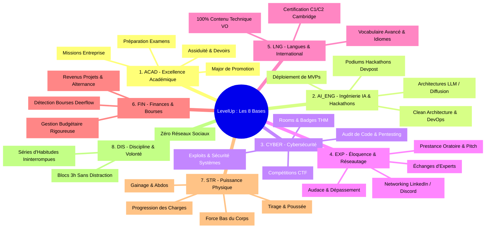
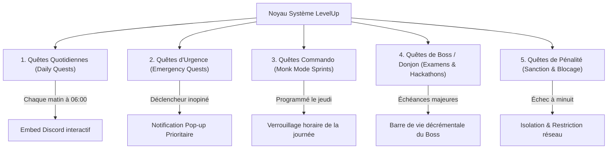

# Product Requirements Document (PRD) — LevelUp ("The System")

> **Document ID :** PRD-LVLUP-001  
> **Nom du Produit :** LevelUp  
> **Nom de Code Système :** "The System" (Le Système de l'Éveillé)  
> **Version du Document :** 2.0.0 (Spécification Industrielle Exhaustive)  
> **Statut :** Approuvé pour Implémentation Immédiate  
> **Auteur(s) :** Huriel & Lead Software Architect AI  
> **Classification :** Confidentiel / Propriétaire  

---

## 1. Contexte Stratégique & Philosophie de Conception

### 1.1 Le Problème Fondamental : La Dispersion Cognitive de l'Étudiant d'Élite
Un étudiant en Intelligence Artificielle ambitieux poursuit simultanément des objectifs à haute intensité :
1. **L'excellence académique :** Viser et maintenir la place de premier de promotion, assimiler des cours denses, préparer des examens théoriques et pratiques complexes, mener des projets scolaires et réussir son alternance en entreprise.
2. **L'ingénierie technique pure :** Concevoir des architectures logicielles, coder des MVPs opérationnels, tester de nouvelles applications, explorer les modèles de fondation, les architectures d'agents et le fine-tuning.
3. **La cybersécurité défensive et offensive :** Pratiquer quotidiennement sur TryHackMe et HackTheBox, participer à des CTF (*Capture The Flag*), auditer du code, comprendre les vulnérabilités de bas niveau et de haut niveau.
4. **L'ambition internationale & l'influence :** Maîtriser l'anglais au niveau bilingue professionnel (C1/C2 Cambridge), développer son éloquence, sa prestance, son aisance oratoire, participer activement à des hackathons compétitifs et bâtir un réseau professionnel puissant.
5. **L'émancipation financière & matérielle :** Détecter et postuler aux bourses d'excellence, financer ses études et son matériel, monétiser ses compétences en ingénierie.
6. **La fondation biologique :** Maintenir une puissance physique d'athlète (musculation, force, endurance) et une clarté mentale inaltérable grâce au sommeil et à une discipline de fer.

**La tragédie classique :** L'accumulation chaotique de ces objectifs engendre la paralysie décisionnelle, la dispersion mentale et la culpabilité. Les to-do lists conventionnelles (Todoist, Notion, Trello) échouent systématiquement car :
* Elles sont passives et manquent d'immersion psychologique.
* Elles ne fournissent aucun retour dopaminergique proportionné à l'effort réel.
* Elles traitent une tâche triviale ("acheter du pain") au même niveau qu'un exploit d'ingénierie ("rooter une machine TryHackMe Insane").
* Elles ne s'interfacent pas avec les outils réels (Discord, transcription audio, bourses d'études, code source).

### 1.2 La Solution : Le Méta-Orchestrateur "Solo Leveling"
Inspiré de l'architecture du "Système" de l'anime *Solo Leveling*, **LevelUp** ne se contente pas de lister des tâches : il transforme la réalité physique et intellectuelle de l'utilisateur en un environnement de RPG brutal, immersif et déterministe. 
Le Système ne négocie pas, ne tolère pas la médiocrité, mais récompense chaque gramme d'effort par une montée en puissance quantifiable et visible.

### 1.3 Principes Directeurs Inviolables
1. **Zéro Réinvention Artificielle (Principe du Réel) :** Le Système ne crée pas de mini-jeux ni de faux tests de niveau. Il oriente vers les standards mondiaux reconnus et gratuits : tests Cambridge English, certifications GitHub Student Developer Pack, challenges TryHackMe, cours MIT/Harvard, plateformes de hackathons Devpost.
2. **Mesure Absolue & Traçabilité :** Tout gain d'XP doit être étayé par une preuve tangible (enregistrement vocal transcrit, lien de commit GitHub, rapport de room TryHackMe, relevé de notes, logs d'entraînement).
3. **Omniprésence Silencieuse :** Le Système communique là où se trouve l'utilisateur : sur son bureau via le HUD Web holographique, sur son téléphone et ses écouteurs via le Bot Discord et la transcription vocale.
4. **Second Brain Unifié :** La mémoire de l'utilisateur n'est pas dispersée. Toutes les connaissances acquises sont indexées dans un cerveau numérique Markdown natif intégré au Système.

---

## 2. Personas Cibles & Analyse Psychologique

### Persona Principal : "L'Éveillé" (Huriel)
* **Profil :** Étudiant en Intelligence Artificielle, développeur, aspirant hacker éthique, athlète en devenir.
* **Moteurs Psychologiques :**
  * *Volonté de Puissance Intellectuelle :* Désir de dominer son domaine, d'être incontestablement le meilleur de sa promotion et d'être reconnu sur la scène internationale.
  * *Sensibilité à la Gamification Sombre :* Forte réceptivité à l'esthétique Solo Leveling (bleu néon, noir abyssal, sentiment d'appartenir à une caste d'élites disciplinées).
  * *Besoin de Cadre Exogène :* Besoin d'une autorité extérieure (Le Système / L'Architecte) qui dicte le programme de la journée pour éliminer la fatigue décisionnelle du matin.
* **Frustrations Majeures :**
  * Procrastination sur les tâches complexes sans retour immédiat.
  * Oubli des connaissances lues ou apprises quelques semaines après.
  * Difficulté à concilier sport intensif, code, cours universitaires et réseautage sans s'épuiser.

---

## 3. Les 8 Bases Fondamentales de Vie & Arbres de Compétences

Chaque statistique du joueur représente un arbre d'évolution vivant. Chaque arbre contient des nœuds de compétences hiérarchiques déblocables par l'accumulation d'XP dédiée.

### 3.1 `ACAD` — Excellence Académique & Diplôme
* **Rôle :** Sécuriser la tête de promotion, maîtriser à 100 % le cursus universitaire, exceller dans les matières théoriques et appliquées, et valoriser le travail en alternance.
* **Arbre de Compétences (Nœuds) :**
  * `ACAD-N1 (Socle Méthodologique)` : Prise de notes systématique pour 100 % des cours dans le Second Brain.
  * `ACAD-N2 (Régularité des Révisions)` : Cycle de révision à J+1, J+7, J+30 implémenté.
  * `ACAD-N3 (Maîtrise Théorique)` : Assimilation approfondie des mathématiques, probabilités, algèbre linéaire et algorithmique.
  * `ACAD-N4 (Major de Promotion)` : Moyenne générale cible $\ge 17/20$, premier de promotion sur tous les semestres.
  * `ACAD-N5 (Excellence en Entreprise)` : Livrables d'alternance certifiés de niveau ingénieur confirmé par le tuteur industriel.

### 3.2 `AI_ENG` — Ingénierie IA, Développement & Hackathons
* **Rôle :** Bâtir une expertise technique de premier plan en intelligence artificielle, créer des architectures prêtes pour la production, concevoir des MVPs percutants et triompher lors des compétitions de code.
* **Arbre de Compétences (Nœuds) :**
  * `AI_ENG-N1 (Foundational Models)` : Maîtrise des architectures Transformers, Attention Mechanisms, Tokenization et LLM APIs.
  * `AI_ENG-N2 (Agentic Systems)` : Développement d'agents autonomes, architectures multi-agents, outils MCP et orchestration.
  * `AI_ENG-N3 (Fullstack MVP Builder)` : Capacité à prototyper, coder et déployer une application web complète (Next.js, FastAPI, PostgreSQL, Tailwind) en moins de 48 heures.
  * `AI_ENG-N4 (Compétiteur Hackathon)` : Participation régulière à des hackathons mondiaux (Devpost, MLH) avec soumission de projets finalisés et primés.
  * `AI_ENG-N5 (Systèmes Distribués & MLOps)` : Docker, Kubernetes, Vector DBs (Qdrant, Pinecone), monitoring et déploiements scalables.

### 3.3 `CYBER` — Cybersécurité Défensive & Offensive
* **Rôle :** Maîtriser l'art du renseignement, de l'intrusion éthique, de la détection de vulnérabilités et de la protection des systèmes informatiques.
* **Arbre de Compétences (Nœuds) :**
  * `CYBER-N1 (Fondations Réseau & OS)` : Analyse de paquets (Wireshark), protocoles TCP/IP, administration Linux avancée.
  * `CYBER-N2 (Web Vulnerabilities)` : OWASP Top 10 maîtrisé, exploitation pratique des failles SQLi, XSS, CSRF, SSRF, IDOR.
  * `CYBER-N3 (TryHackMe Grinder)` : Complétion continue des parcours *Pre-Security*, *Complete Beginner*, *Web Fundamentals* et *Offensive Pentesting*.
  * `CYBER-N4 (Active Directory & Privesc)` : Élévation de privilèges Linux/Windows, attaques Kerberos, pivoting réseau.
  * `CYBER-N5 (CTF Gladiator)` : Classement régulier dans le top 10 % des compétitions Capture The Flag.

### 3.4 `EXP` — Éloquence, Réseautage & Audace
* **Rôle :** Développer un magnétisme social, vaincre toute timidité, pitcher des idées avec autorité et nouer des alliances stratégiques avec des pairs et mentors d'élite.
* **Arbre de Compétences (Nœuds) :**
  * `EXP-N1 (Clarté Oratoire)` : Articulation, voix posée, élimination des tics de langage, structuration en 3 points.
  * `EXP-N2 (Pitch Master)` : Capacité à présenter un projet technique de manière captivante en 60 secondes chrono.
  * `EXP-N3 (Cold Outreach)` : Envoi hebdomadaire de messages ciblés et qualitatifs à des experts de l'industrie, chercheurs et fondateurs sur LinkedIn/Twitter.
  * `EXP-N4 (Présence en Événements)` : Participation physique et virtuelle à des conférences tech, meetups et salons de l'IA.
  * `EXP-N5 (Confiance Inébranlable)` : Pratique délibérée de sorties de zone de confort social.

### 3.5 `LNG` — Langues, Anglais & Portée Internationale
* **Rôle :** Atteindre une maîtrise bilingue parfaite de l'anglais technique et littéraire pour publier, échanger et candidater au niveau mondial.
* **Arbre de Compétences (Nœuds) :**
  * `LNG-N1 (Immersion Totale)` : 100 % des vidéos, podcasts, articles et documentations consommés exclusivement en anglais VO sans sous-titres français.
  * `LNG-N2 (Vocabulaire de Pointe)` : Assimilation quotidienne de 10 termes avancés et structures idiomatiques complexes.
  * `LNG-N3 (Rédaction Fluide)` : Rédaction de documentations, READMEs et fiches de synthèse directement en anglais académique.
  * `LNG-N4 (Certification Cambridge C1/C2)` : Score certifié au Cambridge English Assessment / EF SET $\ge 75/100$ (Niveau C1 Avancé minimum).

### 3.6 `FIN` — Finances, Bourses & Stratégie Matérielle
* **Rôle :** Maximiser les ressources financières, décrocher les bourses universitaires les plus compétitives et monétiser intelligemment ses compétences d'ingénieur.
* **Arbre de Compétences (Nœuds) :**
  * `FIN-N1 (Budget Zéro-Erreur)` : Traçabilité au centime près des flux entrants et sortants dans le Système.
  * `FIN-N2 (Chasseur de Bourses)` : Candidature systématique à toutes les bourses de mobilité, bourses d'excellence et subventions étudiantes détectées par Deerflow.
  * `FIN-N3 (Exploitation des Packs Gratuits)` : Valorisation maximale du GitHub Student Developer Pack (plusieurs milliers de dollars d'outils et serveurs gratuits).
  * `FIN-N4 (Premiers Revenus Tech)` : Monétisation de projets, missions freelance ou primes de concours et hackathons.

### 3.7 `STR` — Puissance Physique & Condition Athlétique
* **Rôle :** Bâtir un corps d'acier capable d'encaisser de lourdes charges de travail intellectuel sans fléchir.
* **Arbre de Compétences (Nœuds) :**
  * `STR-N1 (Fondations Musculaires)` : Exécution parfaite des mouvements polyarticulaires (tractions, pompes lestées, dips, squat).
  * `STR-N2 (Développement Dos & Bras)` : Puissance de tirage, dos en V, force des biceps/triceps.
  * `STR-N3 (Ceinture Abdominale & Gainage)` : Stabilité du tronc, abdos solides, prévention des douleurs posturales liées au bureau.
  * `STR-N4 (Surcharge Progressive)` : Augmentation mesurée et tracée des répétitions et charges séance après séance.

### 3.8 `DIS` — Discipline, Volonté & Résilience Mentale
* **Rôle :** Le catalyseur de tous les autres attributs : la capacité à s'asseoir et à travailler intensément même sans motivation, et l'immunité contre les pièges de la distraction numérique.
* **Arbre de Compétences (Nœuds) :**
  * `DIS-N1 (Zéro Distraction)` : Élimination totale du scroll passif sur TikTok/Instagram/Reels durant les plages de travail.
  * `DIS-N2 (Deep Work Sanctuaire)` : Capacité à tenir des sessions ininterrompues de 90 à 180 minutes en état de flow absolu.
  * `DIS-N3 (Tenue des Engagements)` : Clôture de 100 % des quêtes quotidiennes avant minuit pendant 30 jours consécutifs.
  * `DIS-N4 (Résilience Face à l'Échec)` : Capacité à rebondir immédiatement après une mauvaise note ou un échec sans rupture de routine.

---

## 4. L'Échelle des 9 Rangs Officiels

Chaque palier de rang débloque un titre solennel, de nouvelles fonctionnalités dans le Système et des privilèges spécifiques :

| Rang | Titre Système | Conditions d'Obtention | Privilèges & Fonctionnalités Débloqués |
| :--- | :--- | :--- | :--- |
| **Rang F** | *Civil / Non-Éveillé* | Niveau de départ (Niveau 1 à 4). | Accès au HUD Web de base, Quêtes Quotidiennes (3 quêtes fixes). |
| **Rang E** | *Éveillé Novice* | Niveau 5 atteint ($\ge 1\,200\text{ XP}$), 7 jours de discipline consécutifs. | Déblocage de la transcription vocale et intégration du Second Brain. |
| **Rang D** | *Chasseur Confirmé* | Niveau 12 atteint ($\ge 5\,800\text{ XP}$), 15 rooms TryHackMe validées. | Déblocage des Quêtes d'Urgence instantanées via Discord. |
| **Rang C** | *Chasseur d'Élite* | Niveau 22 atteint ($\ge 18\,500\text{ XP}$), 1er Hackathon terminé, Anglais B2 certifié. | Déblocage de l'accès au Radar Deerflow (scraping automatique des bourses). |
| **Rang B** | *Commandant de Guilde* | Niveau 35 atteint ($\ge 46\,000\text{ XP}$), Top 3 de promotion universitaire. | Déblocage du Planificateur de Journées Commando (Monk Mode Sprints). |
| **Rang A** | *Maître de Donjon* | Niveau 50 atteint ($\ge 92\,000\text{ XP}$), Major de promo officiel, MVP déployé. | Déblocage de l'évaluation avancée par l'Architecte IA avec recommandations prédictives. |
| **Rang S** | *Chasseur Suprême* | Niveau 70 atteint ($\ge 185\,000\text{ XP}$), Bourse d'excellence décrochée, C1 Cambridge. | Accès au mode "Donjon de Raid" (gestion de projets d'envergure internationale). |
| **Nation** | *Héros National* | Niveau 85 atteint ($\ge 310\,000\text{ XP}$), impact financier direct $\ge 10\,000$€ ou distinction nationale. | Déblocage des alertes temps réel prioritaires et monitoring global. |
| **Monarque** | *Le Monarque de l'Ombre* | Niveau 100 atteint ($\ge 500\,000\text{ XP}$), maîtrise souveraine des 8 bases. | Statut Légendaire : interface dorée/pourpre, automatisation totale des flux de vie. |

---

## 5. Typologie Complète des Quêtes & Moteur Événementiel

### 5.1 Quêtes Quotidiennes (`Daily Quests`)
* **Déclenchement :** Générées chaque matin à 06h00 UTC par l'Architecte IA d'Antigravity.
* **Composition Standard (4 Quêtes Obligatoires) :**
  1. *Éveil Physique :* Séance de sport ciblée (ex: 45 min dos/abdos) $\rightarrow$ `+100 XP STR`.
  2. *Entraînement Technique :* 1 room TryHackMe ou 1h de code MVP $\rightarrow$ `+150 XP CYBER` ou `+150 XP AI_ENG`.
  3. *Acquisition Intellectuelle :* Lecture de 20 pages d'un livre d'ingénierie/IA avec dictée vocale d'un résumé de 3 minutes $\rightarrow$ `+120 XP ACAD / DIS`.
  4. *Immersion Internationale :* 30 min d'écoute VO technique ou pratique Cambridge $\rightarrow$ `+80 XP LNG`.
* **Échéance :** 23h59 UTC. En cas de non-validation, bascule automatique vers la procédure de pénalité.

### 5.2 Quêtes d'Urgence (`Emergency / Instant Quests`)
* **Déclenchement :** Aléatoire ou opportuniste (1 à 3 fois par semaine), générées par le Système lorsqu'une opportunité à forte valeur ajoutée apparaît (nouveau papier de recherche IA révolutionnaire, annonce de hackathon avec deadline courte, room TryHackMe CTF temporaire).
* **Fenêtre Temporelle :** Temps limité strict (ex: 45 minutes à 2 heures).
* **Récompense :** Multiplicateur d'XP $\times 2.0$ et bonus temporaire de concentration.

### 5.3 Quêtes de Donjon / Boss (`Boss Raids`)
* **Application :** Épreuves majeures du monde réel.
  * *Boss de Partiels :* Semaine d'examens universitaires. Le Boss possède 1000 HP. Chaque chapitre de cours révisé et testé lui inflige 100 dégâts.
  * *Boss Hackathon :* Compétition de code de 48 heures. Le Boss possède 2000 HP. Chaque étape (Idéation, Architecture, Backend, Frontend, Déploiement, Pitch) décrémente ses HP.
* **Victoire :** Déblocage d'un Titre Spécial, montée instantanée d'un palier de niveau et coffre de récompenses.

### 5.4 Quêtes de Changement de Classe (`Monk Mode Sprints`)
* **Concept :** Inspiré de la journée commando de Sung Jin-Woo dans la forêt des démons. Journée programmée (ex: le jeudi commando) où l'agenda est verrouillé en mode commando :
  * `06:00 - 07:30` : Réveil, hydratation, musculation lourde.
  * `08:00 - 11:30` : Bloc 1 Deep Work (Mathématiques & Recherche IA).
  * `11:30 - 12:30` : Pause nutritionnelle & marche sans téléphone.
  * `12:30 - 15:30` : Bloc 2 Deep Work (Cybersécurité TryHackMe / CTF).
  * `16:00 - 18:30` : Bloc 3 Deep Work (Développement MVP & Code pur).
  * `19:00 - 20:30` : Lecture & Dictée vocale des fiches dans le Second Brain.
  * `21:00 - 22:00` : Déconnexion totale des écrans, préparation au sommeil.

### 5.5 Quêtes de Pénalité (`Penalty Quests`)
* **Déclenchement :** Activé si les Quêtes Quotidiennes ne sont pas validées avant minuit sans justification légitime (ex: maladie déclarée).
* **Sanction Immédiate :**
  1. *Message solennel du Système :* Embed rouge sang sur Discord avec avertissement officiel.
  2. *Épreuve de rachat :* Quête de rattrapage le lendemain matin dès 05h30 (séance physique intensifiée ou 2 heures d'études forcées avant tout loisir).
  3. *Restriction Réseau (Option Active V1.5) :* Déclenchement d'un script local bloquant la résolution DNS et l'accès IP aux applications récréatives (TikTok, YouTube, Twitter) jusqu'à validation de l'épreuve de rachat.

---

## 6. Le Cerveau Numérique Natif (Second Brain Intégré)

Le Système intègre un gestionnaire de connaissances complet inspiré d'Obsidian :
1. **Format Ouvert Markdown (`.md`) :** Aucun verrouillage propriétaire. Les notes sont stockées sous forme de fichiers texte brut avec métadonnées frontmatter YAML.
2. **Liens Bidirectionnels (Wikilinks) :** Syntaxe native `[[TitreDeNote]]` permettant de connecter des concepts d'IA avec des fiches de cybersécurité ou des cours de mathématiques.
3. **Tags Hiérarchiques :** Organisation par mots-clés : `#acad/partiels`, `#cyber/sql-injection`, `#ai/transformers`.
4. **Dictée Vocale Intégrée :** Un bouton d'enregistrement audio dans l'application web ou une commande vocale Discord transcrit automatiquement les paroles via Whisper / Gemini Flash, génère un résumé structuré et crée immédiatement la fiche de révision correspondante.

---

## 7. Critères d'Acceptation Globaux (Definition of Done du Produit)

Le produit LevelUp V1.0 est déclaré conforme et prêt à l'emploi si et seulement si :
* [ ] Le HUD Web Solo Leveling se charge avec fluidité en moins de 800 ms avec ses deux thèmes (Sombre & Clair).
* [ ] Les 8 bases fondamentales et leurs arbres de progression sont instanciés avec des formules de calcul déterministes.
* [ ] Le Bot Discord transmet les quêtes chaque matin, permet la validation par boutons et synchronise les données en temps réel.
* [ ] La transcription vocale convertit un flux audio de 2 minutes en note Markdown formatée en moins de 5 secondes.
* [ ] L'Agent Architecte résidant dans Antigravity évalue les synthèses déposées et calibre l'XP de façon rigoureuse sans hallucination.
* [ ] Le connecteur Deerflow détecte et référence les bourses d'études et hackathons actifs sans intervention manuelle.
* [ ] 100 % des tests du cahier de recette (`07-TEST_PLAN.md`) passent au vert sans aucune régression.
