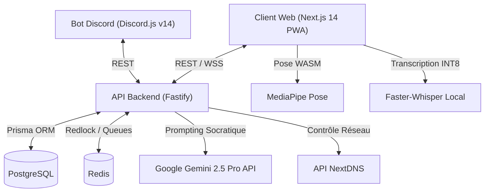

# Technical Requirements Document (TRD) — LevelUp

> **Document ID :** TRD-LVLUP-002  
> **Version :** 3.1.0 (Édition Pareto Simplifiée)  
> **Statut :** Approuvé pour Implémentation  

---

## 1. Architecture Système & Découpage C4

LevelUp est articulé autour d'un monorepo Turborepo géré avec pnpm :



---

## 2. Décomposition des Composants & Packages

| Package / Application | Rôle Technique | Technologies Clés |
| :--- | :--- | :--- |
| **`apps/web`** | Interface utilisateur (HUD, Quêtes, Caméra, Audio) | Next.js 14, Tailwind CSS, Framer Motion, Dexie.js |
| **`apps/api`** | Moteur backend, authentification, routes métier, WebSocket | Fastify, Zod, @fastify/websocket, Prisma Client |
| **`apps/bot`** | Bot Discord, commandes slash, stream vocal UDP | Discord.js v14, @discordjs/voice, Prism-media |
| **`packages/contracts`** | Types partagés, schémas Zod, calculs d'XP et rangs | TypeScript, Zod |
| **`packages/crypto`** | Chiffrement d'enveloppe et signatures d'oracles | Node.js Crypto, Argon2id, AES-256-GCM |
| **`packages/database`** | Modèles de données, migrations et seeds | Prisma ORM, PostgreSQL, SQLite (local) |
| **`packages/engine`** | Logique métier (SM-2, moyenne harmonique, jauges) | Algorithmes purs TypeScript |

---

## 3. Spécifications Backend Fastify (`apps/api`)

### 3.1 Standards & Middleware
* **Validation** : Tout payload d'entrée et de sortie est validé via Zod (`fastify-type-provider-zod`).
* **Concurrence & Anti-Double Dépense** :
  L'attribution de points d'expérience lors de la complétion d'une quête est encapsulée dans un verrou distribué Redis (**Redlock**) :
  ```typescript
  const lock = await redlock.acquire([`locks:quest:${userId}:${questId}`], 5000);
  try {
    return await prisma.$transaction(async (tx) => {
      // Vérification idempotence + Attribution atomique XP
    });
  } finally {
    await lock.release();
  }
  ```
* **WebSockets** : Émission en temps réel des changements d'état (`HP`, `MP`, `XP`, statut de restriction) vers le Web HUD.

---

## 4. Spécifications Frontend Next.js (`apps/web`)

* **App Router (`app/`)** : Découpage par routes fonctionnelles (`/dashboard`, `/quests`, `/workout`, `/audio`, `/penalty`).
* **Offline-First (PWA)** : Enregistrement des actions hors-ligne dans IndexedDB via **Dexie.js** avec synchronisation automatique dès retour de la connectivité.
* **Optimisation Performance** : Mise en pause automatique des animations canvas/particules pendant le rendu de flux vidéo haute résolution afin d'alléger la charge CPU/GPU.

---

## 5. Sous-Systèmes Spécifiques

### 5.1 Pipeline Audio & Évaluation Socratique
1. Enregistrement audio au format Opus / WAV via microphone navigateur ou bot Discord.
2. Transcription par **Faster-Whisper** avec modèle quantifié INT8 pour une inférence locale sans latence.
3. Analyse socratique par l'API Gemini 2.5 Pro selon la grille officielle des 20 points (retour JSON strict).

### 5.2 Superviseur de Pose Cinématique (MediaPipe)
* Inférence cinématique locale exécutée sur le GPU client via MediaPipe Pose (WebAssembly).
* Détection des angles articulaires clés (coude, genou, hanche) avec tolérance paramétrable et anti-falsification.

### 5.3 Moteur de Restriction Réseau (NextDNS & WFP)
* Déclenchement automatique par tâche cron BullMQ si quêtes obligatoires non validées à 22h00.
* Appel API : `POST https://api.nextdns.io/profiles/{profile_id}/denylist` pour injecter la liste des domaines distrayants.
* Synchronisation locale avec les règles Windows Filtering Platform (WFP) et redirection hosts.

### 5.4 Répétition Espacée (Algorithme SM-2)
* Calcul du facteur d'aisance ($EF$) et de l'intervalle ($I_n$) selon la qualité de restitution $q \in \{0, \dots, 5\}$ :
  $$EF' = \max\left(1.3, \; EF + \left(0.1 - (5 - q) \cdot (0.08 + (5 - q) \cdot 0.02)\right)\right)$$
  $$I_n = \begin{cases} 1 & \text{si } n = 1 \\ 6 & \text{si } n = 2 \\ \lceil I_{n-1} \times EF' \rceil & \text{si } n > 2 \end{cases}$$
