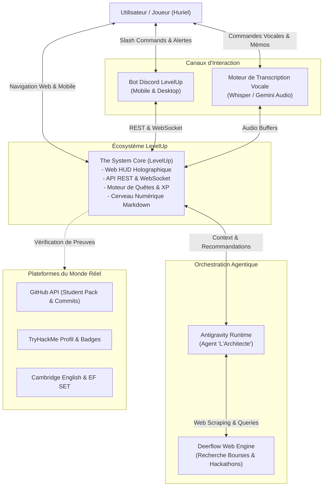
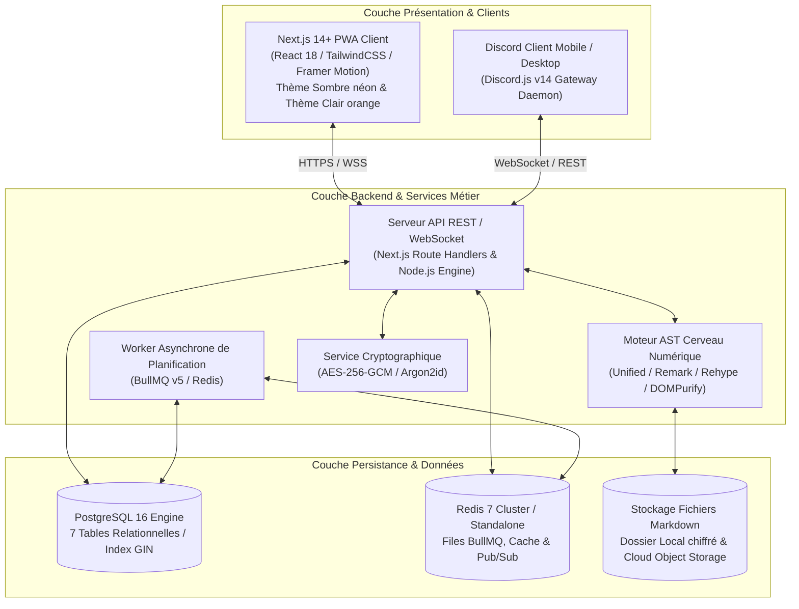
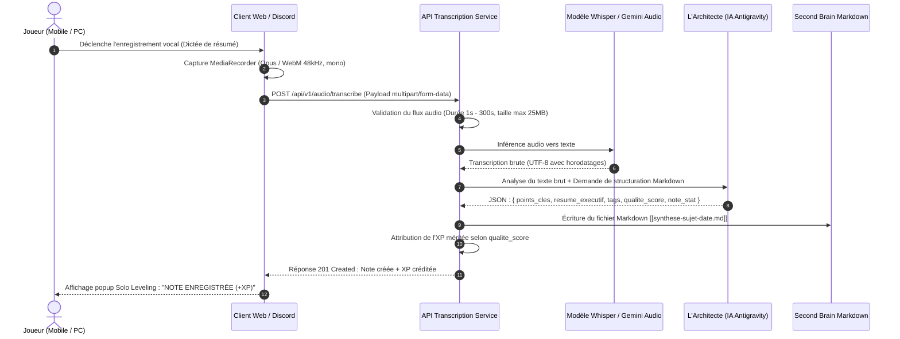
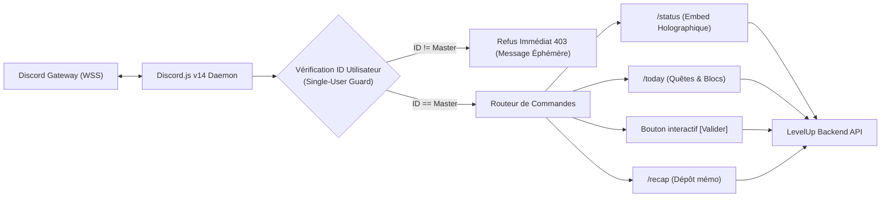

# Technical Requirements Document (TRD) — LevelUp ("The System")

> **Document ID :** TRD-LVLUP-002  
> **Nom du Produit :** LevelUp  
> **Version du Document :** 2.0.0 (Spécification d'Ingénierie Exhaustive)  
> **Statut :** Validé pour Implémentation  
> **Auteur :** Lead Software Architect AI  
> **Architecture Globale :** Hybride Local-First & Micro-Services Connectés

---

## 1. Cartographie de l'Architecture Système (Modèle C4)

### 1.1 Niveau 1 : Diagramme de Contexte Système

### 1.2 Niveau 2 : Diagramme de Conteneurs Applicatifs

---

## 2. Choix Technologiques Détaillés & Rationale d'Ingénierie

### 2.1 Frontend HUD : Next.js 14+ (App Router), TailwindCSS & Framer Motion
* **Rationale :**
  * *Rendu Hybride (SSR / RSC / Client Components) :* Chargement initial instantané du profil joueur via Server Components, avec composants réactifs interactifs pour le chronomètre de Time-Blocking et les animations d'XP.
  * *Esthétique Solo Leveling :* Utilisation de classes utilitaires Tailwind avec variables CSS dynamiques :
    * Thème Sombre (*The Monarch*) : Couleurs primaires `#05050A` (noir abyssal), `#00E5FF` (cyan néon), `#0051FF` (bleu électrique royal), reflets en *glassmorphism* avec `backdrop-blur-md` et ombres portées `box-shadow: 0 0 25px rgba(0, 229, 255, 0.3)`.
    * Thème Clair (*Awakening*) : Couleurs primaires `#FFFFFF` (blanc titane), `#F8FAFC` (albâtre givré), `#FF6B00` (orange système tactique).
  * *Framer Motion :* Animation fluide des barres de progression d'expérience, décompte numérique des points d'XP (effet compteur roulant), animations des popups d'alerte *"SYSTEM NOTIFICATION"*.

### 2.2 Backend & API : Node.js / TypeScript Stricte
* **Rationale :**
  * Typage end-to-end de bout en bout partagé entre l'API, le HUD et le Bot Discord via des schémas de validation Zod unifiés (`@levelup/contracts`).
  * Architecture modulaire structurée en couches :
    * `controllers/` : Gestion des requêtes HTTP et formats de sortie.
    * `services/` : Logique métier pure (moteur de calcul d'XP, machine à états des rangs).
    * `repositories/` : Abstraction d'accès aux données via Prisma ORM.
    * `workers/` : Tâches de fond et alarmes déportées.

### 2.3 Persistance & Base de Données : PostgreSQL 16 & Redis 7
* **PostgreSQL 16 :**
  * Support natif des identifiants UUID v4 pour l'ensemble des clés primaires.
  * Utilisation du type `BIGINT` pour les compteurs d'XP cumulative afin d'éviter tout dépassement d'entier 32-bit.
  * Index GiST / GIN pour la recherche plein texte ultrarapide sur l'intégralité du Cerveau Numérique Markdown.
  * Contraintes d'intégrité CHECK garantissant qu'aucune valeur de stat ou de niveau ne dévie des règles métier.
* **Redis 7 :**
  * Moteur de file d'attente pour **BullMQ** (gestion des alarmes, rappels de transition, jobs de synchronisation).
  * Cache mémoire ultra-rapide pour l'état de session et le statut actif du joueur.
  * Mécanisme de Verrouillage Distribué (*Distributed Locks via Redlock*) pour interdire formellement toute double validation concurrente de quête.

---

## 3. Architecture du Pipeline de Transcription Vocale

### 3.1 Spécifications Techniques Audio
* **Format d'Enregistrement :** WebM avec codec Opus à un débit de 64 kbps (mono), taux d'échantillonnage de 48 000 Hz, assurant une clarté optimale pour la reconnaissance vocale tout en limitant la taille réseau ($< 500\text{ Ko}$ par minute d'audio).
* **Détection d'Activité Vocale (VAD) :** Analyse préalable de l'énergie acoustique (RMS). Si l'énergie moyenne est sous le seuil de bruit de fond pendant l'intégralité du fichier, rejet propre avec code HTTP `422 Unprocessable Entity` ("Flux audio silencieux").
* **Fallback & Haute Disponibilité :** En cas d'indisponibilité de l'API Whisper locale, bascule automatique transparente vers l'endpoint audio multimodal de Gemini 1.5 Flash.

---

## 4. Architecture du Bot Discord (Passerelle Temps Réel)

### 4.1 Caractéristiques Techniques du Bot
* **Bibliothèque :** `discord.js` v14 avec support complet des composants d'interaction (Boutons `ButtonBuilder`, Menus déroulants `StringSelectMenuBuilder`, Modales de saisie `ModalBuilder`).
* **Intents Minimum Nécessaires :** `GatewayIntentBits.Guilds`, `GatewayIntentBits.GuildMessages`, `GatewayIntentBits.DirectMessages`. Zéro intent privilégié inutile pour maximiser la sécurité.
* **Sécurité & Contrôle d'Accès Stricte :** Le bot compare chaque `interaction.user.id` avec la constante système `DISCORD_MASTER_USER_ID`. Si un utilisateur externe tente d'interagir avec le bot, l'interaction est immédiatement avortée sans aucune fuite d'information.

---

## 5. Moteur de Planification Temporelle (Time-Blocking & Queue BullMQ)

Le respect du planning impose un moteur de tâches d'arrière-plan d'une fiabilité absolue :
* **File d'Attente Dédiée :** File BullMQ `schedule-alarms` alimentée par Redis.
* **Typologie des Jobs :**
  1. `DAILY_QUEST_GENERATOR` : Exécution programmée à 06h00 UTC chaque matin.
  2. `BLOCK_TRANSITION_ALARM` : Job retardé (*delayed job*) programmé pour chaque début et fin de bloc de travail.
  3. `MIDNIGHT_RESOLVER` : Exécution à 23h59 UTC pour clôturer les quêtes, vérifier les taux de complétion et déclencher la zone de pénalité en cas d'abandon.
* **Stratégie de Reprise sur Incident (*Retry Policy*) :**
  * 3 tentatives automatiques en cas d'échec réseau.
  * Backoff exponentiel : $1\text{ s} \rightarrow 5\text{ s} \rightarrow 25\text{ s}$.
  * Dead Letter Queue (DLQ) pour tout job corrompu afin de ne jamais bloquer la file d'attente.

---

## 6. L'Agent "L'Architecte" (Antigravity & Deerflow)

### 6.1 Rôle de l'Agent dans Antigravity
L'Architecte n'est pas un simple chatbot conversationnel : c'est un agent d'ingénierie autonome avec des responsabilités précises :
1. **Évaluation Sévère & Juste :** Lors de la soumission d'une synthèse d'étude ou de lecture, l'Architecte analyse :
   * L'originalité et la profondeur de la réflexion.
   * L'exactitude technique des concepts abordés.
   * La concision et la structure des points clés.
   * Il attribue une note sur 20 et module le gain d'XP en conséquence (0 XP pour une note $< 10/20$, XP nominale pour une note $\ge 15/20$).
2. **Génération de Programme Personnalisé :** L'Architecte prend en compte les échéances universitaires réelles, le niveau de fatigue physique (jauge HP) et les priorités de la semaine pour produire le découpage optimal des blocs de temps.

### 6.2 Connecteur Deerflow (Chasseur de Bourses & Opportunités)
* **Mécanisme :** Exécution de requêtes de veille ciblées toutes les 72 heures :
  * Mots-clés : `"Bourse d'études intelligence artificielle"`, `"AI master scholarship Europe"`, `"Hackathon Devpost AI ML"`, `"Subvention mobilité étudiante tech"`.
* **Traitement & Filtrage :** Déduplication des opportunités par URL canonique, vérification que la date limite de candidature est supérieure à $J+7$, et insertion automatique dans la table `opportunities` avec notification sur le HUD.
