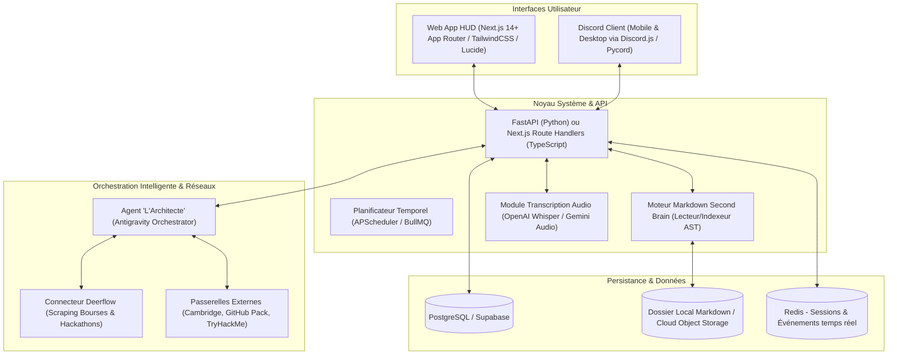

# Technical Requirements Document (TRD) — LevelUp

> **Nom du Projet :** LevelUp ("The System")  
> **Version :** 1.0.0  
> **Architecture Globale :** Hybride Cloud & Local-First (Web Responsive + Bot Discord + Moteur Agentique)

---

## 1. Choix de la Stack Technique

### 1.1 Composants Techniques Retenus
* **Frontend HUD (Web & Mobile PWA) :** Next.js 14+ (App Router), React, TypeScript, TailwindCSS (palette Solo Leveling personnalisée : `#05050A`, `#00E5FF`, `#FF6B00`), Framer Motion (animations holographiques et popups d'alerte du Système), Radix UI.
* **Backend API & Service de Quêtes :** Node.js / TypeScript ou Python FastAPI pour les pipelines d'IA et de transcription. API REST unifiée avec validation de schéma Zod / Pydantic.
* **Cerveau Numérique Intégré :** Éditeur Markdown intégré (TipTap ou CodeMirror 6) avec support des liens wikilinks `[[Note]]`, tags `#tag` et parsing d'arborescence.
* **Bot Discord :** Discord.js v14 ou Disnake/Pycord avec support des Slash Commands, Embeds interactifs enrichis et Component Buttons (`ButtonBuilder`).
* **Transcription Vocale :** Moteur Whisper API (OpenAI) ou Gemini 1.5 Flash Audio pour la transcription instantanée avec horodatage et synthèse des points clés.
* **Base de Données & ORM :** PostgreSQL (local ou Supabase) avec Prisma ORM ou SQLAlchemy.
* **Planificateur & Background Jobs :** BullMQ / Redis pour le déclenchement exact des alarmes, notifications Discord à l'heure pile et réinitialisation des quêtes quotidiennes à minuit.
* **Orchestration IA :** Antigravity Agent Runtime connectant l'Agent Architecte, l'API Gemini et l'outil de recherche Deerflow.

---

## 2. Exigences Non-Fonctionnelles (NFR)

### 2.1 Performance & Latence
* **Affichage du HUD :** Rendu initial (First Contentful Paint) $< 800\text{ ms}$.
* **Notifications Discord :** Déclenchement de l'alerte à la seconde exacte de la programmation ($< 2\text{ s}$ de gigue max).
* **Transcription Audio :** Traitement d'un mémo vocal de 2 minutes en moins de $5\text{ s}$.

### 2.2 Disponibilité & Résilience
* Le système doit fonctionner en mode **Local-First Dégradé** : si la connexion Internet est coupée, l'application Web locale continue d'enregistrer les notes dans le Second Brain et de valider les quêtes hors ligne, avec synchronisation différée dès le retour du réseau.

### 2.3 Sécurité & Confidentialité des Données
* Les données d'objectifs, de notes personnelles et de finances restent strictement privées.
* Chiffrement des tokens Discord, clés API Gemini et credentials au repos via AES-256-GCM.
* Zéro clé secrète exposée au client web.

---

## 3. Matrice d'Intégration Externe

1. **Discord API :** Webhooks et passerelle Gateway WebSocket pour les interactions instantanées avec boutons et modales.
2. **Deerflow API :** Exécution de requêtes asynchrones pour la détection de bourses universitaires et concours d'ingénierie.
3. **Plateformes Éducatives :**
   * GitHub API : Vérification du statut étudiant et des contributions.
   * TryHackMe / HackTheBox : Extraction publique de profil (badges et rangs).
   * Cambridge / Organismes de test : Suivi des scores via justificatifs téléversés.
