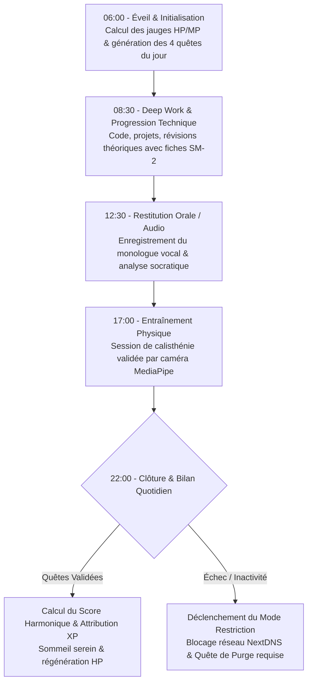
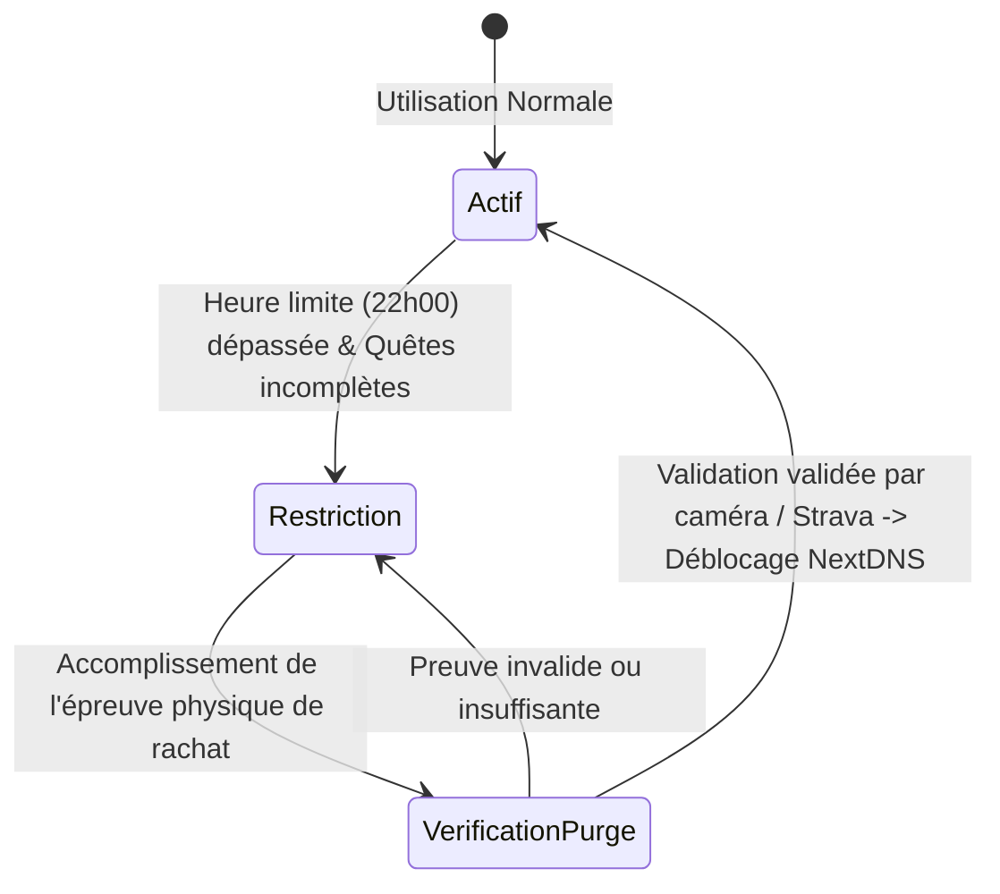

# Application Flow & Expérience Utilisateur — LevelUp

> **Document ID :** FLO-LVLUP-003  
> **Version :** 3.1.0 (Édition Pareto Simplifiée)  
> **Statut :** Approuvé pour Implémentation  

---

## 1. Cycle de Vie Quotidien de l'Utilisateur (La Boucle Principale)

Le système LevelUp structure chaque journée autour d'un flux déterministe en 5 étapes clés :

---

## 2. Arborescence des Écrans & Navigation

| Route | Écran | Description Fonctionnelle |
| :--- | :--- | :--- |
| `/` | **Écran d'Accueil / Splash** | Vidéo d'introduction holographique (8s) puis transition automatique vers le HUD. |
| `/dashboard` | **Web HUD Central** | Visualisation du radar des 8 bases, jauges de vitalité ($HP$/$MP$), quêtes prioritaires. |
| `/quests` | **Tableau des Quêtes** | Liste des quêtes quotidiennes, défis d'urgence et soumission de preuves (liens, textes). |
| `/workout` | **Caméra d'Entraînement** | Flux vidéo avec détection cinématique MediaPipe Pose, chronomètres et compteur de répétitions. |
| `/audio` | **Enregistreur Vocal** | Interface d'enregistrement pour les synthèses orales avec retour en direct de la note /20. |
| `/skills` | **Arbre des Compétences** | Graphe interactif (DAG) des 120 compétences réparties sur les 8 bases avec statut débloqué. |
| `/penalty` | **Mode Restriction** | Écran d'alerte rouge affiché lors d'une sanction, indiquant la quête de purge nécessaire. |

---

## 3. Machine à États du Mode Restriction (Sanction)

### Mécanisme de Déblocage (Quête de Purge)
* Dès l'activation de la restriction, l'accès internet est verrouillé sur les sites récréatifs via NextDNS.
* L'utilisateur doit valider une épreuve physique exigeante (ex: 200 pompes ou 10 km de marche/course) pour que le webhook de déverrouillage NextDNS soit envoyé.
