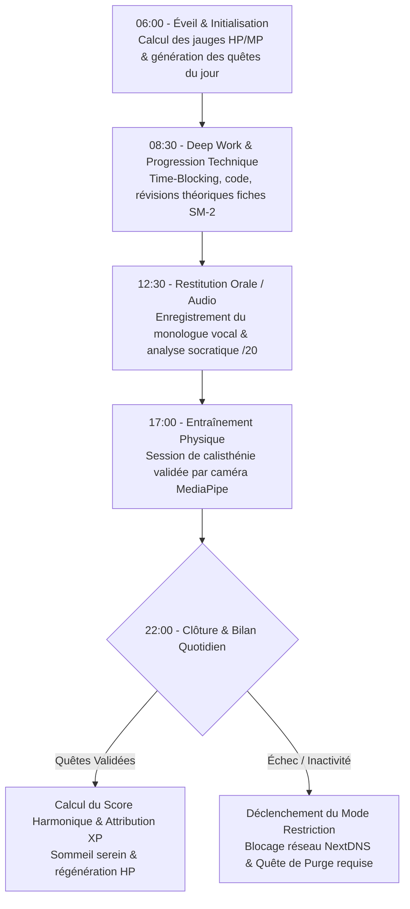
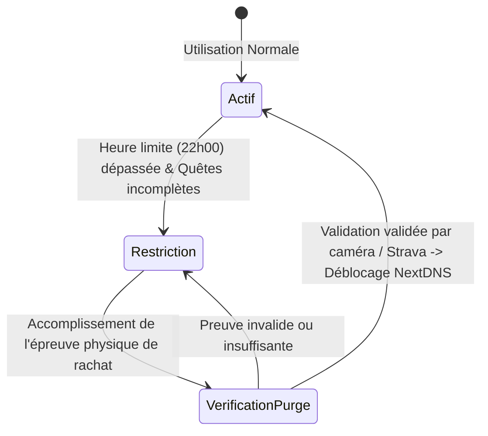

# Application Flow & Expérience Utilisateur — LevelUp

> **Document ID :** FLO-LVLUP-003  
> **Version :** 3.1.0 (Édition Pareto Complète)  
> **Statut :** Approuvé pour Implémentation  

---

## 1. Cycle de Vie Quotidien de l'Utilisateur (La Boucle Principale)

Le système LevelUp structure chaque journée autour d'un flux déterministe en 5 étapes clés :

---

## 2. Arborescence des Écrans & Navigation (Les 10 Écrans Canoniques)

| Route / Vue | Écran | Description Fonctionnelle |
| :--- | :--- | :--- |
| `/` | **Splash / Intro** | Vidéo d'introduction holographique puis transition vers le Web HUD. |
| `/dashboard` | **Web HUD Central** | Visualisation radar des 8 bases, jauges $HP$/$MP$, quêtes prioritaires, rang et XP. |
| `/quests` | **Tableau des Quêtes** | Quêtes journalières, défis d'urgence et soumission de preuves atomiques (GitHub, Strava). |
| `/planner` | **Agenda Circadien & Pomodoro** | Time-Blocking de la journée (06h-22h), suivi des blocs et minuteur Pomodoro 25 min. |
| `/workout` | **Caméra d'Entraînement** | Détection posturale MediaPipe Pose, comptage strict des répétitions et routines guidées. |
| `/audio` | **Enregistreur Vocal Socratique** | Restitution orale en direct, analyse spectrale FFT, transcription Faster-Whisper et note /20. |
| `/skills` | **Arbre des Compétences** | Graphe interactif (DAG) des 120 compétences réparties sur les 8 bases avec prérequis. |
| `/notes` | **Second Brain (Obsidian Vault)** | Édition Markdown avec formules $\LaTeX$ (KaTeX), backlinks et répétition espacée SM-2. |
| `/opportunities` | **Veille Stratégique Deerflow** | Scraper d'opportunités à fort impact (bourses $\\ge 5\\,000$ €, grands hackathons, subventions). |
| `/shop` | **Inventaire du Chasseur** | Gestion des reliques, potions de vitalité/mana et activation du Pass Jour de Repos hebdomadaire. |
| `/penalty` | **Mode Restriction** | Écran d'alerte rouge affiché lors d'un verrouillage NextDNS avec sélection de quête de purge. |

---

## 3. Machine à États du Mode Restriction (Sanction)

### Mécanisme de Déblocage (Quête de Purge)
* Dès l'activation de la restriction à 22h00, l'accès internet est verrouillé sur les plateformes récréatives via NextDNS et pare-feu local.
* L'utilisateur doit valider une épreuve physique exigeante (ex: 200 pompes calisthéniques validées par vision ou 10 km de course) pour que le signal de déverrouillage soit transmis.

---

## 4. Canaux d'Interaction Omnicanaux (Bot Discord & Serveur MCP)

En complément du Web HUD, le système est pilotable via deux canaux opérationnels continus :

### 4.1 Bot Discord (`apps/bot`)
* **Pilotage Mobile & Slash Commands** : `/status`, `/valider`, `/stats`, `/programme`, `/cours`, `/monologue`, `/boutique`, `/penalite`, `/help`.
* **Streaming Audio Vocal (UDP/Opus)** : Le bot rejoint le salon vocal de l'utilisateur, capture le flux audio en direct, et déclenche la transcription Faster-Whisper et la notation socratique /20 sans ouvrir le navigateur.

### 4.2 Serveur MCP LevelUp (`services/mcp`)
* **Interopérabilité Agents IA (Antigravity, Claude, Cursor)** : Exposition d'outils JSON-RPC standardisés permettant aux assistants IA d'auditer les quêtes, d'analyser les preuves, d'évaluer les monologues oraux et de synchroniser le planning Time-Blocking.
