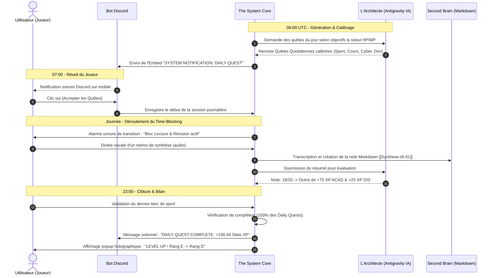

# Flux Applicatif & Expérience Utilisateur (UX Flow) — LevelUp

> **Nom du Projet :** LevelUp ("The System")  
> **Version :** 1.0.0  

---

## 1. La Journée Type : Cinématique de la Boucle Quotidienne

---

## 2. Cartographie des Vues & Écrans (Web HUD)

### 2.1 Écran Principal : `HUD_DASHBOARD`
* **En-tête de Statut :**
  * Pseudo du Joueur & Titre Actuel (ex: *"Apprenti Chasseur"*, *"Éveillé de Rang C"*).
  * Niveau global avec barre de progression d'expérience dynamique.
  * Jauge `HP` (Santé/Sommeil) et Jauge `MP` (Concentration/Focus disponible).
* **Les 8 Sphères d'Attributs (Radar Chart & Arbres) :**
  * Vue synthétique des 8 bases (`ACAD`, `AI_ENG`, `CYBER`, `EXP`, `LNG`, `FIN`, `STR`, `DIS`).
  * Clic sur une sphère $\rightarrow$ ouverture de l'arbre de sous-compétences avec nœuds débloqués et en cours.
* **Le Bloc Actuel (Time-Blocking) :**
  * Compteur à rebours holographique du bloc en cours (ex: *"14:00 - 16:00 : Entraînement TryHackMe Buffer Overflow"*).
  * Bouton d'alarme et statut de concentration.

### 2.2 Écran Quêtes : `QUEST_LOG`
* Onglets :
  * **Quotidiennes :** Liste des 4 à 6 quêtes obligatoires avec cases interactives et preuves requises.
  * **Urgences :** Quêtes temporisées actives avec chronomètre d'expiration.
  * **Donjons & Boss :** Projets d'envergure (Partiels, Hackathons, MVPs) avec la barre de vie du Boss.
  * **Changement de Classe :** Programmation des journées commando (Monk Mode).

### 2.3 Écran Cerveau Numérique : `SECOND_BRAIN_STUDIO`
* Explorateur de fichiers Markdown natif (`/notes/cours/`, `/notes/livres/`, `/notes/cyber/`).
* Éditeur riche avec coloration syntaxique, support mathématique LaTeX et wikilinks `[[NomDeNote]]`.
* Bouton d'enregistrement vocal direct : enregistrement $\rightarrow$ Whisper $\rightarrow$ insertion instantanée du texte formaté.

### 2.4 Écran Radar d'Opportunités : `DEERFLOW_ORACLE`
* Flux continu des bourses d'études mondiales détectées pour étudiants en IA.
* Calendrier des hackathons majeurs (Devpost, MLH, plateformes régionales) avec boutons *Participer / Ajouter au Donjon*.

---

## 3. Gestion des États d'Interface

| Composant | État Initial / Normal | État d'Alerte / Urgence | État d'Échec / Pénalité |
| :--- | :--- | :--- | :--- |
| **Bordures de fenêtres** | Lueur bleu électrique néon discrète | Clignotement rouge/ambré avec message "EMERGENCY QUEST" | Teinte pourpre sombre avec message de verrouillage |
| **Jauge MP** | Remplie en cyan lumineux | Devient ambrée en cas de surmenage | Passe en grisé ("Épuisement mental - Pause forcée") |
| **Notifications Discord** | Embed standard formaté | Mention `@everyone` prioritaire avec compte à rebours | Alerte de sanction système |
