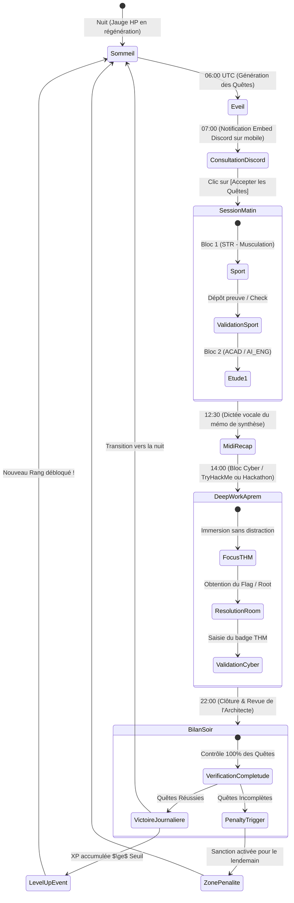

# Flux Applicatif, Parcours Utilisateur & Spécifications UX — LevelUp

> **Document ID :** UX-LVLUP-003  
> **Nom du Produit :** LevelUp ("The System")  
> **Version du Document :** 2.0.0 (Spécification d'Interface & Flux Exhaustive)  
> **Statut :** Validé pour Implémentation  
> **Auteur :** Lead UX/UI Designer & Software Architect AI  

---

## 1. La Cinématique de la Journée d'Élite (Parcours Utilisateur Complet)

La vie de l'utilisateur avec LevelUp est orchestrée comme une succession de phases scénarisées :



---

## 2. Spécification Détaillée des Écrans (Wireframes & Wireflows)

### 2.1 Écran 1 : Le Tableau de Bord Principal (`HUD_DASHBOARD`)

Cet écran est le centre de commandement visuel, accessible en permanence sur l'ordinateur de travail et responsive sur mobile.

#### Structure Wireframe Textuelle :
```
+------------------------------------------------------------------------------------------+
|  [LEVELUP SYSTEM]            STATUS: CONNECTÉ (HOST: LOCAL)            [THEME: MONARCH/AWAKE] |
+------------------------------------------------------------------------------------------+
|                                                                                          |
|  +--------------------+  +------------------------------------------------------------+  |
|  | [AVATAR DU JOUEUR] |  | HURIEL — NIVEAU 14  [RANG D : CHASSEUR CONFIRMÉ]            |  |
|  |                    |  | TITRE ACTUEL : "L'Apprenti des Ombres"                     |  |
|  | Rang Badge: [ D ]  |  | XP TOTALE : 18 450 / 22 500 XP  [===================......] |  |
|  +--------------------+  +------------------------------------------------------------+  |
|                                                                                          |
|  +---------------------------------------------------+  +-----------------------------+  |
|  | JAUGES VITALES DU SYSTÈME                         |  | BLOC TIME-BLOCKING EN COURS |  |
|  | HP (Énergie Biologique / Sommeil) : 85 / 100      |  | [14:00 - 16:30]             |  |
|  | [████████████████████████████████░░░░░░] 85%       |  | "TryHackMe : Buffer Overflow|  |
|  |                                                   |  |  Exploitation Avancée"      |  |
|  | MP (Focus Mental & Concentration) : 60 / 100      |  |                             |  |
|  | [████████████████████████░░░░░░░░░░░░░░] 60%       |  | TEMPS RESTANT : 01:14:22    |  |
|  +---------------------------------------------------+  | [ALARME: ON] [PAUSE BLOC]   |  |
|                                                         +-----------------------------+  |
|                                                                                          |
|  +------------------------------------------------------------------------------------+  |
|  | LES 8 SPHÈRES FONDAMENTALES DE VIE (Cliquer pour ouvrir l'arbre de compétences)     |  |
|  |                                                                                    |  |
|  |   [ACAD] Lv.15       [AI_ENG] Lv.16      [CYBER] Lv.12       [EXP] Lv.9            |  |
|  |   Académique         Ingénierie IA       Cybersécurité       Éloquence & Réseau    |  |
|  |   1 450/1 800 XP     1 920/2 200 XP      950/1 400 XP        420/900 XP            |  |
|  |                                                                                    |  |
|  |   [LNG] Lv.14        [FIN] Lv.8          [STR] Lv.13         [DIS] Lv.17           |  |
|  |   Anglais C1         Finances & Bourses  Force Physique      Discipline & Volonté  |  |
|  |   1 250/1 600 XP     350/800 XP          1 050/1 500 XP      2 400/2 700 XP        |  |
|  +------------------------------------------------------------------------------------+  |
|                                                                                          |
|  +------------------------------------------------------------------------------------+  |
|  | QUÊTES ACTIVES DU JOUR (3 / 4 Complétées)                    [ACCÉDER AU QUEST LOG] |  |
|  | [x] QD-01 : Séance Force Dos & Abdos (45 min) ........................ [+100 XP STR]  |  |
|  | [x] QD-02 : Révision Mathématiques Appliquées & Résumé .............. [+120 XP ACAD] |  |
|  | [ ] QD-03 : Exploitation Faille Mémoire TryHackMe .................... [+150 XP CYBER]|  |
|  | [x] QD-04 : 30 min Écoute Technique VO sans sous-titres .............. [+80 XP LNG]   |  |
|  +------------------------------------------------------------------------------------+  |
+------------------------------------------------------------------------------------------+
```

---

### 2.2 Écran 2 : Le Journal des Quêtes (`QUEST_LOG`)

Permet de visualiser l'ensemble des missions actives, filtrées par typologie, avec détail des récompenses et formulaire de soumission de preuve.

#### Onglets Disponibles :
1. **Quotidiennes (`Daily`) :** Quêtes du jour avec décompte avant l'échéance de 23h59.
2. **Urgences (`Emergency`) :** Quêtes d'opportunités instantanées déclenchées par l'Architecte.
3. **Donjons & Boss (`Boss Raids`) :** Suivi des gros projets (Partiels universitaires, Hackathons 48h, sorties de MVPs). Affichage de la barre de vie du Boss avec chaque action qui lui assène des dégâts.
4. **Changement de Classe (`Monk Mode`) :** Visualisation des journées commando du jeudi avec l'ordonnancement complet des blocs horaires verrouillés.

---

### 2.3 Écran 3 : Le Cerveau Numérique Intégré (`SECOND_BRAIN_STUDIO`)

L'espace de prise de notes Markdown natif, connecté à la transcription vocale.

#### Caractéristiques de l'Écran :
* **Volet Gauche (Explorateur de Connaissances) :**
  * Dossiers hiérarchiques : `/cours/`, `/livres/`, `/cybersecurity/`, `/ai-research/`, `/recapitulatifs/`.
  * Filtre rapide par tags (`#acad`, `#prompt-engineering`, `#tryhackme`).
* **Volet Central (Éditeur Markdown Hybride) :**
  * Mode double vue (Édition brute à gauche / Rendu typographique à droite avec KaTeX pour les équations mathématiques).
  * Autocomplétion intelligente des liens wikilinks : taper `[[` affiche la liste des notes existantes avec recherche instantanée.
* **Bandeau Supérieur d'Action Vocale :**
  * Bouton d'enregistrement micro pulsant en rouge lueur néon : `[🎙️ COMMENCER LA DICTÉE VOCALE]`.
  * Visualiseur de forme d'onde audio en temps réel.
  * Bouton `[Arrêter & Traiter]` : Transmet le fichier à l'API, affiche le texte transcrit et insère la synthèse évaluée par l'Architecte.

---

### 2.4 Écran 4 : Le Radar d'Opportunités Deerflow (`DEERFLOW_ORACLE`)

Tableau de bord de veille stratégique automatisée pour la carrière et les études.

#### Composants de la Vue :
* **Section Bourses Universitaires & Financements :**
  * Cartes de bourses détectées avec : Montant estimé, organisme donateur, critères d'éligibilité, date limite de dépôt, lien officiel.
  * Statut de suivi : `[Nouveau]` $\rightarrow$ `[Dossier en Cours]` $\rightarrow$ `[Soumis]` $\rightarrow$ `[Obtenu]`.
* **Section Hackathons & Compétitions Tech :**
  * Calendrier chronologique des prochains hackathons (Devpost, MLH, Kaggle).
  * Bouton en 1 clic : `[Transformer en Donjon de Boss]` pour intégrer le hackathon dans le planning LevelUp.

---

## 3. Spécification des Embeds & Interactions Discord

Le Bot Discord reproduit fidèlement la communication du Système dans l'anime.

### 3.1 Embed Quotidien du Matin (07h00)
```markdown
╔════════════════════════════════════════════════════════════════════╗
║  ⚡ [SYSTEM NOTIFICATION : QUÊTES QUOTIDIENNES ATTRIBUÉES]          ║
╠════════════════════════════════════════════════════════════════════╣
║  Joueur : Huriel | Niveau : 14 | Rang : D (Chasseur Confirmé)      ║
║  Statut : Les quêtes du jour ont été générées par l'Architecte.    ║
║                                                                    ║
║  📋 LISTE DES OBJECTIFS OBLIGATOIRES :                             ║
║  • [STR] 45 min Musculation (Tirage Dos & Abdos) -> +100 XP        ║
║  • [ACAD] 2h Révisions Réseaux de Neurones & Dictée -> +120 XP     ║
║  • [CYBER] 1 Room TryHackMe Exploitation -> +150 XP                ║
║  • [LNG] 30 min Écoute Active Podcast VO -> +80 XP                 ║
║                                                                    ║
║  ⚠️ ATTENTION : Tout échec non justifié avant 23h59 UTC entraînera  ║
║  l'activation immédiate du protocole de pénalité.                  ║
╚════════════════════════════════════════════════════════════════════╝
[ Bouton : Accepter les Quêtes ]    [ Bouton : Ouvrir le Web HUD ]
```

### 3.2 Embed de Montée de Niveau (`LEVEL UP !`)
```markdown
╔════════════════════════════════════════════════════════════════════╗
║  🔥 [CONGRATULATIONS : LEVEL UP !]                                 ║
╠════════════════════════════════════════════════════════════════════╣
║  Félicitations, Joueur Huriel.                                     ║
║  Vos efforts constants ont porté leurs fruits.                     ║
║                                                                    ║
║  ANCIEN NIVEAU : 14  ─────────────►  NOUVEAU NIVEAU : 15           ║
║  STATISTIQUE PROGRESSEE : AI_ENG (Ingénierie IA) -> Lv.16          ║
║  POINTS DE FOCUS (MP) MAX : 100 ────► 110 (+10)                    ║
║                                                                    ║
║  « Vous vous rapprochez du sommet. Ne relâchez jamais l'effort. »  ║
╚════════════════════════════════════════════════════════════════════╝
```
