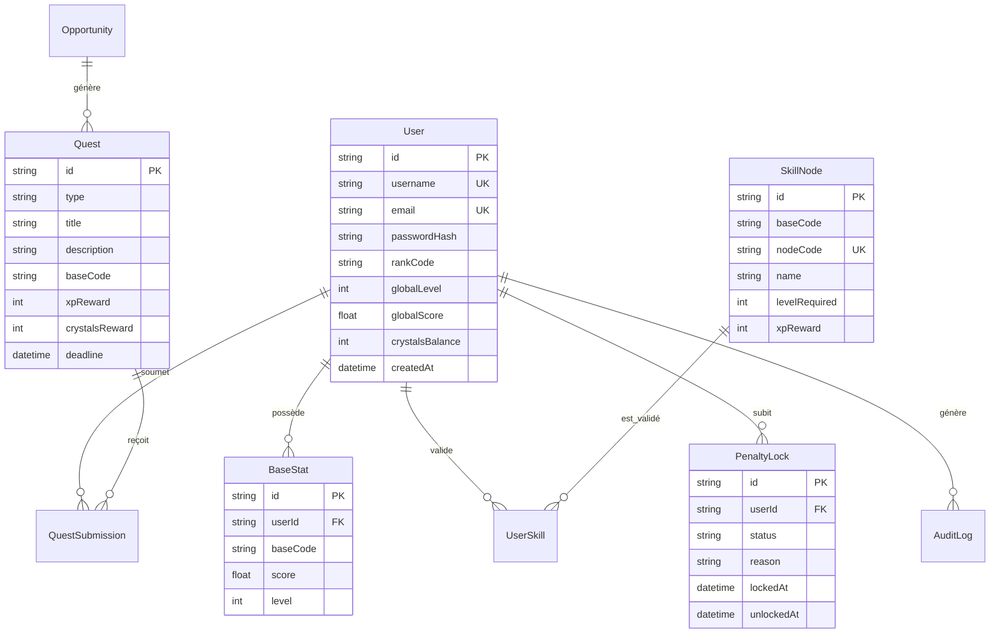

# Schéma de Base de Données & Persistance — LevelUp

> **Document ID :** SCH-LVLUP-004  
> **Version :** 3.1.0 (Édition Pareto Simplifiée)  
> **Statut :** Approuvé pour Implémentation  

---

## 1. Diagramme Entité-Relation (Prisma Schema)



---

## 2. Modèles Principaux & Définition Prisma

### 2.1 Énumérations Clés
```prisma
enum BaseStatCode {
  ACAD
  AI_ENG
  CYBER
  EXP
  LNG
  FIN
  STR
  DIS
}

enum RankCode {
  E
  D
  C
  B
  A
  S
  MASTER
}

enum QuestStatus {
  PENDING
  IN_PROGRESS
  COMPLETED
  FAILED
}

enum PenaltyStatus {
  ACTIVE
  PURGED
  EXPIRED
}
```

### 2.2 Modèles Fondamentaux

```prisma
model User {
  id              String            @id @default(uuid())
  username        String            @unique
  email           String            @unique
  passwordHash    String
  rankCode        RankCode          @default(E)
  globalLevel     Int               @default(1)
  globalScore     Float             @default(0.0)
  crystalsBalance Int               @default(0)
  createdAt       DateTime          @default(now())
  updatedAt       DateTime          @updatedAt

  baseStats       BaseStat[]
  skills          UserSkill[]
  submissions     QuestSubmission[]
  penalties       PenaltyLock[]
  auditLogs       AuditLog[]

  @@index([rankCode])
}

model BaseStat {
  id        String       @id @default(uuid())
  userId    String
  baseCode  BaseStatCode
  score     Float        @default(0.0)
  level     Int          @default(1)
  updatedAt DateTime     @updatedAt

  user      User         @relation(fields: [userId], references: [id], onDelete: Cascade)

  @@unique([userId, baseCode])
}

model SkillNode {
  id            String       @id @default(uuid())
  baseCode      BaseStatCode
  nodeCode      String       @unique
  name          String
  description   String
  levelRequired Int          @default(1)
  xpReward      Int          @default(100)

  userSkills    UserSkill[]

  @@index([baseCode, levelRequired])
}

model Quest {
  id             String            @id @default(uuid())
  title          String
  description    String
  baseCode       BaseStatCode
  xpReward       Int
  crystalsReward Int               @default(10)
  deadline       DateTime?
  createdAt      DateTime          @default(now())

  submissions    QuestSubmission[]

  @@index([baseCode, deadline])
}

model QuestSubmission {
  id          String      @id @default(uuid())
  questId     String
  userId      String
  status      QuestStatus @default(PENDING)
  proofUrl    String?
  proofData   Json?
  score       Float?
  completedAt DateTime?

  quest       Quest       @relation(fields: [questId], references: [id], onDelete: Cascade)
  user        User        @relation(fields: [userId], references: [id], onDelete: Cascade)

  @@unique([questId, userId])
  @@index([userId, status])
}

model PenaltyLock {
  id         String        @id @default(uuid())
  userId     String
  status     PenaltyStatus @default(ACTIVE)
  reason     String
  lockedAt   DateTime      @default(now())
  unlockedAt DateTime?

  user       User          @relation(fields: [userId], references: [id], onDelete: Cascade)

  @@index([userId, status])
}
```

---

## 3. Stratégie d'Indexation & Transactions Atomiques

1. **Anti-Double Dépense** : La contrainte d'unicité `@@unique([questId, userId])` sur `QuestSubmission` garantit au niveau de la base de données qu'une quête ne peut être soumise qu'une seule fois par utilisateur.
2. **Indexation Stratégique** : Les requêtes fréquentes de calcul d'XP et de statistiques filtrent sur `[userId, baseCode]` et `[userId, status]`, couvertes par des index composites.
3. **Idempotence des Mises à Jour** : Tout gain de points d'expérience ou changement de niveau s'exécute dans une transaction Prisma (`prisma.$transaction`) combinée au verrouillage Redis Redlock.
