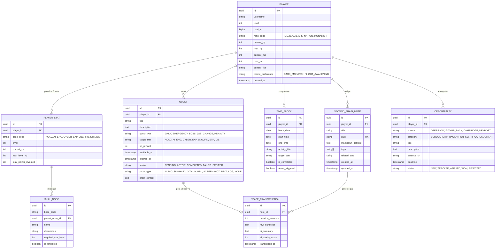

# Modèle de Données & Schéma Backend — LevelUp

> **Nom du Projet :** LevelUp ("The System")  
> **Version :** 1.0.0  
> **SGBD :** PostgreSQL (via Prisma ORM ou SQLAlchemy)

---

## 1. Diagramme Entité-Relation (ERD Mermaid)

---

## 2. Définition Détaillée des Tables Principales

### 2.1 Table `players`
* `id` : UUID v4, Clé primaire.
* `rank_code` : Énumération stricte : `'F'`, `'E'`, `'D'`, `'C'`, `'B'`, `'A'`, `'S'`, `'NATION'`, `'MONARCH'`.
* `total_xp` : Entier 64-bit pour éviter tout dépassement d'entier sur le long terme.
* `current_hp` / `max_hp` : Points de récupération physique (calibrés par le sommeil).
* `current_mp` / `max_mp` : Points d'énergie mentale (consommés par le Deep Work).

### 2.2 Table `player_stats`
* Index composite unique `(player_id, base_code)` pour garantir l'unicité stricte des 8 bases par joueur.
* `base_code` : Vérifié par contrainte CHECK parmi `['ACAD', 'AI_ENG', 'CYBER', 'EXP', 'LNG', 'FIN', 'STR', 'DIS']`.

### 2.3 Table `quests`
* Clé d'idempotence journalière : une contrainte d'unicité empêche d'injecter deux fois la même quête quotidienne pour une date donnée.
* `status` : Machine à état stricte : `PENDING` $\rightarrow$ `ACTIVE` $\rightarrow$ (`COMPLETED` ou `FAILED` / `EXPIRED`).

### 2.4 Table `second_brain_notes`
* Support natif pour la recherche plein texte (*Full-Text Search*) via index GIN PostgreSQL sur `title` et `markdown_content`.

---

## 3. Formules de Calcul Mathématique de l'XP

* **Progression du Niveau Joueur :**
  $$\text{XP}_{\text{requis}}(L) = 100 \times \lfloor L^{1.75} \rfloor$$
  *Cette courbe assure une progression dynamique sur les 10 premiers niveaux, puis impose un travail soutenu pour gravir les rangs supérieurs.*

* **Progression d'une Base Statistique :**
  $$\text{XP}_{\text{stat}}(S) = 50 \times \lfloor S^{1.6} \rfloor$$
