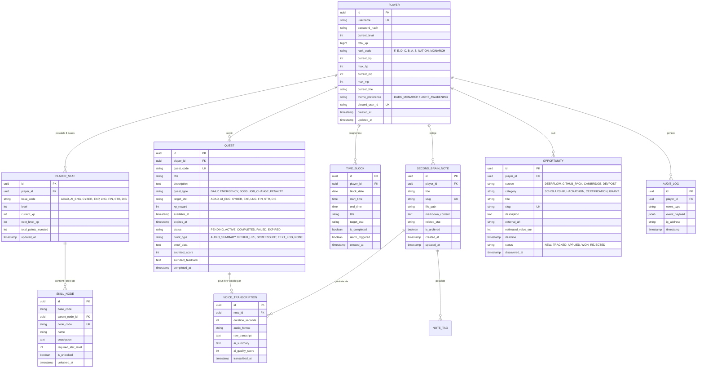

# Modèle de Données & Spécifications Backend Exhaustives — LevelUp

> **Document ID :** DB-LVLUP-004  
> **Nom du Produit :** LevelUp ("The System")  
> **Version du Document :** 2.0.0 (Spécification de Données Industrielle)  
> **SGBD Retenu :** PostgreSQL 16 (avec extensions UUID-OSSP et PG_TRGM)  
> **ORM :** Prisma ORM v5+ / Drizzle ORM  

---

## 1. Schéma Relationnel Complet (Diagramme ERD Mermaid)



---

## 2. Fichier de Schéma Prisma Officiel (`schema.prisma`)

Ce schéma constitue la source unique de vérité pour le modèle de données :

```prisma
datasource db {
  provider = "postgresql"
  url      = env("DATABASE_URL")
}

generator client {
  provider = "prisma-client-js"
}

enum RankCode {
  F
  E
  D
  C
  B
  A
  S
  NATION
  MONARCH
}

enum BaseStatCode {
  ACAD
  AI_ENG
  CYBER
  EXP
  LNG
  FIN
  STR
  DIS
}

enum QuestType {
  DAILY
  EMERGENCY
  BOSS
  JOB_CHANGE
  PENALTY
}

enum QuestStatus {
  PENDING
  ACTIVE
  COMPLETED
  FAILED
  EXPIRED
}

enum ProofType {
  AUDIO_SUMMARY
  GITHUB_URL
  SCREENSHOT
  TEXT_LOG
  NONE
}

enum OpportunityStatus {
  NEW
  TRACKED
  APPLIED
  WON
  REJECTED
}

model Player {
  id               String       @id @default(uuid()) @db.Uuid
  username         String       @unique @db.VarChar(50)
  passwordHash     String       @map("password_hash") @db.VarChar(255)
  currentLevel     Int          @default(1) @map("current_level")
  totalXp          BigInt       @default(0) @map("total_xp")
  rankCode         RankCode     @default(F) @map("rank_code")
  currentHp        Int          @default(100) @map("current_hp")
  maxHp            Int          @default(100) @map("max_hp")
  currentMp        Int          @default(100) @map("current_mp")
  maxMp            Int          @default(100) @map("max_mp")
  currentTitle     String       @default("L'Éveillé Novice") @map("current_title") @db.VarChar(100)
  themePreference  String       @default("DARK_MONARCH") @map("theme_preference") @db.VarChar(30)
  discordUserId    String?      @unique @map("discord_user_id") @db.VarChar(50)
  createdAt        DateTime     @default(now()) @map("created_at")
  updatedAt        DateTime     @updatedAt @map("updated_at")

  stats            PlayerStat[]
  quests           Quest[]
  timeBlocks       TimeBlock[]
  notes            SecondBrainNote[]
  opportunities    Opportunity[]
  auditLogs        AuditLog[]

  @@map("players")
}

model PlayerStat {
  id                   String       @id @default(uuid()) @db.Uuid
  playerId             String       @map("player_id") @db.Uuid
  baseCode             BaseStatCode @map("base_code")
  level                Int          @default(1)
  currentXp            Int          @default(0) @map("current_xp")
  nextLevelXp          Int          @default(100) @map("next_level_xp")
  totalPointsInvested  Int          @default(0) @map("total_points_invested")
  updatedAt            DateTime     @updatedAt @map("updated_at")

  player               Player       @relation(fields: [playerId], references: [id], onDelete: Cascade)
  skillNodes           SkillNode[]

  @@unique([playerId, baseCode])
  @@map("player_stats")
}

model SkillNode {
  id                String       @id @default(uuid()) @db.Uuid
  statId            String       @map("stat_id") @db.Uuid
  baseCode          BaseStatCode @map("base_code")
  parentNodeId      String?      @map("parent_node_id") @db.Uuid
  nodeCode          String       @unique @map("node_code") @db.VarChar(50)
  name              String       @db.VarChar(100)
  description       String       @db.Text
  requiredStatLevel Int          @default(1) @map("required_stat_level")
  isUnlocked        Boolean      @default(false) @map("is_unlocked")
  unlockedAt        DateTime?    @map("unlocked_at")

  stat              PlayerStat   @relation(fields: [statId], references: [id], onDelete: Cascade)
  parentNode        SkillNode?   @relation("SkillHierarchy", fields: [parentNodeId], references: [id])
  childNodes        SkillNode[]  @relation("SkillHierarchy")

  @@map("skill_nodes")
}

model Quest {
  id                 String       @id @default(uuid()) @db.Uuid
  playerId           String       @map("player_id") @db.Uuid
  questCode          String       @unique @map("quest_code") @db.VarChar(100)
  title              String       @db.VarChar(200)
  description        String       @db.Text
  questType          QuestType    @map("quest_type")
  targetStat         BaseStatCode @map("target_stat")
  xpReward           Int          @map("xp_reward")
  availableAt        DateTime     @default(now()) @map("available_at")
  expiresAt          DateTime     @map("expires_at")
  status             QuestStatus  @default(PENDING)
  proofType          ProofType    @default(NONE) @map("proof_type")
  proofData          String?      @map("proof_data") @db.Text
  architectScore     Int?         @map("architect_score")
  architectFeedback  String?      @map("architect_feedback") @db.Text
  completedAt        DateTime?    @map("completed_at")

  player             Player       @relation(fields: [playerId], references: [id], onDelete: Cascade)
  transcriptions     VoiceTranscription[]

  @@index([playerId, status, expiresAt])
  @@map("quests")
}

model TimeBlock {
  id              String        @id @default(uuid()) @db.Uuid
  playerId        String        @map("player_id") @db.Uuid
  blockDate       DateTime      @db.Date @map("block_date")
  startTime       String        @map("start_time") @db.VarChar(5) // Format HH:mm
  endTime         String        @map("end_time") @db.VarChar(5)   // Format HH:mm
  title           String        @db.VarChar(150)
  targetStat      BaseStatCode  @map("target_stat")
  isCompleted     Boolean       @default(false) @map("is_completed")
  alarmTriggered  Boolean       @default(false) @map("alarm_triggered")
  createdAt       DateTime      @default(now()) @map("created_at")

  player          Player        @relation(fields: [playerId], references: [id], onDelete: Cascade)

  @@index([playerId, blockDate])
  @@map("time_blocks")
}

model SecondBrainNote {
  id              String        @id @default(uuid()) @db.Uuid
  playerId        String        @map("player_id") @db.Uuid
  title           String        @db.VarChar(200)
  slug            String        @unique @db.VarChar(250)
  filePath        String        @map("file_path") @db.VarChar(500)
  markdownContent String        @map("markdown_content") @db.Text
  relatedStat     BaseStatCode? @map("related_stat")
  isArchived      Boolean       @default(false) @map("is_archived")
  createdAt       DateTime      @default(now()) @map("created_at")
  updatedAt       DateTime      @updatedAt @map("updated_at")

  player          Player        @relation(fields: [playerId], references: [id], onDelete: Cascade)
  transcriptions  VoiceTranscription[]

  @@index([playerId, relatedStat])
  @@map("second_brain_notes")
}

model VoiceTranscription {
  id                String           @id @default(uuid()) @db.Uuid
  noteId            String?          @map("note_id") @db.Uuid
  questId           String?          @map("quest_id") @db.Uuid
  durationSeconds   Int              @map("duration_seconds")
  audioFormat       String           @default("audio/webm") @map("audio_format") @db.VarChar(50)
  rawTranscript     String           @map("raw_transcript") @db.Text
  aiSummary         String           @map("ai_summary") @db.Text
  aiQualityScore    Int              @map("ai_quality_score")
  transcribedAt     DateTime         @default(now()) @map("transcribed_at")

  note              SecondBrainNote? @relation(fields: [noteId], references: [id], onDelete: SetNull)
  quest             Quest?           @relation(fields: [questId], references: [id], onDelete: SetNull)

  @@map("voice_transcriptions")
}

model Opportunity {
  id                 String             @id @default(uuid()) @db.Uuid
  playerId           String             @map("player_id") @db.Uuid
  source             String             @db.VarChar(100)
  category           String             @db.VarChar(50)
  title              String             @db.VarChar(250)
  slug               String             @unique @db.VarChar(300)
  description        String             @db.Text
  externalUrl        String             @map("external_url") @db.VarChar(1000)
  estimatedValueEur  Int?               @map("estimated_value_eur")
  deadline           DateTime
  status             OpportunityStatus  @default(NEW)
  discoveredAt       DateTime           @default(now()) @map("discovered_at")

  player             Player             @relation(fields: [playerId], references: [id], onDelete: Cascade)

  @@index([playerId, status, deadline])
  @@map("opportunities")
}

model AuditLog {
  id           String       @id @default(uuid()) @db.Uuid
  playerId     String       @map("player_id") @db.Uuid
  eventType    String       @map("event_type") @db.VarChar(100)
  eventPayload Json         @map("event_payload")
  ipAddress    String?      @map("ip_address") @db.VarChar(50)
  timestamp    DateTime     @default(now())

  player       Player       @relation(fields: [playerId], references: [id], onDelete: Cascade)

  @@index([playerId, eventType, timestamp])
  @@map("audit_logs")
}
```

---

## 3. Formules Mathématiques d'XP & Courbes de Progression

### 3.1 Formule de Progression Globale du Joueur
Pour gravir du niveau $L$ au niveau $L+1$, le nombre de points d'expérience requis suit une loi de puissance rigoureuse :

$$\text{XP}_{\text{palier}}(L) = 100 \times \lfloor L^{1.75} \rfloor$$

L'XP cumulée totale requise pour atteindre le niveau $N$ est la somme des paliers :

$$\text{XP}_{\text{totale}}(N) = \sum_{L=1}^{N-1} \left( 100 \times \lfloor L^{1.75} \rfloor \right)$$

#### Table des Seuils de Progression (Échantillon de Paliers) :
| Niveau Cible | XP pour le Palier | XP Cumulée Totale | Rang Associé | Titre Débloqué |
| :--- | :--- | :--- | :--- | :--- |
| **Niveau 1** | $0\text{ XP}$ | $0\text{ XP}$ | **Rang F** | *Civil / Non-Éveillé* |
| **Niveau 5** | $348\text{ XP}$ | $1\,214\text{ XP}$ | **Rang E** | *Éveillé Novice* |
| **Niveau 12** | $1\,342\text{ XP}$ | $5\,890\text{ XP}$ | **Rang D** | *Chasseur Confirmé* |
| **Niveau 22** | $3\,870\text{ XP}$ | $18\,540\text{ XP}$ | **Rang C** | *Chasseur d'Élite* |
| **Niveau 35** | $8\,450\text{ XP}$ | $46\,200\text{ XP}$ | **Rang B** | *Commandant de Guilde* |
| **Niveau 50** | $15\,200\text{ XP}$ | $92\,400\text{ XP}$ | **Rang A** | *Maître de Donjon* |
| **Niveau 70** | $27\,100\text{ XP}$ | $185\,600\text{ XP}$ | **Rang S** | *Chasseur Suprême* |
| **Niveau 85** | $38\,400\text{ XP}$ | $310\,200\text{ XP}$ | **Rang Nation** | *Héros National* |
| **Niveau 100**| $51\,200\text{ XP}$ | $500\,000\text{ XP}$ | **Monarque** | *Le Monarque de l'Ombre* |

### 3.2 Formule de Progression d'une Base Individuelle
Chaque statistique progresse de manière indépendante avec une courbe calibrée pour récompenser la spécialisation :

$$\text{XP}_{\text{stat}}(S) = 50 \times \lfloor S^{1.6} \rfloor$$
