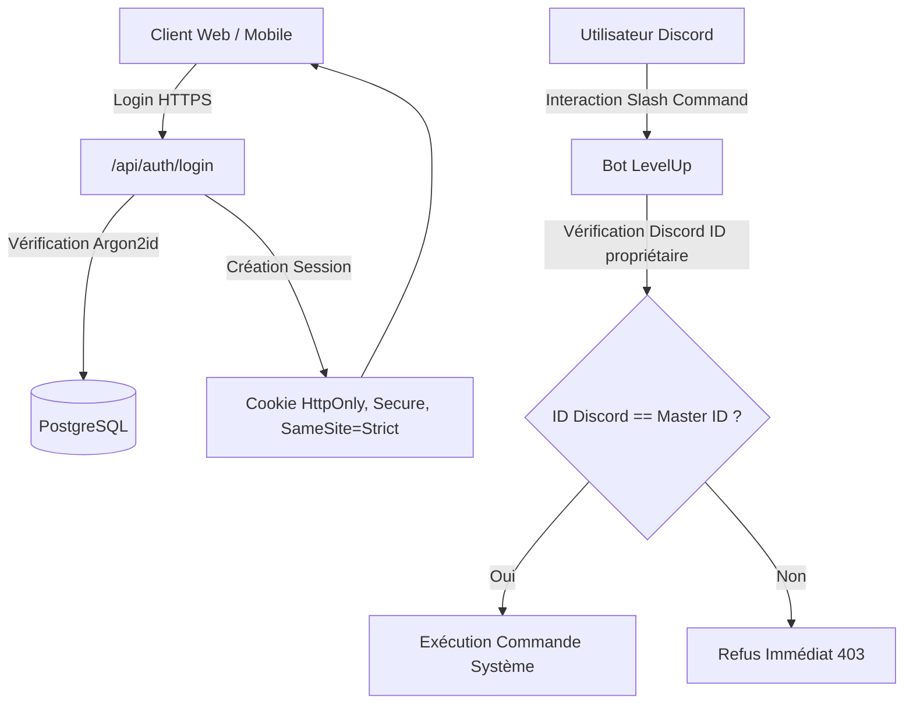

# Sécurité, Authentification & Conformité — LevelUp

> **Nom du Projet :** LevelUp ("The System")  
> **Version :** 1.0.0  

---

## 1. Modèle de Menaces & Invariants de Sécurité

LevelUp centralise des informations intimes et stratégiques : notes d'études, bourses financières, faiblesses physiques et organisationnelles, clés d'API sensibles (Discord, Gemini, Deerflow). La sécurité doit être sans concession.

### Invariants Non-Négociables :
1. **Zéro Secret au Client :** Ni le bot token Discord, ni les clés API Gemini ou Deerflow ne sont transmis au navigateur web. Tout transite par le backend sécurisé.
2. **Chiffrement au Repos (AES-256-GCM) :** Les tokens d'intégration externe et les configurations sensibles stockés en base sont chiffrés avec un sel unique de 96 bits.
3. **Signature des Webhooks (HMAC SHA-256) :** Les requêtes en provenance de Discord ou de Deerflow sont systématiquement authentifiées via signature cryptographique.
4. **Validation Stricte aux Frontières :** 100 % des entrées de l'API sont validées avec Zod ou Pydantic (rejet immédiat de tout payload corrompu ou inattendu).

---

## 2. Authentification & Gestion des Sessions

* **Accès Web :** Authentification par mot de passe avec hachage **Argon2id**. Session gérée via cookies `HttpOnly`, `Secure` et `SameSite=Strict` avec token JWT de courte durée (1 heure) et rotation de Refresh Token.
* **Accès Discord (Single-User Lock) :** Le bot n'exécute aucune action si l'ID Discord de l'émetteur ne correspond pas rigoureusement à l'ID du propriétaire du Système configuré dans les variables d'environnement (`DISCORD_MASTER_USER_ID`).

---

## 3. Sécurité des Données du Cerveau Numérique

* **Sanitisation Markdown :** Tout contenu rendu dans l'interface est nettoyé via `DOMPurify` pour empêcher toute tentative de Cross-Site Scripting (XSS) stocké dans les notes.
* **Isolation du Système de Fichiers :** Lors de l'écriture ou de la lecture des fichiers Markdown locaux, les chemins d'accès (*slugs*) sont validés contre toute attaque par traversée de répertoires (*Directory Traversal* `../`).

---

## 4. Matrice des Secrets & Variables d'Environnement

| Variable | Rôle | Niveau de Risque | Chiffrement |
| :--- | :--- | :--- | :--- |
| `DISCORD_BOT_TOKEN` | Jeton d'authentification du bot Discord | Critique | Chiffré au repos |
| `GEMINI_API_KEY` | Clé pour l'Architecte IA & Transcription | Élevé | Chiffré au repos |
| `DEERFLOW_API_TOKEN` | Jeton d'accès aux flux de recherche | Élevé | Chiffré au repos |
| `DATABASE_URL` | Chaîne de connexion PostgreSQL | Critique | Variable d'environnement serveur |
| `APP_ENCRYPTION_KEY` | Clé maîtresse AES-256-GCM (32 bytes hex) | Suprême | Secret machine non versionné |
