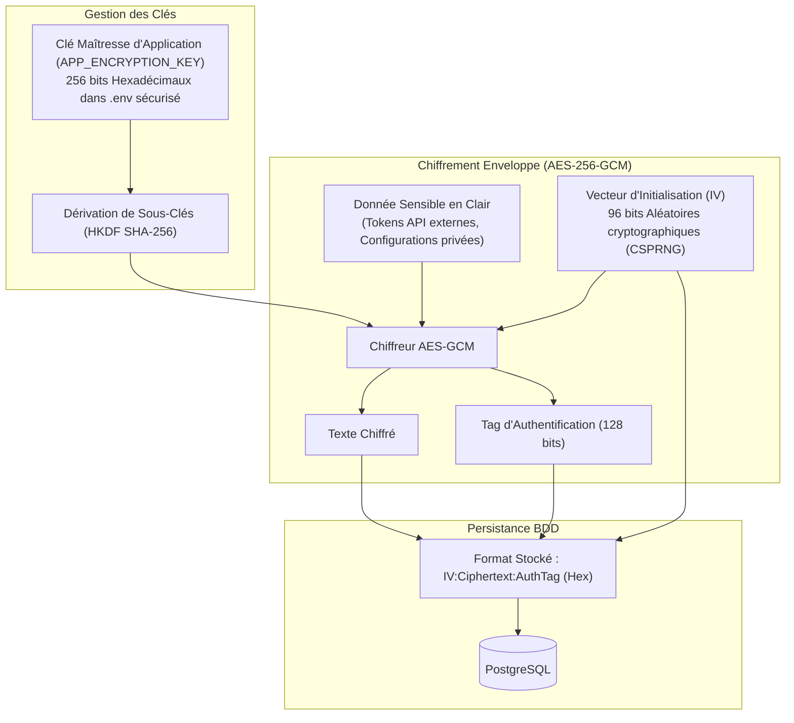

# Spécifications de Sécurité, Cryptographie & Conformité — LevelUp

> **Document ID :** SEC-LVLUP-005  
> **Nom du Produit :** LevelUp ("The System")  
> **Version du Document :** 2.0.0 (Spécification de Durcissement Exhaustive)  
> **Statut :** Validé pour Implémentation  
> **Auteur :** Lead Cybersecurity Architect & Principal Engineer AI  

---

## 1. Modèle de Menaces (Méthodologie STRIDE)

LevelUp héberge la vie personnelle, académique, stratégique et financière de l'utilisateur. Chaque catégorie de risque du modèle STRIDE a fait l'objet d'une contre-mesure technique inviolable :

| Menace (STRIDE) | Risque Spécifique à LevelUp | Contre-Mesure Technique Implémentée |
| :--- | :--- | :--- |
| **Spoofing (Usurpation)** | Un tiers s'authentifie sur le Web HUD ou forge des interactions Discord pour manipuler le Système. | Hachage de mot de passe **Argon2id**, sessions par cookies `HttpOnly; Secure; SameSite=Strict`, et garde-fou strict **Single-User Guard** vérifiant l'ID Discord du propriétaire (`DISCORD_MASTER_USER_ID`). |
| **Tampering (Altération)** | Falsification des points d'XP, injection d'un faux niveau ou modification non autorisée des quêtes. | Validation stricte des schémas via Zod aux frontières de l'API. Calculs de rangs et d'XP exécutés **exclusivement côté serveur** dans des transactions PostgreSQL atomiques. |
| **Repudiation (Répudiation)** | Contestation d'une action ou d'une validation de quête sans trace vérifiable. | Table `audit_logs` immuable consignant chaque événement système majeur (complétion de quête, modification de profil, appel d'évaluation IA) avec horodatage UTC et IP. |
| **Information Disclosure (Fuite)** | Fuite des notes privées du Second Brain, des jetons API (Gemini/Discord) ou des finances. | Chiffrement au repos via **AES-256-GCM** des secrets stockés en base. Zéro variable d'environnement sensible transmise au navigateur client. |
| **Denial of Service (Déni)** | Surcharge du planificateur ou de l'API audio par envoi de fichiers géants ou requêtes en rafale. | Rate-limiting distribué via Redis (Token Bucket), limitation stricte de la taille des requêtes multipart à 25 Mo et timeout sur les inférences IA. |
| **Elevation of Privilege (Élévation)** | Un payload forgé tente de forcer le champ `rank_code: "MONARCH"`. | Le schéma Zod d'entrée exclut formellement les champs d'état (`rank_code`, `total_xp`, `current_level`). Ces champs sont en lecture seule pour le client. |

---

## 2. Architecture Cryptographique & Chiffrement au Repos



### 2.1 Spécification d'Implémentation AES-256-GCM
* **Module :** `lib/crypto/encryption.ts`.
* **Algorithme :** `aes-256-gcm` (Chiffrement Authentifié avec Données Associées - AEAD).
* **Vecteur d'Initialisation (IV) :** 12 octets (96 bits) générés de manière cryptographiquement sécurisée à chaque chiffrement via `crypto.randomBytes(12)`. Réutilisation d'un même IV formellement interdite.
* **Tag d'Authentification :** 16 octets (128 bits) assurant que le texte chiffré n'a subi aucune altération malveillante.
* **Format Sérialisé :** `iv_hex:ciphertext_hex:tag_hex`.

### 2.2 Hachage des Identifiants (Argon2id)
* **Algorithme :** Argon2id (recommandation officielle ANSSI / OWASP).
* **Paramètres de Dérivation :**
  * `memoryCost` : 65 536 Ko (64 Mo de mémoire vive imposée par tentative).
  * `timeCost` : 3 itérations.
  * `parallelism` : 4 threads concurrents.
  * `hashLength` : 32 octets.

---

## 3. Sécurité du Bot Discord (Single-User Guard)

Pour interdire toute exploitation malveillante ou injection de commandes par des utilisateurs tiers d'un serveur Discord partagé, le bot intègre un intercepteur de sécurité en couche zéro :

```typescript
// lib/discord/guards/singleUserGuard.ts
import { Interaction } from 'discord.js';

export function assertMasterUser(interaction: Interaction): boolean {
  const masterId = process.env.DISCORD_MASTER_USER_ID;
  
  if (!masterId || interaction.user.id !== masterId) {
    if (interaction.isRepliable()) {
      interaction.reply({
        content: "⛔ **Accès Refusé :** Vous n'êtes pas le Monarque reconnu par ce Système.",
        ephemeral: true // Message visible exclusivement par l'émetteur rejeté
      });
    }
    console.warn(`[SECURITY ALERT] Tentative d'accès non autorisée de l'ID Discord : ${interaction.user.id}`);
    return false;
  }
  return true;
}
```

---

## 4. Sécurité du Cerveau Numérique (XSS & Path Traversal)

### 4.1 Prévention du Cross-Site Scripting (XSS) Stocké
Le Cerveau Numérique interprète du Markdown riche (incluant des tables et du LaTeX). Tout HTML généré passe obligatoirement au crible d'un parseur assaini avec `DOMPurify` :

```typescript
// lib/markdown/sanitizer.ts
import DOMPurify from 'isomorphic-dompurify';

export function sanitizeMarkdownHtml(rawHtml: string): string {
  return DOMPurify.sanitize(rawHtml, {
    ALLOWED_TAGS: [
      'h1', 'h2', 'h3', 'h4', 'h5', 'h6', 'p', 'b', 'i', 'strong', 'em',
      'ul', 'ol', 'li', 'code', 'pre', 'blockquote', 'table', 'thead', 'tbody',
      'tr', 'th', 'td', 'a', 'span', 'hr'
    ],
    ALLOWED_ATTR: ['href', 'target', 'rel', 'class'],
    FORBID_TAGS: ['script', 'iframe', 'object', 'embed', 'form', 'input'],
    FORBID_ATTR: ['onerror', 'onload', 'onclick', 'onmouseover']
  });
}
```

### 4.2 Prévention de la Traversée de Répertoire (*Path Traversal*)
Lors de l'écriture ou de la lecture d'une note Markdown sur le disque local :
1. Les caractères réservés et séquences relatives (`..`, `/`, `\`) sont systématiquement éliminés des slugs.
2. La résolution du chemin canonique (`path.resolve`) vérifie que le chemin final se trouve obligatoirement confiné à l'intérieur du répertoire racine configuré (`STORAGE_NOTES_ROOT`).

---

## 5. Mécanisme de Sanction Réseau (Invariants de Sécurité du Pare-feu Local)

Le script de restriction locale (option V1.5 pour la zone de pénalité) applique des règles strictes de sécurité système :
1. **Zéro Altération Permanente :** Le script effectue une sauvegarde horodatée du fichier `hosts` système (`/etc/hosts` ou `C:\Windows\System32\drivers\etc\hosts`) avant toute modification.
2. **Durée de Vie Bornée (*TTL Safety Lock*) :** Toute restriction appliquée s'accompagne d'une tâche cron de déblocage automatique après un délai maximal de 24 heures pour prévenir tout blocage définitif en cas de plantage du démon.
3. **Périmètre Strict :** Seuls les domaines de distraction ciblés (`tiktok.com`, `instagram.com`, `twitter.com`, `youtube.com`) sont redirigés vers `127.0.0.1`. Les accès éducatifs, universitaires, GitHub et Discord restent sanctuarisés et inaltérables.
