# Plan d'Implémentation & Feuille de Route d'Exécution — LevelUp

> **Document ID :** IMPL-LVLUP-008  
> **Nom du Produit :** LevelUp ("The System")  
> **Version du Document :** 2.0.0 (Spécification d'Exécution Exhaustive)  
> **Statut :** Prêt pour Développement Séquentiel  
> **Règle Opérationnelle :** *Strict Sequential Gating* (Chaque phase doit obligatoirement valider 100 % de ses mini-tests au vert avant d'engager la phase suivante).

---

## 1. Vue d'Ensemble des Phases & Diagramme de Dépendances

```mermaid
flowchart TD
    subgraph P0 ["Phase 0 : Socle Technique & Tooling"]
        P0_1["Setup Next.js 14, TypeScript & ESLint"]
        P0_2["Configuration Docker (PostgreSQL 16 & Redis 7)"]
        P0_3["Schéma Prisma initial & Migrations DDL"]
        P0_G["Gate 0 : Tests 0.1, 0.2, 0.3 Validés"]
    end

    subgraph P1 ["Phase 1 : Moteur Mathématique & Sécurité"]
        P1_1["Formules XP logarithmiques & Paliers de Rangs"]
        P1_2["Service d'Authentification Argon2id & Sessions"]
        P1_3["Chiffrement Enveloppe AES-256-GCM"]
        P1_G["Gate 1 : Tests 1.1, 1.2 Validés"]
    end

    subgraph P2 ["Phase 2 : HUD Web Solo Leveling"]
        P2_1["Layout & Tokens Solo Leveling (Sombre / Clair)"]
        P2_2["Composant StatusWindow & Jauges HP/MP"]
        P2_3["Visualisation des 8 Sphères de Compétences"]
        P2_G["Gate 2 : Tests 2.1, 2.2 Validés"]
    end

    subgraph P3 ["Phase 3 : Cerveau Numérique & Audio"]
        P3_1["Éditeur Markdown & Wikilinks DOMPurify"]
        P3_2["Module Transcription Audio Whisper/Gemini"]
        P3_3["Génération automatique de fiches de révision"]
        P3_G["Gate 3 : Tests 3.1, 3.2 Validés"]
    end

    subgraph P4 ["Phase 4 : Planificateur & Bot Discord"]
        P4_1["Agenda Time-Blocking & minuterie active"]
        P4_2["Bot Discord.js v14 & SingleUserGuard"]
        P4_3["Queue BullMQ pour les alarmes et quêtes 06h00"]
        P4_G["Gate 4 : Tests 4.1, 4.2 Validés"]
    end

    subgraph P5 ["Phase 5 : L'Architecte IA & Deerflow"]
        P5_1["Agent Antigravity d'évaluation de synthèses"]
        P5_2["Connecteur de Scraping Deerflow pour Bourses"]
        P5_3["Intégration E2E de la boucle de journée complète"]
        P5_G["Gate 5 : Tests 5.1, 5.2 Validés"]
    end

    P0_1 --> P0_2 --> P0_3 --> P0_G
    P0_G --> P1_1 --> P1_2 --> P1_3 --> P1_G
    P1_G --> P2_1 --> P2_2 --> P2_3 --> P2_G
    P2_G --> P3_1 --> P3_2 --> P3_3 --> P3_G
    P3_G --> P4_1 --> P4_2 --> P4_3 --> P4_G
    P4_G --> P5_1 --> P5_2 --> P5_3 --> P5_G
```

---

## 2. Découpage Détaillé des Tâches par Phase

### Phase 0 : Socle Technique, Tooling & Base de Données
* [ ] **Tâche 0.1 :** Initialiser le dépôt avec Next.js 14 App Router, TypeScript en mode `strict: true`, ESLint, Prettier et TailwindCSS.
  * *Fichiers cibles :* `package.json`, `tsconfig.json`, `.eslintrc.json`, `tailwind.config.ts`.
* [ ] **Tâche 0.2 :** Configurer `docker-compose.yml` avec PostgreSQL 16 (port 5432) et Redis 7 (port 6379) avec sondes de santé (*healthchecks*) et volumes de persistance locaux.
  * *Fichiers cibles :* `docker-compose.yml`, `.env.example`.
* [ ] **Tâche 0.3 :** Rédiger le schéma Prisma complet (`prisma/schema.prisma`) d'après `docs/04-BACKEND_SCHEMA.md` et exécuter la migration inaugurale.
  * *Fichiers cibles :* `prisma/schema.prisma`, `prisma/migrations/init_schema/migration.sql`.
* [ ] **Tâche 0.4 :** Mettre en place le harnais de test unitaire Vitest avec support TypeScript et configuration de couverture.
  * *Fichiers cibles :* `vitest.config.ts`, `tests/setup.ts`.
* **Porte de Sortie (Gate 0) :**
  - Validation de `pnpm lint && pnpm typecheck` sans aucun avertissement.
  - Validation de `docker compose up -d` avec sondes saines.
  - Exécution réussie des mini-tests 0.1, 0.2, 0.3 de `docs/07-TEST_PLAN.md`.

---

### Phase 1 : Moteur Mathématique d'XP, Rangs & Authentification
* [ ] **Tâche 1.1 :** Développer le moteur mathématique d'expérience (`lib/engine/xpCalculator.ts`) avec formules logarithmiques et paliers stricts.
  * *Fichiers cibles :* `lib/engine/xpCalculator.ts`, `tests/unit/engine/xpCalculator.spec.ts`.
* [ ] **Tâche 1.2 :** Développer la machine d'état des rangs de F à Monarque (`lib/engine/rankManager.ts`).
  * *Fichiers cibles :* `lib/engine/rankManager.ts`, `tests/unit/engine/rankManager.spec.ts`.
* [ ] **Tâche 1.3 :** Implémenter le service de chiffrement symétrique AES-256-GCM (`lib/crypto/encryption.ts`).
  * *Fichiers cibles :* `lib/crypto/encryption.ts`, `tests/unit/crypto/encryption.spec.ts`.
* [ ] **Tâche 1.4 :** Développer les routes d'authentification (`/api/v1/auth/login`, `/api/v1/auth/logout`) avec hachage Argon2id et cookies HttpOnly.
  * *Fichiers cibles :* `app/api/v1/auth/login/route.ts`, `lib/auth/session.ts`.
* **Porte de Sortie (Gate 1) :**
  - 100 % des tests unitaires du moteur d'XP et des rangs passent au vert.
  - Validation du flux d'authentification et de la sécurité des cookies (Mini-test 1.2).

---

### Phase 2 : HUD Web Solo Leveling (Interface & Immersion)
* [ ] **Tâche 2.1 :** Configurer les palettes Solo Leveling dans TailwindCSS (`#05050A`, `#00E5FF`, `#FF6B00`) et le provider de thème dynamique.
  * *Fichiers cibles :* `app/globals.css`, `components/theme/ThemeProvider.tsx`.
* [ ] **Tâche 2.2 :** Développer le composant de profil `StatusWindow` : Niveau, avatar, rang et barres d'XP animées Framer Motion.
  * *Fichiers cibles :* `components/hud/StatusWindow.tsx`, `components/hud/XpProgressBar.tsx`.
* [ ] **Tâche 2.3 :** Implémenter les jauges vitales dynamiques `VitalGauges` (HP santé/sommeil & MP focus mental).
  * *Fichiers cibles :* `components/hud/VitalGauges.tsx`.
* [ ] **Tâche 2.4 :** Bâtir le panneau interactif des 8 Sphères Fondamentales avec affichage des niveaux et ouverture des arbres de compétences.
  * *Fichiers cibles :* `components/hud/StatSpheresGrid.tsx`, `components/hud/SkillTreeModal.tsx`.
* [ ] **Tâche 2.5 :** Implémenter le bandeau supérieur du Time-Blocking avec minuteur à rebours en temps réel.
  * *Fichiers cibles :* `components/hud/ActiveBlockBanner.tsx`.
* **Porte de Sortie (Gate 2) :**
  - Rendu fluide sans erreur d'hydratation (Mini-test 2.1).
  - Validation visuelle du switch de thème et du responsive design (Mini-test 2.2).

---

### Phase 3 : Cerveau Numérique Markdown & Transcription Vocale
* [ ] **Tâche 3.1 :** Bâtir l'explorateur de fichiers du Second Brain et l'éditeur Markdown avec support des wikilinks `[[Note]]` et tags.
  * *Fichiers cibles :* `components/brain/MarkdownEditor.tsx`, `lib/markdown/wikilinks.ts`.
* [ ] **Tâche 3.2 :** Intégrer le module de sanitisation `DOMPurify` pour immuniser l'affichage contre les attaques XSS.
  * *Fichiers cibles :* `lib/markdown/sanitizer.ts`, `tests/unit/markdown/sanitizer.spec.ts`.
* [ ] **Tâche 3.3 :** Développer le composant d'enregistrement audio avec capture MediaRecorder et visualiseur d'ondes sonores.
  * *Fichiers cibles :* `components/audio/VoiceRecorder.tsx`.
* [ ] **Tâche 3.4 :** Implémenter l'endpoint `POST /api/v1/audio/transcribe` connectant le moteur Whisper / Gemini Audio et la création automatique de note.
  * *Fichiers cibles :* `app/api/v1/audio/transcribe/route.ts`, `lib/audio/whisperService.ts`.
* **Porte de Sortie (Gate 3) :**
  - Neutralisation XSS prouvée par test unitaire (Mini-test 3.1).
  - Pipeline audio validé de bout en bout en moins de 5 secondes (Mini-test 3.2).

---

### Phase 4 : Planificateur (Time-Blocking) & Bot Discord
* [ ] **Tâche 4.1 :** Bâtir le calendrier journalier bloc par bloc avec gestion des états d'activité et détection des conflits de créneaux.
  * *Fichiers cibles :* `components/schedule/TimeBlockScheduler.tsx`, `app/api/v1/schedule/route.ts`.
* [ ] **Tâche 4.2 :** Développer le démon Discord.js v14 avec enregistrement des Slash Commands (`/status`, `/today`, `/complete`, `/recap`).
  * *Fichiers cibles :* `lib/discord/bot.ts`, `lib/discord/commands/*.ts`.
* [ ] **Tâche 4.3 :** Intégrer le middleware de sécurité `SingleUserGuard` vérifiant strictement l'identité du propriétaire.
  * *Fichiers cibles :* `lib/discord/guards/singleUserGuard.ts`.
* [ ] **Tâche 4.4 :** Configurer les workers BullMQ pour la génération des quêtes du matin à 06h00 et le déclenchement des alarmes sonores et push.
  * *Fichiers cibles :* `lib/workers/schedulerWorker.ts`, `lib/workers/questWorker.ts`.
* **Porte de Sortie (Gate 4) :**
  - Réactivité et verrouillage single-user du Bot Discord validés (Mini-test 4.1).
  - Idempotence absolue des alarmes BullMQ vérifiée (Mini-test 4.2).

---

### Phase 5 : L'Architecte IA (Antigravity) & Connecteur Deerflow
* [ ] **Tâche 5.1 :** Configurer l'agent "L'Architecte" dans le runtime Antigravity avec son prompt d'évaluation sévère et équitable.
  * *Fichiers cibles :* `lib/ai/architectAgent.ts`, `lib/ai/prompts/evaluationPrompt.ts`.
* [ ] **Tâche 5.2 :** Implémenter la route d'évaluation de synthèse avec extraction JSON stricte et calcul d'XP borné.
  * *Fichiers cibles :* `app/api/v1/architect/evaluate-summary/route.ts`.
* [ ] **Tâche 5.3 :** Développer le connecteur Deerflow pour le scraping et l'ingestion automatique des bourses d'études et hackathons mondiaux.
  * *Fichiers cibles :* `lib/integrations/deerflowService.ts`, `app/api/v1/opportunities/route.ts`.
* [ ] **Tâche 5.4 :** Exécuter la suite complète de tests de bout en bout simulant une semaine entière d'activité.
  * *Fichiers cibles :* `tests/e2e/full_system_lifecycle.spec.ts`.
* **Porte de Sortie (Gate 5) :**
  - Évaluation impartiale de l'Architecte et plafond d'XP validés (Mini-test 5.1).
  - Ingestion saine des bourses sans doublon ni expiration dépassée (Mini-test 5.2).
  - 100 % des 100 cas de défaillances de `docs/07-TEST_PLAN.md` testés et validés.
