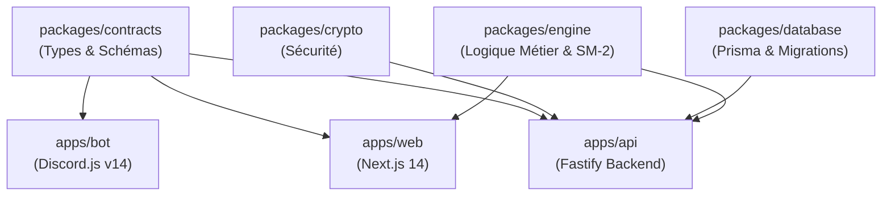

# Plan d'Implémentation & Déploiement — LevelUp

> **Document ID :** IMP-LVLUP-008  
> **Version :** 3.1.0 (Édition Pareto Simplifiée)  
> **Statut :** Approuvé pour Implémentation  

---

## 1. Topologie du Monorepo & Dépendances

Le projet utilise **Turborepo** et **pnpm workspaces** pour orchestrer les builds et les dépendances partagées :



---

## 2. Déploiement en Production (Render)

L'architecture de production est déployée sur **Render** avec l'infrastructure suivante :
* **Service Web Principal (`srv-dbqgbkoae00c738ata8g`)** :
  * Hébergement de l'application fullstack / API.
  * URL publique : `https://levelup-system.onrender.com/`
* **Base de Données PostgreSQL Managée** :
  * Connexion sécurisée SSL via `DATABASE_URL`.
  * Migrations automatiques au déploiement via `pnpm exec prisma db push`.
* **Cache Redis Managé** :
  * Utilisé pour la gestion des verrous distribués Redlock et la file d'attente BullMQ.
* **CDN & Hébergement Médias (Supabase Storage)** :
  * Vidéo et images lourdes (4K/WebM/WebP) déportées sur CDN pour éliminer les latences réseau du serveur.

---

## 3. Procédure de Déploiement & Scripts CI/CD

```bash
# 1. Installation des dépendances de production
pnpm install --frozen-lockfile

# 2. Génération du client Prisma & Synchronisation DB
pnpm exec prisma generate
pnpm exec prisma db push

# 3. Build de tous les packages et applications
pnpm build

# 4. Lancement en production
pnpm start
```
