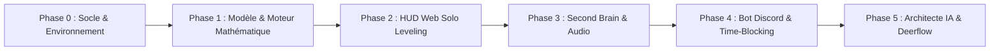

# Plan d'Implémentation & Checklist Opérationnelle — LevelUp

> **Nom du Projet :** LevelUp ("The System")  
> **Version :** 1.0.0  
> **Méthode :** Séquençage strict par phases avec mini-tests de gating obligatoires (*Definition of Done*).

---

## 1. Vue d'Ensemble des Phases

---

## 2. Découpage Détaillé par Phase & Mini-Tests Déterministes

### Phase 0 : Initialisation du Dépôt, Tooling & Base de Données
* [ ] Initialiser le projet Next.js 14+ / TypeScript avec ESLint, Prettier et TailwindCSS.
* [ ] Configurer `docker-compose.yml` avec PostgreSQL 16 et Redis 7.
* [ ] Configurer le schéma Prisma / migrations initiales d'après `docs/04-BACKEND_SCHEMA.md`.
* **Mini-tests de Gating Phase 0 :**
  * *Test 0.1 :* Exécution de `pnpm lint` et `pnpm typecheck` avec zéro erreur et zéro warning.
  * *Test 0.2 :* `docker compose up -d` $\rightarrow$ vérification de la santé des conteneurs via `pg_isready`.
  * *Test 0.3 :* `pnpm prisma migrate dev` $\rightarrow$ application propre des 7 tables sans erreur.

---

### Phase 1 : Moteur Mathématique d'XP, Rangs & Authentification
* [ ] Implémenter les formules de calcul d'XP de joueur et de stats dans `lib/engine/xp.ts`.
* [ ] Implémenter la machine d'état des rangs (F $\rightarrow$ Monarque) dans `lib/engine/ranks.ts`.
* [ ] Développer le système d'authentification sécurisé (Argon2id + cookies HttpOnly).
* **Mini-tests de Gating Phase 1 :**
  * *Test 1.1 :* Suite de tests unitaires Vitest validant les paliers d'XP (Cas 01 à 06 de `docs/07-TEST_PLAN.md`).
  * *Test 1.2 :* Test de non-régression : tentative d'injection d'XP négative $\rightarrow$ rejet 400.
  * *Test 1.3 :* Test d'authentification : connexion réussie $\rightarrow$ présence du cookie `session` avec flags `HttpOnly` et `SameSite=Strict`.

---

### Phase 2 : HUD Web Solo Leveling (Thème Sombre / Thème Clair)
* [ ] Bâtir le layout principal avec la palette Solo Leveling (`#05050A`, `#00E5FF`, `#FF6B00`).
* [ ] Implémenter le composant `StatusWindow` : Niveau, Rangs, Jauges HP/MP animées.
* [ ] Implémenter l'affichage des 8 sphères de bases avec radar chart et détails au clic.
* [ ] Implémenter la bascule de thème (*The Monarch* vs *Awakening*).
* **Mini-tests de Gating Phase 2 :**
  * *Test 2.1 :* Rendu du composant `StatusWindow` avec données de test sans erreur d'hydratation.
  * *Test 2.2 :* Test visuel de responsive design (vue mobile 375px et desktop 1440px).
  * *Test 2.3 :* Vérification du basculement instantané des tokens CSS de couleur lors du switch de thème.

---

### Phase 3 : Cerveau Numérique Markdown & Transcription Vocale
* [ ] Intégrer l'éditeur Markdown avec support des wikilinks `[[Note]]` et tags.
* [ ] Développer la route d'API `POST /api/v1/notes` avec sanitisation DOMPurify.
* [ ] Implémenter le composant d'enregistrement audio avec appel à l'API Whisper / Gemini.
* **Mini-tests de Gating Phase 3 :**
  * *Test 3.1 :* Écriture d'une note contenant `` $\rightarrow$ neutralisation complète dans le rendu.
  * *Test 3.2 :* Upload d'un fichier audio `.wav` de test $\rightarrow$ retour de la transcription et insertion automatique dans une nouvelle note Markdown.
  * *Test 3.3 :* Résolution d'un lien `[[TitreNote]]` vers son slug correspondant.

---

### Phase 4 : Planificateur (Time-Blocking) & Bot Discord
* [ ] Développer l'agenda journalier bloc par bloc avec minuteur en temps réel.
* [ ] Initialiser le bot Discord avec Discord.js et enregistrer les Slash Commands (`/status`, `/today`, `/complete`).
* [ ] Configurer le worker BullMQ pour l'envoi du message du matin à 07h00 et la notification des blocs.
* **Mini-tests de Gating Phase 4 :**
  * *Test 4.1 :* Exécution de `/status` sur Discord $\rightarrow$ réception de l'Embed Solo Leveling avec les vraies données BDD.
  * *Test 4.2 :* Clic sur le bouton `[Valider]` dans Discord $\rightarrow$ quête marquée `COMPLETED` en BDD et mise à jour du HUD Web en direct.
  * *Test 4.3 :* Test d'alarme : passage d'un bloc horaire $\rightarrow$ déclenchement de l'alerte sonore et visuelle.

---

### Phase 5 : L'Architecte IA (Antigravity) & Connecteur Deerflow
* [ ] Créer l'agent "L'Architecte" dans Antigravity avec ses directives d'évaluation.
* [ ] Développer l'endpoint d'évaluation des récapitulatifs soumis.
* [ ] Câbler le connecteur Deerflow pour la recherche automatique des bourses étudiantes en IA et hackathons.
* **Mini-tests de Gating Phase 5 :**
  * *Test 5.1 :* Envoi d'un résumé de lecture à l'Architecte $\rightarrow$ attribution d'une note et calcul de l'XP cohérente sans hallucination.
  * *Test 5.2 :* Requête de test vers Deerflow $\rightarrow$ indexation en base des 3 premières opportunités détectées.
  * *Test 5.3 :* Simulation complète de la boucle quotidienne de bout en bout.
