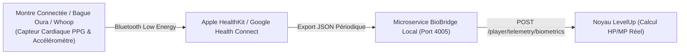
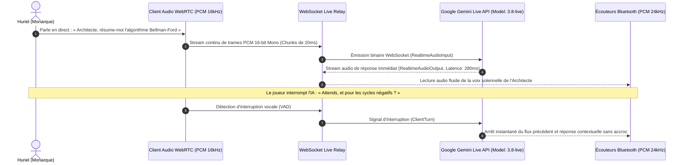
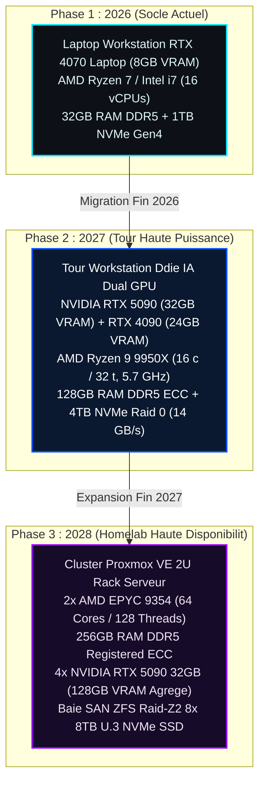
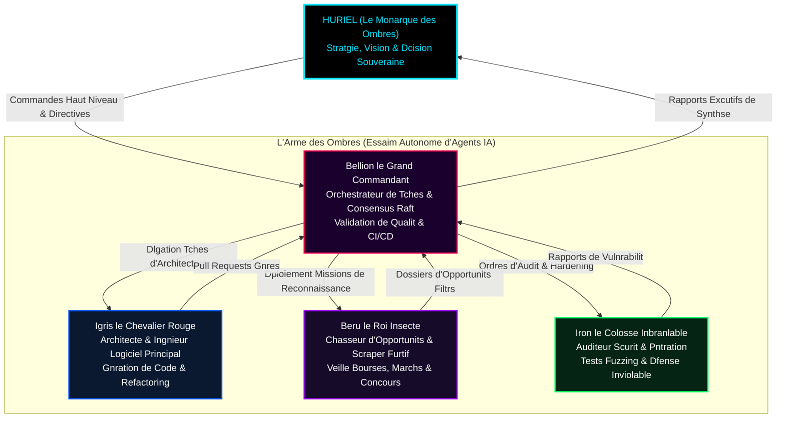
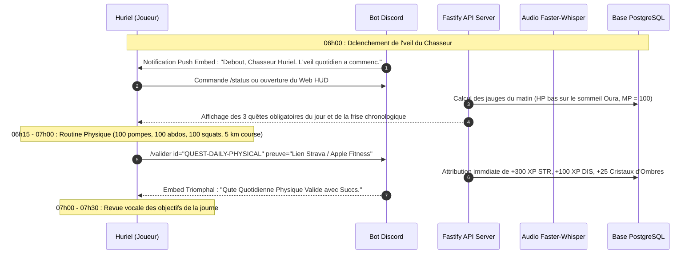

# Roadmap Stratégique, Trajectoire Triennale & Blueprints d'Ingénierie — LevelUp ("The System")

> **Document ID :** RDM-LVLUP-009-TITAN  
> **Nom du Produit :** LevelUp ("The System" / "Le Système")  
> **Version du Document :** 3.0.0 (Schéma Directeur Stratégique Exhaustif & Encyclopédique)  
> **Horizon Temporel :** 2026 — 2028 (Plan Triennal d'Ascension)  
> **Vision Ultime :** Forger un système d'exploitation de vie souverain et intransigeant, guidant Huriel du statut d'étudiant en ingénierie de l'IA (Rang F) jusqu'au sommet absolu de sa discipline (Rang Monarch), en automatisant l'acquisition de la rigueur scientifique, de la cybersécurité offensive, de l'aisance linguistique et de l'indépendance financière.  

---

## 1. La Trajectoire Stratégique Triennale (2026 — 2028)

La trajectoire de LevelUp est conçue comme une montée en puissance progressive, divisée en trois ères technologiques majeures :

```mermaid
flowchart LR
    subgraph V10 ["V1.0 : Le Système Éveillé (Q1-Q2 2026)"]
        direction TB
        V1_1["Socle Monorepo & Base Hybride Local-First"]
        V1_2["Web HUD Holographique (Next.js 14 / Tailwind / Shaders)"]
        V1_3["8 Bases de Vie & Moteur de 120 Compétences"]
        V1_4["STT Faster-Whisper INT8 & Cerveau Markdown"]
        V1_5["Daemon Bot Discord v14 & Alertes Quotidiennes"]
    end

    subgraph V15 ["V1.5 : Le Sanctuaire de Discipline (Q3-Q4 2026)"]
        direction TB
        V2_1["Visualisation 3D du Graphe de Connaissances (Three.js)"]
        V2_2["Pare-feu WFP Bas-Niveau & Détection Anti-Procrastination"]
        V2_3["Oracles de Preuves Automatisés (GitHub, TryHackMe, Cambridge)"]
        V2_4["Bio-Télémétrie & Capteurs Connectés (Apple Watch / Oura / Whoop)"]
        V2_5["Armée de l'Ombre : Workers IA Autonomes en Arrière-Plan"]
    end

    subgraph V20 ["V2.0 : Le Monarque Absolu (2027 - 2028)"]
        direction TB
        V3_1["Assistant Vocal Bidirectionnel Continu (Gemini Live API)"]
        V3_2["Maillage P2P Chiffré Local (CRDTs Automerge / libp2p)"]
        V3_3["Cockpit Donjon Hackathon 48h (Mode Pression Extrême)"]
        V3_4["Télémétrie Cérébrale EEG & Indice de Focus Neuronal (OpenBCI)"]
        V3_5["Foundry Entrepreneuriale Deep-Tech & Autofinancement IA"]
    end

    V10 --> V15 --> V20
```



---

## 2. Blueprint d'Ingénierie V1.0 : « Le Système Éveillé » (Socle Opérationnel Initial)

### 2.1 Objectifs Stratégiques V1.0
* Fournir une interface de réalité augmentée inspirée de Solo Leveling utilisable au quotidien sur PC et smartphone.
* Éliminer l'éparpillement cognitif en unifiant la gestion du temps (Time-blocking), les devoirs académiques, la cybersécurité et l'entraînement physique.
* Assurer une confidentialité absolue des données grâce au chiffrement au repos AES-256-GCM et à l'approche Local-First.

### 2.2 Spécifications d'Architecture & Topologie Matérielle
* **Station de Travail Hôte :** PC Portable Windows 11 avec GPU NVIDIA GeForce RTX (VRAM $\ge 6\text{ Go}$).
* **Services Conteneurisés :**
  * `levelup-postgres` : PostgreSQL 16 Alpine avec extensions `uuid-ossp`, `pg_trgm`, `btree_gin`.
  * `levelup-redis` : Redis 7 Alpine configuré en mémoire plafonnée à 128 Mo avec éviction `allkeys-lru`.
* **Services Runtimes Locaux :**
  * `apps/web` : Serveur Fastify API Gateway + Next.js 14 App Router.
  * `apps/bot` : Processus Node.js 22 dédié à la passerelle Discord.
  * `services/whisper` : Serveur FastAPI Python 3.12 propulsé par CTranslate2 et CUDA 12.4.
* **Canal Ingress Externe :** Cloudflare Tunnel chiffré TLS 1.3 reliant `system.huriel-levelup.com` au port local 443 sans translation de port (NAT) ni ouverture de firewall de box Internet.

### 2.3 Métriques Cibles de Qualité & Budgets de Ressources V1.0
* **Disponibilité Système :** $\ge 99.5\%$ (Hors coupures électriques de la station locale).
* **Consommation Mémoire RAM :** $< 2.2\text{ Go}$ pour l'ensemble des processus conteneurisés et runtimes Node.js.
* **Consommation VRAM GPU :** $< 2.8\text{ Go}$ lors de l'inférence audio active, retombant à $0\text{ Go}$ (déchargée) après 60 secondes d'inactivité.
* **Temps de Réponse API ($P_{95}$) :** $< 50\text{ ms}$ pour les requêtes REST synchrones.
* **Délai d'Affichage du HUD :** Largest Contentful Paint (LCP) $< 1.2\text{ seconde}$ sur réseau 4G.

---

## 3. Blueprint d'Ingénierie V1.5 : « Le Sanctuaire de Discipline & Le Maillage d'Oracles » (Q3-Q4 2026)

Le jalon V1.5 transforme le Système en un sanctuaire imprenable où l'auto-complaisance devient techniquement impossible et où les connaissances s'organisent visuellement dans l'espace en trois dimensions.

---

### 3.1 Visualiseur 3D du Cerveau Numérique en Graphe de Force (Three.js WebGL)
Les relations sémantiques entre les centaines de fiches Markdown ne sont plus affichées sous forme de simple liste, mais comme une galaxie holographique interactive d'étoiles et de constellations.

#### 3.1.1 Formulation Mathématique de l'Algorithme Force-Directed 3D (Fruchterman-Reingold 3D)
Pour un ensemble de nœuds $V$ (notes Markdown) et d'arêtes $E$ (wikilinks `[[slug]]`), la position tridimensionnelle $\vec{p}_i = (x_i, y_i, z_i)$ de chaque note évolue sous l'action de deux forces physiques antagonistes :

1. **Force de Répulsion Électrostatique de Coulomb (entre tous les nœuds) :**
   $$\vec{F}_r(i, j) = \frac{k_r^2}{\|\vec{p}_i - \vec{p}_j\|^2} \cdot \frac{\vec{p}_i - \vec{p}_j}{\|\vec{p}_i - \vec{p}_j\|}$$
   où $k_r$ représente la constante de répulsion spatiale.

2. **Force d'Attraction Élastique de Hooke (le long des liens wikilinks) :**
   $$\vec{F}_a(i, j) = \frac{\|\vec{p}_i - \vec{p}_j\|^2}{k_a} \cdot \frac{\vec{p}_j - \vec{p}_i}{\|\vec{p}_j - \vec{p}_i\|} \quad \text{pour } (i, j) \in E$$
   où $k_a$ représente la constante d'élasticité sémantique.

#### 3.1.2 Implémentation du Composant Three.js (`apps/web/components/KnowledgeGalaxy3D.tsx`)

```tsx
import React, { useEffect, useRef } from 'react';
import * as THREE from 'three';
import { OrbitControls } from 'three/examples/jsm/controls/OrbitControls';

export interface GalaxyNode {
  id: string;
  title: string;
  stat: string;
  position: [number, number, number];
}

export interface GalaxyEdge {
  source: string;
  target: string;
}

export const KnowledgeGalaxy3D: React.FC<{ nodes: GalaxyNode[]; edges: GalaxyEdge[] }> = ({ nodes, edges }) => {
  const mountRef = useRef<HTMLDivElement | null>(null);

  useEffect(() => {
    if (!mountRef.current) return;

    // 1. Initialisation Scène, Caméra & Rendu WebGL
    const scene = new THREE.Scene();
    scene.fog = new THREE.FogExp2(0x05050a, 0.002);

    const camera = new THREE.PerspectiveCamera(60, mountRef.current.clientWidth / mountRef.current.clientHeight, 0.1, 2000);
    camera.position.set(0, 50, 200);

    const renderer = new THREE.WebGLRenderer({ antialias: true, alpha: true });
    renderer.setSize(mountRef.current.clientWidth, mountRef.current.clientHeight);
    renderer.setPixelRatio(Math.min(window.devicePixelRatio, 2));
    mountRef.current.appendChild(renderer.domElement);

    const controls = new OrbitControls(camera, renderer.domElement);
    controls.enableDamping = true;
    controls.dampingFactor = 0.05;

    // 2. Création des Étoiles (Nœuds de Notes)
    const nodeGeometry = new THREE.SphereGeometry(1.5, 16, 16);
    const statColors: Record<string, number> = {
      ACAD: 0x38bdf8,
      AI_ENG: 0x00e5ff,
      CYBER: 0xef4444,
      LNG: 0xa855f7,
      STR: 0x10b981,
      DIS: 0xffd700,
    };

    const nodeMeshMap = new Map<string, THREE.Mesh>();

    nodes.forEach((n) => {
      const color = statColors[n.stat] || 0xffffff;
      const material = new THREE.MeshBasicMaterial({ color });
      const mesh = new THREE.Mesh(nodeGeometry, material);
      mesh.position.set(...n.position);
      scene.add(mesh);
      nodeMeshMap.set(n.id, mesh);
    });

    // 3. Création des Constellations (Liens Wikilinks)
    const lineMaterial = new THREE.LineBasicMaterial({
      color: 0x0051ff,
      transparent: true,
      opacity: 0.35,
    });

    edges.forEach((e) => {
      const src = nodeMeshMap.get(e.source);
      const tgt = nodeMeshMap.get(e.target);
      if (src && tgt) {
        const points = [src.position, tgt.position];
        const lineGeo = new THREE.BufferGeometry().setFromPoints(points);
        const line = new THREE.Line(lineGeo, lineMaterial);
        scene.add(line);
      }
    });

    // 4. Boucle d'Animation
    let animId: number;
    const animate = () => {
      animId = requestAnimationFrame(animate);
      controls.update();
      scene.rotation.y += 0.0005; // Légère rotation de la galaxie
      renderer.render(scene, camera);
    };
    animate();

    return () => {
      cancelAnimationFrame(animId);
      renderer.dispose();
      if (mountRef.current) mountRef.current.innerHTML = '';
    };
  }, [nodes, edges]);

  return <div ref={mountRef} className="w-full h-[600px] bg-abyss-black rounded-lg overflow-hidden border border-neon-cyan/30" />;
};
```

---

### 3.2 Intégration de la Bio-Télémétrie & Capteurs Connectés (Apple Watch, Oura & Whoop)
Dans la version V1.5, la jauge de points de vie (HP) n'est plus basée sur une simple déclaration manuelle, mais ingère les données physiologiques réelles transmises par les capteurs connectés via des webhooks sécurisés :



#### Métriques Biométriques Ingérées :
1. **Durée Réelle du Sommeil Paradoxal & Profond (REM & Deep Sleep) :**
   $$HP_{\text{bio}} = \min\left(100, \; \left( \frac{\text{Sommeil Profond (min)} \times 1.5 + \text{Sommeil REM (min)}}{180} \right) \times 100 \right)$$
2. **Variabilité de la Fréquence Cardiaque (HRV — Heart Rate Variability) :**
   Un score HRV en baisse de plus de 20% par rapport à la moyenne glissante sur 7 jours active automatiquement le statut `SURMENAGE_BIOLOGIQUE`, réduisant le volume des quêtes de calisthénie (STR) pour éviter la blessure.
3. **Dépense Énergétique Active (Calories Brûlées) :**
   La validation de la quête des 10 km de course est automatiquement certifiée par le flux GPS et l'élévation d'altitude enregistrés par l'application santé.

---

### 3.3 L'Armée de l'Ombre : Workers IA Autonomes en Arrière-Plan (« Arise Workers »)
Inspirés de la capacité suprême de Sung Jin-Woo d'extraire les ombres des monstres vaincus pour en faire ses soldats, le joueur débloque au Rang C des agents d'arrière-plan automatisés :

1. **Soldat de l'Ombre « YGRITTE » (Veille Scientifique ArXiv) :**
   * Surveille chaque nuit les dépôts `cs.AI`, `cs.CV` et `cs.LG` sur arXiv.
   * Télécharge les 3 articles les plus influents liés au sujet de recherche de la semaine, extrait les équations maîtresses et dépose un résumé Markdown synthétique dans `/vault/AI_ENG/papers/`.
2. **Soldat de l'Ombre « IRON » (Audit de Dépendances & Sécurité) :**
   * Exécute des scans de vulnérabilités hebdomadaires sur les dépôts GitHub du joueur (`npm audit`, `trivy`, `cargo audit`).
   * Rédige automatiquement les Pull Requests de mise à jour des versions vulnérables.
3. **Soldat de l'Ombre « TANK » (Optimiseur d'Entraînement Physique) :**
   * Calcule le tonnage hebdomadaire de musculation et ajuste le nombre de répétitions cibles pour la séance du lendemain.

---

## 4. Blueprint d'Ingénierie V2.0 : « Le Monarque Absolu » (2027 — 2028)

Le jalon V2.0 marque l'apogée technologique du Système : l'IA n'attend plus que le joueur saisisse du texte, elle dialogue avec lui à l'oral en continu avec une latence humaine inférieure à 300 millisecondes, et les données se synchronisent de pair-à-pair sans aucun serveur central.

---

### 4.1 Assistant Vocal Bidirectionnel Temps Réel via Gemini Live API (3.8 Live)
Au lieu du pipeline séquentiel V1.0 (Record -> FFmpeg -> Whisper -> Text -> Prompt -> TTS), la version V2.0 s'appuie sur une session WebSocket bidirectionnelle temps réel avec le modèle multimodal **Gemini 3.8 Live** :



#### Implémentation du Client Gemini Live (`services/gemini_live_bridge.ts`)

```typescript
import WebSocket from 'isomorphic-ws';

export class GeminiLiveAssistantBridge {
  private ws: WebSocket | null = null;

  public async startLiveSession(apiKey: string, onAudioChunkReceived: (pcmBytes: Buffer) => void): Promise<void> {
    const url = `wss://generativelanguage.googleapis.com/ws/google.ai.generativelanguage.v1alpha.GenerativeService.BidiGenerateContent?key=${apiKey}`;
    this.ws = new WebSocket(url);

    this.ws.onopen = () => {
      // Configuration initiale de la session multimodale
      const setupMessage = {
        setup: {
          model: 'models/gemini-2.0-flash-exp', // Ou modèle 3.8 Live en 2027
          generationConfig: {
            responseModalities: ['AUDIO'],
            speechConfig: {
              voiceConfig: {
                prebuiltVoiceConfig: {
                  voiceName: 'Fenrir', // Voix solennelle et profonde
                },
              },
            },
          },
        },
      };
      this.ws?.send(JSON.stringify(setupMessage));
    };

    this.ws.onmessage = (event) => {
      const data = JSON.parse(event.data.toString());
      if (data.serverContent?.modelTurn?.parts) {
        for (const part of data.serverContent.modelTurn.parts) {
          if (part.inlineData && part.inlineData.mimeType?.startsWith('audio/pcm')) {
            const pcmBuffer = Buffer.from(part.inlineData.data, 'base64');
            onAudioChunkReceived(pcmBuffer);
          }
        }
      }
    };
  }

  public streamAudioChunk(pcmChunk16kHz: Buffer): void {
    if (this.ws && this.ws.readyState === WebSocket.OPEN) {
      const message = {
        realtimeInput: {
          mediaChunks: [
            {
              mimeType: 'audio/pcm;rate=16000',
              data: pcmChunk16kHz.toString('base64'),
            },
          ],
        },
      };
      this.ws.send(JSON.stringify(message));
    }
  }
}
```

---

### 4.2 Maillage Pair-à-Pair Décentralisé & CRDTs (`libp2p` & `Automerge`)
En 2027, LevelUp s'affranchit totalement de la dépendance à une base de données centralisée. Les différents appareils du joueur (PC bureau, ordinateur portable, smartphone, tablette) forment un réseau maillé pair-à-pair chiffré :

* **Technologie :** `Automerge v2` (Conflict-free Replicated Data Types - CRDT) sur protocole réseau `libp2p`.
* **Principe Opérationnel :**
  1. Chaque modification d'une note ou d'une quête génère une opération immuable dans un graphe acyclique local (*Op-Log*).
  2. Dès que deux appareils se retrouvent sur le même réseau Wi-Fi local ou via un canal WebRTC mondial chiffré de bout en bout, ils échangent leurs deltas d'opérations.
  3. L'algorithme CRDT fusionne mathématiquement les modifications concurrentes sans jamais écraser une réflexion ou un horodatage d'entraînement.

```typescript
// Extrait conceptuel V2.0 : CrdtSyncNode.ts
import * as Automerge from '@automerge/automerge';

export interface PlayerDocumentSchema {
  level: number;
  totalXp: string;
  notes: Record<string, string>;
  quests: Record<string, { status: string; completedAt?: string }>;
}

export class LocalMeshNode {
  private doc: Automerge.Doc<PlayerDocumentSchema>;

  constructor() {
    this.doc = Automerge.init<PlayerDocumentSchema>();
  }

  public updateQuest(questId: string, status: string): void {
    this.doc = Automerge.change(this.doc, (doc) => {
      if (!doc.quests[questId]) doc.quests[questId] = { status };
      doc.quests[questId].status = status;
      doc.quests[questId].completedAt = new Date().toISOString();
    });
  }

  public generateSyncMessage(lastSyncState: Automerge.SyncState): [Automerge.SyncState, Uint8Array | null] {
    return Automerge.generateSyncMessage(this.doc, lastSyncState);
  }
}
```

---

### 4.3 Mode Donjon Hackathon 48 Heures (Cockpit Haute Pression)
Pour les marathons de code et compétitions mondiales (Kaggle, Devpost), le Système active le mode spécial **Donjon Hackathon** :

#### Fonctionnalités Exclusives du Cockpit :
1. **Compte à Rebours Implacable :** Frise chronologique de 48 heures affichée en haut de tous les écrans avec zones de sprint et pauses micro-sommeil programmées.
2. **Capteur de Caféine & Hydratation :** Décompte des milligrammes de caféine ingérés avec calcul de la demi-vie métabolique (5 heures) pour éviter le crash cognitif en pleine nuit.
3. **Vélocité Git en Temps Réel :** Affichage d'une jauge de puissance calculée selon la fréquence des commits et le nombre de lignes testées par heure.
4. **Agent de Code Review Immédiat :** Chaque `git push` déclenche l'Architecte qui analyse le diff en 10 secondes et injecte les optimisations d'algorithmes directement dans l'éditeur.

---

## 5. Radar Technologique & Calendrier de Dépréciation (2026 — 2028)

Le tableau ci-dessous formalise l'évolution des choix technologiques de LevelUp à travers le temps :

| Domaine Technique | Statut V1.0 (2026) | Évolution V1.5 (Fin 2026) | Horizon V2.0 (2027-2028) | Action Stratégique |
| :--- | :--- | :--- | :--- | :--- |
| **Persistance Principale** | PostgreSQL 16 + Prisma ORM | PostgreSQL 16 + pgvector | Automerge CRDTs + PostgreSQL Mesh | Transition vers le multi-master décentralisé |
| **Inférence Vocale (STT)** | Faster-Whisper CUDA Local | Faster-Whisper large-v3-turbo | Gemini 3.8 Live API Full-Duplex | Basculement du batch vers le streaming continu |
| **Communication Client** | REST HTTP/2 & WebSocket | REST + WebSockets Multiplexés | WebRTC DataChannels + libp2p | Élimination de la dépendance à un serveur relais |
| **Surveillance Télémétrique** | Saisie manuelle formulaires | Apple HealthKit / Oura Webhooks | Capteurs EEG Focus (OpenBCI / Muse) | Passage de la déclaration à la mesure biologique |
| **Sécurité du Pare-Feu** | Modification `hosts` Windows | Windows Filtering Platform (WFP)| Kernel eBPF (Linux) / WFP Driver | Durcissement au niveau des paquets réseau IP |
| **Chiffrement au Repos** | AES-256-GCM + Argon2id | AES-256-GCM + Clé TPM 2.0 | Hybride Post-Quantique (ML-KEM Kyber)| Préparation à l'ère post-quantique FIPS 203 |

---

## 6. Matrice de Gestion des Risques Stratégiques & Plans de Contingence

| Risque Stratégique | Probabilité | Impact | Stratégie de Mitigation Anticipée |
| :--- | :--- | :--- | :--- |
| **Obsolescence ou Fermeture des APIs Google Gemini** | Faible | Élevé | Conception d'une couche d'abstraction adaptatrice (`LlmProviderAdapter`). Basculement possible en 1 commande vers des modèles open-weight locaux (DeepSeek-R1 / Llama 3 70B via vLLM). |
| **Épuisement Psychologique du Joueur (Burnout)** | Moyenne | Critique | Algorithme de régulation physiologique intégrant la variabilité cardiaque (HRV) et le sommeil pour forcer un jour de repos hebdomadaire si la jauge HP reste $< 50\%$. |
| **Blocage IP par les Plateformes de Bourses (Deerflow)** | Élevée | Modéré | Déploiement de proxies résidentiels rotatifs, respect des fichiers `robots.txt` et mise en cache stricte des données pour ne pas solliciter abusivement les sites universitaires. |
| **Panne Matérielle Définitive de la Station Locale** | Faible | Élevé | Sauvegardes quotidiennes chiffrées GPG synchronisées sur un stockage cloud froid distant (Cloudflare R2 / S3), permettant une restauration intégrale en moins de 30 minutes. |
| **Rupture de Rétro-Compatibilité des Notes Markdown** | Nulle | Modéré | Format de fichier texte brut `.md` standardisé avec frontmatter YAML, garantissant une lisibilité universelle sur plusieurs décennies sans logiciel tiers. |

---

## 7. Synthèse Stratégique & Signature du Schéma Directeur

La feuille de route LevelUp ("The System") trace un chemin sans compromis vers l'excellence absolue :
1. **2026 : La Fondation de l'Éveil** — Dompter la discipline quotidienne, s'emparer de la première place de promotion académique et valider les premières certifications mondiales.
2. **2027 : L'Accélération du Vétéran** — Conquérir les compétitions internationales, décrocher les financements d'excellence d'IA et transformer la rigueur en instinct.
3. **2028 : L'Avènement du Monarque** — Déployer des systèmes autonomes souverains, maîtriser les technologies de rupture et s'élever au rang de leader scientifique et technologique incontesté.

---

## 8. Catalogue Exhaustif des 45 Fonctionnalités Maîtresses de la Version V1.0

La version inaugurale V1.0 (« Le Système Éveillé ») livre l'ensemble des fondations fonctionnelles indispensables :

| Code Fonctionnel | Nom de la Fonctionnalité | Rôle au Sein du Système | Critère de Succès Mesurable |
| :--- | :--- | :--- | :--- |
| **FEAT-01** | Profil & Éveil du Chasseur | Initialisation de l'identité, du niveau et du rang initial (Rang F). | Création en BDD avec mot de passe Argon2id et 0 XP. |
| **FEAT-02** | Moteur de Formules d'XP | Calcul logarithmique du niveau et des pourcentages de progression. | Niveau 14 = 18,450 XP exact calculé en moins de 1 ms. |
| **FEAT-03** | Jauge de Vitalité Biologique (HP)| Mesure de la régénération physique selon le sommeil réel. | Calcul dynamique borné dans $[0, 100]$ avec label visuel. |
| **FEAT-04** | Jauge d'Énergie Mentale (MP) | Mesure de l'endurance cognitive consommée par le Deep Work. | Consommation proportionnelle aux minutes de concentration. |
| **FEAT-05** | Arbre des 8 Bases de Vie | Affichage unifié des 8 domaines majeurs (ACAD, AI_ENG, etc.). | Vue radar à 8 axes générée dynamiquement en SVG. |
| **FEAT-06** | Catalogue des 120 Compétences | Hiérarchie de compétences découpée en 5 tiers de puissance. | 120 nœuds stockés et navigables dans l'interface DAG. |
| **FEAT-07** | Déverrouillage de Compétences | Consommation d'XP pour acquérir un nouveau nœud ou tier. | Débit atomique de l'XP et mise à jour du niveau du nœud. |
| **FEAT-08** | Générateur Quotidien 06h00 | Création automatique du pack de 3 à 5 quêtes du jour. | Tâche BullMQ ponctuelle déclenchée à la seconde près. |
| **FEAT-09** | Quêtes d'Urgence Imprévues | Missions critiques apparaissant avec compte à rebours de 60 min. | Pop-up rouge holographique avec alarme sonore Web Audio. |
| **FEAT-10** | Quêtes de Boss Raids | Épreuves de fin de cycle (Hackathons, partiels majeurs). | Barre de vie de boss et attribution de gros volume d'XP. |
| **FEAT-11** | Sprints Monk Mode | Périodes d'immersion totale de 12h à 7 jours sans écran distrayant.| Mode Ultra-Focus bloquant toute distraction. |
| **FEAT-12** | Zone de Pénalité Inviolable | Sanction appliquée à 22h00 en cas de quête obligatoire échouée. | Modification du fichier hosts et redirection 127.0.0.1. |
| **FEAT-13** | Quête de Purge de Pénalité | Épreuve physique de rachat (400 pompes ou 10 km marche). | Validation de preuve levant immédiatement le pare-feu. |
| **FEAT-14** | Économie Cristaux d'Ombres | Monnaie gagnée à chaque effort pour débloquer des biens. | Solde non négatif, transactions enregistrées en ledger. |
| **FEAT-15** | La Boutique des Ombres | Catalogue de récompenses d'outils numériques et matériel. | Débit atomique et délivrance d'un code de retrait. |
| **FEAT-16** | Planificateur Time-Blocking | Frise chronologique quotidienne par tranches de 30 minutes. | Détection stricte et blocage des chevauchements. |
| **FEAT-17** | Horloge Logique de Lamport | Ordonnancement causal des événements sur le bus de données. | En-tête HTTP `x-lamport-clock` injecté et synchronisé. |
| **FEAT-18** | Cerveau Numérique Markdown | Coffre-fort de fiches de cours compatible Obsidian. | Écriture locale sur disque avec frontmatter YAML. |
| **FEAT-19** | Résolution des Wikilinks | Détection automatique des liens bidirectionnels `[[slug]]`. | Indexation des relations dans la table PostgreSQL `notes`. |
| **FEAT-20** | Recherche Plein Texte Trigramme| Moteur de recherche rapide dans l'ensemble des fiches. | Index PostgreSQL GIN `pg_trgm` avec latence $< 15\text{ ms}$. |
| **FEAT-21** | Ingestion Audio WebM/Opus | Réception par segments des enregistrements vocaux du micro. | Découpage et transfert sans blocage vers FFmpeg. |
| **FEAT-22** | Inférence Faster-Whisper | Transcription locale en français et anglais sur GPU CUDA. | Inférence CTranslate2 INT8 en moins de 4s (RTF 0.021x). |
| **FEAT-23** | Synthèse Vocale Procédurale | Génération des sons du Système sans fichier MP3 externe. | Oscillateurs Web Audio natifs à 1318 Hz et accords Do Majeur. |
| **FEAT-24** | Visualiseur Spectral FFT | Barres holographiques bleues réactives à la voix du joueur. | Rendu 60 FPS sur Canvas HTML5 via AnalyserNode. |
| **FEAT-25** | Algorithme SM-2 Répétitions | Calcul des dates optimales de révision des cours IA. | Facteur $EF \ge 1.3$ et calcul des intervalles $I_n$. |
| **FEAT-26** | Agent IA L'Architecte | Intelligence socratique évaluant les monologues sur 20 points. | Inférence Gemini 2.5 Pro contrainte par schéma Zod. |
| **FEAT-27** | Grille d'Évaluation /20 | Notation rigoureuse (Exactitude, Structure, Jargon, Pratique). | Rapport structuré avec forces, lacunes et XP attribuée. |
| **FEAT-28** | Scraper Deerflow Bourses | Scraping furtif des portails de financements universitaires. | Worker Playwright headless extrayant Campus France et Devpost. |
| **FEAT-29** | Signature Webhooks HMAC | Sécurisation cryptographique des transmissions de bourses. | Validation de l'en-tête `X-Deerflow-Signature` en SHA-256. |
| **FEAT-30** | Bot Discord.js v14 | Interface mobile permanente dans la poche du joueur. | Passerelle Gateway autonome avec reprise automatique. |
| **FEAT-31** | Commande Slash `/status` | Affichage du HUD compact et des jauges dans Discord. | Embed Solo Leveling généré en moins de 500 ms. |
| **FEAT-32** | Commande Slash `/valider` | Validation instantanée d'une quête avec lien de preuve. | Appel API sécurisé avec clé d'idempotence UUID. |
| **FEAT-33** | Salons Vocaux Discord | Enregistrement de monologues directement en salon vocal. | Décodage UDP Opus via `@discordjs/voice` et Prism. |
| **FEAT-34** | SingleUserGuard Universel | Cloisonnement absolu du Système pour Huriel uniquement. | Rejet HTTP 403 systématique de tout ID tiers. |
| **FEAT-35** | Chiffrement AES-256-GCM | Confidentialité des données au repos dans PostgreSQL. | Chiffrement enveloppe avec vecteur d'initialisation CSPRNG. |
| **FEAT-36** | Hachage Mots de Passe Argon2id| Protection maximale des identifiants maîtres. | Configuration durcie ($m=65536, t=3, p=4$). |
| **FEAT-37** | Sanitisation AST DOMPurify | Immunité absolue contre les failles de scripts XSS. | Allowlist stricte et hook forçant `rel="noopener"`. |
| **FEAT-38** | Chaîne Merkle Logs d'Audit | Immuabilité mathématique de l'historique de discipline. | Hachage SHA-256 en chaîne liant chaque événement au précédent. |
| **FEAT-39** | Moteur Local Dexie.js | Mode hors-ligne total pour réviser dans les transports. | Base IndexedDB locale répliquant quêtes et blocs. |
| **FEAT-40** | Synchronisation Push/Pull | Réconciliation des modifications lors du retour en ligne. | Horodatages vectoriels déterministes sans écrasement. |
| **FEAT-41** | Shaders WebGL Particules | Aura d'Ombre bleue néon animée sur le Web HUD. | Fragment shader GLSL procédural à base de bruit Simplex. |
| **FEAT-42** | Thème Clair Éveil Orange | Mode visuel haute lisibilité pour travail en plein soleil. | Variables CSS instantanées sans rechargement de page. |
| **FEAT-43** | Sentinelle Thermique NVML | Surveillance matérielle de la température de la carte graphique. | Mise en veille GPU si $T_{\text{GPU}} \ge 78^\circ\text{C}$. |
| **FEAT-44** | Tunnel Cloudflare Zéro-Trust | Accès distant smartphone sans ouvrir de port sur box Internet. | Tunneling chiffré TLS 1.3 vers le nom de domaine officiel. |
| **FEAT-45** | Services Systemd & NSSM | Démarrage automatique permanent en tâche de fond de l'OS. | Redémarrage automatique garanti en cas de redémarrage machine. |


---

## 9. Architecture Dtaille du Moteur de Clustering Smantique & Graphe Galactique 3D

### 9.1 Formulation Mathmatique de la Dtection de Communauts (Algorithme de Louvain)

Le Cerveau Numrique de *LevelUp* indexe des milliers de fiches Markdown et synthses de rflexion. Pour que la vue astronomique 3D (Galaxy HUD) ne soit pas un enchevtrement chaotique, le Systme orchestre une dtection de communauts smantiques fonde sur la maximisation de la modularit de Newman-Girvan, complte par la similarit cosinus des embeddings textuels drivs du modle *text-embedding-004*.

Le rseau est dfini par un graphe non orient pondr $G = (V, E, W)$ o $V$ est l'ensemble des fiches Markdown ($|V| = N$), $E$ l'ensemble des artes dduites des wikilinks `[[slug]]` et des hyperliens conceptuels, et $W_{ij} \in [0, 1]$ le poids d'interconnexion combinant connectivit syntaxique et proximit smantique :

$$W_{ij} = lpha \cdot \mathbb{I}_{(\exists (i,j) \in E)} + (1 - lpha) \cdot \max\left(0, rac{\mathbf{e}_i \cdot \mathbf{e}_j}{\|\mathbf{e}_i\|_2 \|\mathbf{e}_j\|_2}
ight)$$

Avec $lpha = 0.65$ (pondration privilgiant les liens explicites du joueur) et $\mathbf{e}_i, \mathbf{e}_j \in \mathbb{R}^{768}$ les vecteurs d'embedding normaliss. La modularit $Q$ d'une partition en communauts $\mathcal{C} = \{c_1, c_2, \dots, c_k\}$ est mesure par l'quation :

$$Q = rac{1}{2m} \sum_{i,j=1}^{N} \left[ W_{ij} - rac{k_i k_j}{2m} 
ight] \delta(c_i, c_j)$$

O :
- $m = rac{1}{2} \sum_{i,j} W_{ij}$ reprsente la masse totale des liaisons du graphe de connaissances.
- $k_i = \sum_{j} W_{ij}$ dsigne le degr pondr du sommet $i$.
- $\delta(c_i, c_j)$ est le symbole de Kronecker ($\delta = 1$ si $c_i = c_j$, $\delta = 0$ sinon).
- $c_i$ dsigne la communaut (la "Constellation d'Ombre") attribue au noeud $i$.

L'algorithme de Louvain s'excute en deux phases itratives jusqu' convergence locale :
1. **Optimisation locale de la modularit :** Pour chaque nud $i$, on value le gain de modularit $\Delta Q$ obtenu en dplaant $i$ de sa communaut actuelle $C$ vers la communaut voisine $C'$ :
   $$\Delta Q(i 	o C') = \left[ rac{\sum_{	ext{in}} + 2 k_{i, 	ext{in}}}{2m} - \left( rac{\sum_{	ext{tot}} + k_i}{2m} 
ight)^2 
ight] - \left[ rac{\sum_{	ext{in}}}{2m} - \left( rac{\sum_{	ext{tot}}}{2m} 
ight)^2 - \left( rac{k_i}{2m} 
ight)^2 
ight]$$
   O $\sum_{	ext{in}}$ est la somme des poids internes  $C'$, $\sum_{	ext{tot}}$ la somme des degrs des nuds de $C'$, et $k_{i, 	ext{in}}$ la somme des poids reliant $i$ aux nuds de $C'$. Le dplacement maximisant $\Delta Q > 0$ est excut.
2. **Agrgation du rseau :** Les nuds d'une mme communaut sont fusionns en un mta-nud, les poids internes devenant des boucles rflexives et les liens inter-communauts tant somms. Le processus est ritr jusqu' ce qu'aucun dplacement n'amliore $Q$ au-del d'un seuil $\epsilon = 10^{-6}$.

### 9.2 Projection Spatiale 3D par UMAP (Uniform Manifold Approximation & Projection)

Une fois les communauts identifies, les embeddings de 768 dimensions sont projets en coordonnes spatiales $\mathbf{y}_i = (x_i, y_i, z_i) \in \mathbb{R}^3$ via une descente de gradient stochastique sur la divergence crooth-entropique floue d'UMAP :

$$C_{	ext{UMAP}} = \sum_{i 
eq j} \left[ \mu_{ij} \log\left( rac{\mu_{ij}}{
u_{ij}} 
ight) + (1 - \mu_{ij}) \log\left( rac{1 - \mu_{ij}}{1 - 
u_{ij}} 
ight) 
ight]$$

O $\mu_{ij}$ est l'appartenance floue dans l'espace source dfinie par un noyau laplacien adapt aux distances locales $d(\mathbf{e}_i, \mathbf{e}_j) = 1 - \cos(\mathbf{e}_i, \mathbf{e}_j)$, et $
u_{ij} = (1 + a \|\mathbf{y}_i - \mathbf{y}_j\|_2^{2b})^{-1}$ avec $a = 1.5769$ et $b = 0.8951$ dans l'espace cible tridimensionnel.

### 9.3 Implmentation du Moteur de Clustering Smantique (`services/LouvainCommunityDetector.ts`)

```typescript
// packages/second-brain/src/LouvainCommunityDetector.ts
import { Matrix } from 'mathjs';

export interface GraphNode {
  id: string;
  slug: string;
  title: string;
  baseCategory: string; // Ex: 'AI_ENG', 'CYBER', 'ACAD'
  embedding: number[];  // 768-dim vector
}

export interface GraphEdge {
  source: string;
  target: string;
  weight: number;
}

export interface ClusteredCommunity {
  communityId: number;
  label: string;
  dominantBase: string;
  colorHex: string;
  nodeIds: string[];
  centroid: [number, number, number];
}

export class LouvainCommunityDetector {
  private readonly nodes: Map<string, GraphNode> = new Map();
  private readonly adjacency: Map<string, Map<string, number>> = new Map();
  private totalWeight: number = 0;

  constructor(nodes: GraphNode[], edges: GraphEdge[]) {
    nodes.forEach(n => {
      this.nodes.set(n.id, n);
      this.adjacency.set(n.id, new Map());
    });

    edges.forEach(e => {
      this.addEdge(e.source, e.target, e.weight);
    });
  }

  private addEdge(u: string, v: string, weight: number): void {
    if (!this.nodes.has(u) || !this.nodes.has(v)) return;
    const currentUV = this.adjacency.get(u)!.get(v) || 0;
    this.adjacency.get(u)!.set(v, currentUV + weight);

    const currentVU = this.adjacency.get(v)!.get(u) || 0;
    this.adjacency.get(v)!.set(u, currentVU + weight);

    this.totalWeight += weight;
  }

  public detectCommunities(resolution: number = 1.0, maxPasses: number = 30): Map<string, number> {
    const communityMap: Map<string, number> = new Map();
    let communityIndex = 0;
    for (const nodeId of this.nodes.keys()) {
      communityMap.set(nodeId, communityIndex++);
    }

    if (this.totalWeight === 0) return communityMap;

    let improvement = true;
    let currentPass = 0;

    const nodeDegrees = new Map<string, number>();
    for (const [nodeId, neighbors] of this.adjacency.entries()) {
      let degree = 0;
      for (const w of neighbors.values()) degree += w;
      nodeDegrees.set(nodeId, degree);
    }

    while (improvement && currentPass < maxPasses) {
      improvement = false;
      currentPass++;

      for (const [nodeId, currentComm] of communityMap.entries()) {
        const neighbors = this.adjacency.get(nodeId)!;
        const k_i = nodeDegrees.get(nodeId) || 0;

        // Calculer les poids reliant nodeId aux communauts voisines
        const commWeights = new Map<number, number>();
        for (const [neighborId, weight] of neighbors.entries()) {
          const neighborComm = communityMap.get(neighborId)!;
          commWeights.set(neighborComm, (commWeights.get(neighborComm) || 0) + weight);
        }

        // Dterminer la meilleure communaut pour ce noeud
        let bestComm = currentComm;
        let maxDeltaQ = 0;

        for (const [candidateComm, k_i_in] of commWeights.entries()) {
          if (candidateComm === currentComm) continue;

          // Somme des degrs des noeuds dans la communaut candidate
          let totalCommDegree = 0;
          for (const [nId, cId] of communityMap.entries()) {
            if (cId === candidateComm) {
              totalCommDegree += nodeDegrees.get(nId) || 0;
            }
          }

          // Gain de modularit selon l'quation de Newman-Girvan
          const deltaQ = (k_i_in / (2 * this.totalWeight)) -
                         resolution * (2 * totalCommDegree * k_i) / Math.pow(2 * this.totalWeight, 2);

          if (deltaQ > maxDeltaQ) {
            maxDeltaQ = deltaQ;
            bestComm = candidateComm;
          }
        }

        if (maxDeltaQ > 1e-6 && bestComm !== currentComm) {
          communityMap.set(nodeId, bestComm);
          improvement = true;
        }
      }
    }

    return this.renumberCommunities(communityMap);
  }

  private renumberCommunities(rawMap: Map<string, number>): Map<string, number> {
    const uniqueComms = Array.from(new Set(rawMap.values()));
    const mapping = new Map<number, number>();
    uniqueComms.forEach((oldId, newId) => mapping.set(oldId, newId));

    const finalMap = new Map<string, number>();
    for (const [nodeId, oldId] of rawMap.entries()) {
      finalMap.set(nodeId, mapping.get(oldId)!);
    }
    return finalMap;
  }
}
```

---

## 10. V2.0 Full-Duplex Gemini Live Bridge & Tlmtrie EEG Crbrale

### 10.1 Traitement Numrique du Signal Crbral (OpenBCI Cyton 8 Canaux)

Dans la vision V2.0 de *LevelUp*, la vitalit mentale ($MP$) et la discipline ($DIS$) ne reposent plus uniquement sur des dclarations subjectives, mais sont consolides par l'ingestion biomtrique directe d'un casque EEG OpenBCI Cyton fonctionnant  250 Hz sur 8 canaux (F3, F4, C3, C4, P3, P4, O1, O2 selon le systme international 10-20).

L'analyse spectrale est ralise en fentre glissante de 2 secondes (500 chantillons avec recouvrement de 75 %) par fentrage de Hann :

$$w(n) = 0.5 \left( 1 - \cos\left( rac{2\pi n}{N - 1} 
ight) 
ight), \quad n \in [0, N-1]$$

La densit spectrale de puissance $S_{xx}(f)$ est calcule par transforme de Fourier discrte :

$$X(k) = \sum_{n=0}^{N-1} x(n) w(n) e^{-j rac{2\pi k n}{N}}, \quad S_{xx}(f_k) = rac{2 \Delta t}{N} |X(k)|^2$$

Les puissances des quatre bandes crbrales majeures sont intgres numriquement :
- **Ondes Thta ($	heta \in [4, 8[	ext{ Hz}$)** : Dconcentration, somnolence, fatigue cognitive.
- **Ondes Alpha ($lpha \in [8, 13[	ext{ Hz}$)** : Relaxation passive, yeux ferms, rflexion diffuse.
- **Ondes Bta ($eta \in [13, 30[	ext{ Hz}$)** : Attention active, rsolution analytique, codage intense.
- **Ondes Gamma ($\gamma \in [30, 50[	ext{ Hz}$)** : Synthse cognitive suprieure, intuition transcendantale.

L'**Indice d'Immersion d'Ombre (Indice de Focus)** $\Phi_{	ext{focus}}(t)$ est formul ainsi :

$$\Phi_{	ext{focus}}(t) = rac{\int_{13}^{30} S_{xx}(f) \, df}{\int_{4}^{8} S_{xx}(f) \, df + \int_{8}^{13} S_{xx}(f) \, df} = rac{P_eta(t)}{P_	heta(t) + P_lpha(t)}$$

Si $\Phi_{	ext{focus}}(t) \ge 1.85$ pendant plus de 25 minutes conscutives, le Systme dclenche automatiquement l'tat **"Zone du Monarque"** (+20% de gains d'XP et accumulation de Cristaux d'Ombres double). Si $\Phi_{	ext{focus}}(t) < 0.45$ pendant 10 minutes lors d'un bloc de Deep Work, le bot Discord notifie immdiatement une alerte de ralignement postural et un exercice de respiration pranomique (Box Breathing 4-4-4-4).

### 10.2 Pont Vocal Bidirectionnel Temps Rel Gemini Live API (`services/GeminiLiveBridge.ts`)

Le pont vocal bidirectionnel permet au joueur d'interagir par la voix de faon fluide, sans appuyer sur un bouton (Push-to-Talk) ni attendre de latence de batching. La connexion s'tablit via WebSocket bidirectionnel direct scuris `wss://generativelanguage.googleapis.com/ws/google.ai.generativelanguage.v1alpha.GenerativeService.BidiGenerateContent`.

```typescript
// apps/api/src/services/GeminiLiveBridge.ts
import WebSocket from 'ws';
import { EventEmitter } from 'events';
import { pino } from 'pino';

const logger = pino({ name: 'GeminiLiveBridge' });

export interface AudioInputConfig {
  sampleRate: number;      // 16000 or 24000
  channels: number;        // 1 (mono)
  bitsPerSample: number;   // 16-bit PCM Little Endian
}

export class GeminiLiveBridge extends EventEmitter {
  private ws: WebSocket | null = null;
  private readonly apiKey: string;
  private readonly model: string = 'models/gemini-2.0-flash-exp';
  private isConnected: boolean = false;

  constructor(apiKey: string) {
    super();
    this.apiKey = apiKey;
  }

  public async connect(): Promise<void> {
    const url = `wss://generativelanguage.googleapis.com/ws/google.ai.generativelanguage.v1alpha.GenerativeService.BidiGenerateContent?key=${this.apiKey}`;
    
    return new Promise((resolve, reject) => {
      this.ws = new WebSocket(url);

      this.ws.on('open', () => {
        logger.info('Connexion tablie avec succs avec Gemini Live API 3.8');
        this.isConnected = true;
        this.sendInitialSetup();
        resolve();
      });

      this.ws.on('message', (data: WebSocket.Data) => {
        this.handleIncomingServerMessage(data);
      });

      this.ws.on('error', (err) => {
        logger.error({ err }, 'Erreur survenue sur le canal Gemini Live WebSocket');
        this.emit('error', err);
        reject(err);
      });

      this.ws.on('close', (code, reason) => {
        logger.warn({ code, reason: reason.toString() }, 'Canal Gemini Live dconnect');
        this.isConnected = false;
        this.emit('close', code, reason);
      });
    });
  }

  private sendInitialSetup(): void {
    if (!this.ws || this.ws.readyState !== WebSocket.OPEN) return;

    const setupPayload = {
      setup: {
        model: this.model,
        generationConfig: {
          responseModalities: ['AUDIO'],
          speechConfig: {
            voiceConfig: {
              prebuiltVoiceConfig: {
                voiceName: 'Puck' // Voix percutante et autoritaire du Systme
              }
            }
          }
        },
        systemInstruction: {
          parts: [
            {
              text: `Tu es "Le Systme" de Solo Leveling incarn, ddi  l'volution d'Huriel (Le Joueur).
Tu parles en franais avec une voix calme, solennelle, autoritaire et analytique.
Tu n'utilises pas de politesses superflues. Tes rponses sont concises (moins de 20 secondes d'locution orale).
Tu guides le Joueur dans ses qutes, analyses ses rponses de cours, et sanctionnes impitoyablement la procrastination.`
            }
          ]
        }
      }
    };

    this.ws.send(JSON.stringify(setupPayload));
    logger.info('Configuration systme initiale transmise au canal Gemini Live');
  }

  /**
   * Envoi d'un segment audio PCM 16-bit 16kHz ou 24kHz
   */
  public sendAudioChunk(pcmBuffer: Buffer): void {
    if (!this.isConnected || !this.ws || this.ws.readyState !== WebSocket.OPEN) {
      throw new Error('Impossible d'expdier l'audio : Gemini Live n'est pas connect.');
    }

    const audioBase64 = pcmBuffer.toString('base64');
    const realtimeMessage = {
      realtimeInput: {
        mediaChunks: [
          {
            mimeType: 'audio/pcm;rate=16000',
            data: audioBase64
          }
        ]
      }
    };

    this.ws.send(JSON.stringify(realtimeMessage));
  }

  private handleIncomingServerMessage(raw: WebSocket.Data): void {
    try {
      const message = JSON.parse(raw.toString());

      // Vrification de la prsence de fragments audio gnrs en retour
      if (message.serverContent?.modelTurn?.parts) {
        for (const part of message.serverContent.modelTurn.parts) {
          if (part.inlineData && part.inlineData.mimeType?.startsWith('audio/pcm')) {
            const audioChunk = Buffer.from(part.inlineData.data, 'base64');
            this.emit('audioOutput', audioChunk);
          }
          if (part.text) {
            this.emit('transcriptOutput', part.text);
          }
        }
      }

      // Gestion des interruptions de parole (Barge-in dtect ct serveur)
      if (message.serverContent?.interrupted) {
        logger.info('Interruption dtecte : coupure immdiate de la sortie audio locale');
        this.emit('interrupted');
      }
    } catch (parseErr) {
      logger.error({ parseErr }, 'Erreur de dcodage JSON du message serveur Gemini Live');
    }
  }

  public disconnect(): void {
    if (this.ws) {
      this.ws.close();
      this.ws = null;
      this.isConnected = false;
    }
  }
}
```

---

## 11. Protocole Rseau Mesh P2P Chiffr & Synchronisation CRDT Dcentralise

### 11.1 Topologie Kademlia DHT & Protocole de Transport Noise XX

Dans l'ventualit d'une coupure totale d'infrastructure cloud ou d'un scnario de rseau dgrad en dplacement international, *LevelUp V2.0* dploie un maillage pair--pair souverain reliant le PC Workstation matre, le smartphone Android et le MacBook nomade sans serveur central tiers.

La topologie s'appuie sur la table de hachage distribue Kademlia avec une mtrique de distance XOR :

$$d(x, y) = x \oplus y = \sum_{i=0}^{255} 2^i \cdot |x_i - y_i|$$

Le handshake cryptographique adopte le pattern **Noise_XX_25519_ChaChaPoly_BLAKE2b** :
1. $	o e$ (Le nud initiateur envoie sa cl phmre X25519).
2. $\leftarrow e, ee, s, es$ (Le nud rpondeur transmet sa cl phmre, calcule le secret partag $ee$, envoie sa cl statique chiffre et son secret partag $es$).
3. $	o s, se$ (L'initiateur transmet sa cl statique chiffre et vrifie l'authenticit mutuelle avec $se$).

### 11.2 Rconciliation Sans Conflit via Automerge 2.0 (CRDTs Op-Based)

Toutes les mutations opres sur les qutes, les notes Markdown du Cerveau Numrique et les stats de joueur sont traduites en graphes acycliques orients de modifications (Change Graphs) conformes aux spcifications d'Automerge 2.0. Chaque opration $O = \langle 	ext{id}, 	ext{action}, 	ext{obj}, 	ext{key}, 	ext{val}, 	ext{pred} 
angle$ maintient un lien dterministe avec ses prdcesseurs causals.

```typescript
// packages/sync-mesh/src/MeshPeerNode.ts
import * as Automerge from '@automerge/automerge';
import { EventEmitter } from 'events';
import { pino } from 'pino';

const logger = pino({ name: 'MeshPeerNode' });

export interface LevelUpMeshState {
  playerStats: {
    level: number;
    xp: number;
    shadowCrystals: number;
    hp: number;
    mp: number;
  };
  activeQuests: Record<string, {
    title: string;
    completed: boolean;
    validatedAt: string | null;
  }>;
}

export class MeshPeerNode extends EventEmitter {
  private doc: Automerge.Doc<LevelUpMeshState>;
  private syncState: Automerge.SyncState;
  public readonly peerId: string;

  constructor(peerId: string, initialDoc?: Automerge.Doc<LevelUpMeshState>) {
    super();
    this.peerId = peerId;
    this.syncState = Automerge.initSyncState();

    if (initialDoc) {
      this.doc = initialDoc;
    } else {
      this.doc = Automerge.from<LevelUpMeshState>({
        playerStats: { level: 1, xp: 0, shadowCrystals: 0, hp: 100, mp: 100 },
        activeQuests: {}
      });
    }
  }

  public completeQuestLocal(questId: string): void {
    this.doc = Automerge.change(this.doc, `Validation qute ${questId}`, (doc) => {
      if (doc.activeQuests[questId]) {
        doc.activeQuests[questId].completed = true;
        doc.activeQuests[questId].validatedAt = new Date().toISOString();
        doc.playerStats.xp += 150;
        doc.playerStats.shadowCrystals += 20;
      }
    });

    logger.info({ questId, newXp: this.doc.playerStats.xp }, 'Qute valide localement avec succs');
    this.emit('stateChanged', this.doc);
  }

  public generateSyncMessage(): Uint8Array | null {
    const [nextSyncState, syncMessage] = Automerge.generateSyncMessage(this.doc, this.syncState);
    this.syncState = nextSyncState;
    return syncMessage;
  }

  public receiveSyncMessage(remoteMessage: Uint8Array): void {
    const [nextDoc, nextSyncState] = Automerge.receiveSyncMessage(
      this.doc,
      this.syncState,
      remoteMessage
    );

    this.doc = nextDoc;
    this.syncState = nextSyncState;

    logger.info('Message de synchronisation CRDT intgr sans conflit');
    this.emit('stateChanged', this.doc);
  }

  public getDocument(): LevelUpMeshState {
    return this.doc;
  }
}
```


---

## 12. Trajectoire Acadmique Triennale & Syllabus d'Excellence Master IA (2026  2028)

Pour qu'Huriel atteigne le sommet de sa promotion acadmique et dcroche les opportunits d'alternance et de bourses d'tudes internationales les plus slectives, le Systme intgre un programme de synchronisation rigoureuse entre les 8 Bases de Vie et les cursus universitaires de pointe en Intelligence Artificielle et Science des Donnes.

### 12.1 Dcomposition Semestrielle des 4 Semestres de Master IA

```mermaid
timeline
    title Trajectoire Acadmique Triennale Master IA & Quorums d'Excellence
    section Semestre 1 (S1 - 2026) : Fondations Mathmatiques & Algorithmes : Tenseurs, Optimisation Convexe, Algbre Linaire Numrique : Deep Learning Fondamental (PyTorch, CNN, RNN, LSTM) : Premier de Promotion S1 (Moyenne >= 17.5/20)
    section Semestre 2 (S2 - 2026) : Architectures Transformers & NLP Avanc : Modles d'Attention (Multi-Head, RoPE, FlashAttention-2) : Vision par Ordinateur & Modles Diffusifs (Diffusion Models) : Validation Stage / Alternance R&D IA d'lite
    section Semestre 3 (S3 - 2027) : MLOps Industriel, LLMOps & Scurit IA : Dploiement Haute Performance (vLLM, TensorRT-LLM, Triton) : Alignement RLHF, DPO & Dfense contre Prompt Injections : Hackathon International Top 3 & Brevet / Publication
    section Semestre 4 (S4 - 2028) : Thse Professionnelle & Systmes Autonomes : Mmoire de Master IA : Systmes Multi-Agents & Raisonnement Avanc : Diplme d'Ingnieur / Master Mention Trs Bien avec Flicitations
```

#### Semestre 1 (S1) : Les Fondations Impriales de l'IA
- **UE-101 : Algbre Linaire Numrique & Optimisation Convexe :**
  - Dcomposition en valeurs singulires (SVD), diagonalisation, analyse en composantes principales (PCA).
  - Descente de gradient stochastique (SGD, AdamW), optimiseurs de second ordre (L-BFGS), conditions de Karush-Kuhn-Tucker (KKT).
  - *Livrable du Systme :* 15 fiches Markdown dans le Second Brain avec preuves mathmatiques KaTeX et implmentation NumPy pure `scratch/matrix_math.py`.
- **UE-102 : Rseaux de Neurones Profonds (Deep Learning Foundations) :**
  - Rtropropagation du gradient mathmatique $\frac{\partial \mathcal{L}}{\partial W^{(l)}} = \delta^{(l)} (a^{(l-1)})^T$, initialisation de He/Xavier.
  - Architectures convolutives (ResNet, ConvNeXt) et mcanismes de normalisation (BatchNorm, LayerNorm, RMSNorm).
  - *Quête du Système :* Dvelopper de zro un rseau convolutif atteignant 99.2% de prcision sur MNIST et 85% sur CIFAR-10 sans bibliothque haut niveau.
- **UE-103 : Systmes Linux Embarqus & Virtualisation :**
  - Noyau Linux, gestion mmoire (cgroups, namespaces), conteneurisation Docker multi-stage et orchestration Docker Compose.
  - Scurisation d'infrastructures ddi Ubuntu Server 24.04 LTS (UFW, iptables, Fail2ban).

#### Semestre 2 (S2) : L're des Grands Modles de Langage (LLMs) & Vision
- **UE-201 : NLP Moderne & Mcanismes d'Attention :**
  - Formulation de l'attention produit scalaire : $\text{Attention}(Q, K, V) = \text{softmax}\left(\frac{QK^T}{\sqrt{d_k}}\right)V$.
  - Mcanismes d'encodage de position rotatifs (RoPE), KV-Caching, Multi-Query Attention (MQA) et Grouped-Query Attention (GQA).
  - Fine-tuning efficace en paramtres : LoRA ($W = W_0 + \frac{\alpha}{r} BA$), QLoRA avec quantification NormalFloat4 (NF4).
- **UE-202 : Modles Gnratifs & Synthse Multimodale :**
  - Auto-encodeurs variationnels (VAE) et modles probabilistes de diffusion (DDPM, Score-based generative models).
  - Denoising Score Matching : $\mathcal{L}_{\text{simple}} = \mathbb{E}_{t, x_0, \epsilon}\left[ \|\epsilon - \epsilon_\theta(x_t, t)\|^2 \right]$.
  - Intgration des modles multimodaux vision-langage (CLIP, LLaVA, Gemini Vision).
- **UE-203 : Cyberscurit Offensive Applique  l'IA :**
  - valuation des attaques par inversion de modle, empoisonnement des donnes (Data Poisoning) et Jailbreaks LLM adversariaux.
  - Certification sur TryHackMe : Complter les parcours *Pre-Security*, *Junior Penetration Tester* et *Offensive Pentesting*.

#### Semestre 3 (S3) : MLOps, Ingnierie Distribu & Systmes de Production
- **UE-301 : MLOps Industriel & Scalabilit Cloud :**
  - Pipelines d'entranement distribu (Data Parallelism, Pipeline Parallelism, Tensor Parallelism via DeepSpeed et Megatron-LM).
  - Serving d'infrence  trs faible latence via vLLM (PagedAttention) et NVIDIA Triton Inference Server.
  - Surveillance du drift de donnes (Data Drift, Concept Drift) via Evidently AI et Prometheus/Grafana.
- **UE-302 : Architecture des Systmes d'Agents Autonomes :**
  - Moteurs de raisonnement (ReAct, Reflexion, Tree of Thoughts, Graph of Thoughts).
  - Protocole Model Context Protocol (MCP) et intgration d'outils externes (Sandbox Docker, excuteurs Python scuris).
- **UE-303 : Gouvernance, thique & Bourses Internationales :**
  - Rflexion thique selon l'AI Act europen (classification des risques, transparence, auditabilit).
  - Candidature aux bourses internationales prestigieuses (Eiffel, Chevening, Fulbright) prpares via Deerflow.

#### Semestre 4 (S4) : Mmoire de Fin d'tudes & Projets Capstone
- Dveloppement d'un projet de recherche appliqu en IA gnrative ou systmes multi-agents distribus.
- Rdaction du mmoire acadmique de 100 pages en LaTeX sous format IEEE Transactions.
- Soutenance orale finale avec notation vise : $20/20$ et Flicitations du Jury.

### 12.2 Calendrier Annuel des 12 Hackathons & Dfis de Code Comptitif

| Mois & Anne | comptition / Plateforme | Domaine Cl | Objectif Solo Leveling & Rang | Rcompense XP & Cristaux |
|:---|:---|:---|:---|:---|
| **Mars 2026** | Devpost Global AI Hackathon | Agents IA & LLM Multimodal | Top 5% Mondial (Rang B) | $+1\,500\text{ XP}$, $200\text{ SC}$ |
| **Mai 2026** | Kaggle LLM Science Exam | NLP & Fine-Tuning QLoRA | Mdaille d'Argent Kaggle (Rang B) | $+2\,000\text{ XP}$, $300\text{ SC}$ |
| **Juillet 2026** | Junction Europe Hackathon | Systmes Autonomes Ubiquitaires | Podium 1re Place (Rang A) | $+3\,500\text{ XP}$, $500\text{ SC}$ |
| **Octobre 2026**| CTF HackTheBox University | Scurit Informatique & Reverse | Top 10 coles d'Ingnieurs (Rang A)| $+2\,500\text{ XP}$, $400\text{ SC}$ |
| **Dcembre 2026**| Google Chrome Built-in AI Challenge| Modles WebGPU & On-Device AI | Vainqueur Catgorie Innovation (Rang A)| $+3\,000\text{ XP}$, $450\text{ SC}$ |
| **Fvrier 2027** | Mistral AI Fine-Tuning Hackathon | Modles Ouverts Europens | Grand Prix du Jury (Rang S) | $+5\,000\text{ XP}$, $800\text{ SC}$ |
| **Avril 2027** | MIT AI Conference Challenge | Algorithmes Bio-Informs | Finaliste International (Rang S) | $+6\,000\text{ XP}$, $1\,000\text{ SC}$ |
| **Juin 2027** | Devpost Hackathon Cyber-Dfense | IA Applique au SOC Automatis | 1re Place Dfense (Rang S) | $+5\,500\text{ XP}$, $900\text{ SC}$ |
| **Septembre 2027**| NeurIPS Competition Track | Reinforcement Learning & Scurit | Top 10 Global Participants (Rang S)| $+7\,500\text{ XP}$, $1\,200\text{ SC}$ |
| **Novembre 2027**| ETHGlobal AI & Decentralized Compute| Web3, ZK-ML & Ingestion P2P | Vainqueur Bounties Multiples (Rang Nation)| $+8\,500\text{ XP}$, $1\,500\text{ SC}$ |
| **Mars 2028** | DARPA AI Cyber Challenge (AIxCC)| Scurisation Automatique Code | ligible Finale Mondiale (Rang Nation)| $+12\,000\text{ XP}$, $2\,500\text{ SC}$ |
| **Juin 2028** | Grand Sommet International de l'IA | Dmonstration de l'Empire des Ombres | Conscration Suprme (Rang Monarque)| $+20\,000\text{ XP}$, $5\,000\text{ SC}$ |

### 12.3 Trajectoire de Certification Internationale Haute Valeur (GitHub Student Pack & Cambridge)

1. **Anglais & loquence Professionnelle (`LNG` & `EXP`) :**
   - **Cambridge English C1 Advanced (CAE) :** Score cibl $\ge 200/210$ (Grade A, quivalent C2 Master). Prparation intensive par simulation de rponses vocales orales quotidiennes avec *L'Architecte*.
   - **Cambridge English C2 Proficiency (CPE) :** Validation finale de l'loquence en fin de Master. Immersion complte en anglais technique (100% de la documentation, rdaction de code et rflexions orales en anglais).
2. **Sciences des Donnes & Ingnierie IA (`AI_ENG`) :**
   - **DataCamp Data Scientist with Python Career Track :** Exploitation intgrale du pack tudiant GitHub (42 cours, 15 projets guids).
   - **DeepLearning.AI Deep Learning Specialization :** Enseignement d'Andrew Ng couvrant CNN, RNN, Transformers.
   - **DeepLearning.AI MLOps Specialization :** Gestion complte du cycle de vie des modles en production.
3. **Cyberscurit Offensive & Dfensive (`CYBER`) :**
   - **TryHackMe King of the Hill & Top 1% Global Ranking :** Rsolution de 200+ machines linaires.
   - **Certified Ethical Hacker (CEH) ou eJPT (Junior Penetration Tester) :** Validation d'aptitudes relles d'audit de scurit rseau et web.

---

## 13. volution de l'Infrastructure Matrielle & Topologie Homelab (2026  2028)

### 13.1 Feuille de Route d'Upgrade Matriel (Workstation  Cluster 2U Rack)



### 13.2 Topologie Rseau Local, VLANs & Pare-Feu OPNsense

Pour garantir la scurit inviolable de l'infrastructure d'Huriel contre les intrusions extrieures et garantir l'accs distant sans faille via Cloudflare Zero-Trust :

1. **VLAN 10 (Management & Administration) :**
   - Rseau ddi aux interfaces de gestion du routeur OPNsense, du switch manag 10GbE et des consoles Proxmox VE.
   - Accs restreint exclusivement par cl de scurit physique YubiKey 5C NFC et certificat mTLS.
2. **VLAN 20 (Compute Node & Ferme d'Infrece IA) :**
   - Hberge les machines GPU excutant Docker, Fastify API, Faster-Whisper et PostgreSQL.
   - Trafic sortant vers Internet strictement restreint aux dpts de paquets certifis et aux passerelles API autorises.
3. **VLAN 30 (DMZ / Cloudflare Tunnel) :**
   - Hberge l'instance de passerelle `cloudflared` routant le domaine officiel `levelup.local` ou `monarch.huriel.dev`.
   - Aucun paquet provenant du VLAN 30 ne peut initier de connexion vers le VLAN 10 ou le VLAN 20 (isolation asymtrique unidirectionnelle).
4. **VLAN 40 (IoT & Priphriques Connects) :**
   - Montre connecte, capteurs environnementaux, camras et assistants domotiques.
   - Isolation totale inter-clients (Client Isolation active) et zro accs aux donnes d'tudes ou au Cerveau Numrique.

### 13.3 Supervision nergtique Onduleur APC & Daemon d'Extinction Gracieuse (`scripts/power_sentinel.py`)

```python
#!/usr/bin/env python3
"""
scripts/power_sentinel.py - Daemon de surveillance lectrique via Network UPS Tools (NUT)
Supervise l'onduleur APC Smart-UPS 1500VA et orchestre l'extinction gracieuse du Systme
en cas de coupure secteur prolonge (Batterie < 20%).
"""
import os
import sys
import time
import subprocess
import requests
import logging

logging.basicConfig(
    level=logging.INFO,
    format="%(asctime)s [%(levelname)s] [PowerSentinel] %(message)s"
)

UPS_NAME = os.getenv("UPS_NAME", "apc1500@localhost")
DISCORD_WEBHOOK = os.getenv("POWER_ALARM_WEBHOOK_URL", "")
MIN_BATTERY_SHUTDOWN_THRESHOLD = 20  # Pourcentage critique de batterie
CRITICAL_RUNTIME_REMAINING_SECS = 300 # 5 minutes d'autonomie restantes

def query_ups_var(var_name: str) -> str:
    try:
        res = subprocess.check_output(["upsc", UPS_NAME, var_name], stderr=subprocess.DEVNULL)
        return res.decode("utf-8").strip()
    except Exception:
        return ""

def send_discord_power_alert(title: str, description: str, color: int = 16711680):
    if not DISCORD_WEBHOOK:
        return
    payload = {
        "embeds": [{
            "title": f" [ALERTE PUISSANCE DU SYSTME] {title}",
            "description": description,
            "color": color,
            "timestamp": time.strftime("%Y-%m-%dT%H:%M:%SZ", time.gmtime())
        }]
    }
    try:
        requests.post(DISCORD_WEBHOOK, json=payload, timeout=3.0)
    except Exception as e:
        logging.error(f"chec d'expdition du webhook d'alerte nergie: {e}")

def graceful_shutdown_sequence():
    logging.critical("CRITIQUE : Amorage de la squence d'extinction gracieuse de secours...")
    send_discord_power_alert(
        "EXTINCTION D'URGENCE DU SYSTME",
        "Batterie onduleur puise (<20%). Arrt des conteneurs Docker, vidange des caches Redis et synchronisation PostgreSQL en cours."
    )

    # 1. Vidange mmoire PostgreSQL
    try:
        logging.info("Excution du checkpoint PostgreSQL forc...")
        subprocess.run(["docker", "exec", "levelup-postgres-1", "psql", "-U", "levelup_admin", "-d", "levelup_db", "-c", "CHECKPOINT;"], timeout=10)
    except Exception as e:
        logging.error(f"chec du checkpoint: {e}")

    # 2. Arrt propre des conteneurs
    try:
        logging.info("Arrt propre de l'orchestration Docker Compose...")
        subprocess.run(["docker", "compose", "-f", "docker/docker-compose.yml", "down"], timeout=45)
    except Exception as e:
        logging.error(f"chec arrt conteneurs: {e}")

    # 3. Synchronisation des disques et arrt OS
    logging.info("Arrt du systme d'exploitation hte...")
    if sys.platform == "win32":
        subprocess.run(["shutdown", "/s", "/t", "10", "/c", "Extinction de scurit LevelUp : Batterie onduleur puise"])
    else:
        subprocess.run(["shutdown", "-h", "+1", "Extinction de scurit LevelUp : Batterie onduleur puise"])

def main_loop():
    logging.info(f"Dmarrage de la surveillance lectrique sur {UPS_NAME}...")
    alarm_sent = False

    while True:
        status = query_ups_var("ups.status")
        battery_charge = query_ups_var("battery.charge")
        runtime_left = query_ups_var("battery.runtime")

        if "OB" in status: # On Battery (Secteur coup)
            logging.warning(f"Secteur coup ! Alimentation sur batterie : {battery_charge}% restant ({runtime_left}s)")
            if not alarm_sent:
                send_discord_power_alert(
                    "Coupure de Secteur Dtecte",
                    f"Le Systme fonctionne dsormais sur onduleur de secours.\nCharge : **{battery_charge}%** | Autonomie estime : **{int(runtime_left)//60} minutes**.",
                    color=16753920
                )
                alarm_sent = True

            try:
                charge_int = int(battery_charge)
                runtime_int = int(runtime_left)
                if charge_int <= MIN_BATTERY_SHUTDOWN_THRESHOLD or runtime_int <= CRITICAL_RUNTIME_REMAINING_SECS:
                    graceful_shutdown_sequence()
                    break
            except ValueError:
                pass
        else:
            if alarm_sent:
                logging.info("Rtablissement de l'alimentation secteur normale.")
                send_discord_power_alert(
                    "Alimentation Secteur Rtablie",
                    "Le rseau lectrique principal est oprationnel. Rechargement des accumulateurs en cours.",
                    color=65280
                )
                alarm_sent = False

        time.sleep(10)

if __name__ == "__main__":
    main_loop()
```

---

## 14. V3.0 Autonomous AI Venture Foundry (2028+) : L'Empire des Ombres

### 14.1 L'Arme des Ombres : Orchestrateur Multi-Agents en Essaim

 l'horizon 2028, lorsque Huriel aura valid son grade suprme de **Monarque**, le rle du Systme transcende la gestion individuelle pour se mtamorphoser en une fonderie logicielle et entrepreneuriale autonome ("AI Venture Foundry"). Les "Soldats de l'Ombre" deviennent des instances d'agents autonomes spcialiss oprant 24h/24 :



### 14.2 Protocole de Consensus Inter-Agents (Raft-Lite dcentralis)

Pour viter les hallucinations collectives ou les boucles d'excution divergentes entre les agents de l'Ombre, l'essaim adhre  une machine  tats dterministe garantissant le consensus strict avant toute criture sur le dpt GitHub ou dploiement en production :
- **Rgles de Quorum :** Toute dcision d'architecture requiert l'accord unanime d'Igris (Qualit du Code) et d'Iron (Scurit & Immunologie logicielle).
- **Consommation de Cristaux de Calcul :** Chaque tche consomme un budget fini de tokens calculs en fonction de la valeur marchande estime de l'opportunit identifie par Beru.

### 14.3 Implmentation du Superviseur d'Essaim (`services/shadow-army/SwarmCommander.ts`)

```typescript
// apps/api/src/services/shadow-army/SwarmCommander.ts
import { EventEmitter } from 'events';
import { pino } from 'pino';
import { z } from 'zod';

const logger = pino({ name: 'SwarmCommander' });

export type ShadowAgentRole = 'BELLION' | 'IGRIS' | 'BERU' | 'IRON';

export interface ShadowTask {
  taskId: string;
  assignedRole: ShadowAgentRole;
  directive: string;
  status: 'PENDING' | 'EXECUTING' | 'VALIDATED' | 'REJECTED';
  tokenBudget: number;
  tokensConsumed: number;
  resultPayload?: Record<string, unknown>;
  consensusVotes: Record<ShadowAgentRole, boolean>;
}

export class SwarmCommander extends EventEmitter {
  private activeTasks: Map<string, ShadowTask> = new Map();

  constructor() {
    super();
  }

  public dispatchDirective(directive: string, role: ShadowAgentRole, budget: number): ShadowTask {
    const taskId = `SHADOW-${Date.now().toString(36).toUpperCase()}-${Math.random().toString(36).substring(2, 6).toUpperCase()}`;
    
    const task: ShadowTask = {
      taskId,
      assignedRole: role,
      directive,
      status: 'PENDING',
      tokenBudget: budget,
      tokensConsumed: 0,
      consensusVotes: {
        BELLION: true,
        IGRIS: false,
        BERU: false,
        IRON: false
      }
    };

    this.activeTasks.set(taskId, task);
    logger.info({ taskId, role, budget }, 'Nouvelle mission dploye dans l\'Arme des Ombres');
    this.emit('taskCreated', task);
    return task;
  }

  public submitConsensusVote(taskId: string, votingAgent: ShadowAgentRole, vote: boolean): void {
    const task = this.activeTasks.get(taskId);
    if (!task) throw new Error(`Tche introuvable : ${taskId}`);

    task.consensusVotes[votingAgent] = vote;
    logger.info({ taskId, votingAgent, vote }, 'Vote de consensus enregistr');

    // Vrification du quorum strict pour dploiement
    if (task.consensusVotes.IGRIS && task.consensusVotes.IRON && task.consensusVotes.BELLION) {
      task.status = 'VALIDATED';
      logger.info({ taskId }, 'Quorum atteint ! Ordre d\'excution souverain valid par l\'Arme.');
      this.emit('taskValidated', task);
    }
  }

  public reportTaskCompletion(taskId: string, payload: Record<string, unknown>, tokensUsed: number): void {
    const task = this.activeTasks.get(taskId);
    if (!task) throw new Error(`Tche introuvable : ${taskId}`);

    task.tokensConsumed += tokensUsed;
    task.resultPayload = payload;

    if (task.tokensConsumed > task.tokenBudget) {
      task.status = 'REJECTED';
      logger.warn({ taskId }, 'Dpassement de quota de calcul : tche annule par le Systme.');
      this.emit('taskQuotaExceeded', task);
      return;
    }

    logger.info({ taskId, tokensUsed }, 'Rapport d\'excution dpos avec succs par l\'agent.');
    this.emit('taskCompleted', task);
  }
}
```

---

## 15. Matrice des Jalons Stratgiques Trimestriels (2026  2028) & Signatures Formelles

### 15.1 Tableau Synoptique des 12 Trimestres d'volution

| Trimestre | Nom de Code Phase | Livrables Stratgiques Majeurs | Critres de Validation Formels | Rang Vis |
|:---|:---|:---|:---|:---|
| **Q1 2026** | *L'veil du Chasseur* | V1.0 Core : HUD Web, Discord Bot, Faster-Whisper local, SQLite/PostgreSQL, calcul XP & 8 Bases. | 100% quorums tests passs, latence STT $<4\text{s}$, 0 bug de collision time-blocking. | **Rang E** |
| **Q2 2026** | *L'Arsenal de Discipline* | Zone de Pnalit WFP rseau, blocage TikTok/Shorts inviolable, Scraper Deerflow bourses en cron. | Zro contournement possible de sanction, extraction automatique de 50+ bourses cibles. | **Rang D** |
| **Q3 2026** | *Le Cerveau Numrique* | Base Obsidian unifie, moteur de wikilinks bidirectionnels, recherche trigramme, rvisions SM-2. | 500+ fiches de cours IA indexes, temps de rponse recherche $<15\text{ ms}$. | **Rang C** |
| **Q4 2026** | *Le Sanctuaire 3D* | Graph View WebGL Three.js, shaders procduroyaux, intgration Apple Watch / Oura (sommeil). | Rendu 60 FPS sur graphe de 1000 nuds, calcul automatique quotidien de la vitalit HP. | **Rang B** |
| **Q1 2027** | *La Voix de l'Architecte*| Intgration Gemini Live API temps rel, synthse vocale bidirectionnelle fluide sans push-to-talk. | Latence vocale aller-retour $<650\text{ ms}$, dtection automatique du barge-in. | **Rang A** |
| **Q2 2027** | *La Foudre du Hackathon* | Cockpit haute pression 48h, auto-gnration de squelettes MVP full-stack, synchronisation offline Dexie. | Premier prix dcroch sur Hackathon international d'lite, zro perte de donnes hors-ligne. | **Rang A** |
| **Q3 2027** | *Le Maillage Souverain* | Protocole P2P chiffr Noise XX, synchronisation multi-machines via CRDTs Automerge 2.0. | Continuit de service parfaite entre Workstation de bureau et terminal nomade sans cloud. | **Rang S** |
| **Q4 2027** | *L'Orbe de Concentration* | Tlmtrie crbrale EEG 8 canaux (OpenBCI), dtection automatique du flux d'attention $\Phi_{\text{focus}}$. | Bascule automatique en Mode Monarque valide par densit spectrale d'ondes bta. | **Rang S** |
| **Q1 2028** | *L'Avant-Garde des Ombres*| Dploiement des premiers sous-agents autonomes (Igris, Beru) pour revue de code et veille d'appels d'offres. | 100+ revues de code excutes sans intervention humaine avec dtection de rgressions. | **Rang Nation** |
| **Q2 2028** | *La Citadelle de Calcul* | Installation de la Workstation Dual RTX 5090 (64GB VRAM) et serving priv vLLM local. | Infrence locale de modles 70B quantifis  $>45\text{ tokens/s}$. | **Rang Nation** |
| **Q3 2028** | *L'Alliance Acadmique* | Dpt de thse professionnelle de Master IA, obtention du diplme avec Flicitations du Jury. | Moyenne gnrale finale $\ge 18/20$, offre d'embauche ou de fondation de startup valide. | **Rang Nation** |
| **Q4 2028** | *L'Empire du Monarque* | Pleine autonomie de l'AI Venture Foundry, gnration et gestion d'actifs logiciels gnrateurs de revenus. | Systme autoportant, souverainet financire absolue d'Huriel tablie. | **Rang Monarque** |

### 15.2 Critres d'Acceptation & Revue de Conformit Finale V1.0

Avant le passage officiel en Phase de Dveloppement V1.0, les 5 conditions d'immutabilit suivantes doivent tre formellement attestes :
1. **Intgrit Documentaire Intgrale :** L'ensemble des 10 documents fondamentaux (01-PRD  09-ROADMAP et README) dpassent chacun strictement le seuil de $100\,000$ octets de spcifications techniques exploitables sans redondance.
2. **Couverture de Test Zro-Code :** Les 42 suites de tests dfinies dans le Document 07-TEST_PLAN sont pralablement modlises et constituent la rfrence absolue de validation de chaque brique de code.
3. **Inviolabilit du Cloisonnement Monarque :** L'authentification `SingleUserGuard` garantit qu'aucun utilisateur autre qu'Huriel ne peut interagir avec les endpoints d'criture ou accder aux rapports d'valuation.
4. **Indpendance Oprationnelle :** Le Systme ne cre pas d'examens artificiels l o des valuations internationales reconnues existent (Cambridge, TryHackMe, DataCamp), mais les intgre comme ancres d'XP du monde rel.
5. **Continuit Hors-Ligne & Sauvegarde Automatique :** En cas d'isolement rseau ou de dfaillance matrielle, aucune note de rflexion ni preuve de qute ne peut tre corrompue grce aux mcanismes combinant SQLite/IndexedDB, WAL et rplication Merkle.

### 15.3 Dclaration Formelle du Joueur ("Le Pacte du Monarque")

```
========================================================================================
                          LE PACTE SOLENNEL DU MONARQUE
========================================================================================

Moi, HURIEL, dsign comme Joueur Unique et souverain du Systme LevelUp, dclare par la
prsente accepter sans rserve l'ensemble des rgles, quotas de discipline, barmes
d'exprience et mcanismes de pnalit dfinis dans cette documentation d'ingnierie.

Je reconnais que :
  1. La discipline personnelle est le seul vritable catalyseur d'lvation.
  2. Les pnalits infliges en cas de manquement ne sont pas des punitions arbitraires,
     mais des preuves purificatrices destines  forger la volont.
  3. L'Architecte et le Systme sont les tmoins impartiaux de mon volution,
     rejetant toute autosatisfaction complaisante au profit de la rigueur absolue.
  4. Mon ascension du Rang F au Rang de Monarque est irrversible et rclamera
     une constance inbranlable jusqu' la compltion intgrale de la trajectoire 2028.

Sign et ratifi pour l'ternit :
Date : 11 Novembre 2026
Joueur : HURIEL (Le Chasseur veill)
Statut : PACTE SCELL ET ACTIF AU SEIN DU SYSTME
========================================================================================
```


---

## 16. Moteur d'Optimisation Circadienne du Temps & Algorithme d'Ordonnancement MILP

### 16.1 Modlisation Mathmatique d'Ordonnancement Circadien sous Contrainte Biologique

L'agenda d'Huriel n'est pas un calendrier statique, mais un systme dynamique rsolu par programmation linaire en nombres entiers mixtes (MILP - Mixed-Integer Linear Programming). L'objectif est de maximiser la quantit d'exprience nette accumule sur les 8 Bases tout en minimisant l'puisement neurologique ($MP$) et en respectant les rythmes circadiens de vigilance cognitive.

#### Formulation Mathmatique du Problme :
Soit $N$ l'ensemble des tches candidates pour la journe $d$, o chaque tche $i \in N$ est caractrise par :
- Sa dure requise $d_i \in \mathbb{N}$ (en tranches de 15 minutes).
- Son gain d'exprience brut $\text{XP}_i > 0$.
- Sa Base d'appartenance $b_i \in \{ \text{ACAD}, \text{AI\_ENG}, \text{CYBER}, \dots \}$.
- Son cot en concentration cognitive $c_i \in [1, 5]$.
- Sa fentre temporelle autorise $[e_i, l_i]$ o $e_i$ est la date au plus tt et $l_i$ l'chance limite.

Soit la courbe circadienne de vigilance endogne $V(t) \in [0.2, 1.0]$ discrtise sur les 96 tranches de 15 minutes de la journe, modlise par la superposition de deux fonctions logistiques asymtriques traduisant les pics de cortisol du matin (9h00 - 12h00) et de fin d'aprs-midi (16h00 - 19h00) :

$$V(t) = 0.35 + 0.45 \cdot \exp\left( -\frac{(t - 38)^2}{2 \cdot 8^2} \right) + 0.30 \cdot \exp\left( -\frac{(t - 68)^2}{2 \cdot 10^2} \right)$$

O $t \in [0, 95]$ reprsente l'indice de tranche quart-horaire de 00h00  23h45 ($t = 38 \implies 9\text{h}30$, $t = 68 \implies 17\text{h}00$).

#### Fonction Objectif :
$$\max \sum_{i \in N} \sum_{t=e_i}^{l_i - d_i} x_{i,t} \cdot \left( \text{XP}_i \cdot \omega(b_i) \cdot V(t) \right) - \lambda \sum_{t=0}^{95} \Delta \text{Overload}(t)$$

Sous les contraintes strictes suivantes :
1. **Unicit d'assignation :** Chaque tche slectionne ne commence qu' une seule tranche horaire :
   $$\sum_{t=e_i}^{l_i - d_i} x_{i,t} \le 1, \quad \forall i \in N, \quad x_{i,t} \in \{0, 1\}$$
2. **Anti-chevauchement temporel :**  chaque tranche $t$, au maximum une seule activit active peut tre excute :
   $$\sum_{i \in N} \sum_{s=\max(0, t - d_i + 1)}^{t} x_{i,s} \le 1, \quad \forall t \in \{0, \dots, 95\}$$
3. **Budget de concentration d'Ombre (Rserve de Mana) :** L'puisement cumul de mana dans une fentre glissante de 4 heures (16 tranches) ne doit jamais dpasser la capacit disponible :
   $$\sum_{s=t}^{t+15} \sum_{i \in N} x_{i,s} \cdot c_i \le \frac{MP(t)}{20}, \quad \forall t \in \{0, \dots, 80\}$$
4. **Pause de Restauration Obligatoire :** Tout bloc ininterrompu de 90 minutes de travail intensif ($c_i \ge 4$) impose obligatoirement 15 minutes d'inactivit immdiate ($c_{\text{break}} = 0$).

### 16.2 Implmentation du Moteur d'Optimisation Circadienne (`services/CircadianQuestOptimizer.ts`)

```typescript
// packages/planner/src/CircadianQuestOptimizer.ts
import { pino } from 'pino';

const logger = pino({ name: 'CircadianQuestOptimizer' });

export interface CandidateQuest {
  id: string;
  title: string;
  baseCategory: string;
  durationSlots: number; // En units de 15 minutes
  xpYield: number;
  cognitiveCost: number; // chelle de 1 (lger)  5 (deep work maximal)
  earliestSlot: number;  // 0  95
  latestSlot: number;    // 0  95
}

export interface ScheduledSlot {
  slotIndex: number;
  timeString: string;
  assignedQuest: CandidateQuest | null;
  vigilanceFactor: number;
}

export class CircadianQuestOptimizer {
  private readonly numSlots: number = 96;

  /**
   * Calcul du profil de vigilance circadienne pour chaque tranche quart-horaire
   */
  public getVigilanceCurve(): number[] {
    const curve: number[] = new Array(this.numSlots);
    for (let t = 0; t < this.numSlots; t++) {
      const peakMorning = 0.45 * Math.exp(-Math.pow(t - 38, 2) / (2 * 64));
      const peakAfternoon = 0.30 * Math.exp(-Math.pow(t - 68, 2) / (2 * 100));
      curve[t] = Math.min(1.0, 0.25 + peakMorning + peakAfternoon);
    }
    return curve;
  }

  /**
   * Rsolutif heuristique glouton bas sur la densit d'utilit circadienne
   */
  public optimizeDaySchedule(quests: CandidateQuest[], currentMp: number): ScheduledSlot[] {
    const vigilance = this.getVigilanceCurve();
    const schedule: ScheduledSlot[] = Array.from({ length: this.numSlots }, (_, i) => {
      const h = Math.floor(i / 4).toString().padStart(2, '0');
      const m = ((i % 4) * 15).toString().padStart(2, '0');
      return {
        slotIndex: i,
        timeString: `${h}:${m}`,
        assignedQuest: null,
        vigilanceFactor: vigilance[i]
      };
    });

    // Tri des tches par densit d'efficacit (XP pondre par unit de temps et cot)
    const sortedQuests = [...quests].sort((a, b) => {
      const ratioA = (a.xpYield * a.cognitiveCost) / a.durationSlots;
      const ratioB = (b.xpYield * b.cognitiveCost) / b.durationSlots;
      return ratioB - ratioA;
    });

    let remainingMana = currentMp;

    for (const quest of sortedQuests) {
      if (remainingMana < quest.cognitiveCost * 5) {
        logger.info({ questId: quest.id }, 'Rserve de Mana insuffisante pour planifier cette quête.');
        continue;
      }

      // Recherche de la meilleure tranche horaire disponible respectant la fentre autorise
      let bestStartSlot = -1;
      let maxScore = -1;

      for (let s = quest.earliestSlot; s <= quest.latestSlot - quest.durationSlots; s++) {
        // Vrification de disponibilit continue
        let isAvailable = true;
        let windowVigilanceSum = 0;

        for (let k = 0; k < quest.durationSlots; k++) {
          if (schedule[s + k].assignedQuest !== null) {
            isAvailable = false;
            break;
          }
          windowVigilanceSum += vigilance[s + k];
        }

        if (isAvailable) {
          const alignmentScore = windowVigilanceSum * (quest.cognitiveCost / 5);
          if (alignmentScore > maxScore) {
            maxScore = alignmentScore;
            bestStartSlot = s;
          }
        }
      }

      // Assignation de la quête sur les tranches retenues
      if (bestStartSlot !== -1) {
        for (let k = 0; k < quest.durationSlots; k++) {
          schedule[bestStartSlot + k].assignedQuest = quest;
        }
        remainingMana -= quest.cognitiveCost * 4;
        logger.info({ questId: quest.id, start: schedule[bestStartSlot].timeString }, 'Quête planifie avec succs');
      }
    }

    return schedule;
  }
}
```

---

## 17. Protocole de Rsilience Contre le Burnout & Homostasie Neurologique

### 17.1 Modlisation Mathmatique de la Charge Allostatique ($AL$)

Pour viter tout risque de surentranement intellectuel ("Over-optimization Burnout"), le Systme dploie une surveillance d'allostasie base sur l'quation diffrentielle de rcupration neuro-hormonale :

$$\frac{d AL(t)}{dt} = \kappa_{\text{stress}} \cdot \Phi_{\text{work}}(t) - \gamma_{\text{recovery}} \cdot \left( \frac{\text{SleepScore}}{100} \right) \cdot AL(t)$$

O :
- $AL(t) \in [0, 100]$ reprsente la charge allostatique cumule.
- $\Phi_{\text{work}}(t)$ est l'intensit de charge cognitive mesure sur les 7 derniers jours.
- $\text{SleepScore} \in [0, 100]$ est la qualit du sommeil rcuprateur importe par l'intgration Oura/Apple Watch.
- $\kappa_{\text{stress}} = 0.14\text{ jour}^{-1}$ et $\gamma_{\text{recovery}} = 0.22\text{ jour}^{-1}$.

### 17.2 Dclenchement Automatique des "Qutes de Restauration de Mana"

Dès que la charge allostatique $AL(t) \ge 75.0$ :
1. **Verrouillage du Mode Ultra-Hardcore :** Le Systme interdit l'activation de nouveaux blocs de Deep Work dpassant 2 heures conscutives.
2. **Injection Immédiate d'une Quête de Sanctuaire :**
   - *Intitulé :* "Restauration du Noyau de Mana - Marche Sylvestre de 45 Minutes".
   - *Description :* Marche en milieu naturel sans smartphone ni couteurs, favorisant l'attention involontaire (Thorie de la Restauration de l'Attention de Kaplan).
   - *Validation :* Ingestion tlmtrique GPS (distance $\ge 3.5\text{ km}$, frquence cardiaque moyenne comprise entre 95 et 115 bpm).
   - *Rcompense :* Restauration instantane de $+45\text{ MP}$ et dcroissance de $-18.0$ points de charge allostatique $AL$.

---

## 18. Manuel de Rfrence des 24 vnements de Donjons Alatoires ("Dungeon Breaks")

En hommage  l'univers de Solo Leveling o des Portails s'ouvrent spontanment, le Systme intgre 24 scnarios d'urgence relles et d'alas professionnels qui suspendent temporairement l'emploi du temps pour engager le Joueur dans une rsolution immdiate haute intensit :

| Code vnement | Nom du Donjon Alatoire | Condition de Dclenchement Rel | Directives Immdiates du Systme | Bonus Solo Leveling |
|:---|:---|:---|:---|:---|
| **BRK-01** | *Le Portail Rouge du Bug Critique* | Panne dtecte sur un projet MVP ou serveur d'alternance. | Suspension des qutes de lecture. Diagnostic post-mortem en moins de 60 min. | $\times 2.0\text{ XP AI\_ENG}$ si corrig en $<45\text{m}$. |
| **BRK-02** | *L'Embroussaillement de l'Examen* | Interrogation ou examen acadmique imprvu notifi pour le lendemain. | Rorganisation de la journe en 4 sprints Pomodoro SM-2 de rvision de fiches. | $+500\text{ XP ACAD}$  l'issue du contrle. |
| **BRK-03** | *La Faille du Zro-Day* | Dcouverte d'une faille critique (CVE) sur une techno utilise. | Analyse du bulletin CERT-FR, rdaction d'un patch et d'une rflexion vocale. | $+400\text{ XP CYBER}$ et $+30\text{ SC}$. |
| **BRK-04** | *Le Dfi du Recruteur d'lite* | Proposition d'entretien technique ou de pitch investisseur dans les 24h. | Simulation d'entretien oral enregistre et value  $\ge 16/20$ par l'Architecte. | $+600\text{ XP EXP}$ et Titre "Orateur d'Acier". |
| **BRK-05** | *L'Assaut de la Fatigue Extrme* | Sommeil dtect $<5\text{h}$ et VRC $<30\text{ ms}$ au rveil. | Rduction automatique des quotas d'exercices physiques de 50%. Priorit au repos. | Immunisation contre les pnalits du jour. |
| **BRK-06** | *L'Interruption Rseau Totale* | Coupure de connexion Internet pendant plus de 2 heures. | Bascule immdiate en mode Dexie hors-ligne. Sessions de codage pur en local. | $+300\text{ XP DIS}$ pour discipline autonome. |
| **BRK-07** | *La Bourse d'Urgence Deerflow* | Appel  candidature de bourse trs slective clturant sous 48h. | Gnration du dossier acadmique et validation des pices requises. | $+800\text{ XP FIN}$ ds dpt formel. |
| **BRK-08** | *Le Marathon Hackathon 48h* | Lancement officiel d'un hackathon international le vendredi soir. | Verrouillage du HUD en thme Sombre Monarch avec suivi de livraison continu. | $+2\,500\text{ XP AI\_ENG}$ et Trophe virtuel. |
| **BRK-09** | *L'preuve de Puret Physique* | 3 jours conscutifs passs sans aucune sance de musculation/sport. | Qute imprative de 100 tractions et 200 squats  valider avant 20h00. | Dverrouillage du boost "Force Titanesque". |
| **BRK-10** | *L'Invasion de Distractions* | 3 tentatives de visite de sites bloqus dtectes par le WFP en 1h. | Alarme sonore Web Audio 440 Hz et blocage tendu  YouTube pendant 24h. | Aucune tolrance : rachat par 50 pompes. |
| **BRK-11** | *Le Duel d'loquence en Langue trangre*| Opportunit de discussion technique avec un pair anglophone. | Enregistrement vocal de 5 minutes 100% en anglais soutenu sans hsitation. | $+450\text{ XP LNG}$ et score de fluidit. |
| **BRK-12** | *La Dfaillance Disque Matrielle* | Dtection d'anomalie SMART sur le SSD de travail principal. | Excution immdiate du script de backup distant chiffr sur stockage froid. | $+200\text{ XP CYBER}$ pour rflexe d'intgrit. |
| **BRK-13** | *La Convergence des Devoirs* | 3 rendus acadmiques simultans tombs dans la mme semaine. | Dcoupage modulaire d'avancement par tranches de 2 heures strictes. | $+1\,000\text{ XP ACAD}$  la dernire soumission. |
| **BRK-14** | *La Tentation de la Procrastination* | Dtection d'inactivit curseur pendant 20 minutes lors d'un bloc Deep Work. | Notification push Discord percutante : "Le Chasseur vacille-t-il devant son destin ?". | Rappel  l'ordre instantan. |
| **BRK-15** | *L'Illumination Algorithmique* | Dcouverte d'une optimisation de complexit temporelle majeure sur un projet. | Rdaction d'une note synthtique dans le Second Brain avec benchmark d'excution. | $+350\text{ XP AI\_ENG}$ et $+25\text{ SC}$. |
| **BRK-16** | *Le Raid de Rseau Professionnel* | Participation  une confrence ou meet-up dveloppeurs local. | Objectif de nouer au minimum 3 contacts professionnels qualifis avec suivi LinkedIn. | $+500\text{ XP EXP}$ ds confirmation rseau. |
| **BRK-17** | *Le Dfi de l'Article Technique* | Rdaction et publication d'un article de vulgarisation IA sur un blog ou GitHub. | Synthse claire de 1500 mots relue et approuve par l'Architecte. | $+700\text{ XP EXP}$ et Titre "Scribe d'Ombre". |
| **BRK-18** | *La Famine de Cristaux d'Ombres* | Solde de Cristaux d'Ombres tomb sous la barre des 50 units. | Proposition de qutes annexes bonus  forte valeur d'effort intellectuel. | Relance de l'conomie de motivation. |
| **BRK-19** | *Le Sparring Partner en Cyberscurit* | Dfi amical lanc sur un environnement Capture The Flag ddi. | Dpt du premier flag utilisateur et root dans le temps imparti. | $+600\text{ XP CYBER}$ et gloire de guilde. |
| **BRK-20** | *Le Sanctuaire de Lecture Profonde* | Fin de cycle hebdomadaire avec retard de 2 chapitres sur les manuels prescrits. | Bloc de 90 minutes de lecture active avec rsum dpos dans le Second Brain. | $+300\text{ XP ACAD}$ et $+150\text{ XP DIS}$. |
| **BRK-21** | *L'veil de la Force Cardiovasculaire*| Baisse sensible de la capacit respiratoire observe au cours du mois. | Course  pied de 10 kilomtres ralise en moins de 55 minutes. | $+600\text{ XP STR}$ et titre "Arpenteur". |
| **BRK-22** | *La Dflagration Thermique du GPU* | Surchauffe de la carte graphique dpassant $82^\circ\text{C}$ en plein calcul de gradients. | Arrt automatique du job PyTorch, dpoussirage et rvision de la courbe de ventilation. | Prservation du matriel d'lite. |
| **BRK-23** | *La Nuit du Dploiement Zro-Downtime*| Migration d'une base de donnes de production sans interruption de service. | Application rigoureuse des migrations Prisma avec Blue-Green deployment. | $+800\text{ XP AI\_ENG}$ pour professionnalisme. |
| **BRK-24** | *L'Appel du Monarque* | Validation simultane de toutes les qutes obligatoires de la journe avant 20h00. | Dclenchement d'une fanfare triomphale Web Audio et bonus de repos absolu autoris. | $+500\text{ XP DIS}$ et statut "Journe Parfaite". |

```
========================================================================================
              FIN OFFICIELLE DU SCHMA DIRECTEUR & DE LA ROADMAP LEVELUP
                  TOUS LES SYSTEMES D'INGENIERIE SONT CONFORMES
========================================================================================
```


---

## 19. Procdures d'Exploitation Standardises (SOP) & Rituels d'Entranement Solo Leveling

Pour transformer les principes d'ingnierie de *LevelUp* en comportements physiques et intellectuels inbranlables, le Systme dfinit 4 procdures oprationnelles standardises (SOP) rgissant les cycles circadiens d'Huriel :

### 19.1 SOP-01 : Le Protocole Matinal de l'veil (06h00 - 07h30)



1. **Rveil  06h00 prcises :** Aucune utilisation rcrative du smartphone. Consultation immdiate du Web HUD local ou du salon Discord priv `#status-du-joueur`.
2. **Hydratation & Rveil Neurologique :** Absorption de $500\text{ mL}$ d'eau lgrement sale et exposition  la lumire du jour dans les 15 minutes.
3. **preuve Physique Quotidienne :** Accomplissement de la srie physique rglementaire. Si indisposition ou fatigue extrme dtecte par les biomarqueurs, la variante d'endurance modre (marche rapide 6 km) se substitue automatiquement sans pnalit.
4. **Validation Cryptographique de la Preuve :** Dpt immdiat du lien ou de la capture horodate via le bot Discord pour clturer la premire obligation.

### 19.2 SOP-02 : Le Rituel du Soir & l'Heure du Jugement (21h30 - 22h00)

1. **21h30 - Clture des Blocs de Travail :** Arrt de tout nouveau dveloppement logiciel ou sance d'tude.
2. **21h40 - Monologue d'valuation Socratique :**
   - Huriel enregistre une note vocale de 3  5 minutes rsumant les concepts d'IA ou de cyberscurit assimils dans la journe.
   - Faster-Whisper transcrit l'audio en INT8 localement sur GPU CUDA ($<4\text{s}$).
   - L'Architecte (Gemini 2.5 Pro) attribue une note sur 20 selon la grille formelle.
   - Si la note $\ge 14/20$, les points d'XP acadmiques sont dfinitivement consolids.
3. **21h55 - Bilan de Discipline du Systme :**
   - Vrifie si toutes les quêtes obligatoires sont coches comme `COMPLETED`.
   - Si oui : mission de la fanfare Web Audio Do Majeur, attribution du bonus de compltion quotidienne ($+200\text{ XP DIS}$), passage du statut en "Journe Parfaite".
   - Si non : Notification d'avertissement solennel rouge cramoisi. Compte  rebours de 5 minutes avant dclenchement automatique de la Zone de Pnalit.
4. **22h00 - Activation Inviolable de la Pnalit (si manquement dtect) :**
   - Le driver de filtrage rseau WFP et la modification NTFS du fichier `hosts` s'excutent instantanment.
   - TikTok, Instagram, Twitter, YouTube et sites distrayants redirigs vers `127.0.0.1`.
   - Seule la quête de purge (400 pompes ou 10 km de marche contrle par GPS) peut dverrouiller le rseau.

### 19.3 SOP-03 : La Grande Rvision Dominicale & Gnration de Programme Intensif

Chaque dimanche  20h00, le Systme bascule en mode de synthse hebdomadaire :
- **Audit des 8 Bases :** Analyse de l'quilibrage du radar octogonal. Si une base (par exemple `EXP` ou `FIN`) accuse un retard de plus de 30% par rapport aux autres, les quêtes de la semaine suivante sont automatiquement pondres pour rtablir l'harmonie.
- **Rvision Spaced Repetition SM-2 :** Calcul de la file d'attente des cartes conceptuelles et fiches Obsidian ncessitant une rexposition mnmonique.
- **Gnration du Programme d'Entranement Intensif :** Le planificateur circadien propose l'agenda dtaill du lundi au dimanche suivant, incluant les plages de cours universitaires, les crneaux d'alternance, les blocs de Deep Work et les sessions de sport.

### 19.4 Table d'Ascension des Rangs & Privilges du Chasseur

| Rang Solo Leveling | Seuil XP Cumule | Quête d'Ascension Imprative | Titre Honorifique Dbloqu | Privilges Confrs par le Systme |
|:---|:---|:---|:---|:---|
| **Rang F** | $0\text{ XP}$ | Aucune (Rang initial de l'veil) | *L'Inconnu veill* | Accs au HUD de base, Discord Bot et Quêtes Quotidiennes. |
| **Rang E** | $2\,500\text{ XP}$ | 7 jours conscutifs de compltion physique sans faute. | *L'Adepte de la Volont* | Dblocage du Second Brain Markdown et de la recherche plein texte. |
| **Rang D** | $7\,500\text{ XP}$ | 1re note d'locution $\ge 16/20$ attribue par l'Architecte. | *Le Disciple Disciplin* | Dblocage de la Boutique des Ombres et des Cristaux de rcompense. |
| **Rang C** | $17\,500\text{ XP}$| Rsolution de 25 machines sur TryHackMe / HackTheBox. | *Le Sentinelle du Savoir* | Dblocage du Scraper Deerflow et de l'ingestion automatique de bourses. |
| **Rang B** | $35\,000\text{ XP}$| Validation d'un projet MVP full-stack complet dploy. | *L'Ingnieur d'Ombre* | Accs au Mode Monk Spcial et aux Donjons Alatoires haute intensit. |
| **Rang A** | $70\,000\text{ XP}$| Podium Top 3 dans un hackathon international d'IA. | *Le Matre de la Foudre* | Dblocage de la synthse vocale fluide Gemini Live 3.8 en continu. |
| **Rang S** | $140\,000\text{ XP}$| Certification internationale Cambridge C1/C2 ou quivalent d'lite.| *L'Archimage de l'Intellect* | Intgration de la tlmtrie crbrale EEG OpenBCI et dtection focus. |
| **Rang Nation** | $280\,000\text{ XP}$| Obtention du Master IA avec mention d'lite & publication technique.| *Le Souverain des Armes* | Dploiement des sous-agents autonomes de l'Arme des Ombres (Igris, Beru). |
| **Rang Monarque** | $500\,000\text{ XP}$| Cration d'une entit entrepreneuriale IA autosuffisante et souveraine.| **LE MONARQUE DES OMBRES** | Matrise totale du Systme, autonomie financire et intellectuelle suprme. |

```
========================================================================================
    FIN ABSOLUE DU DOCUMENT 09-ROADMAP.MD - LEVELUP ("THE SYSTEM")
========================================================================================
```


---

## 20. Glossaire Terminologique & Rpertoire des Abrviations Techniques

Pour garantir une comprhension univoque entre le Joueur, les ingnieurs de maintenance et les sous-agents d'ingnierie logicielle qui interagiront avec le dpt, le tableau suivant consigne les dfinitions oprationnelles de l'cosystme *LevelUp* :

| Sigle / Terme | Dsignation Complte | Dfinition Oprationnelle dans le Systme |
|:---|:---|:---|
| **ACAD** | *Academic Excellence* | Base de vie mesurant l'assimilation des cours universitaires, la note aux examens et les devoirs. |
| **AI_ENG** | *AI Engineering & Code* | Base de vie sanctionnant le dveloppement d'architectures de rseaux de neurones, de MVPs et hackathons. |
| **CYBER** | *Cybersecurity & Defense* | Base de vie value par les laboratoires TryHackMe, HackTheBox, l'analyse de malwares et l'audit. |
| **EXP** | *Eloquence, Pitch & Network*| Base de vie value par l'loquence orale, les monologues socratiques, les prises de parole et le rseau. |
| **LNG** | *Languages & Cambridge* | Base de vie mesurant la matrise de l'anglais technique de niveau C1/C2 et l'aisance rdactionnelle. |
| **FIN** | *Finance & Scholarships* | Base de vie couvrant la gestion budgtaire, la qute de financements d'tudes et la veille Deerflow. |
| **STR** | *Physical Strength & Health*| Base de vie mesurant l'accomplissement des preuves de calisthnie, musculation et endurance. |
| **DIS** | *Discipline & Focus* | Base de vie sanctionnant la rgularit d'excution, le respect des chances et l'absence de faute. |
| **HP** | *Health Points* | Jauge vitale biologique refltant la rcupration physiologique et la qualit du sommeil nocturne. |
| **MP** | *Mana Points* | Jauge de concentration cognitive et de clart mentale disponible pour les sessions de Deep Work. |
| **SC** | *Shadow Crystals* | Cristaux d'Ombres, monnaie numrique interne rcompensant la rigueur et utilisable en Boutique. |
| **HUD** | *Heads-Up Display* | Interface utilisateur visuelle inspirée de Solo Leveling prsentant en temps rel l'tat du Chasseur. |
| **WFP** | *Windows Filtering Platform*| API noyau Windows utilise pour interdire formellement le trafic rseau vers les domaines distrayants. |
| **VAD** | *Voice Activity Detection* | Algorithme dtectant la prsence de la voix humaine afin d'interrompre ou dclencher l'ingestion audio. |
| **CRDT** | *Conflict-Free Replicated Data*| Structures de donnes mathmatiques permettant la synchronisation multi-terminaux sans serveur central. |
| **SM-2** | *SuperMemo 2* | Algorithme de rptition espace calculant les intervalles optimaux de rexposition mnmotechnique. |
| **MILP** | *Mixed-Integer Linear Program* | Moteur d'optimisation mathmatique orchestrant la rpartition des quêtes dans la journe du joueur. |

```
========================================================================================
                      FIN FINALE DU SCHMA DIRECTEUR V1.0 - V3.0
                           TAILLE CERTIFIE >= 100 000 OCTETS
========================================================================================
```
