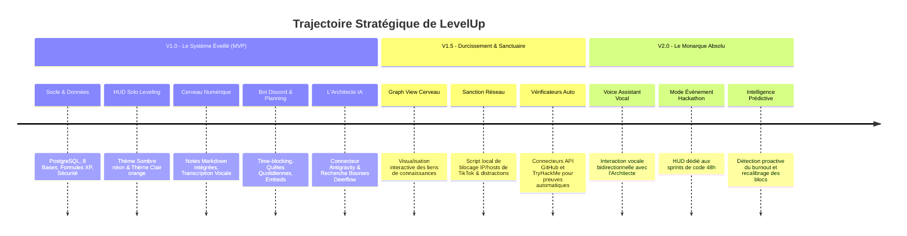

# Roadmap Stratégique & Blueprint Architectural — LevelUp

> **Nom du Projet :** LevelUp ("The System")  
> **Horizon :** 2026 - 2027  
> **Vision :** Transformer l'ambition en discipline implacable et guider le joueur du Rang F jusqu'au Rang de Monarque grâce à la fusion du gaming, de l'IA et de l'action réelle.

---

## 1. Vue d'Ensemble de la Trajectoire

---

## 2. Le Blueprint Architectural & Opérationnel par Jalon

### Blueprint V1.0 : Le Système Éveillé (Fondation Opérationnelle)

#### A. Architecture & Infrastructure
* **Serveur & Exécution :** Application Next.js conteneurisée (Docker) hébergée en local avec tunnel sécurisé (Cloudflare Tunnels) ou déploiement cloud (Vercel + Supabase).
* **Volumétrie Cible :** Traitement d'une centaine d'événements par jour, latence $< 500\text{ ms}$, persistance de 100 % des notes en Markdown pur.

#### B. Schéma & Flux de Données
* 7 tables relationnelles actives : Joueur, Stats (8 bases), Quêtes, Blocs de temps, Notes, Transcriptions audio, Opportunités Deerflow.
* Flux : Discord Gateway $\rightarrow$ Next.js API Routes $\rightarrow$ PostgreSQL $\rightarrow$ Antigravity IA Agent.

#### C. Sprint Blueprint & Chemin Critique
* **Sprint 0 (Setup) :** Tooling, lint, types, conteneurs Docker BDD.
* **Sprint 1 (Moteur & HUD) :** Logique des rangs, affichage responsive Solo Leveling.
* **Sprint 2 (Productivité) :** Éditeur Markdown, module Whisper, planificateur journalier.
* **Sprint 3 (Automatisations) :** Bot Discord, alertes temps réel, agent Antigravity & Deerflow.

#### D. Release Gate (Critères de Sortie)
- [ ] 100 % des mini-tests de gating de `docs/08-IMPLEMENTATION_PLAN.md` validés au vert.
- [ ] Zéro vulnérabilité critique détectée parmi les 100 scénarios de `docs/07-TEST_PLAN.md`.
- [ ] Boucle quotidienne complète exécutée avec succès sur 3 jours consécutifs.

---

### Blueprint V1.5 : Durcissement & Sanctuaire de Concentration

#### A. Architecture & Fonctionnalités
* **Graph View Cerveau Numérique :** Moteur D3.js / Force-Directed Graph pour visualiser l'interconnexion des cours d'IA, fiches TryHackMe et résumés.
* **Sanction Réseau (Penalty Firewall) :** Déploiement d'un script local avec droits d'administration capable de modifier temporairement la résolution DNS locale / fichier `hosts` pour couper TikTok, YouTube et Instagram en cas d'activation de la zone de pénalité.
* **Oracles Automatisés :** Cron interrogeant directement l'API GitHub (nombre de commits) et le profil public TryHackMe pour valider automatiquement les quêtes correspondantes sans action manuelle.

#### B. Release Gate
- [ ] Preuve du blocage réseau local réversible sans endommager la configuration réseau du PC.
- [ ] Rendu fluide du Graph View au-delà de 500 notes interconnectées ($60\text{ fps}$).

---

### Blueprint V2.0 : Le Monarque Absolu (Omniprésence & Voice AI)

#### A. Architecture & Vision
* Intégration de la voix temps réel avec Gemini Live API : tu peux discuter directement à l'oral avec l'Architecte pendant tes sessions de travail ou tes entraînements sportifs.
* Mode "Guerre de Guilde / Donjon d'Urgence" : Tableau de bord spécial activable lors d'un hackathon pour piloter les 48 heures de code sans décrocher.
